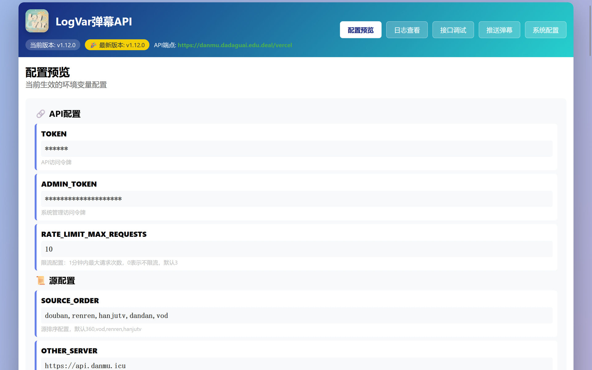

---

id: 1461516

title: "logvar弹幕API简要介绍"

created_at: 2026-01-15T03:26:54.263Z

username: axuitomo

display_username: "axuitomo"

---

# logvar弹幕API简要介绍

# logvar弹幕API简要介绍：

> [!warning]

>

> 不要在国内媒体平台宣传[danmu_api](https://github.com/huangxd-/danmu_api)

> [!NOTE]

>

> 为了不影响观看体验，没有添加引用。

>

> 不一定按照我推荐的设置，按你的喜好设置即好。

>

> 本篇文章是非官方的第三方文档，目的是帮助你尽快上手logvar弹幕API。

>

> 本篇文章具有时效性，建议访问[官方文档](https://github.com/huangxd-/danmu_api)或[LogVar弹幕API通知频道](https://t.me/logvar_danmu_channel)获取最新信息，如果有什么问题建议去[logvar弹幕互助群](https://t.me/logvar_danmu_group)交流

>

> 本人没有参与项目开发，仅作为使用者，可能存在疏忽纰漏，望包涵。

## 描述

一个人人都能部署的基于js的弹幕API服务器，支持爱优腾芒哔人韩巴弹幕直接获取，兼容弹弹play的搜索、详情查询和弹幕获取接口规范，并提供日志记录，支持vercel/netlify/edgeone/cloudflare/docker/claw等部署方式，不用提前下载弹幕，没有nas或小鸡也能一键部署。

## 有必要搭建弹幕API吗？

在看视频时常常因为没有弹幕而无聊？试一试**logvar弹幕API**为你的播放器填充弹幕

**danmu_api**支持  forward/senplayer/hills/小幻/yamby/eplayerx/afusekt/uz影视/dscloud/lenna/danmaku-anywhere/omnibox/ChaiChaiEmbyTV/moontv/capyplayer/kerkerker/[飞牛影视OS](https://club.fnnas.com/forum.php?mod=viewthread&tid=19989&highlight=) 等支持**弹幕API的播放器** ，可搭配[danmaku-anywhere](https://github.com/Mr-Quin/danmaku-anywhere) 实现格外支持

**使用弹幕API**：以`hills`为例,**设置-弹幕-弹幕API基础地址-添加弹幕API URL** 例如：[https://danmu.8081666.xyz/cloudflare](https://danmu.8081666.xyz/cloudflare)

**MPV播放器**可以使用[uosc_danmaku插件](https://github.com/Tony15246/uosc_danmaku)

**Forward**推荐直接使用插件，如果非要使用，则可以配合 [https://raw.githubusercontent.com/huangxd-/ForwardWidgets/refs/heads/main/widgets.fwd](https://raw.githubusercontent.com/huangxd-/ForwardWidgets/refs/heads/main/widgets.fwd) 里的**danmu_api**插件使用

## 部署

**推荐：国内IP部署，本地部署。[部分国内源会限制海外IP访问]**

#### [官方文档目录](https://github.com/huangxd-/danmu_api#%E7%9B%AE%E5%BD%95)

#### [安卓本地部署](https://github.com/lilixu3/danmu-api-android)【爱好者开发】

#### [vercel部署logvar弹幕API ](https://linux.do/t/topic/1341688)【毛遂自荐】

---

## 系统配置设置：

**优先级： 环境变量>.env**

配置起来非常简单,只需要启用并修改.env其中的ADMIN_TOKEN=123或者添加一个环境变量ADMIN_TOKEN=123

这里的123是举例

之后直接访问UI界面进入系统配置即可  http://{ip}:9321/{ADMIN_TOKEN}

例如 [http://127.0.0.1:9321/123](http://127.0.0.1:9321/123)

结合[官方的环境变量列表](https://github.com/huangxd-/danmu_api/tree/main#%E7%8E%AF%E5%A2%83%E5%8F%98%E9%87%8F%E5%88%97%E8%A1%A8)看下面内容就容易理解了

---

### 1.API配置：

**TOKEN**  用于**调用API**，须在链接后填入**TOKEN**才可调用使用 **例如**：[https://danmu.8081666.xyz/cloudflare](https://danmu.8081666.xyz/cloudflare)

**RATE_LIMIT_MAX_REQUESTS**  限流配置：**同一IP**内1 分钟内最大请求次数，防止滥用限制IP

---

### 2.源配置

**SOURCE_ORDER**  采集源设置

| 源类别 | 源名称 |

| --- | --- |

| 动漫源 | dandan，animeko，bahamut |

| 影视源1 | tencent，youku，iqiyi，bilibili |

| 影视源2 | imgo，leshi，sohu |

| 采集源 | 360，vod，tmdb，douban |

| 自定义源 | custom |

| 采集源 | 对应平台列表 |

| --- | --- |

| 360 | qiyi, bilibili1, imgo, youku, qq |

| vod | qiyi, bilibili1, imgo, youku, qq |

| tmdb | qiyi, bilibili1, youku, qq |

| douban | qiyi, bilibili1, youku, qq |

> [!warning]

>

> 部分国内源会限制海外IP访问

>

> 采集源的多少会影响返回速度。

>

> 源合并返回的顺序会沉底，开启源合并时不建议使用VOD和 360

**海外IP**推荐使用**douban**源来代替**tencent**，**youku**，**iqiyi**，**bilibili**等官方源，不可避免弹幕数量减少

**限制IP的源**有**bilibili，imgo**【不是确定其他的源是否限制】

**360，vod，tmdb**这类资源适合兜底。**tmdb源**搜索速度偏慢，需设置**TMDB_API_KEY**使用。

**bilibili源**弹幕获取较少，设置**BILIBILI_COOKIE**可获取更多弹幕，多人使用有封号风险，cookie过期时间不定 ，**BILIBILI_COOKIE** 可自行设置，参考[环境变量列表](https://github.com/huangxd-/danmu_api/tree/main#%E7%8E%AF%E5%A2%83%E5%8F%98%E9%87%8F%E5%88%97%E8%A1%A8)

---

**MERGE_SOURCE_PAIRS** 源合并配置，配置后将对应源合并同时一起获取弹幕返回，示例：`imgo&iqiyi,dandan&animeko,dandan&bahamut`， 允许多组、允许同时存在、一组配置一对，目前允许合并的源字段有`qiyi, bilibili1, imgo, youku, qq, sohu, renren, hanjutv, bahamut, dandan, animeko`

**推荐设置**：`dandan&animeko`

韩剧TV会在中间插广告可能导致弹幕位移，不建议合并hanjutv

源合并会稍微拖慢，考虑是否开启源合并

---

**VOD_SERVERS** 默认即可，通常追风返回速度是最快的

**VOD_RETURN_MODE** VOD 返回模式：**all**（所有站点）或 **fastest**（最快的站点），默认 **fastest**

**VOD_REQUEST_TIMEOUT** 当采集源**SOURCE_ORDER**启用**VOD**需设置，默认10S，建议调整为**15S**以上

---

### 3.匹配设置

**PLATFORM_ORDER** 优先匹配排名靠前的，适用于**自动匹配**和**手动匹配**，根据个人来调整

**TITLE_TO_CHINESE** 将外语标题转换中文开关，需设置 **TMDB_API_KEY**

---

### 4.弹幕设置

**BLOCKED_WORDS** 屏蔽词，可能降低弹幕返回速度，建议在播放器里设置

**DANMU_LIMIT**  弹幕数量限制，单位为k，即千：默认 0，表示不限制弹幕数，建议限制弹幕数量，一瞬间获取大量弹幕可能会使容器崩溃

**GROUP_MINUTE** 分钟内合并去重（0 表示不去重），默认 1

**DANMU_SIMPLIFIED** 弹幕繁体转简体，用于巴哈姆特

**DANMU_PUSH_URL **弹幕推送地址，用于OK影视等播放器，两端需要在同一局域网或使用公网ip

---

### 5.缓存配置【可选配置】

优先级：数据库＞内存 ，可选择配置**Upstash**【Redis】或**Localcache**

docker服务推荐配置Localcache，两种存储模式会保存缓冲信息

**Localcache** :  docker一般路径为： /app/.cache  【根据实际路径进行挂载】

[Upstash](https://upstash.com/)需配置 **UPSTASH_REDIS_REST_URL** 和 **UPSTASH_REDIS_REST_TOKEN**

**MAX_LAST_SELECT_MAP** 配置大小，用于保存缓存条目，当存在缓存目录时可以加快返回速度

---

### 6.系统设置

**LOG_LEVEL**  默认日志储存在内存中，可以手动清理日志。优先级：数据库＞内存

日志级别，默认为 `info`，可选值：`error`（仅错误）、`warn`（错误和警告）、`info`（所有日志），生产环境建议使用 `warn`，调试时使用 `info`

**PROXY_URL**:目前只对**巴哈姆特、TMDB API、bilibili[港澳台]生效，国内可能用不了bahamut，tmdb**等源可利用[vercel](https://github.com/souying/vercel-api-proxy)或[netlify](https://github.com/wan0ge/bahamut-api-proxy)设置反向代理。优先级：特定反代 > 万能反代 > 正常代理。

**举例**：

特定反代：`bahamut@https://api.axuitomo.dpdns.org`

万能反代：`@http://127.0.0.1`

正常代理：`http://127.0.0.1:7890`

**TMDB_API_KEY** [API密钥申请教程](https://www.ugnas.com/tutorial-detail/id-81.html)

**NODE_TLS_REJECT_UNAUTHORIZED** 在证书过期或者自签证书需设置，在建立 HTTPS 连接时是否验证服务器的 SSL/TLS 证书，0表示忽略，默认为1

---

## 别忘了点击重新部署

一般播放器设置自定义弹幕API 例如：[https://danmu.8081666.xyz/cloudflare](https://danmu.8081666.xyz/cloudflare) 即可

少数播放器需要添加/api/v2

---

*来源: https://linux.do/t/topic/1461516.json*

