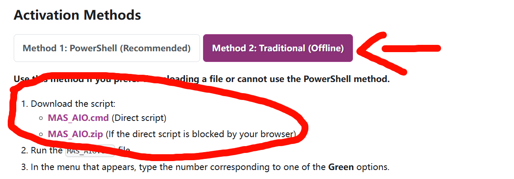
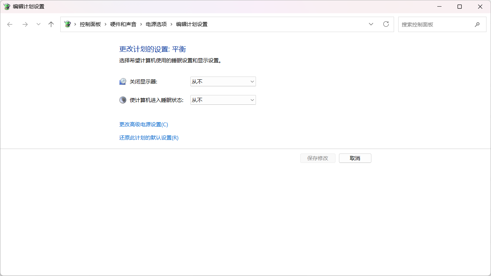
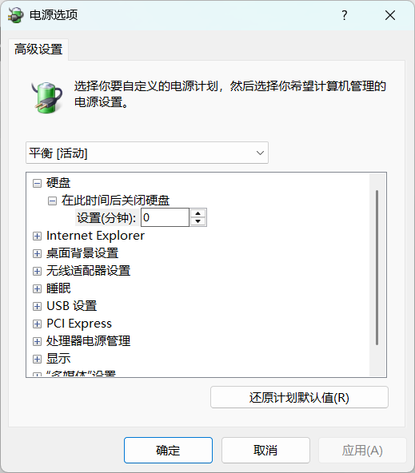
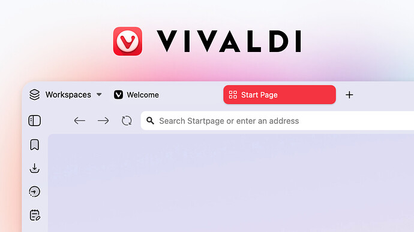
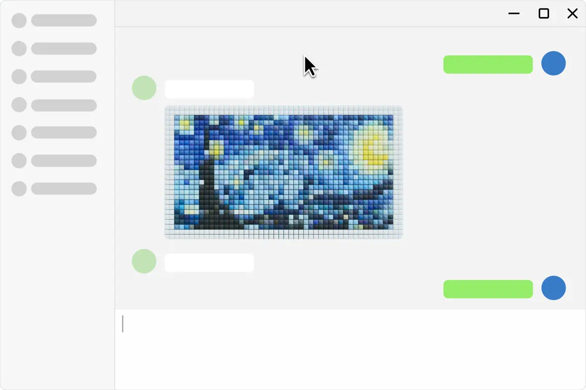
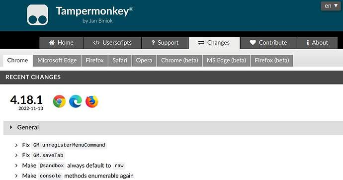
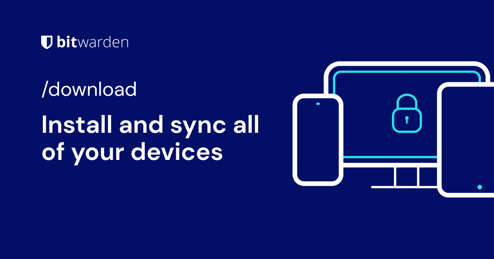

---

id: 1465089

title: "整理了一下我重装系统的步骤"

created_at: 2026-01-15T14:10:59.852Z

username: akane8086

display_username: "思茜"

---

# 整理了一下我重装系统的步骤

*格式可能会很辣眼睛，这是我第一次用Markdown语法码字，可能会有很多问题，请多指教*

**零、需要准备的**

1.U盘

2.Ventoy（[https://www.ventoy.net/cn/index.html）](https://www.ventoy.net/cn/index.html%EF%BC%89)

3.微PE（[https://www.wepe.com.cn](https://www.wepe.com.cn)）

4.需要的系统ISO文件

5.我喜欢用微PE里的Dism++安装系统，大家可以试试，真的很方便

[https://home.gamer.com.tw/artwork.php?sn=5195025](https://home.gamer.com.tw/artwork.php?sn=5195025)

**一、选择的系统**

1.Windows 11 24H2 Enterprise LTSC （可以通过MAS激活变成IoT Enterprise LTSC，获得更长时间的支持）

2.Windows 10 21H2 Enterprise LTSC （同上，不再赘述）

下载地址：[Windows LTSC Download | MAS](https://massgrave.dev/windows_ltsc_links)

**二、驱动安装**

强烈建议安装驱动的时候断网安装！不然Windows自动安装驱动的时候屏幕会一闪一闪，很难受。

我的配置是I5-12400F+4060,我一般只安装显卡驱动和鼠标驱动，剩下的丢给Windows处理。

Windows 10的情况下（560.81 Game Ready）：[搜索结果 | <dd~ProductName> | <dd~OSName>](https://www.nvidia.cn/geforce/drivers/results/230598/)

Windows 11的情况下（560.94 Game Ready）：[搜索结果 | <dd~ProductName> | <dd~OSName>](https://www.nvidia.cn/geforce/drivers/results/230856/)

鼠标驱动就不提供了，按需安装。

**三、激活系统**

联网之后以管理员打开PowerShell，输入以下命令

> irm [https://get.activated.win](https://get.activated.win) | iex

或者是直接下载MAS提供的批处理文件，双击就可以运行了，不过这玩意有时候会抽风，建议安装上代理软件再运行。

### [Microsoft Activation Scripts | MAS](https://massgrave.dev)

An open-source Windows and Office activator featuring HWID, Ohook, TSforge, and Online KMS activation methods, along with advanced troubleshooting.

**四、Windows 11的设置**

1.恢复Windows 10样式右键菜单

> reg.exe add “HKCU\Software\Classes\CLSID{86ca1aa0-34aa-4e8b-a509-50c905bae2a2}\InprocServer32” /f /ve

还原Windows 11样式右键菜单

> reg.exe delete “HKCU\Software\Classes\CLSID{86ca1aa0-34aa-4e8b-a509-50c905bae2a2}” /f

1. 解决无法打开此链接"ms-gamingoverlay"的问题

[解决无法打开此链接"ms-gamingoverlay"的问题_哔哩哔哩_bilibili](https://www.bilibili.com/video/BV1KXtXexEbs/)

3.我的电源计划

4.关闭粘滞键

**五、软件**

1.卸载Edge

本人极其讨厌Edge这坨屎，放在桌面上看着膈应，所以我选择卸载。（按需选择*只卸载Edge版本*或者*卸载Edge+WebView版本*。）

### [GitHub - ShadowWhisperer/Remove-MS-Edge: Uninstall Microsoft Edge with an executable or...](https://github.com/ShadowWhisperer/Remove-MS-Edge)

Uninstall Microsoft Edge with an executable or batch script.

（Windows 10用户请选择*2.2*版本，经过我测试，2.3版本在Windows 10上无法完全卸载Edge）

2.解压软件

Bandizip

### [Bandizip 官方网站 - 免费压缩软件下载 (Windows)](https://www.bandisoft.com/bandizip/)

Bandizip official download page

3.浏览器

Vivaldi，一个自定义程度很高的浏览器。

### [Vivaldi 浏览器 | 功能强大、个性定制、注重隐私的浏览器](https://vivaldi.com/zh-hans/)

这是一个有趣的浏览器，内置了很多强大的功能，并且非常灵活，不会跟踪你。获取适用于桌面、手机、汽车的 Vivaldi 浏览器！

4.代理软件

FlClash

### [GitHub - chen08209/FlClash: A multi-platform proxy client based on...](https://github.com/chen08209/FlClash)

A multi-platform proxy client based on ClashMeta,simple and easy to use, open-source and ad-free.

（如果无法正常安装，请先打上这个运行库[搜索 - Microsoft 必应](https://aka.ms/vs/17/release/vc_redist.x64.exe%EF%BC%89)

*防止DNS泄露方法*

[Flclash dns泄漏，有解决办法没有 · Issue #1136 · chen08209/FlClash · GitHub](https://github.com/chen08209/FlClash/issues/1136)

Throne（Sing-box内核，没有DNS泄露问题，但是需要自己设置分流）感谢我的好厚米 [@Sakyvo](/u/sakyvo) 推荐

### [GitHub - throneproj/Throne: Cross-platform GUI proxy utility (Empowered by...](https://github.com/throneproj/Throne)

Cross-platform GUI proxy utility (Empowered by sing-box)

5.播放器

PotPlayer

[https://potplayer.daum.net](https://potplayer.daum.net)

6.看图软件

Honeyview

### [BandiView - 图像查看器、快速且强大](https://www.bandisoft.com/honeyview/)

BandiView official page

7.截图软件

PixPin

### [PixPin - 截图/贴图/长截图/图片转文字(OCR) | 免费全能截图工具](https://pixpin.cn)

PixPin 是一款专业级免费截图软件，集截图、贴图、长截图、OCR文字识别、屏幕录制于一体。支持 Windows 和 macOS，为您提供高效的桌面办公体验。

8.记事本

Notepad3

### [GitHub - rizonesoft/Notepad3: Notepad like text editor based on the Scintilla...](https://github.com/rizonesoft/Notepad3)

Notepad like text editor based on the Scintilla source code. Notepad3 based on code from Notepad2 and MiniPath on code from metapath. Download Notepad3:

9.文件搜索

Everything

### [voidtools](https://www.voidtools.com/zh-cn/)

EverythingToolBar（让Everything替代你的搜索栏）

### [GitHub - srwi/EverythingToolbar: Everything integration for the Windows taskbar.](https://github.com/srwi/EverythingToolbar)

Everything integration for the Windows taskbar.

10.下载器

IDM

不过我觉得这玩意现在在Firefox系浏览器表现更好，IDM从一年前就没办法精准拦截Vivaldi的窗口，听说Chrome现在也有这种情况，自行测试吧。

### [Internet Download Manager is a powerful download accelerator](https://www.internetdownloadmanager.com)

Internet Download Manager (IDM) is a tool to increase download speeds by up to 10 times, resume or schedule downloads and download streaming videos

破解补丁

### [GitHub - YuHuanTin/IDM_Cracker](https://github.com/YuHuanTin/IDM_Cracker)

通过在 GitHub 上创建帐户来为 YuHuanTin/IDM_Cracker 开发做出贡献。

11.杀毒软件

卡巴斯基

老牌杀软，不用多说了。

### [面向家庭和商业企业的卡巴斯基网络安全解决方案 | 卡巴斯基](https://www.kaspersky.com.cn)

作为下一代网络安全解决方案和服务的全球领导者，卡巴斯基为您的家庭和商务提供高级防护，抵御所有网络威胁。

KES（卡巴斯基企业版，下面是奶昔大佬分享的教程）

### [卡巴斯基企业版(KES)免费用到2037年底_哔哩哔哩_bilibili](https://www.bilibili.com/video/BV1K9JnziELg/)

卡巴斯基企业版(KES)免费用到2037年底共计2条视频，包括：卡巴斯基企业版(KES)免费用到2037年底、最新版卡巴斯基(含KES)试用和重置等，UP主更多精彩视频，请关注UP账号。

12.剪贴板

Ditto

### [Ditto - Clipboard Manager](https://sabrogden.github.io/Ditto/)

Ditto Clipboard Manager

**六、浏览器扩展**

1.Kiss Translator

### [简约翻译 - Chrome 应用商店](https://chromewebstore.google.com/detail/kiss-translator/bdiifdefkgmcblbcghdlonllpjhhjgof?hl=zh-CN)

一个简约的双语对照翻译扩展，支持网页、划词、视频字幕翻译等功能，支持多种翻译服务及AI翻译接口，拥有丰富灵活的自定义选项。

让KT更好用的方法：[Kiss Translator 使用教程](https://linux.do/t/topic/855242)

2.Vencord（可以让网页版Discord体验Discord Nitro的功能）

### [Vencord](https://vencord.dev)

Vencord is the cutest modification for Discord

3.Ublock Origin

### [uBlock Origin - Free, open-source ad blocker extension](https://ublockorigin.com)

uBlock Origin is a free, open-source ad blocker extension and content blocker. Block ads on YouTube, Twitch, and across the web with low CPU and memory usage. Available for Firefox, Edge, Opera, and Chrome via uBlock Origin Lite.

我的规则：

### [GitHub - damengzhu/abpmerge: 广告拦截规则合并](https://github.com/damengzhu/abpmerge)

广告拦截规则合并

### [GitHub - lingeringsound/adblock_auto: 自动合并 Adblock 规则，用于网页广告拦截](https://github.com/lingeringsound/adblock_auto)

自动合并 Adblock 规则，用于网页广告拦截

### [GitHub - 217heidai/adblockfilters: 去广告合并规则，每8个小时更新一次。](https://github.com/217heidai/adblockfilters)

去广告合并规则，每8个小时更新一次。

4.Tampermonkey（油猴）

### [Home | Tampermonkey](https://www.tampermonkey.net)

Home

我的油猴脚本:

### [GitHub - XIU2/UserScript: 🐵 自用的一些乱七八糟 油猴脚本~ ](https://github.com/XIU2/UserScript)

🐵 自用的一些乱七八糟 油猴脚本~

### [跟踪链接净化](https://greasyfork.org/zh-CN/scripts/456881-%E8%B7%9F%E8%B8%AA%E9%93%BE%E6%8E%A5%E5%87%80%E5%8C%96)

净化所有网站上的跟踪链接和事件

### [Pagetual](https://greasyfork.org/zh-CN/scripts/438684-pagetual)

终极自动翻页 - 加载并拼接下一分页内容至当前页尾，智能适配任意网页

### [CSDN优化](https://greasyfork.org/zh-CN/scripts/406136-csdn%E4%BC%98%E5%8C%96)

支持PC和手机端、屏蔽广告、优化浏览体验、重定向拦截的Url、自动展开全文、自动展开代码块、全文居中、允许复制内容、去除复制内容的小尾巴、自定义屏蔽元素等

### [GitHub - hmjz100/123panYouthMember: 123 云盘会员青春版 - 模拟 123...](https://github.com/hmjz100/123panYouthMember)

123 云盘会员青春版 - 模拟 123 云盘会员，还支持隐藏广告、使用视频倍速、修改头像、修改用户名、修改等级等功能；123云盘辅助增强脚本 - “解锁”123云盘

Chromium系内核浏览器用户需要在地址栏输入

> chrome://extensions

，点击Tampermonkey的详情，并按图上打开这个才能正常注入油猴脚本。

5.PixivDownloader（下载Pixiv图片）

### [Powerful Pixiv Downloader, Pixiv Batch Downloader,Pixiv 批量下载器](https://pixiv.download/index-zh-cn.html)

Powerful Pixiv Downloader 是一个免费的 Chrome 浏览器扩展程序，功能强大，使用方便，可以让您在浏览 Pixiv

    时，方便地下载图片和小说。它可以批量下载插画、漫画、动图、小说。

1. I don’t care about cookies（屏蔽烦人的Cookies弹窗）

[https://chromewebstore.google.com/detail/i-dont-care-about-cookies/fihnjjcciajhdojfnbdddfaoknhalnja](https://chromewebstore.google.com/detail/i-dont-care-about-cookies/fihnjjcciajhdojfnbdddfaoknhalnja)

7.Shazam（听歌识曲）

### [Shazam：在浏览器中直接识别歌曲 - Chrome 应用商店](https://chromewebstore.google.com/detail/shazam-find-song-names-fr/mmioliijnhnoblpgimnlajmefafdfilb)

识别音乐、搜索歌词与更多内容

8.IDM

当你安装好IDM之后会自动给你打上的。

9.Bitwarden（替代掉浏览器自带的废物密码管理器）

### [Download the Bitwarden Password Manager App for iPhone, Android, Chrome,...](https://bitwarden.com/download/)

Secure your digital life. Download Bitwarden and sync your secure password vault across all your devices including mobile iPhone or Android devices, desktop applications such as Windows, MacOS, or Linux, and the browser extension on Chrome, Safari,...

10.BewlyCat（让你的哔哩哔哩主页更干净）

### [BewlyCat - Chrome 应用商店](https://chromewebstore.google.com/detail/bewlycat/oopkfefbgecikmfbbapnlpjidoomhjpl)

Just make a few small changes to your Bilibili homepage.

这是我第一次码这么长的文章，码字不易，点个赞再走吧。

---

*来源: https://linux.do/t/topic/1465089.json*

