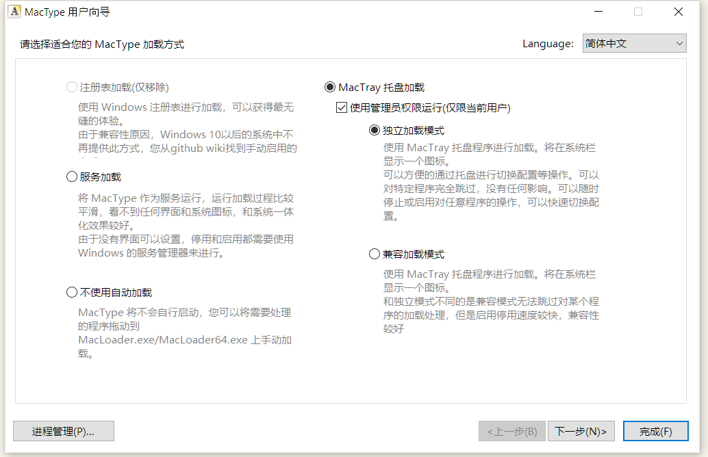
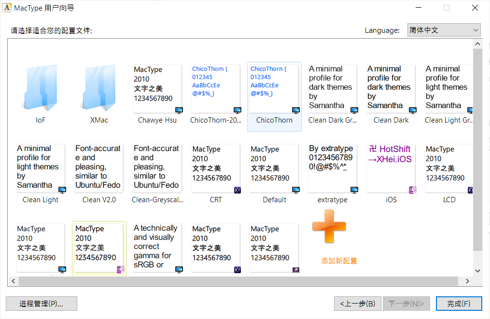
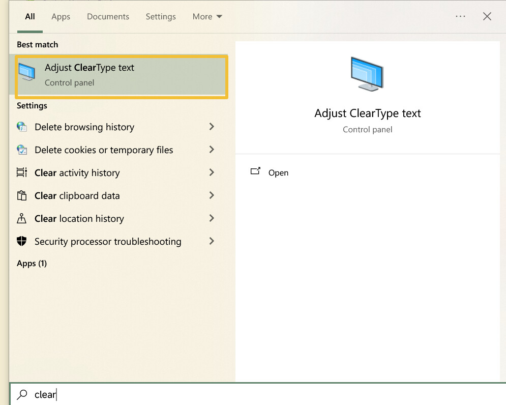
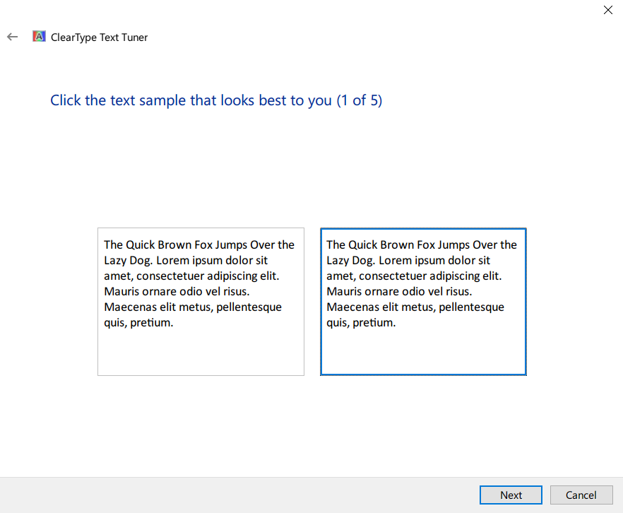
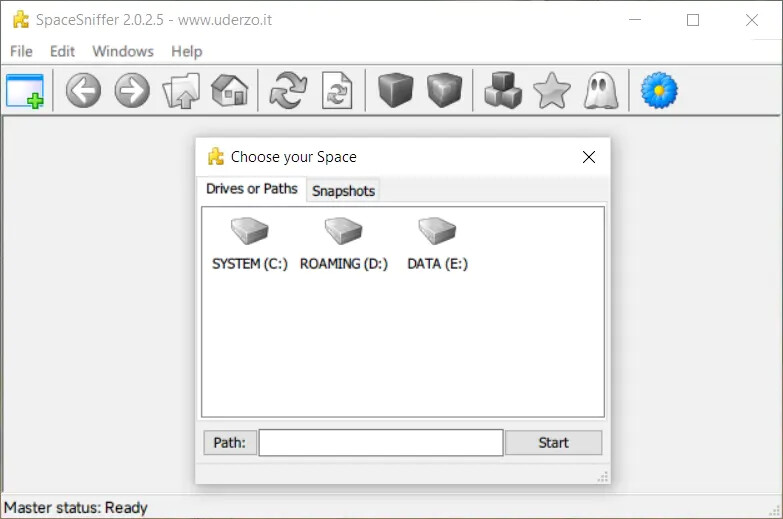
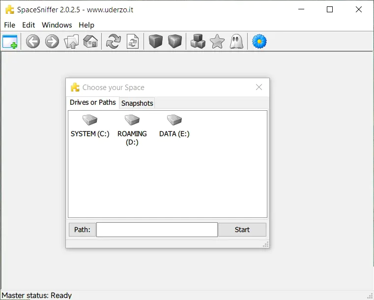
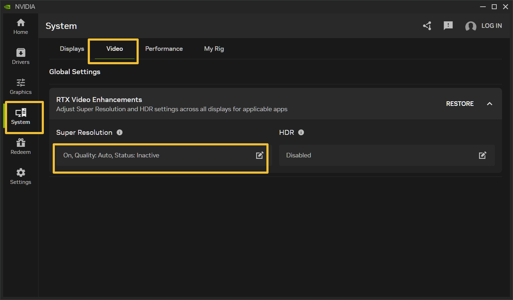
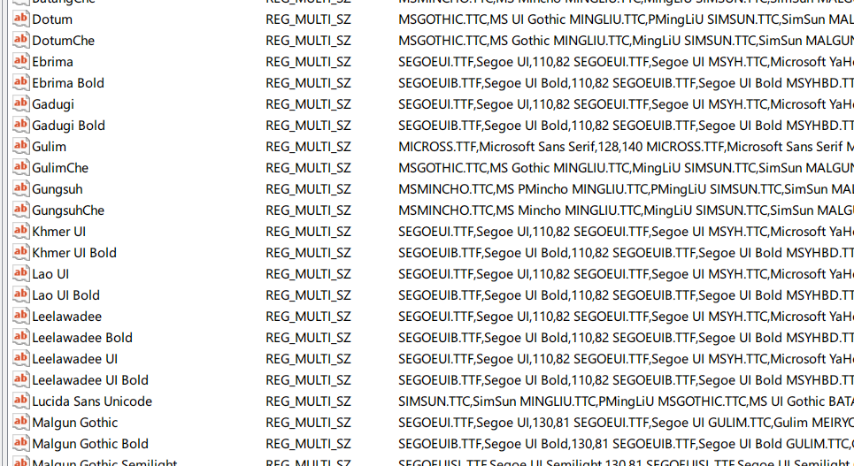

---

id: 1467553

title: "「文档」Windows 终极字体渲染优化指南（可能是）20260409"

created_at: 2026-01-16T05:05:23.548Z

username: ckrvxr

display_username: "Charles Cao"

---


# 「文档」Windows 终极字体渲染优化指南（可能是）20260409


众所周知，Windows 是一座屎山。相同 PPI 的屏幕，Windows 的显示效果是明显不如 Mac 和 Android 的。

经过长期的测试和尝试，我整理出一套针对 Windows 渲染效果的优化方案，能够显著改善显示清晰度和观感，使其更接近 macOS 的视觉体验。

> 需要说明的是，本文主要作为方案的整合与收集，核心技术和功劳应归属于各位原始方案的作者。

---

## 一、基本知识

在介绍软件和配置方法之前，我先简单介绍一下 Windows 的两种主流字体呈现方式。

Windows 并行地存在两套绘图接口:

- GDI（Graphics Device Interface）

- DirectWrite + Direct2D 。

### 1. GDI

GDI 是 Windows 自早期版本起就支持的一套基础图形接口，它允许开发者通过简单的 API 实现窗口、按钮、图表等基本图形元素的绘制。GDI 的一大优势在于其广泛的兼容性，几乎可以在所有版本的 Windows 上运行，并且使用起来非常直观。

不过，由于 GDI 主要依赖 CPU 进行图形处理，缺乏硬件加速支持，因此在处理复杂图形、动画效果或高分辨率显示时性能有限。此外，**GDI 的文本渲染质量也相对较弱**，尤其是在小字号或旋转文本场景下，清晰度和可读性不如现代技术。

**使用它来进行绘图的程序开发框架：**

- 传统的 Win32

- MFC 应用程序

- WinForms

- wxWidgets

- JavaFX

- 旧软件

### 2. DirectWrite + Direct2D

随着图形需求的不断提升，微软推出了基于 DirectX 技术的 **Direct2D** 和 **DirectWrite** ，它们共同构成了现代 Windows 平台上的 2D 绘图接口。

- **Direct2D** 是一个硬件加速的 2D 图形绘制引擎，能够高效地渲染矢量图形、位图、路径、渐变等多种图形元素；

- **DirectWrite** 则专注于提供高质量的文本渲染，支持 ClearType 技术、子像素精度排版、多语言文字布局等功能，显著提升了文本的清晰度和美观性。

DirectWrite + Direct2D 是现在主流的绘图方案。

**使用它来进行绘图的程序开发框架：**

- WPF

- WinUI / UWP

- SkiaSharp

- Chromium / Edge / Chrome/ Electron 浏览器

- QT

- 新软件

---

## 具体操作步骤

**正确的操作顺序是先配置 Mactype，后配置 Cleartype。**

### 1. Mactype

Mactype 是一款由 [snowie2000](https://github.com/snowie2000) 开发，对 GDI 进行重绘的软件。（现在也能对 DirectWrite 重绘，但有时会有兼容性问题。）

Mactype 可在 Github 页面 [Github snowie2000/mactype](https://github.com/snowie2000/mactype) 中下载。

下载安装后，初次使用软件会弹出加载方式选择的页面。

这里使用 `服务加载` 的加载方式。`服务加载` 是几乎无感的， `托盘加载` 会闪一下。



点击 `下一步 ` 后，可以看到软件自带的一些预设文件。这些预设大多可以直接使用。并且效果也不差。



根据我本人的设备和使用体验来讲，我认为效果比较好的配置文件有：

- Chawye Hsu

- Clear V2.0

- Xmac\Xmac.LCD

老的预设**只能**对 GDI 修改，部分新预设能对 DirectWrite 进行修改。

我自己配了一个预设（请使用 V3 版），放在了下面这个网址中：

[Codeberg/CocoaDuck/Snippets/MactypeINI](https://codeberg.org/CocoaDuck/Snippets/src/branch/master/MactypeINI/Source)

**该预设功能包括：**（改自 Xmac.LCD）

- GDI 和 DirectWrite 都进行字体渲染优化。

- 丑丑的等宽编程字体（Consolas、Courier New 等）换成 Cascadia Code 或 Cascadia Next SC。

- 始终使用矢量渲染，而非位图。解决 **宋体** 在字体大小极低的时候变成马赛克的问题。

如果按照默认路径安装，配置文件目录则在目录 `C:\Program Files\MacType\ini` 下。

把我的配置文件保存下来，放入目录中就能在配置文件选择时看到。

---

#### 兼容性的问题

使用 Mactype 时，大部分的兼容性问题来自于字体替换功能。原因在于：

- 有的软件会使用字体中非公共区域中的符号，如果代替的字体没有这个符号，或这个符号不对，软件就不能显示字符和部分图标。（经过实测， Arial 是绝对不能替换的。）

- 字体替换流程本身的兼容性问题

当遇到乱码或字体不能显示后，第一种解决办法就是在配置文件 `.ini` 中的 `ExcludeSub` 中添加不需要替换字体的进程。

```
; ----------- Programs Excluded from Font Replacement ----------------
[ExcludeSub]
; Sysinternals Suite
Autoruns.exe
Autoruns64.exe
procexp.exe
procexp64.exe
Procmon.exe
Procmon64.exe
; Microsoft Office
EXCEL.EXE
POWERPNT.EXE
WINWORD.EXE
; Wallpaper Engine
ui32.exe
; WPS Office
wps.exe
Mihomo Party.exe
MATLAB.exe
...
```

如果第一种解决方法不起作用，可以进一步把对应进程设置为既不替换字体也不渲染。即在配置文件 `.ini` 中的 `UnloadDll` 中添加不需要加载 DLL 的进程。

```
; ----- Programs not Rendered or Replaced Fonts (DLL Not Loaded) -----
[UnloadDll]
; Desktop Window Manager
; dwm.exe
; Windows Subsystem for Linux (WSL)
wslhost.exe
wsl.exe
; Cygwin/MSYS2
gpg.exe
pacman.exe
; Altium Designer
X2.EXE
; Process Lasso
ProcessLasso.exe
```

如果问题持续，则可以进一步尝试下面的方法：

1. 关闭字体替换功能。

2. 关闭对 DirectWrite 加载。

3. 关闭实验性的功能 ColorFont 和 ArmBreaker。

```
; ------------------- Font Loading Configuration -------------------
HookChildProcesses=1
FontLoader=0
FontLink=2
UseMapping=0
MaxHeight=0
MaxBitmap=0
FontSubstitutes=1	; <--- 字体替换功能，1 为开启，0 为关闭
DirectWrite=1		; <--- 是否对 DirectWrite 加载，1 为开启，0 为关闭
```

```
[Experimental]
ColorFont=1
ArmBreaker=2
```

具体可参考 [snowie2000/mactype Wiki](https://github.com/snowie2000/mactype/wiki) 和 [Issues · snowie2000/mactype](https://github.com/snowie2000/mactype/issues) 中讨论与解释。

---

### 2. Cleartype

Cleartype 对应优化的绘图接口是 DirectWrite + Direct2D 。

Cleartype 是 Windows 自带的功能，不需要安装任何软件。

想要使用 Cleartype 只需要再 `开始菜单` 搜索 `Cleartype` 点击打开即可。



然后根据提示，一步步选择你“主观”认为最清楚的那个文本即可，非常简单，没有任何参数配置。



---

## 三、其他建议

### 1.部分老软件渲染模糊的解决方法

部分老软件渲染模糊，原因在于部分**老软件未更新支持每显示器 DPI 感知（Per-Monitor DPI Awareness）** ，导致系统强制拉伸位图而非矢量重绘，产生了模糊。

解决方法：

1. 右键软件的 exe 文件 → 属性  → 兼容性  → 更改高 DPI 设置 。

2. 勾选 替代高 DPI 缩放行为 。

3. 保持执行缩放选择 应用程序 。

4. 点击 应用 后重启软件。

5. 如果效果不理想，可以尝试 系统 、 系统（增强） 。

这个替代缩放的方法只对**少部分**软件能完美重绘。

前后对比：





---

### 2.Nvidia 显卡的视频超分

NVIDIA 的视频超分辨率 (VSR) 功能效果很好，可在提升视频锐度的同时保持画面自然，无明显瑕疵。

**硬件要求**：

- 仅支持 **RTX 30/40/50 系显卡**（RTX 3050 及以上）

- 驱动程序需 ≥ **551.23 版本**（2024年3月后发布）

**开启步骤：**

1. 系统托盘右键点击 NVIDIA 图标 → 选择 NVIDIA App 。

2. 点击 系统 → 视频 → Super Resolution 。

3. 选择  **ON**  → 质量选择 **Auto**。

4. 点击 OK 保存设置。



#### Edge 中视频增强不起作用

如果 Edge 中视频增强不起作用，就把在Edge的地址栏中输入 `edge://flags/#edge-video-super-resolution` 这个地址，将 `edge-video-super-resolution` 设置为 Disabled。

---

### 3. 网页字体替换脚本

我还写了一个网页字体替换油猴脚本，用于把一些个人认为不好看的字体换成好看的字体。这个脚本比较偏向于个人偏好，而且脚本逻辑比较粗暴，会破坏一些作者的创作意图。使用中，可能不太需要。

脚本放在下面的网址中：

[Codeberg/CocoaDuck/Snippets/BrowserTextRenderTweaks.js](https://codeberg.org/CocoaDuck/Snippets/src/branch/master/BrowserTextRenderTweaks/Source/BrowserTextRenderTweaks.js)

主要功能：

1. 把编程字体换成微软的 [Cascadia Next SC](https://github.com/microsoft/cascadia-code/releases/tag/cascadia-next) 和 Cascadia Code

2. 一些网站的字体修复

3. 字体渲染调成子像素抗锯齿。（虽然这个属性在 Windows 平台没效果，但先把这个坑占了）

这个脚本和大部分的字体替换脚本逻辑有点不一样，它是通过重定向字体来源来实现的，是不会改变 font-family 在 CSS 里显示的。好处是文本不会闪烁和性能好，坏处是无法实现高级的Fallback 回退机制。

---

### 4. 英文系统下的中文字体回退问题修复方法

### 4. 基于注册表 SystemLink 的带回退机制的字体替换方法

 注意： 如果您没有遇到明显的字体显示错误（如乱码、缺字），或者没有极端的高级自定义需求，强烈建议**不要随意改动此项设置**。

Windows 系统内置了一套名为 **SystemLink** 的字体回退（Fallback）机制，主要由注册表项控制。其核心作用是：当系统在当前使用的字体（如 Segoe UI）中找不到某个特定字符的代码位时，会自动查阅 SystemLink 表，并按照预设的优先级顺序，从候选字体中寻找并抓取对应的字形进行显示。

**SystemLink 的默认键值在不同语言版本的 Windows 系统（指原版发行版本，而非后期添加的语言包）中是存在差异的。**

 注册表路径：

```
HKEY_LOCAL_MACHINE\SOFTWARE\Microsoft\Windows NT\CurrentVersion\FontLink\SystemLink
```

该路径下有大量 Fallback 键值：



遇到系统中的**中文字体不一致问题**（例如部分界面显示雅黑，部分显示宋体或日文字体），就要注入下面的 SystemLink 注册表。（提取自 Windows 11 LTSC 2024 中文版和英文版的镜像）

[Codeberg/CocoaDuck/Snippets/Windows_11_LTSC_2024_CN_SystemLink.reg](https://codeberg.org/CocoaDuck/Snippets/src/branch/master/MactypeINI/Source/Windows_11_LTSC_2024_CN_SystemLink.reg)

[Codeberg/CocoaDuck/Snippets/Windows_11_LTSC_2024_US_SystemLink.reg](https://codeberg.org/CocoaDuck/Snippets/src/branch/master/MactypeINI/Source/Windows_11_LTSC_2024_US_SystemLink.reg)

一定要备份原本的注册表！一定要备份！

该机制还可以用来实现带回退机制的自定义字体功能，这里就不讲了，有需求的话，可以自行探索一下。

> 其实最好的解决方法是换到 MacOS 


---


*来源: https://linux.do/t/topic/1467553.json*

