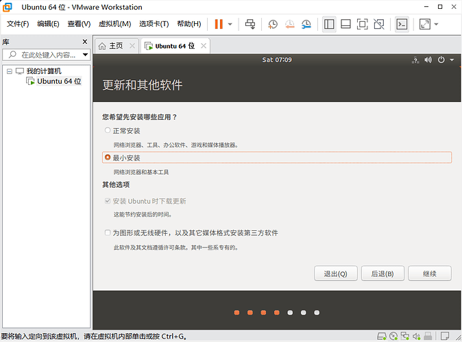

---

id: 1495356

title: "Docker配置vcs"

created_at: 2026-01-21T08:58:40.993Z

username: lycx

display_username: "lycx"

---


# Docker配置vcs


# Docker配置vcs

因为项目在docker环境中，在本机ubuntu22.04已安装vcs,并且verilator仿真较慢的情况下，选择


在docker中挂载vcs以达到方便，节省空间的目的。本文采用vscode进行docker连接。

## 1.本机配置vcs

参考 [记一次在Ubuntu18虚拟机上安装VCS等 - TooyamaYuuouji - 博客园](https://www.cnblogs.com/Lexington-CV2/articles/16703093.html%E3%80%82%E6%B3%A8%E6%84%8F%E4%BF%AE%E6%94%B9hostname%E7%AD%89%E5%86%85%E5%AE%B9%E5%8D%B3%E5%8F%AF%E3%80%82)

## 2.在docker中挂载vcs

在vscode中选择Dev Containers扩展下载并安装。


接着新建目录.devcontainer,并在其中新建文件devcontainer.json,内容如下：

```
{
    "name": "chipyard + VCS",
    "image": "chipyard-vcs-base:first",
    "remoteUser": "root",
    "workspaceFolder": "/root/chipyard",
    "mounts": [
        "source=/home/mingzhenjia/Downloads/vcs,target=/opt/vcs,type=bind"
    ],
    "containerEnv": {
        "SNPSLMD_LICENSE_FILE": "27000@172.17.0.1",
        "LM_LICENSE_FILE": "27000@172.17.0.1"

    },
    "runArgs": [
        "--net=bridge"
    ]
}
```

整体项目结构如图


接着Ctrl+Shift+P,选择Dev Containers: Reopen in Container,即可连接到docker容器中。

## 3.在docker中配置环境变量

接着在docker中打开.bashrc,添加如下内容：

```
# ===== Synopsys VCS / Verdi in Docker =====
export PATH=/usr/bin:$PATH #防止conda或其他地方的gcc干扰
export VCS_TARGET_ARCH=amd64
export NPI_PLATFORM=LINUX64_GNU_472

# VCS/Verdi paths (inside container)
export VCS_HOME=/opt/vcs/vcs/vcs/O-2018.09-SP2
export DVE_HOME=$VCS_HOME/gui/dve
export VERDI_HOME=/opt/vcs/verdi/verdi/Verdi_O-2018.09-SP2
export NOVAS_HOME=$VERDI_HOME
export NOVAS_INST_DIR=$VERDI_HOME
export VERDI_DIR=$VERDI_HOME

# PATH
export PATH=$VCS_HOME/bin:$DVE_HOME/bin:$VERDI_HOME/bin:$PATH
export PATH=/opt/vcs/scl/scl/2018.06/linux64/bin:$PATH

# Libraries
export LD_LIBRARY_PATH=$VERDI_HOME/share/PLI/lib/LINUX64:$LD_LIBRARY_PATH
export LD_LIBRARY_PATH=$NOVAS_INST_DIR/share/NPI/lib/LINUX64_GNU_520:$LD_LIBRARY_PATH

# License: use host license server
export SNPSLMD_LICENSE_FILE=27000@172.17.0.1
export LM_LICENSE_FILE=27000@172.17.0.1

# Aliases
alias vcs64="vcs -full64"
alias dve="dve -full64 &"
alias verdi="verdi -full64 &"
```

接下来输入vcs即可调用。

## 4.引用



### [记一次在Ubuntu18虚拟机上安装VCS等 - TooyamaYuuouji - 博客园](https://www.cnblogs.com/Lexington-CV2/articles/16703093.html)

没想到Questa Sim被我用崩了，出了问题还找不到问题在哪。一气之下转战VCS。远离需要写代码的工作，会变得不幸。 首先感谢这篇博文《VCS2018在Ubuntu20 18安装步骤》的博主，安装方法几乎都来自于此。使用到的软件主要为Ubuntu-18.04.6-desktop-amd64， 一、


---


*来源: https://linux.do/t/topic/1495356.json*

