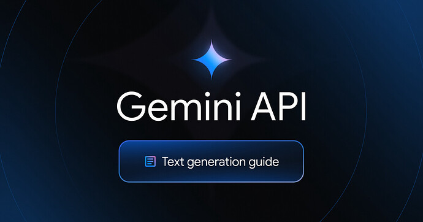

---

id: 1500121

title: "简单易懂的LLM相关知识梳理-ep.5 常见接口规范的介绍及实践中的坑"

created_at: 2026-01-22T06:07:24.977Z

username: flymyd

display_username: "flymyd"

---


# 简单易懂的LLM相关知识梳理-ep.5 常见接口规范的介绍及实践中的坑


目录帖：

[简单易懂的LLM相关知识梳理](https://linux.do/t/topic/1403348) [


文档共建](/c/wiki/42)

> 迫于项目被砍，失业赋闲在家，恰好也快过年了不想动了，想了下写点文章回馈下社区吧。

> PS：如有年后Base重庆的AI/全栈/FAE岗可PM我

> 本文从实用角度出发，梦到哪写哪。部分八股文知识就不搬了，这里主要分享一下本人在使用各种云服务及本地部署过程中学到的知识。

> 这里优先介绍LLM/VLM，暂不涉及音频/视频/Omni相关模型（也可能梦到了以后补一下）

> 注：文章为本人手写，部分模型介绍搬运自…

可能有人要问了：接口规范有什么可介绍的？OpenAI兼容接口一把梭不就好了吗？

实际上，由于御三家各有各的特色，所以以前的一把梭已经不再适用。转换过程中不仅缺少了某些服务商的特有参数，还可能因为不慎传入错误的参数导致调用失败。最要命的是，对于非文本模态而言，即使是所谓OpenAI兼容也不是真正统一的格式（比如画图、传图片、视频、向量等，许多服务商都有自己的表示法）

为了统一，这里只从HTTP请求角度讲起，基本不讲SDK调用，因为SDK本质上也就是对请求进行了包装而已。

Function Call、MCP的调用在后面讲，本章略过。

### OpenAI兼容

先从使用最广泛、变体最多的OpenAI兼容接口讲起。

参考文档：

- OpenAI：[https://platform.openai.com/docs/quickstart](https://platform.openai.com/docs/quickstart)

- New API：[https://docs.newapi.pro/zh/docs/api/ai-model/chat/openai](https://docs.newapi.pro/zh/docs/api/ai-model/chat/openai)

#### Chat Completion API

梦开始的地方，114.514%的人第一次调用LLM都是使用OpenAI兼容接口来完成的。**Chat Completion API**和**Completion API**是两码事，这个一定要注意。

##### 概念易混淆：**Chat Completion** 和 Completion

Completion接口：补全接口，最简单的接口。用户给出prompt和max_tokens，模型预测最可能出现的文字。

Chat Completion接口：聊天接口。平常用的基本上是这个，特点是有了messages数组表示，每条消息包含role和content，若干条消息构成messages。

##### Chat Completion请求及解析示例详解

这里以JavaScript + Node.js 18举例，详细剖析一下流式请求情况下都需要传什么参、参数的意思以及如何解析：

```
const API_KEY = "sk-1145141919810"; // 你的API Key
const BASE_URL = "https://api.deepseek.com/v1/chat/completions";
// 对于通用的Chat Completion请求而言，最终请求的一定是POST方法的v1/chat/completions
// 有的AI应用会自动为你补全/v1前缀，而有的服务商的前缀则不一定是/v1
// 所以请求失败的时候先打印下最终请求的端点URL到底是个什么东西

async function chatCompletionSample() {
  // 构造请求头，经典POST JSON起手
  const headers = {
    "Content-Type": "application/json",
    "Authorization": `Bearer ${API_KEY}`,
  };
  // 构造请求体
  // 注意！这里的参数是为了讲解而故意设置得比较复杂。实际上应该按需选择
  // 标*号的是必填。其他的参数如果不太懂就可以不填
  const payload = {
    // *模型ID
    model: "deepseek-chat",

    // *对话历史
    messages: [
      {
        role: "system",
        // 注意：如果你想进行JSON格式化输出，即response_format: json_object时，建议在prompt里强调输出json
        content: "你是一名资深游戏设计师。请直接输出角色信息的描述JSON文本。"
      },
      {
        role: "user",
        content: "请设计一个男性角色，人设是24岁的大学生，名字叫李天梭。"
      }
    ],

    // =====控制随机性的参数=====
    // temperature: 采样温度，范围[0.0, 2.0]。不传的话按照模型服务的默认设置来
    // 现在的模型一般默认取0.7~1.0左右。早期模型1.0就很狂野了
    // 注意！部分API不接受temperature=0.0
    temperature: 0.7,
    // top_p: 核采样。通常是和temperature二选一
    // 这里设为 1.0 表示不使用核采样限制（默认值）。不过不少模型的推荐值是0.95
    top_p: 1.0,

    // =====控制长度与停止=====
    // max_tokens: 限制模型生成的最大 token 数。防止它写太长耗费额度或者胡言乱语
    // 当然，这个数也不是无限的。具体上限值需要查询模型调用文档，通常叫做输出Token限制
    max_tokens: 500,

    // stop: 停止词。当模型生成这个字符时，立即强制停止。下面只是随便一个示例，实际上通常不用设置，尤其是强制JSON输出的时候
    stop: ["\n\nUser:"],

    // =====惩罚机制 (控制重复输出)=====
    // presence_penalty范围[-2.0, 2.0]
    // >0即鼓励模型谈论新话题。这里设个0.5，因为是创造性的发散任务
    presence_penalty: 0.5,

    // frequency_penalty范围[-2.0, 2.0]
    // >0惩罚重复词汇。这里不启用惩罚
    frequency_penalty: 0,

    // =====格式约束与流输出=====
    // stream: true 开启流式输出。这是纯HTTP调用的难点，下面会演示解析方法
    stream: true,

    // response_format: 强制JSON模式，保证输出的一定是合法 JSON 字符串（其实也不一定，只能说尽量减少异常）
    // 注意：需要模型支持。具体支持性需要查询文档，一般叫做格式化输出或JSON Output等
    response_format: { type: "json_object" },

    // =====高级参数=====
    // seed: 随机种子，需要模型支持。
    // 填入固定的整数 (如114514)，在参数和prompt不变的情况下，能极大提高结果的一致性
    seed: 123456,

    // user: 终端用户ID。
    // 用于安全审计，告诉后台是哪个用户在发请求。
    user: "user_id_9527",

    // logit_bias: 调整特定 Token 出现的概率。
    // 例：禁止出现某个词，或者强行让某个词出现。需要知道 Token ID
    // 下面示例是假设1145是 "善" 字的ID，-100表示禁止生成该字（最终大概率生成反派角色）
    // logit_bias: { "1145": -100 }

    // tools: 函数调用定义。如果这里定义了，模型可能会返回tool_calls
    // 为了简化本示例的解析逻辑，暂不开启tools
  };

  try {
    console.log("发起请求");
    const response = await fetch(BASE_URL, {
      method: "POST",
      headers: headers,
      body: JSON.stringify(payload),
    });

    if (!response.ok) {
      const errorText = await response.text();
      throw new Error(`HTTP Error: ${response.status} - ${errorText}`);
    }

    // =====流式响应解析=====
    // OpenAI接口的流是 Server-Sent Events (SSE) 格式
    // 数据是一块块传过来的，需要拼接
    // 非流式就比较简单了，这里略过

    const reader = response.body.getReader();
    const decoder = new TextDecoder("utf-8");

    let buf = "";
    let finalContent = "";
    let done = false;

    while (!done) {
      const { value, done: readerDone } = await reader.read();
      if (readerDone) break;

      buf += decoder.decode(value, { stream: true });

      // 以事件为单位拆分（空行分隔）
      let sep;
      while ((sep = buf.indexOf("\n\n")) !== -1) {
        const eventBlock = buf.slice(0, sep);
        buf = buf.slice(sep + 2);

        if (!eventBlock.trim()) continue;

        // 合并该事件中的所有 data: 行
        const dataPayload = eventBlock
          .split("\n")
          .filter(l => l.startsWith("data: "))
          .map(l => l.slice(6)) // 去掉 "data: "
          .join("\n")
          .trim();

        if (dataPayload === "[DONE]") { done = true; break; }

        try {
          const data = JSON.parse(dataPayload);
          const delta = data.choices?.[0]?.delta;

          if (delta?.content) {
            process.stdout.write(delta.content);
            finalContent += delta.content;
          }
        } catch (e) {
          console.error("解析出错事件:", dataPayload, e);
        }
      }
    }

    // =====验证 JSON 完整性=====
    // 既然我们开启了 response_format: json_object，最后拿到的string理论上应该能parse
    // 实践中容易导致JSON解析失败的原因可能是max_tokens太小导致截断，或者模型犯犟种又套了层markdown输出
    try {
      const resultObj = JSON.parse(finalContent);
      console.log(resultObj);
    } catch (e) {
      console.log("生成的JSON可能不完整");
    }
  } catch (error) {
    console.error("请求失败:", error);
  }
}

chatCompletionSample();
```

对于非流式而言，解析就很简单了：

```
const result = data.choices?.[0]?.message.content;
```

##### 响应体的详细解析

非流式的返回示例：

```
{
  "id": "chatcmpl-123",            // 此次请求的唯一标识符
  "object": "chat.completion",     // 对象类型，始终为 chat.completion
  "created": 1677652288,           // Unix 时间戳（秒）
  "model": "deepseek-chat",        // 实际使用的模型名称
  "system_fingerprint": "fp_447",  // 后端配置指纹（用于追踪模型更新带来的变化）
  "choices": [                     // 核心内容数组（通常只有一项）
    {
      "index": 0,
      "message": {
        "role": "assistant",
        "content": "{\n  \"name\": \"李天梭\",\n  \"age\": 24...}", // 生成的正文内容
        "reasoning_content": "用户要求设计一个24岁大学生..."   // 思考模型的推理内容（非标准字段，部分厂家支持）
      },
      "logprobs": null,            // 包含 log 概率信息（如果在请求中开启了该参数）
      "finish_reason": "stop"      // 停止原因：stop(正常结束), length(截断), content_filter(敏感词拦截), tool_calls(函数调用)
    }
  ],
  "usage": {                       // Token 统计（计费核心）
    "prompt_tokens": 56,           // 输入所占 Token
    "completion_tokens": 120,      // 输出所占 Token
    "total_tokens": 176,           // 总计
    "completion_tokens_details": {
        "reasoning_tokens": 40     // 思考过程消耗的 Token（部分模型支持）
    }
  }
}
```

流式的返回示例：

当设置了 stream=true 时，API 会返回一系列 ChatCompletionChunk。每一块的结构与标准响应略有不同，主要区别在于 message 变成了 delta。

```
// 第一个 chunk 通常是角色定义或空内容
{"id":"chatcmpl-123","object":"chat.completion.chunk","created":1677652288,"model":"deepseek-chat","choices":[{"index":0,"delta":{"role":"assistant"},"finish_reason":null}]}

// 中间的 chunk 包含增量内容
{"id":"chatcmpl-123","object":"chat.completion.chunk","created":1677652288,"model":"deepseek-chat","choices":[{"index":0,"delta":{"content":"你好"},"finish_reason":null}]}

// 最后一个 chunk 包含结束标识
{"id":"chatcmpl-123","object":"chat.completion.chunk","created":1677652288,"model":"deepseek-chat","choices":[{"index":0,"delta":{},"finish_reason":"stop"}]}

// 如果开启了 include_usage，最后会多出一个包含 usage 的 chunk
{"id":"chatcmpl-123","object":"chat.completion.chunk",..., "usage":{"prompt_tokens":56,"completion_tokens":120,"total_tokens":176}}
```

**1. finish_reason（停止状态判别）**


这是用于判断回复是否完整的字段：

- **stop**: 模型自然结束（遇到了停止符或生成完毕）。

- **length**: 达到了请求中设定的 max_tokens 限制，导致内容被截断（此时拿到的 JSON 往往是不完整的）。

- **content_filter**: 内容因为触发安全审核策略而被静默拦截。Gemini 429！

- **tool_calls**: 模型决定调用你提供的 Tools。

**2. usage（用量统计）**

- **prompt_tokens**: 你的输入 + 系统提示词 + 历史记录经过 Tokenizer 后的数量。

- **completion_tokens**: AI 生成的内容长度。

- **reasoning_tokens**: 在思考模型中，这是不可见但计费的思考成本。即使你不在前端展示思考过程，这部分 Token 依然会计费。

**3. system_fingerprint（系统指纹）**


如果服务商更新了底层硬件或模型权重，这个指纹会变化。如果你在做模型性能对比（Benchmark），记录这个字段有助于排查为什么同样的 Prompt 在今天和昨天的输出表现不一致。

---

##### 思考模型的请求及解析示例

```
const API_KEY = "sk-114514"; // 你的API Key
const BASE_URL = "https://test.com/v1/chat/completions";

async function reasoningChatCompletion() {
  // 构造请求头
  const headers = {
    "Content-Type": "application/json",
    "Authorization": `Bearer ${API_KEY}`,
    "Accept": "text/event-stream",
  };

  // 构造请求体（标*号的是必填）
  const payload = {
    // *模型ID（思考模型示例）
    model: "gemini-2.5-flash",

    // *对话历史
    messages: [
      {
        role: "system",
        content: "你是一名资深游戏设计师。只输出 JSON，不要额外文字。"
      },
      {
        role: "user",
        content: "请设计一个男性角色，人设是24岁的大学生，名字叫李天梭。"
      }
    ],

    // =====思考相关（注意！此处有各种兼容性问题）=====
    // reasoning: 思考配置。影响模型内部推理预算与耗时/成本，o3时代的参数
    // 可选值通常为 'low' | 'medium' | 'high'（默认一般是 medium）
    // 注意：仅部分思考模型支持该参数；不支持时会被忽略或报错
    // reasoning: { effort: "high" },

    // 思考强度：现在更通行的参数
    // 可选值通常为 'none' | 'low' | 'medium' | 'high' | 'xhigh'（默认一般是 medium）
    // Gemini 3 Pro只支持low和high。所以用之前最好先去文档查查或者做好回退逻辑
    reasoning_effort: "high",

    // 思考开关：部分模型适用
    // DeepSeek在合并思考/非思考后，需要传入这个参数以启用/抑制思考功能。但OpenAI模型是不支持这个参数的
    // GLM系列模型也使用这个字段来开启/抑制思考
    // 如果不传，那么通常由模型自动决定是否思考或默认不思考
    // thinking: {"type": "enabled"},

    // 思考开关：vLLM / SGLang + Qwen3-235B
    // chat_template_kwargs: {"enable_thinking": false},

    // 思考开关：百炼
    // extra_body={"enable_thinking": True},

    // =====控制随机性=====
    // 温度与top_p：思考模型为了稳定性，服务端可能在范围上做约束。最好是查一下官方文档或者干脆不填
    // 实际上有的思考模型会直接忽略掉温度、核采样、重复惩罚等参数
    // temperature: 0.7,
    // top_p: 1.0,

    // =====长度与停止=====
    // 思考+结构化输出时不建议设置stop，容易截断导致JSON不完整

    // =====重复惩罚=====
    presence_penalty: 0.3,
    frequency_penalty: 0.3,

    // =====结构化输出（可选）=====
    response_format: { type: "json_object" },

    // =====流式输出=====
    stream: true,

    // stream_options: include_usage=true 将在流中追加一条 usage 事件，包含 token 与（若有）reasoning_tokens
    stream_options: { include_usage: true },

    // =====高级参数=====
    seed: 123456,         // 随机种子（部分模型有效）
    user: "user_id_9527", // 终端用户ID（安全/审计）
  };

  console.log("发起Thinking流式请求...");
  const resp = await fetch(BASE_URL, {
    method: "POST",
    headers,
    body: JSON.stringify(payload),
  });

  if (!resp.ok) {
    const errText = await resp.text();
    throw new Error(`HTTP ${resp.status}: ${errText}`);
  }

  // =====SSE解析=====
  const reader = resp.body.getReader();
  const decoder = new TextDecoder("utf-8");

  let buf = "";
  let finalContent = "";
  let doneFlag = false;
  let lastUsage = null; // 接收 stream_options.include_usage=true 时的用量统计（含reasoning_tokens时）

  console.log("开始接收流式数据...");
  while (!doneFlag) {
    const { value, done } = await reader.read();
    if (done) break;
    buf += decoder.decode(value, { stream: true });

    // 以事件为单位切分
    let idx;
    while ((idx = buf.indexOf("\n\n")) !== -1) {
      const eventBlock = buf.slice(0, idx);
      buf = buf.slice(idx + 2);

      if (!eventBlock.trim()) continue;

      // 只处理 data: 行（忽略其他SSE字段）
      const dataPayload = eventBlock
        .split("\n")
        .filter(l => l.startsWith("data: "))
        .map(l => l.slice(6))
        .join("\n")
        .trim();

      if (dataPayload === "[DONE]") {
        doneFlag = true;
        break;
      }

      try {
        const data = JSON.parse(dataPayload);

        // usage 事件（需要 stream_options.include_usage=true）
        if (data.usage) {
          lastUsage = data.usage; // 可能包含 reasoning_tokens（若模型支持）
        }

        // 标准增量内容
        const delta = data.choices?.[0]?.delta;

        // 注意：OpenAI、Gemini、Anthropic等闭源模型不会返回具体思考过程的文本（不提供CoT），只会给一个简略。
        // 某些OpenAI兼容接口可能在 delta.reasoning_content / delta.thoughts 返回非标准字段。
        // 为了兼容性，这里仅演示如果出现就单独处理；默认不打印到最终输出。
        if (delta?.reasoning_content) {
          process.stderr.write(delta.reasoning_content);
        }
        if (delta?.content) {
          process.stdout.write(delta.content);
          finalContent += delta.content;
        }
      } catch (e) {
        console.error("解析出错事件:", dataPayload, e);
      }
    }
  }

  console.log("\n=== 流接收完毕 ===");

  // 若强制JSON，可在此校验
  try {
    const obj = JSON.parse(finalContent);
    console.log("JSON校验OK");
  } catch {
    console.warn("警告：输出可能不是严格JSON或被截断");
  }

  if (lastUsage) {
    // 常见字段：prompt_tokens / completion_tokens / total_tokens
    // 思考模型还可能包含：reasoning_tokens（若模型/事件支持）
    console.log("用量统计:", lastUsage);
  }
}

reasoningChatCompletion().catch(err => console.error("请求失败:", err));
```

非流式解析同样简单：

```
const result = data.choices?.[0]?.message.content;
const reasoning_content = data.choices?.[0]?.message.reasoning_content;
```

##### 思考模型的调用相关扩展阅读

- 对于Gemini系列模型，建议参考文档：[https://ai.google.dev/gemini-api/docs/thinking?hl=zh-cn](https://ai.google.dev/gemini-api/docs/thinking?hl=zh-cn)

- 对于Gemini系列模型在OpenAI兼容接口下的交错思考使用，建议参考文档：[https://ai.google.dev/gemini-api/docs/thought-signatures?hl=zh-cn#openai](https://ai.google.dev/gemini-api/docs/thought-signatures?hl=zh-cn#openai)

- 对于GLM系列模型，想了解通常采用的交错思考控制/回合级思考控制可以参考文档：[Thinking Mode - Overview - Z.AI DEVELOPER DOCUMENT](https://docs.z.ai/guides/capabilities/thinking-mode#interleaved-thinking)

##### 多模态调用

这也是个大坑。这里介绍较为通用的：

```
const url = 'https://api.z.ai/api/paas/v4/chat/completions';
const apiKey = 'your-api-key';

const payload = {
    model: "glm-4.6v",
    messages: [
        {
            role: "user",
            content: [
                {
                    type: "image_url",
                    image_url: {
                        url: "https://aaa.com/test.png"
                    }
                },
                {
                    type: "text",
                    text: "图片里有什么？"
                }
            ]
        }
    ],
    stream: true,
    // 百炼平台通义千问VL的特有参数，参考https://bailian.console.aliyun.com/cn-beijing/?tab=doc#/doc/?type=model&url=2845871
    // vl_high_resolution_images: true
};

async function chatWithImg() {
    try {
        const response = await fetch(url, {
            method: 'POST',
            headers: {
                'Authorization': `Bearer ${apiKey}`,
                'Content-Type': 'application/json'
            },
            body: JSON.stringify(payload)
        });

        if (!response.ok) {
            const errorText = await response.text();
            throw new Error(`HTTP error! status: ${response.status}, body: ${errorText}`);
        }

        // 处理流式响应
        const reader = response.body.getReader();
        const decoder = new TextDecoder();

        // 解析部分略，前面讲过了

    } catch (error) {
        console.error('请求失败:', error);
    }
}

chatWithImg();
```

以下是`content`字段的定义描述：

```
interface ContentItem {
  type?: "text" | "image_url" | "input_audio" | "file" | "video_url",
  text?: string,
  image_url?: {
    url?: string,  // 一般是支持Base64或HTTP链接。Base64字符串格式：data:[MIME_type];base64,{base64_image}
    detail?: "low" | "high" | "auto"  // 控制后台分辨率缩放用，部分支持
  },
  input_audio?: {
    data?: string,  // Base64编码的音频
    format?: "wav" | "mp3"
  },
  file?: {
    filename?: string,
    file_data?: string,
    file_id?: string
  },
  video_url?: {
    url?: string  // 通常是在线视频链接。也有魔丸支持传Base64编码，比如百炼
  },
  fps?: number,  // 百炼平台通义千问VL模型在进行视频理解时的参数
  max_pixels?: number,  // 百炼平台通义千问VL模型在进行视觉理解时的参数
  // max_pixels表示输入图像的最大像素阈值，vl_high_resolution_images=True时不生效。支持自定义，不同模型最大值不同
}

type Content = ContentItem[];
```

图片转换为Base64的示例代码，视频也一样：

```
const encodeImage = (imagePath) => {
  const imageFile = readFileSync(imagePath);
  return imageFile.toString('base64');
};
```

实时多模态、全模态等实验性模型的调用方法略，有兴趣的看官可以自己参阅官方文档进行了解。目前Qwen3家族以及Gemini家族有对应的模型。

##### 坑1：Chat Completion的role定义适配问题

在将各种模型接入你的AI应用时，有时候会遇到如下报错：

```
[{'type': 'value_error', 'loc': ('body', 'messages', 0, 'ChatCompletionMessageGenericParam', 'role'), 'msg': "Value error, 'role' must be one of 'system', 'assistant', 'tool', or 'function' (case-insensitive).", 'input': 'developer', 'ctx': {'error': ValueError("'role' must be one of 'system', 'assistant', 'tool', or 'function' (case-insensitive).")}}, {'type': 'literal_error', 'loc': ('body', 'messages', 0, 'ChatCompletionMessageUserParam', 'role'), 'msg': "Input should be 'user'", 'input': 'developer', 'ctx': {'expected': "'user'"}}]
```

为什么呢？难道role不就是`system`、`assistant`、`user`吗？

| 角色值 (Value) | 对应概念 | 主要使用平台/场景 | 备注 |

| --- | --- | --- | --- |

| **system** | 系统指令 | OpenAI, Mistral, Llama, Ollama | 最基础的角色，定义 AI 人设。 |

| **user** | 用户输入 | **所有平台** (Google, OpenAI, Anthropic) | 核心角色。 |

| **assistant** | AI 回复 | OpenAI, Anthropic, Mistral, Ollama | 核心角色。 |

| **model** | AI 回复 | **Google Gemini / Vertex AI** | Google 专用，等同于 assistant。 |

| **developer** | 开发者指令 | **OpenAI o1 系列** | **新特性**，权重高于 system，用于推理模型。 |

| **tool** | 工具结果 | OpenAI, Mistral (新版) | 用于回传函数/工具执行结果。 |

| **function** | 函数结果 | OpenAI (旧版), Google (部分) | `tool` 的旧称，仍广泛兼容。 |

| **human** | 用户 | LangChain (框架层) | 最终会转换为 `user`。 |

| **ai** | AI 回复 | LangChain (框架层) | 最终会转换为 `assistant`。 |

##### 坑2：Gemini/Anthropic模型转换至OpenAI兼容接口的参数问题

大部分模型服务/提供商都对请求参数做了比较宽松的限制。如果某些并不需要的参数传递了进去也会自动忽略而不会报错。但御三家的模型卡的比较死。某些情况下，如果你错误地传了冗余参数（如top_p、top_k、重复惩罚等）但模型本身并不支持，则会直接报错。千万要按需注入参数而不是直接写在请求模板里。

在使用模型前一定一定要阅读官方的调用指南文档！每个模型都有着些许差别。OpenAI Chat Completion现在只是一个框架，很多服务商会附加额外参数。

#### Response API

这个是比较新的格式，支持了许多新特性：

- 统一输入：`input`（可为字符串，或 messages/内容块数组），取代 Chat Completions 的 `messages`

- 统一输出：非流式返回 `response` 对象（含 `output` 数组、聚合 `usage`），流式走 SSE 带事件名（如 `response.output_text.delta`、`response.completed`）

- 多模态：通过 `modalities`（输出）+ `input_*` 内容块（输入），TTS/语音输出通过 `audio` 配置

- 结构化输出：`response_format` 支持 `json_object` 与更强的 `json_schema`

- 工具调用：`tools`/`tool_choice`；流式有 `response.tool_call.*` 事件，完成后需“二阶段提交”`/responses/{id}/tool_outputs`

下文均以OpenAI官方服务举例（除了gpt5系列以外谁会用Responses API啊）

##### Responses请求及解析示例代码

```
const API_KEY = process.env.OPENAI_API_KEY;
const BASE_URL = "https://api.openai.com/v1/responses";

async function responsesBasicJson() {
  const headers = {
    "Content-Type": "application/json",
    "Authorization": `Bearer ${API_KEY}`,
  };

  const payload = {
    model: "gpt-5.2",
    // input 可直接是字符串，也可用更细粒度的内容块，见后文多模态示例
    input: "请输出一个男性角色（24岁大学生，名为李天梭）的设定JSON。字段：name, age, background, traits。",
    response_format: { type: "json_object" },
    temperature: 0.7,
    // 注：Responses 常见为 max_output_tokens；如服务端仍使用 max_tokens，请按文档选择其一
    max_output_tokens: 500,
    // reasoning（若模型支持）
    // reasoning: { effort: "high" },
    // seed（若模型支持）
    seed: 1919810,
    user: "user_id_9527",
  };

  const resp = await fetch(BASE_URL, { method: "POST", headers, body: JSON.stringify(payload) });
  if (!resp.ok) {
    throw new Error(`HTTP ${resp.status} - ${await resp.text()}`);
  }

  const data = await resp.json();
  const text = extractTextFromResponse(data); // 见下方辅助函数
  console.log(text);

  // 若强制 JSON，可校验
  try { JSON.parse(text); } catch { console.warn("警告：输出不是严格JSON或被截断"); }

  // 用量（Responses 直接在顶层 data.usage）
  console.log("usage:", data.usage);
}

function extractTextFromResponse(r) {
  // Responses 可能提供聚合的 output_text（若有则优先）
  if (typeof r.output_text === "string") return r.output_text;
  // 通用回退：拼接 output[].content[] 中的 output_text
  const parts = [];
  for (const msg of r.output ?? []) {
    for (const c of msg.content ?? []) {
      if (c.type === "output_text" && c.text) parts.push(c.text);
    }
  }
  return parts.join("");
}

responsesBasicJson().catch(console.error);
```

##### 多模态调用

几个需要注意的点：

- 图片输入：使用内容块 `input_image`，可传 `image_url`（HTTP 链接）或 Base64 数据

- 语音输入：内容块 `input_audio`，携带 Base64 与格式

- 语音输出（TTS）：设置 `modalities: ["text","audio"]` 并配置 `audio.voice/format`；流式事件为 `response.output_audio.delta`（Base64 块）

示例代码（图文输入，语音输出）：

```
import fs from "node:fs";

const payload = {
  model: "gpt-4o-mini-tts",
  input: [
    {
      role: "user",
      content: [
        { type: "input_text", text: "看看这张图里有什么，并用一句话描述。" },
        { type: "input_image", image_url: "https://example.com/test.png" }
      ]
    }
  ],
  modalities: ["text", "audio"],
  audio: { voice: "alloy", format: "wav" },
  stream: true
};

async function multimodalStream() {
  const resp = await fetch("https://api.openai.com/v1/responses", {
    method: "POST",
    headers: {
      "Authorization": `Bearer ${process.env.OPENAI_API_KEY}`,
      "Content-Type": "application/json",
      "Accept": "text/event-stream"
    },
    body: JSON.stringify(payload)
  });
  if (!resp.ok) throw new Error(await resp.text());

  const reader = resp.body.getReader();
  const decoder = new TextDecoder();

  let buf = "", audioChunks = [], textOut = "";

  while (true) {
    const { value, done } = await reader.read();
    if (done) break;
    buf += decoder.decode(value, { stream: true });

    let sep;
    while ((sep = buf.search(/\r?\n\r?\n/)) !== -1) {
      const block = buf.slice(0, sep);
      buf = buf.slice(sep + (buf[sep] === '\r' ? 4 : 2));

      let eventName = null, dataStr = "";
      for (const line of block.split(/\r?\n/)) {
        if (line.startsWith("event:")) eventName = line.slice(6).trim();
        if (line.startsWith("data:")) dataStr += line.slice(5).trimStart() + "\n";
      }
      dataStr = dataStr.trim();
      if (!dataStr || dataStr === "[DONE]") continue;

      const evt = JSON.parse(dataStr);

      if (eventName === "response.output_text.delta" && evt.delta) {
        process.stdout.write(evt.delta);
        textOut += evt.delta;
      } else if (eventName === "response.output_audio.delta" && evt.delta) {
        audioChunks.push(evt.delta); // Base64 片段
      } else if (eventName === "response.completed") {
        if (audioChunks.length) {
          const b64 = audioChunks.join("");
          fs.writeFileSync("speech.wav", Buffer.from(b64, "base64"));
          console.log("\n音频已保存：speech.wav");
        }
      }
    }
  }
}

multimodalStream().catch(console.error);
```

##### Responses API的常见坑

其实大部分都是兼容性的坑（Response API用的比较少 + 各平台可能魔改），还是老话，先看文档再调用！！！

- max_* 字段名：Responses 普遍使用 `max_output_tokens`；部分兼容服务仍沿用 `max_tokens`。以目标服务文档为准，避免抄错。

- 流事件名：Responses 流含 `event:` 行（与 Chat Completions 只有 data 不同）。解析时务必读取 `event:`，根据事件名路由处理。

- JSON 严格性：`json_object` 只是“尽量 JSON”；要强约束用 `json_schema.strict=true`。但严格模式更可能触发拒绝/空输出。

- 工具调用为二阶段：记得对接 `/responses/{id}/tool_outputs`；参数流式到达（`*.delta`），需拼接再 `JSON.parse`。

- Reasoning 与 usage：`reasoning` 只在部分模型有效；`reasoning_tokens` 仅在支持的事件/模型与 `usage` 中出现，不保证一定返回。

- 超时与断线：SSE 建议使用 `AbortController` 设置超时；同时处理中断后重试策略。

- 多模态命名：本文在 Responses 示例中使用 OpenAI 官方 `input_text/input_image/input_audio/output_*` 命名；与通用 Chat 兼容示例中的 `image_url` 等命名不同，注意区分。

### Gemini

Gemini API端点的典型特征是`/v1beta`而非OpenAI常见的`/v1`。`基米我不许你管它叫beta，它很成熟了 \ 😭 / \ 😭 / \ 😭 /`

在某些涉及多模态/长上下文/工具调用的场景下，基米模型用基米自家API可能有神秘加成。

和OpenAI兼容接口相比，有几个重大差异：

- OpenAI 体系里，对话角色是 user 和 assistant。而 Gemini 原生体系里，对话角色是 user 和 model

- Gemini 的消息结构不是简单的 role + content 字符串，而是 role + parts 数组

- 请求路径比较直观，格式是：`/v1beta/models/{model_name}:{action}`

- action：generateContent=非流，streamGenerateContent=流式

- 比起其他家模型来说，基米很容易遇到429，所以要特别注意检查响应体的candidates.finishReason和candidates.promptFeedback以确定是否被安全审查过滤掉了。Vertex保平安！

基米的文档非常清晰直观，我认为远强于OpenAI。而且无论是Anthropic还是Gemini都没吃过OpenAI兼容的苦，没那么多历史包袱，直接看文档就行：



### [文本生成  |  Gemini API  |  Google AI for Developers](https://ai.google.dev/gemini-api/docs/text-generation?hl=zh-cn)

开始使用 Gemini API 构建聊天和文本生成应用

### Anthropic

很多服务商为了兼容Claude Code，也提供了Anthropic格式的API（又称Messages API）。需要注意的是，由于大部分使用Anthropic API的场景都是发生在接入Claude Code时，所以要特别注意多轮对话场景下签名携带的问题，否则很容易导致Claude Code爆炸。

官方文档写的也挺直观，直接看就行：

快速入门示例：[使用 Messages API - Claude Docs](https://platform.claude.com/docs/zh-CN/build-with-claude/working-with-messages)

API详细描述：[https://platform.claude.com/docs/en/api/messages](https://platform.claude.com/docs/en/api/messages)


---


*来源: https://linux.do/t/topic/1500121.json*

