---

id: 1506128

title: "ComposeFlow：AI驱动、0代码，设计并构建属于你的多平台原生 Compose APP"

created_at: 2026-01-23T11:55:31.640Z

username: ForteScarlet

display_username: "Forte Scarlet"

---

# ComposeFlow：AI驱动、0代码，设计并构建属于你的多平台原生 Compose APP

想必做移动端的朋友们肯定或多或少听说过 Kotlin 和 Compose Multiplatform，

前者是 JetBrains 开源、Google 首推用于 Android 开发（自2019 年 Google I/O 大会起）的现代开发语言，

后者是使用 Compose API 开发多端（Android、iOS、桌面端、Web端等）应用的 UI 框架。

但是不论你是使用 Compose/Kotlin 开发应用，还是使用其他解决方案，都会有一个苦恼：使用代码编写UI，

终归是不如大家最喜欢的拖拖拽拽来的直观。你选择 Compose/KMP 的理由，其中大概率有一条会留给它的多平台逻辑共享与原生互操作能力，

避免中间层的出现，可以有更好地表现效果与上限。

那么有没有什么办法，可以即让我使用 Compose 开发应用、又可以借助AI神力并且以拖拉拽的形式而免去需要写代码的苦恼？

如果你有这些想法，那么也许你可以关注一下 **ComposeFlow**: 一个 Compose Multiplatform 的可视化应用构建器。

> 注意，这篇文章图片会比较多喔～

## 什么是 ComposeFlow

> ComposeFlow 是一个 Compose Multiplatform 的可视化应用构建器，它通过 AI 代理和直观的拖放界面，

>

> 赋能开发者、企业家、设计师和产品经理创建功能完整的应用程序。它能生成完整的、可运行的 Compose Multiplatform 项目，

>

> 并提供干净的 Kotlin 代码，支持桌面、Android、iOS 和 Web 等多个平台。

以上是它们的 [GitHub](https://github.com/ComposeFlow/ComposeFlow) 仓库中的首段自我介绍。

简单来说，它就是一个 AI 驱动、可视化、拖拉拽的 Compose Multiplatform 开发工具。

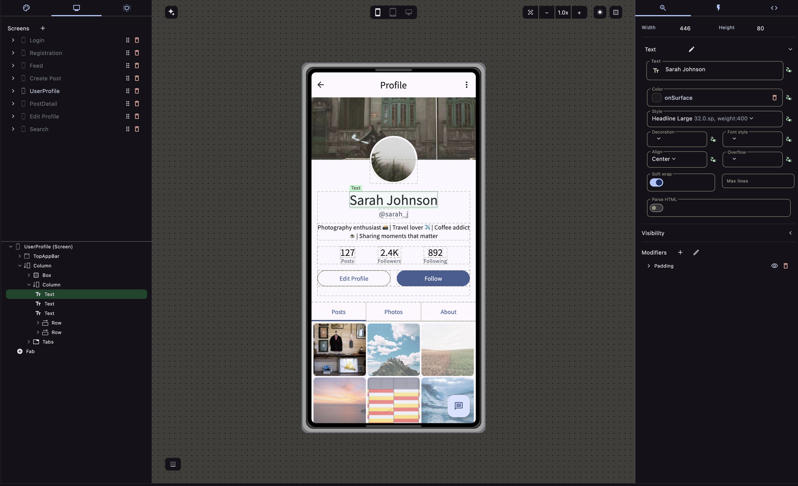

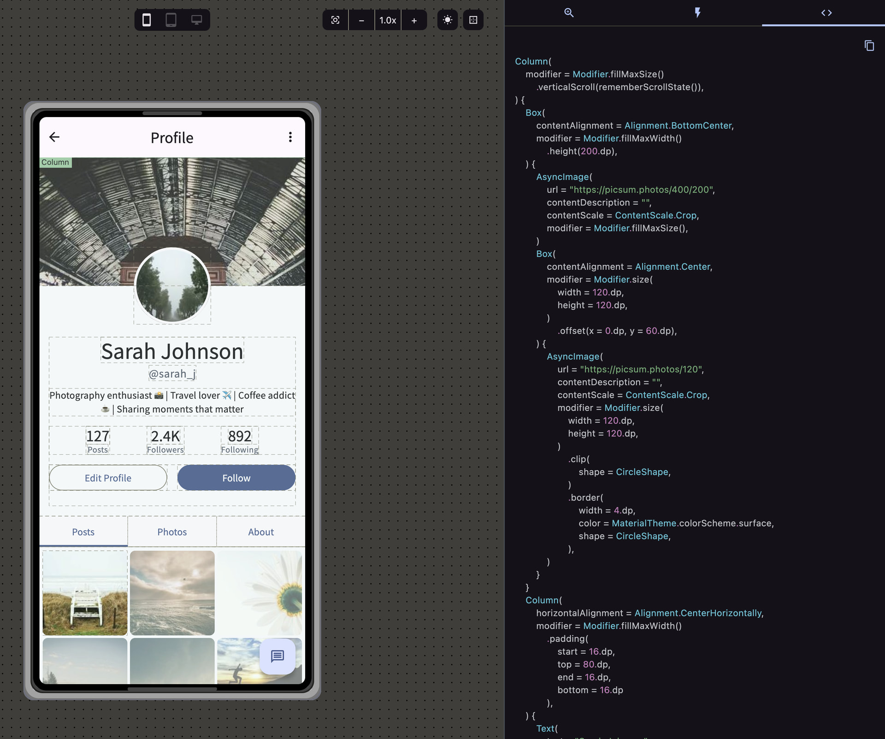

> 图片来自官方 GitHub README 中的配图。

更多信息，你可以前往它们的 [文档](https://docs.composeflow.io/) 了解更多。

## 使用

### 安装

> 首先需要知道，这个工具目前仍处于早期阶段，因此可能存在各种各样的问题，我们今天就只是尝鲜为主。

根据 GitHub 的说明，我们前往它们的下载页面去下载对应的应用（Windows 用户可以直接使用 Microsoft Store 安装）。

安装完成后，它会提示你登陆账号（也可以不登录，只不过那样就不能使用 AI 服务了），我选择使用 Google 账号登陆。

登录后，这就是它的首页：

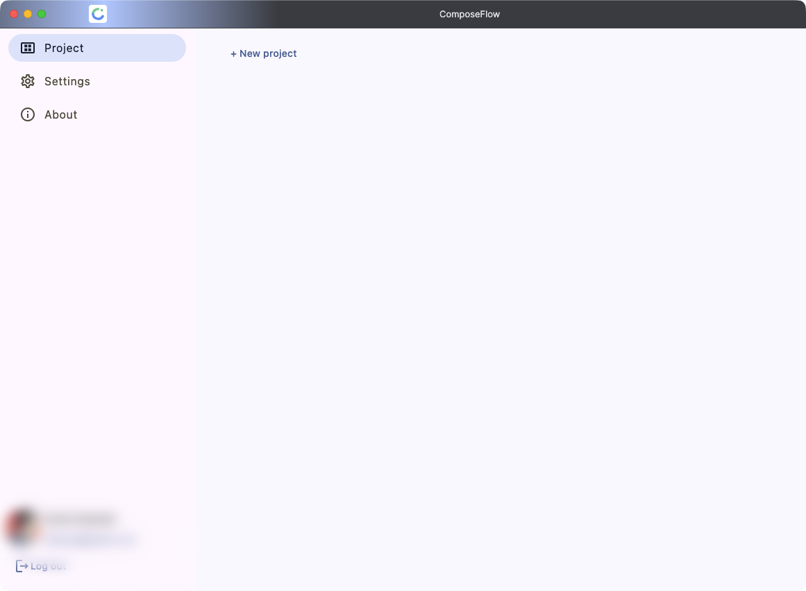

### 创建项目

毕竟是新安装的，我们先来创建一个项目。

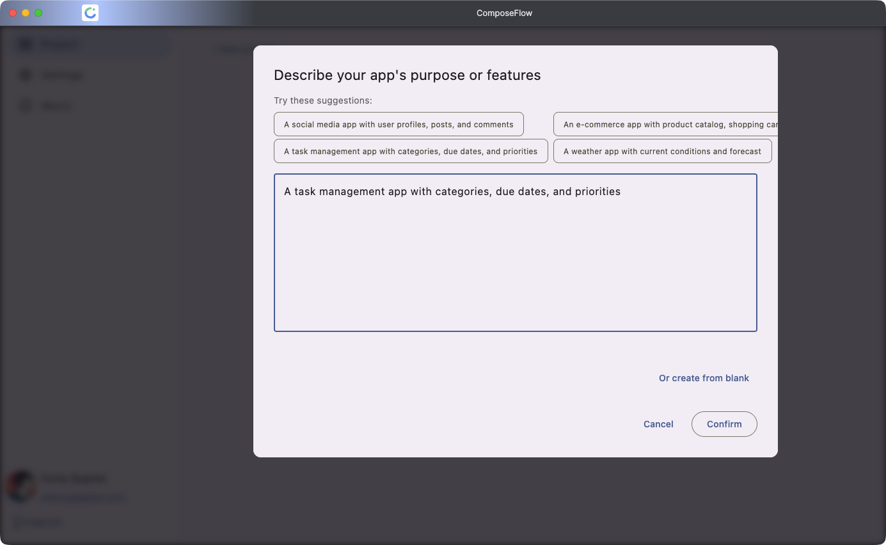

就按照它的推荐提示词，创建一个**任务管理**的应用，为了方便演示，我加了一句 “USE CHINESE”，其他的内容均未修改。

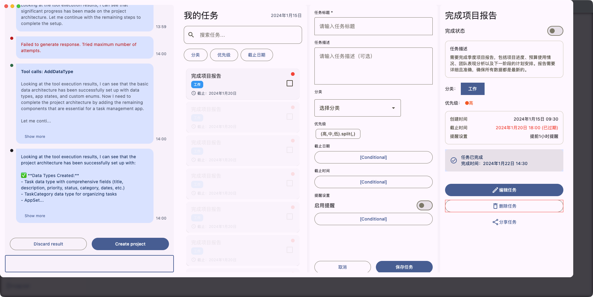

通过 AI 提示词创建一个项目的基本过程就在上面了。它会根据你的基础提示词，设计出几个详细的界面设计，

然后再根据每个界面的细节内容生成具体的界面布局与样式，然后在右侧供你预览。当一切就绪，你就可以直接创建项目了。

作为一个尝鲜体验，我就不修改什么了，直接默认并创建即可～

那么接下来，我们点击 **create project** 创建一个项目看看。

### 项目视图

首次进入项目内容，它会给你一个引导，欢迎你，并告诉你一些操作方法：

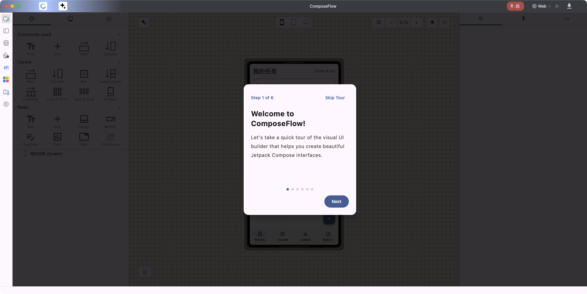

项目的左侧，是各类工具视图，它们提供了添加文字、图标等组件的 UI 构筑功能，以及布局功能等等，如图所示：

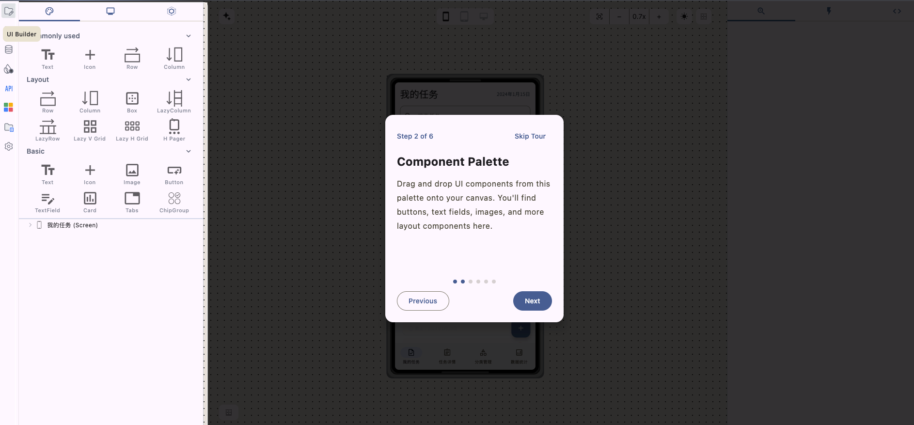

接下来，为你介绍了画布的正中央：你的 UI 表现效果，以及画布尺寸、明暗等内容的配置和展现。

随后是右半侧，提供了选中组件的各类属性信息的展示与编辑等。

当然，作为一个 AI 驱动的工具，除了构建项目之外，肯定也会在其他功能上增加 AI 能力。左上角的小图标便是提供 AI assistant 能力的地方。

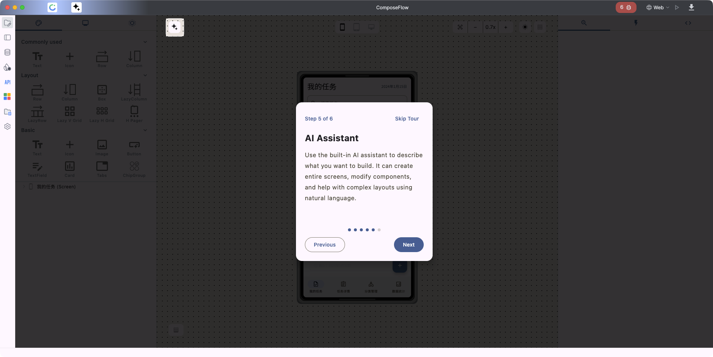

接下来引导就结束了，然后便是我们自由发挥的时候啦。

下面便是我生成的项目的一些基本样式与信息：

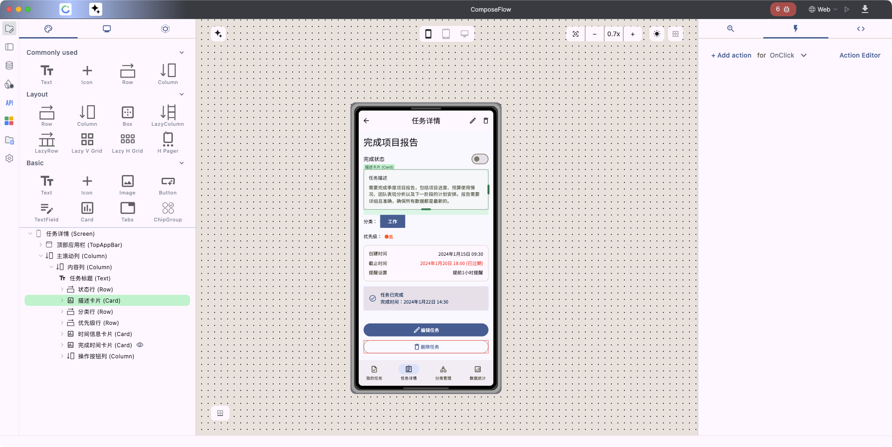

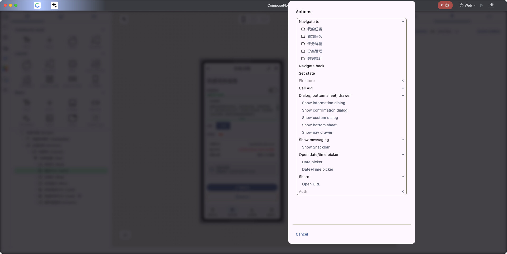

可以看到信息和功能还是相当丰富的。而且除了基本的 UI 设置之外，左侧工具还可以选择切换到：

- 数据/枚举类型定义

- App 状态(App state)

- Firesotre(好像是某种NoSQL的云服务？)

- API editor(看上去是配置 API 调用的)

- 配置主题配色的 Theme editor

- 图片图标等资源的管理 Assets

- 项目和应用的基础配置

可谓是功能相当丰富。

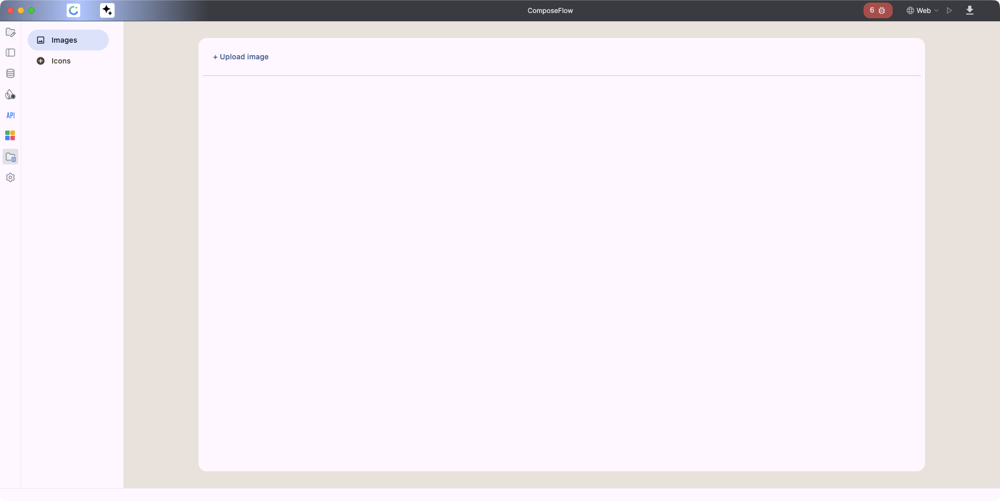

### 下载&安装项目

不过这次主打一个基础体验，我也就不做什么修改了，直接点击右上角的“下载代码”，下载一份 Web 版的看看样子。

有一说一，它这个下载成功的提示真的很不起眼哈哈

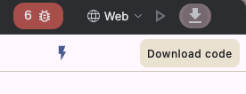

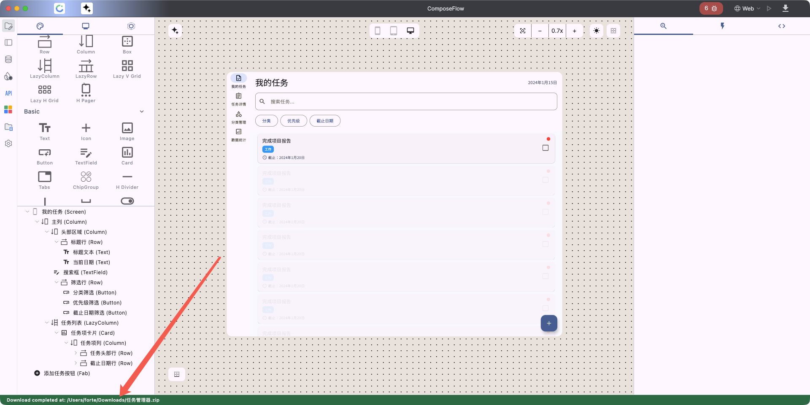

可以看到，项目的大概文件结构是这个样子的：

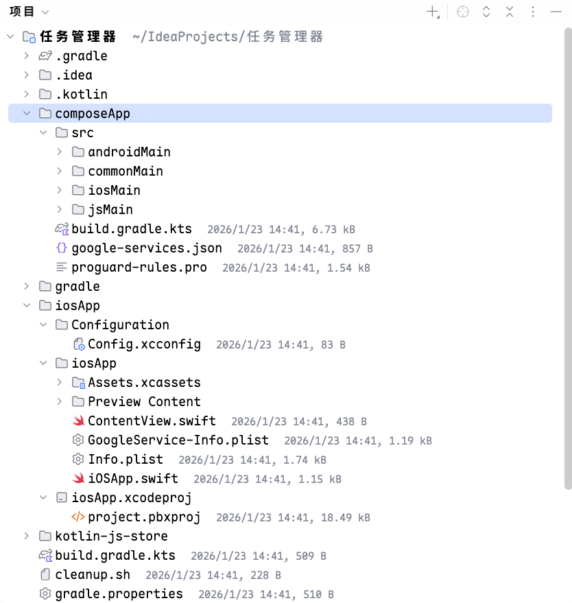

安卓、iOS 和 JS 都有（虽然不知道为什么没用 WasmJs），也是相当全面了。

让我来随便找几个源代码文件看看内容：

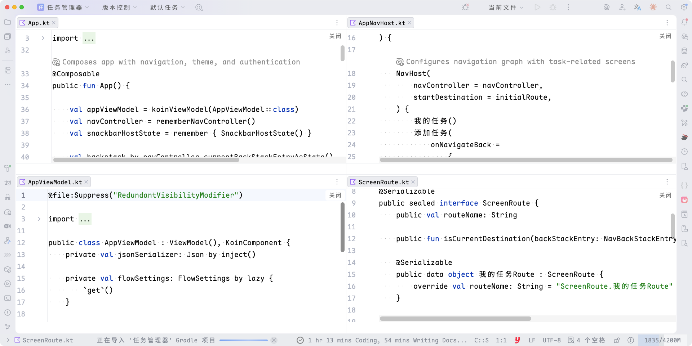

嗯…整体来说还是可以的，不过也有一些小缺陷：

1. 代码可以说几乎没什么注释。

2. 由于我一开始的提示词用了 `USE CHINESE`，结果导致它生成的代码中存在一些使用中文命名的类型。

上面这几个小缺陷我觉得如果用英文原版的提示词，或者再精修一下、将这些问题都在提示词中说明白，

那应该也都是可以避免的，所以问题不大。

### 运行项目

考虑到我没配置移动端的开发工具和相关的东西，咱们就跑一下 web 端看看效果吧。

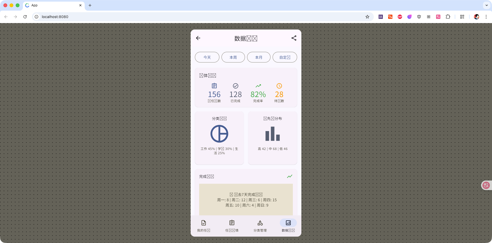

嗯…让我们先忽略它中文乱码的问题，这是 Compose for Web 渲染 canvas 的老问题了，找个中文字体加载下就好（或者有什么配置）。

单从 UI 布局上来看，是基本符合之前的设计布局的。

只不过不知道是不是应该在下载的时候选什么配置，这个 Web 端出来的布局仍是竖屏手机的样式哈哈哈，

之前在 UI 设计阶段是有宽屏 Web 布局的样式的，可能我漏掉了什么选项吧。不过我也懒得回去找了，就不再重新捣鼓了。

我将它生产出来的这个项目发布到了 GitHub 的仓库中：[GitHub - ForteScarlet/ComposeFlow-TaskManagementApp: A demo project for ComposeFlow](https://github.com/ForteScarlet/ComposeFlow-TaskManagementApp)

你如果感兴趣的话，也可以去看看。

## 尾声

对此工具的体验就到此为止啦～ 有一说一在 UI 构建的工作区里功能比我想象要丰富不少。

不过毕竟工具也还是在早期阶段，还是会有不少细枝末节的小问题存在的，尝尝鲜还可以，不过想要非常优质的生产级体验还是有些距离。总而言之，**未来可期！**

至于我是怎么知道这个的呢，是因为前阵子看到 JetBrains 的布道师关注了这个仓库的所述组织，

于是乎就进去看了下，而后便有了这篇文章。

不管怎样，感谢你读到这里，祝你有愉快的一天，我们下次再见～

---

*来源: https://linux.do/t/topic/1506128.json*

