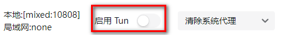

---

id: 1517377

title: "【持续更新】反重力Antigravity使用汇总，问题、技巧、插件等等"

created_at: 2026-01-26T10:25:51.547Z

username: hel

display_username: "hel"

---

# 【持续更新】反重力Antigravity使用汇总，问题、技巧、插件等等

收集整理一下Antigravity的小笔记。

欢迎分享，一并收录。

问题：

登录无反应，或者登录一直转圈圈

[image494×367 13.4 KB](https://cdn3.ldstatic.com/original/4X/1/8/9/189448f9c39fcd5174d80f69239d3c319d2497e4.png)

原因：上网环境的问题。

解决办法一：

开启Tun

解决办法二：（1.19.x的版本可能无效）

用Proxifier，强制Antigravity走本地代理。

[谷歌IDE antigravity 解决登陆问题-- win、mac通用版本](https://linux.do/t/topic/1190670)

[https://linux.do/t/topic/1278898](https://linux.do/t/topic/1278898)

[https://linux.do/t/topic/655899](https://linux.do/t/topic/655899)

解决办法三：

如果不想开TUN，1.18.4不更新不能用，而1.19.x用Proxifier又无效，那么可以试试ProxyBridge

[Antigravity 非 TUN 代理方案ProxyBridge (Proxifier平替方案)](https://linux.do/t/topic/1688640)

[GitHub - InterceptSuite/ProxyBridge: Proxifier Alternative to redirect any Windows/MacOS/Linux TCP and UDP traffic to HTTP/Socks5 proxy · GitHub](https://github.com/InterceptSuite/ProxyBridge)

*问题：*

*登录时，提示"Your current account is not eligible for Antigravity. Try signing in with another personal Google account."*

[image457×216 26.9 KB](https://cdn3.ldstatic.com/original/4X/b/c/f/bcf60cc5a33fe0aa4685d65fa30c26e09c55a1ea.png)

原因：和所在区域、年龄等有关。开通PRO前登录过、开通PRO依然可能无资格。

解决办法：（Antigravity-tool反代可能会封号）

Antigravity-tool登录后，点击切换账号即可登录。

[image657×417 29.9 KB](https://cdn3.ldstatic.com/original/4X/7/2/f/72f6ac2604a677740be4ed940d28f4ddd85411d5.png)

问题：

频繁出现   Waiting…  的问题

[image549×234 53 KB](https://cdn3.ldstatic.com/original/4X/e/e/7/ee7aef16ef38c52cc0cd5db7d1b2277833e856af.png)

原因：大概率是Windows系统，CMD命令/终端的问题

解决办法：

1. Open Antigravity → Settings (or F1)

打开反重力→设置（或 F1）

2. Find: Terminal select default profile

查找：终端选择默认配置文件

[image662×184 21.5 KB](https://cdn3.ldstatic.com/original/4X/9/4/a/94a6f6f77ecd64ae8c9c0df4dd23b0cbe3394158.png)

3. Set “Git Bash” instead of “PowerShell”

设置“Git Bash”或者“PowerShell”代替“CMD”，推荐“Git Bash”

[image661×172 30.2 KB](https://cdn3.ldstatic.com/original/4X/d/c/6/dc6888c8475a5f1695b141e284ad5e4215b40b72.png)

4. Restart Antigravity   重启反重力

问题：

不是问题，但如果你觉得很烦，希望它自己确认。

[image683×377 31.9 KB](https://cdn3.ldstatic.com/original/4X/7/f/2/7f24a50dcd04f7dea4624a8576608bc170ebad50.png)

在“Antigravity: Quick Settings”面板中配置。

通过 Command Palette 打开面板，然后将“Auto-execution”设置为“Always proceed”

[image336×181 3.06 KB](https://cdn3.ldstatic.com/original/4X/7/0/2/7020abe2d77fa69a1c0ade0eae68551d1c68aafc.png)

还是不行的话，那么就得试试这个插件了：

Antigravity Auto Accept

[Open VSX Registry](https://open-vsx.org/extension/pesosz/antigravity-auto-accept)

[https://linux.do/t/topic/1494666/4](https://linux.do/t/topic/1494666/4)

（注：请谨慎使用。另外，对Token的消耗也很快）

本地使用，可以用Antigravity-tool

[Releases · lbjlaq/Antigravity-Manager · GitHub](https://github.com/lbjlaq/Antigravity-Manager/releases)

本地还可以搭配cc-switch

[GitHub - farion1231/cc-switch: A cross-platform desktop All-in-One assistant tool for Claude Code, Codex, OpenCode, openclaw & Gemini CLI. · GitHub](https://github.com/farion1231/cc-switch)

有外网需求的，可以用CLIProxyAPI

[没有VPS？教你零成本在ClawCloud上部署CLIProxyAPI](https://linux.do/t/topic/1033205)

[Releases · router-for-me/CLIProxyAPI · GitHub](https://github.com/router-for-me/CLIProxyAPI/releases)

[https://linux.do/t/topic/1362485](https://linux.do/t/topic/1362485)

**简体中文包**

通过使用“Configure Display Language”命令显式设置 简体中文界面，可以替代默认 UI 语言。 按下“Ctrl+Shift+P”组合键以显示“命令面板”，然后键入“display”以筛选并显示“Configure Display Language”命令。按“Enter”，然后会按区域设置显示安装的语言列表，并突出显示当前语言设置。

监听本地 Antigravity 客户端配额

[image454×358 11.8 KB](https://cdn3.ldstatic.com/original/4X/0/f/b/0fb730d7169e7e60727e95a23fa18f25f85e9166.png)

为什么要关掉？

因为消耗token特别多，而且之后监测前端，对后台、数据无任何意义。解决不了问题还加倍消耗token

如何关？

[image335×213 7.79 KB](https://cdn3.ldstatic.com/original/4X/9/1/8/918248822df054999aef43df02ae210356147bff.png)

[image1122×420 28.3 KB](https://cdn3.ldstatic.com/original/4X/0/9/b/09be0defc8d7dc2a627cfc195d3f2c9ff25829dc.png)

原因是新版本 language_server_macos_x64 不走Proxifier（即使规则加了也不行）

解决办法：

解决办法一：开TUN

解决办法二：回退到1.18.4版本。

antigravity 历史版本下载

[Google Antigravity](https://antigravity.google/releases)

解决办法三：不想开TUN，1.18.4不更新不能用，试试ProxyBridge

[Antigravity 非 TUN 代理方案ProxyBridge (Proxifier平替方案)](https://linux.do/t/topic/1688640)

[GitHub - InterceptSuite/ProxyBridge: Proxifier Alternative to redirect any Windows/MacOS/Linux TCP and UDP traffic to HTTP/Socks5 proxy · GitHub](https://github.com/InterceptSuite/ProxyBridge)

---

*来源: https://linux.do/t/topic/1517377.json*

