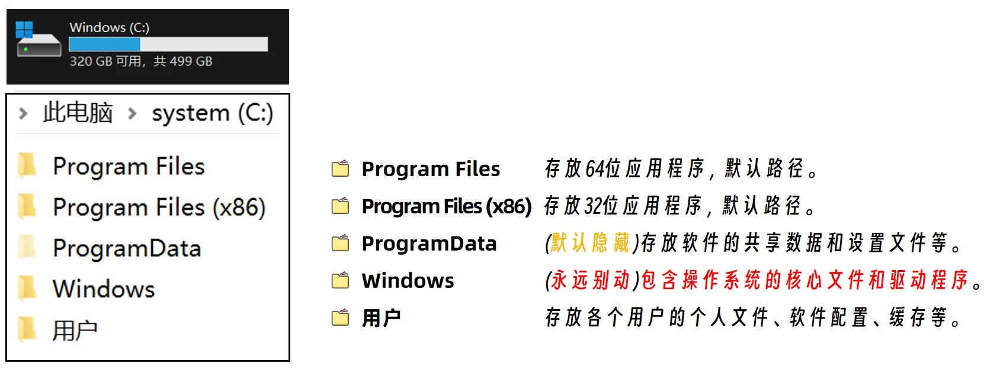
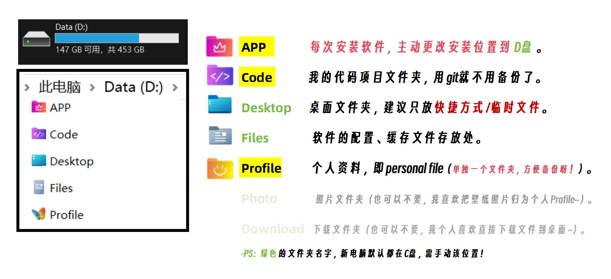
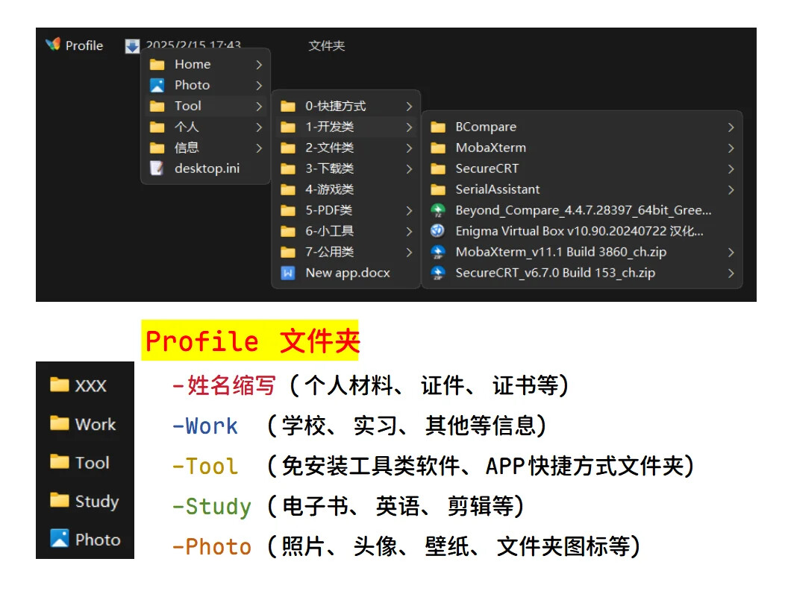
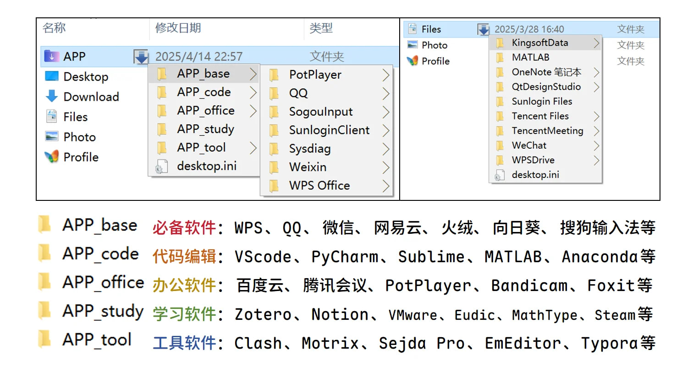
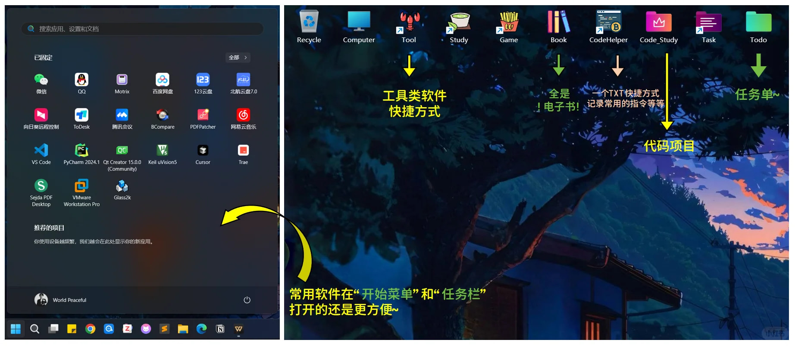
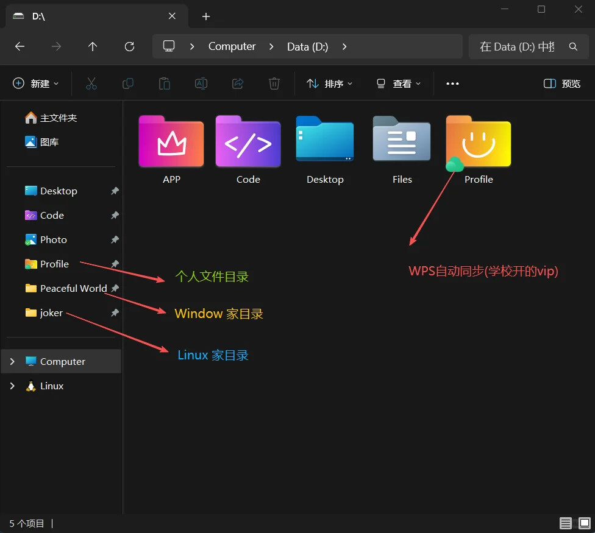
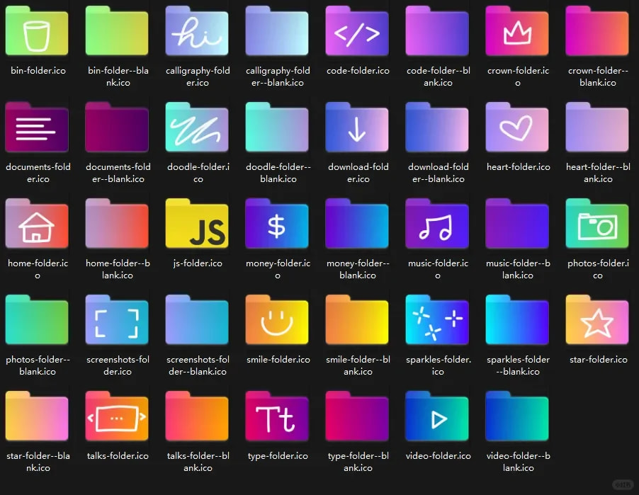

---

id: 1518315

title: "【文件夹分类】最简C盘/D盘/桌面文件夹分类管理推荐"

created_at: 2026-01-26T15:11:17.582Z

username: JokerTOP

display_username: "耗不尽的先生"

---

# 【文件夹分类】最简C盘/D盘/桌面文件夹分类管理推荐

# 1. C盘分类

不出意外的话，大家的电脑C盘都至少有这几个文件夹（当然我的C盘只有这些了）：

- Program Files：默认存放64位应用程序

- Program Files (x86)：默认存放32位应用程序

- ProgramData：存放软件的共享数据和设置文件

- Windows：包含操作系统的核心文件和驱动程序

- 用户：存放各个用户的个人文件、软件配置、缓存等

# 2. D盘分类

分为5部分：

- APP：每次安装软件，主动更改安装位置到 D盘

- Code：当前项目代码

- Desktop：桌面文件夹。

- Files：软件的配置、缓存文件存放处

- Profile：个人资料，即Personal File，单独一个文件夹，直接移动，方便备份呀！

PS：绿色的文件夹名字，新电脑默认都在C盘，需手动该位置！

#### 2.1 应用程序分类

- APP_base 必备软件：WPS、QQ、微信、网易云、火绒、向日葵等

- APP_code 代码编辑：VScode、PyCharm、Sublime、MATLAB等

- APP_offic 办公软件：百度云、腾讯会议、PotPlayer、Bandicam等

- APP_study 学习软件：Zotero、Notion、VMware、Eudic、Steam等

- APP_tool 工具软件：Clash、Motrix、Sejda Pro、EmEditor、Typora等

### 2.2 桌面分类

我的常用软件在“开始菜单”和“ 任务栏”打开的还是更方便~

- Tool：工具类软件快捷方式

- Code_Study：代码项目

- CodeHelper：一个TXT快捷方式，记录常用的指令等

- Task：待办任务，过往项目

## 3. 文件夹图标

最后是一些好看的文件夹图标~

> [百度网盘 请输入提取码](https://pan.baidu.com/s/1KudsHqwhaOvSYKOKCvONfw?pwd=hbjd)

---

*来源: https://linux.do/t/topic/1518315.json*

