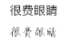

---

id: 1518468

title: "让你快速理解【可读性】的含义"

created_at: 2026-01-26T16:10:55.249Z

username: liet_xia

display_username: "lietxia"

---

# 让你快速理解【可读性】的含义

# 前言

### 你是否有过这样的疑问：为什么几乎所有的手机默认字体都是黑体(无衬线体）？其实答案很简单：因为黑体是可读性最好的。

可读性好，说通俗一点就是：【不需要非常仔细的去看细节】

## 举个例子，这是黑体字和手写体

[image540×390 43.9 KB](https://cdn3.ldstatic.com/original/4X/0/e/c/0ec8b835efef2b4f6d5d147d0a15566e1c6e6c3c.png)

## 然后我们手动让他损失一些细节，其实很简单，只要缩小图像

## 区别一下子就出来了，因为黑体比较方正，在损失大部分细节的情况下，依然能有最高级的辨识度。在小字号的情况下是最优解。

## 我们熟悉的书法体/楷体，其实需要【进一步看细节】，所以可读性会差一些。我们最常用的宋体字其实比较方正，可读性其实不算很差，只是没黑体高。

## 中文字体可读性大概为：黑体或圆体 > 宋体 > 楷体或隶书 > 行书或草书

# 除了对比字体，我们也能对一些UI的可读性进行一些判断。

[image1588×954 374 KB](https://cdn3.ldstatic.com/original/4X/8/4/9/849a6e1457008d9efa809fcc140db4c04264ace6.jpeg)

## 当他们损失一些细节之后，可读性会发生怎样的变化呢？

[image810×496 129 KB](https://cdn3.ldstatic.com/original/4X/9/1/9/919871abadcb76518d18897bf8587aacf974cc51.jpeg)

## 聪明的一些小伙伴可能发现规律了，就是颜色对比，明暗对比度，都会影响可读性。

# 所以大家，现在知道怎样才是【可读性好】的设计了吗？

---

*来源: https://linux.do/t/topic/1518468.json*

