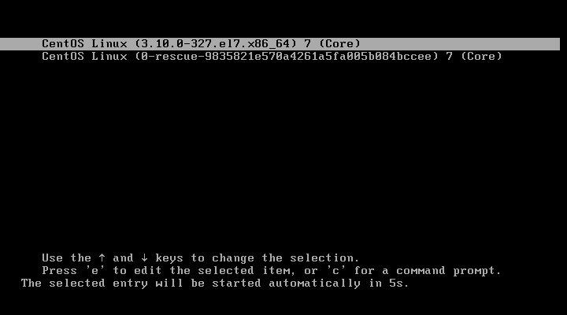
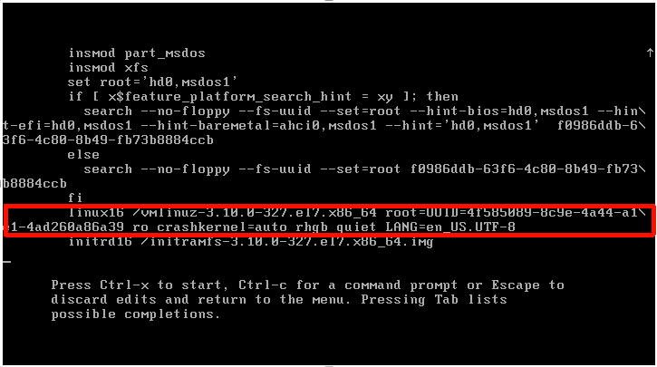
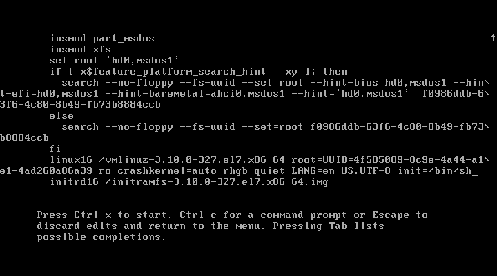
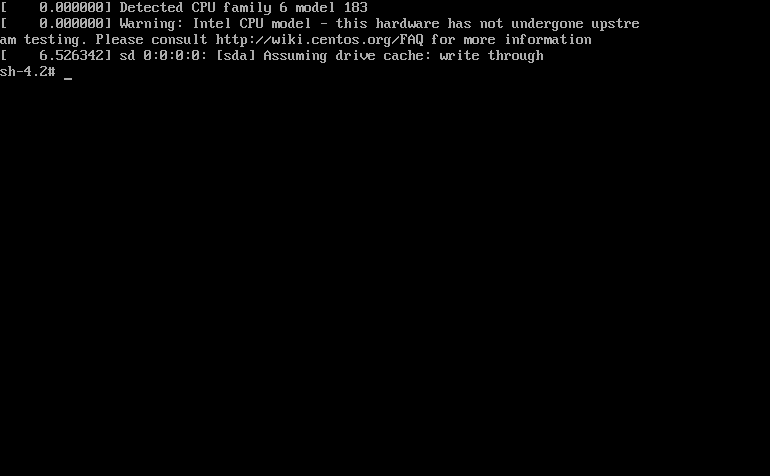
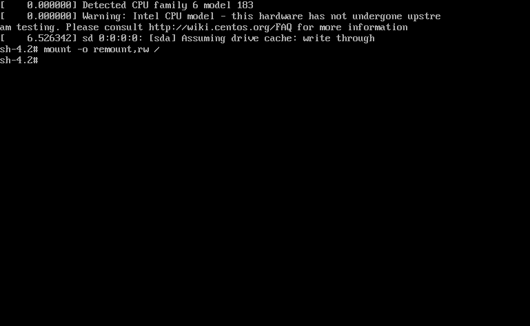
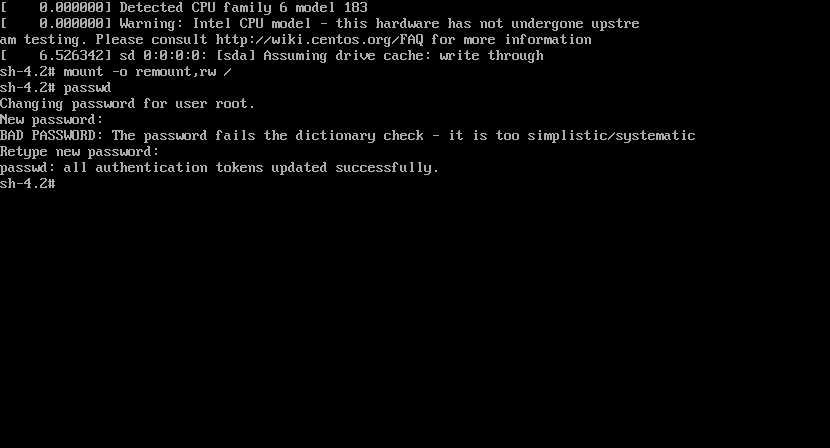
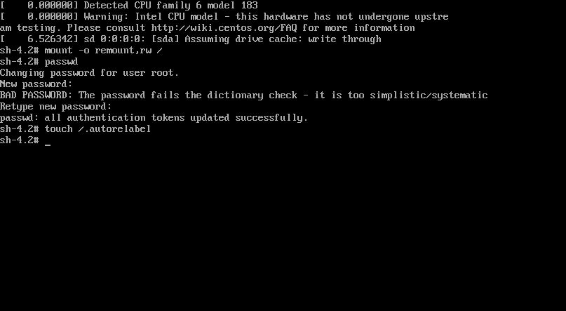
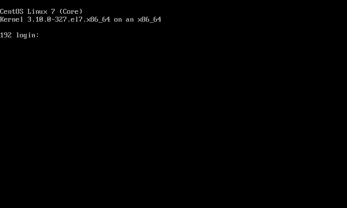
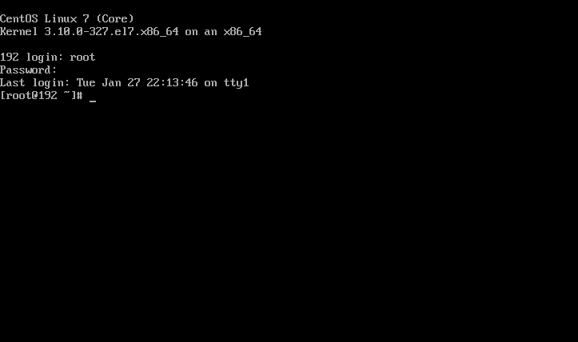

---

id: 1522794

title: "CentOS 虚拟机忘记密码重置"

created_at: 2026-01-27T14:57:29.797Z

username: runbrick

display_username: "砖头"

---

# CentOS 虚拟机忘记密码重置

**我这是虚拟机环境里，如果是生产环境或者实体机请仔细斟酌使用下面的教程**

- 在系统启动进入蓝色背景的 GRUB 内核选择界面时，迅速按下键盘上的 `e` 键（进入编辑模式）。

- 进入编辑界面后，使用方向键找到以 linux16 或 linux 开头的那一行。

- 在该行的末尾，添加 `init=/bin/sh` . 就是光标一直按方向键的下键一直到这行，再一直按方向键的右键到 **LANG=en_US.UTF-8** 的后面

- 按快捷键Ctrl + X 系统将引导进入紧急模式，这时候需要等一会等出现下面的界面就好

了

- 命令行中输入 `mount -o remount,rw /` 这时候并不会出现什么

- 输入`passwd` 这时候会提示你输入密码

- 更新SELinux 上下文： 如果你的系统开启了 SELinux（默认开启），必须运行这个命令

`touch /.autorelabel` 否则新密码将无法生效。执行后并不会有提示的

- 执行 `exec /sbin/init` 回车之后需要等一会，成功的话会出现下面的内容

这时候在输入你修改的 root 密码就可以看到系统了

---

*来源: https://linux.do/t/topic/1522794.json*

