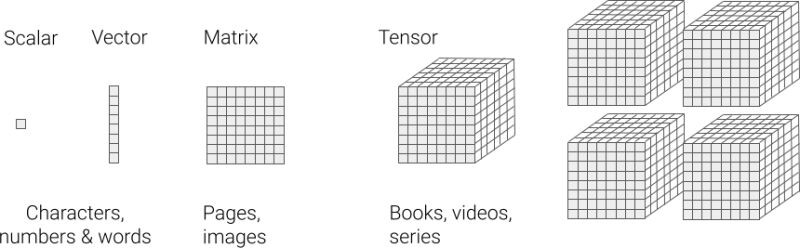

---

id: 1536474

title: "神经网络与大语言模型初步 - 第一章 神经网络 1"

created_at: 2026-01-28T12:22:05.542Z

username: Moonie

display_username: "Moonie"

---

# 神经网络与大语言模型初步 - 第一章 神经网络 1

上一个帖子  里佬友们反响热烈，于是趁热打铁写了一些，大家可以先看看提提意见 。

比较在意的是神经网络这些，佬友们会不会觉得太过基础了。

都是手码的，然后ai优化了一些markdown排版（没有修改内容）。

> **写在前面：**

>

>

> 尽量 **写干货**，保持最小需求原则

>

>

> 尽量 **通俗易懂**，在保证内容质量的情况下，将前置知识要求压缩在高中数学之内（四则运算、函数、导数、高中概率、向量，当然，不可避免会涉及一些 **线性代数**）

>

>

> 由于本人语言组织能力、技术水平有限，如有缺陷或引起佬友们阅读不适，还请海涵，也欢迎留言说可以改进之处、希望看的内容

---

## **1.1 神经网络的简要理解**

所谓神经网络，可以认为是一种函数 f，拥有输入 x 、输出 y 。

它的工作原理是：

1.通过将 原始的数据 转换为用数字表示的 输入 x

- 原始数据通常是图片、文本、音频等

- 用数字表示的 x ，比如 1 \times n 的向量、n \times n 的矩阵，亦或者 n \times n \times \dots \times n 的张量（张量可以理解为一个高维矩阵）

2.再将 x 输入到神经网络 f 中，得到有意义的输出 y = f(x) ，比如：

- 在预测任务中，输出 y 通常是一个预测值

- 在二元判别任务中，y = 1 表示一类，y = 0 表示另一类

- 在多分类任务中，输出 y 通常是 **one-hot 编码**的向量

整体流程可以概括为： 原始数据 \xrightarrow{\text{数据转换}} 输入  x \xrightarrow{\text{神经网络 } f} 输出 y

**注 1：标量 Scalar、向量 Vector、矩阵 Matrix、张量 Tensor**

可以结合下面的图([图源](https://de.linkedin.com/pulse/unlocking-potential-generative-ai-from-vectors-tensors-rajesh-angadi-kczgc?tl=de))来理解，每个方格代表一个数

**注 2：原始数据转换成输入 x 的一个例子**

一张图片 i 是由 H \times W 个像素组成的，其中， H 为像素高度， W 为像素宽度；

而每个像素的颜色信息又可以由一个 1 \times C 的向量表示（例如RGB中由红绿蓝三原色强度表示，即 C=3 ）；

故图片 i 可以由一个 H \times W \times C 的3维张量组成。

**注 3：one-hot 编码（独热编码）**

在多分类任务中，one-hot 编码通常是一个 1 \times K 维的 **二值向量**，其中，K 为类别数。若物品 a 属于第 j 类，则 a 的独热编码为 (0,\ 0,\ \dots,\ \underset{\text{第 } j \text{ 个元素}}{1},\ \dots,\ 0)

## **1.2 简单的神经网络**

这章只介绍各神经网络的结构，效果评估、训练等放在后面

### **1.2.1 线性神经网络**

**单层线性网络模型：**

\hat{y} = \mathbf{w}^\top \mathbf{x} + b = w_1 x_1 + \cdots + w_k x_k + b

- 输入 x 为 k 维的向量，输出 \hat{y} 为标量

- k 维向量 w，称为 **权重(Weight)**

- 标量 b，称为 **偏置(Bias)**

**高维输出的线性网络**

如果 \mathbf{x} 是 n \times k 维的矩阵，则偏置 b 也为 k 维向量

**多层线性网络**

如果是多层网络，则是每层有自己的权重 w_k、偏置 b_k；

将每层的输出 y_k 当作下一层的输入 x_{k+1}，

容易推理，就不详细讲了

**一个例子**

我们可以提取出一个开中转站的富可敌国佬的一些特征，比如

x =（回复数、粉丝数、模型数量、近7天模型平均可用率）

训练一个线性神经网络 f(\cdot; w, b)，其输出 y = f(x) = w * x + b 为其中转站跑路概率

**注：**

- 统计学中，k 维向量 x 一般指的是 k \times 1 维的列向量，即 x=\begin{pmatrix}x_1\\ \vdots\\ x_k\end{pmatrix}\in\mathbb{R}^{k\times 1}

- 由于统计学中，通常将 x 的预测值表示为 \hat{x}，因此这里将神经网络的输出写成 \hat{y}，其实和 1.1 中的输出 y 是一个东西

- 机器学习中，一般将拥有参数 a,b,c,\dots 的模型记为 f(\cdot; a,b,c,\dots) 。线性神经网络的参数为权重 w 和偏置 b，故记为 f(\cdot; w,b)

---

*来源: https://linux.do/t/topic/1536474.json*

