---

id: 1542051

title: "VSCode中使用LINGO"

created_at: 2026-01-29T20:58:01.211Z

username: XLY23333

display_username: "XLY23333"

---


# VSCode中使用LINGO


# VSCode中使用LINGO

> 这种贼小众的用法可能主要用于简单的任务和Lingo学习者，对Lingo自带的编辑器和闪瞎眼的配色无可奈何地人。本操作只适用于简单使用Lingo，由于无法显示实施参数，如果需要观察实时状态，您可以先配置好后在VSC中完成代码书写，随后打开Lingo进行计算

>  Version: Lingo15 - Lingo20 [Windows & Linux(Ubuntu-Gnome)]


## 下载Lingo

- [Download Link](https://www.lindo.com/index.php/ls-downloads/try-lingo)

- [LanZ Link](https://wws.lanzouj.com/i27eimzmrwd)

> 推荐使用学生认证，涉及Crack等请自行搜索

正常安装完成后，会将LINGO主文件夹添加到Path，如果没有可以自行添加

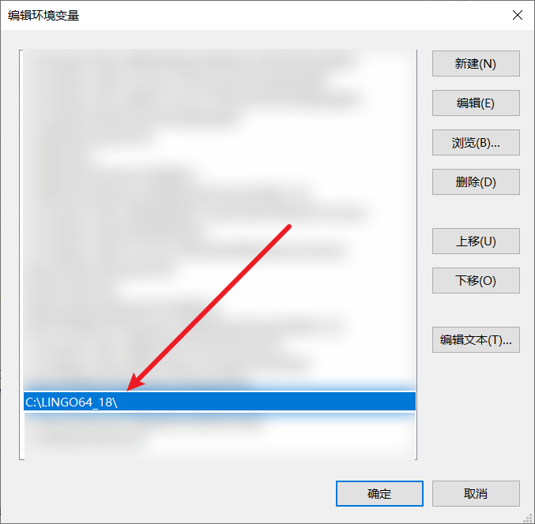

该文件夹下的 `RunLingo.exe` 即可在命令行中使用的LINGO程序，Linux版本中同理

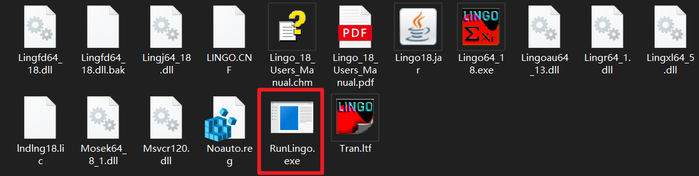

可在Powershell中输入`runlingo`命令检查是否可以使用

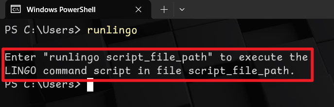

出现上述内容则证明可用


Ubuntu同理安装deb版本的应用即可

这里请注意，在Ubuntu中，可以先安装应用，随后直接将安装的软件打包复制到不含桌面应用的服务器中，这样即可实现在终端中直接使用Lingo，也可以结合code-server使用，但是会出现无法避免的只能试用免费试用的license的问题

## 配置VSCode

> 这里由于已经配置过了，使用的是insiders，标准版本相同

### 插件下载

#### Lingo language support

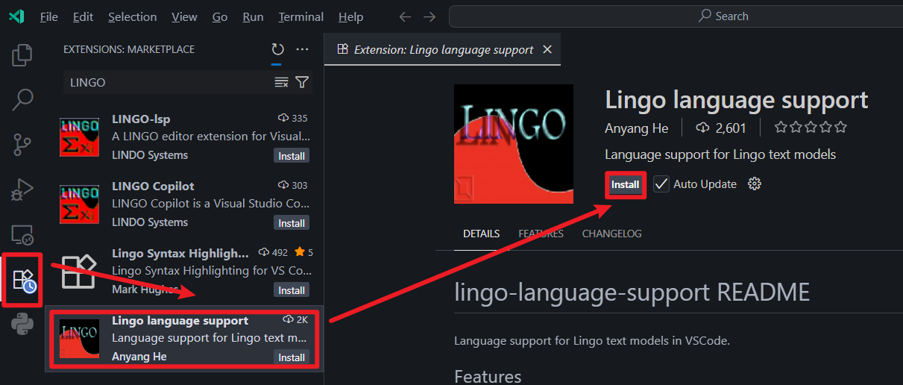

#### Code Runner

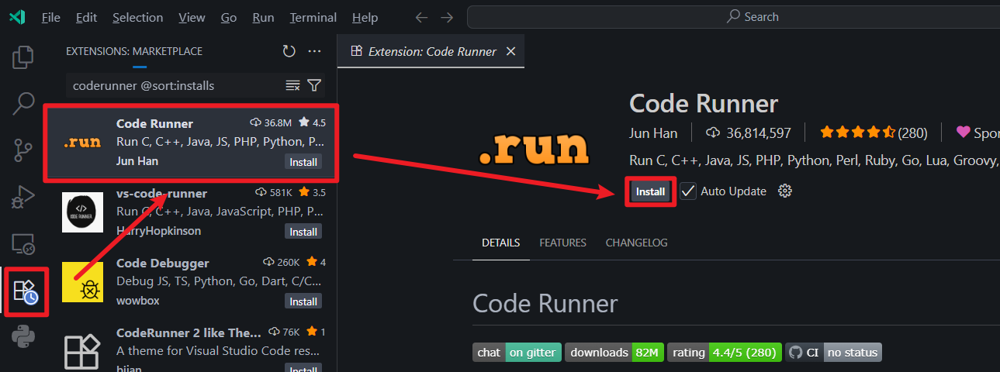

### 配置参数

修改Code Runner配置

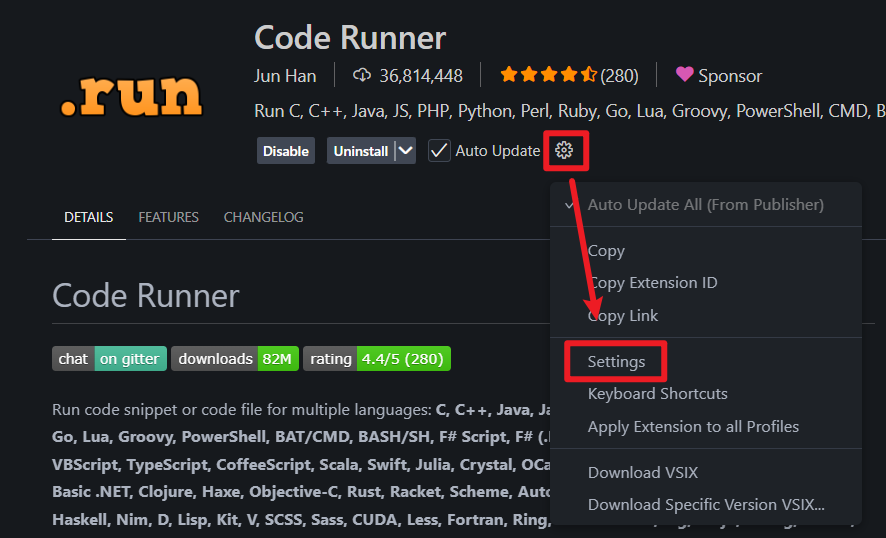

勾选下面的三个选项，方便在终端中查看

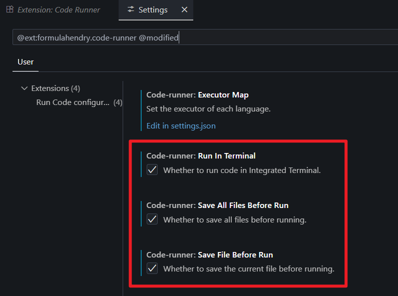

修改Executor Map

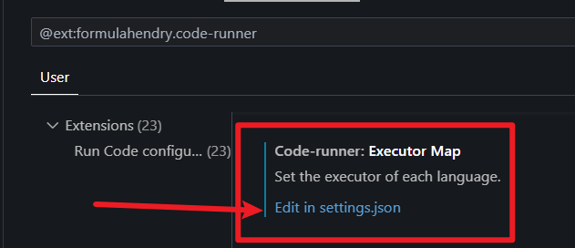

在`code-runner.executorMap`中加入下面内容:

```
"lingo" : "cd $dir && runlingo $fileName",
```

意为进入文件所在文件夹，并使用runlingo运行文件

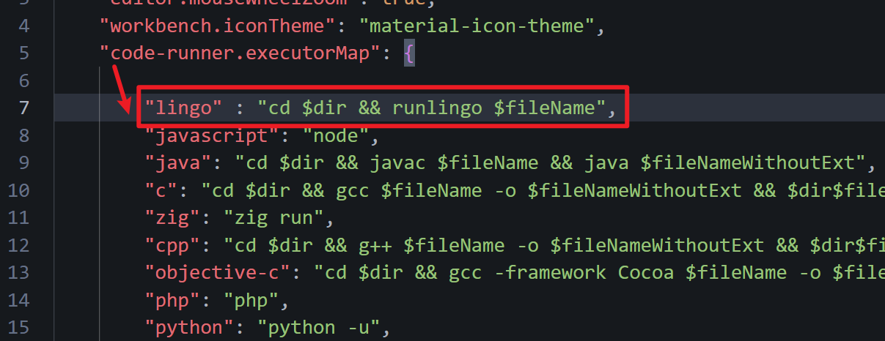

为lingo添加后缀识别

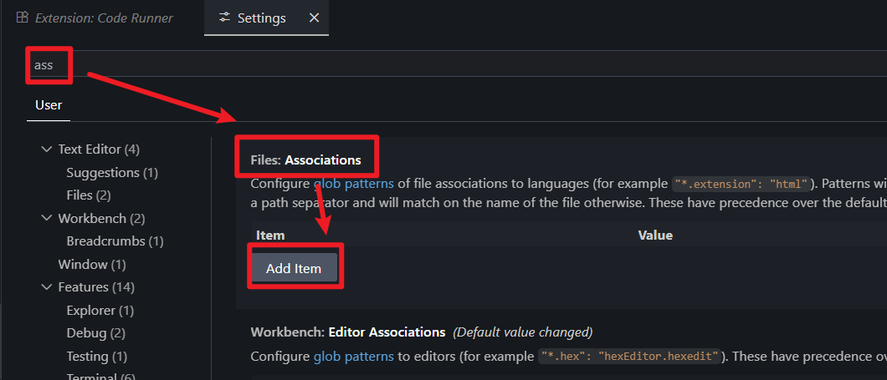

| Item | Value |

| --- | --- |

| _.lg4 | lingo |

| _.lng | lingo |

| *.ltf | lingo |

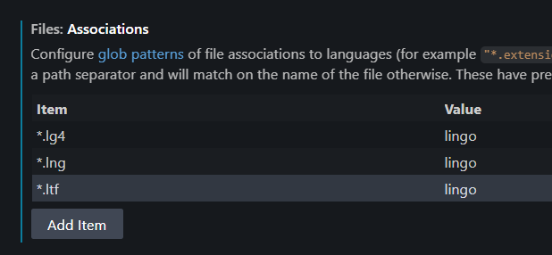

新建一个lng文件，即可发现自动识别并出现代码提示

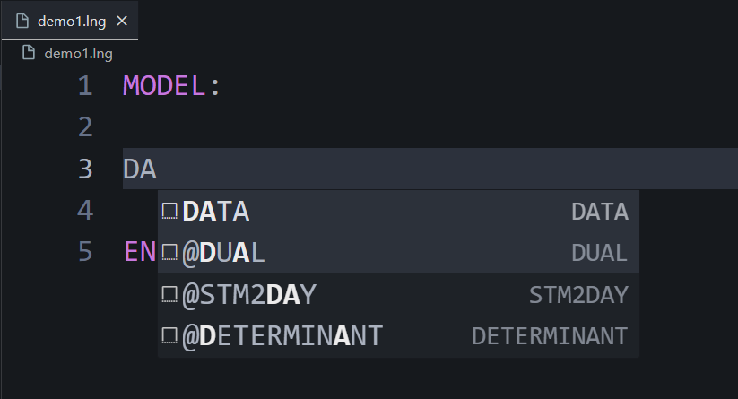

### 用户代码片段

编辑方面使用的用户代码片段


CTRL + SHIFT + P 呼出命令窗，搜索snippets，并选择`Snippets: Configure Snippets`

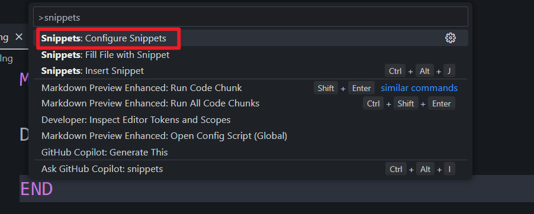

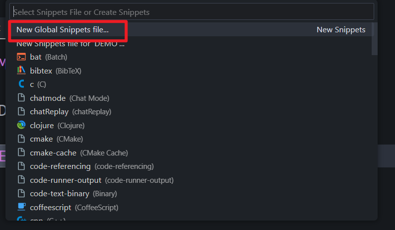

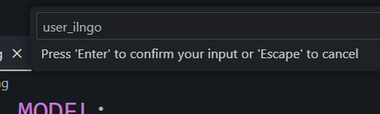

这里也可以搜索lingo创建其专属的用户代码片段

修改文件内容为：

```
{
  "LINGO FULL": {
    "prefix": "lingo",
    "body": [
      "MODEL:",
      "TITLE: ;",
      "",
      "$0",
      "",
      "END",
      "GO",
      "DIVERT solu_${TM_FILENAME_BASE}.txt",
      "SOLUTION",
      "RVRT"
    ],
    "description": "Lingo FULL MODEL"
  },
  "LINGO TAIL": {
    "prefix": "run lingo",
    "body": [
      "",
      "GO",
      "DIVERT solu_${TM_FILENAME_BASE}.txt",
      "SOLUTION",
      "RVRT"
    ],
    "description": "Lingo Run"
  }
}
```

## 快速使用

### 仅运行

在源代码的最后添加一个`GO`即可，按右上角的运行按钮运行

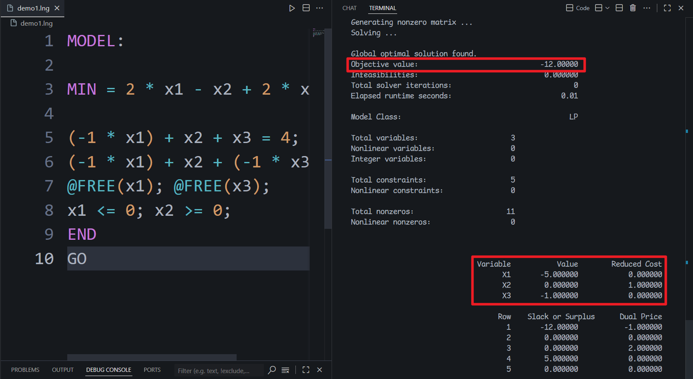

在源代码的最后添加一个`GO`和`RANGE`即可，按右上角的运行按钮运行，则可运行并添加灵敏度分析

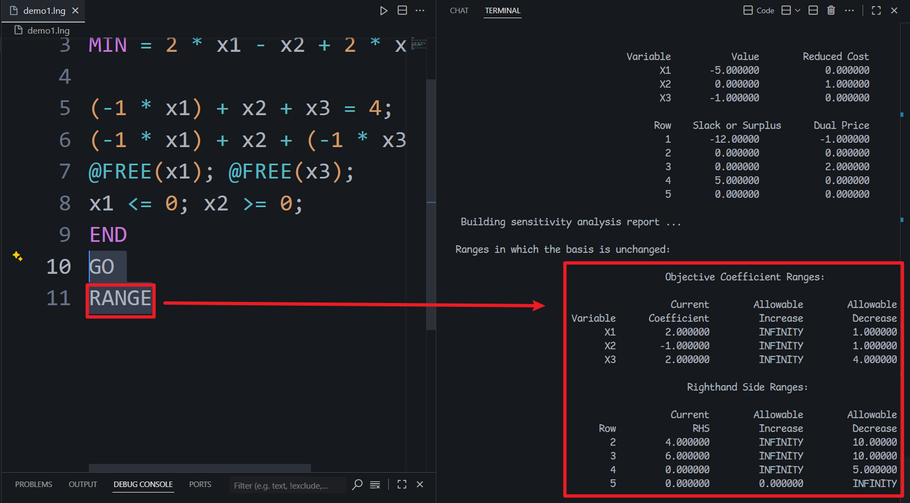

### 使用代码片段

输入`run lingo`并回车，补全尾缀

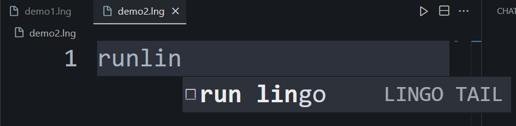

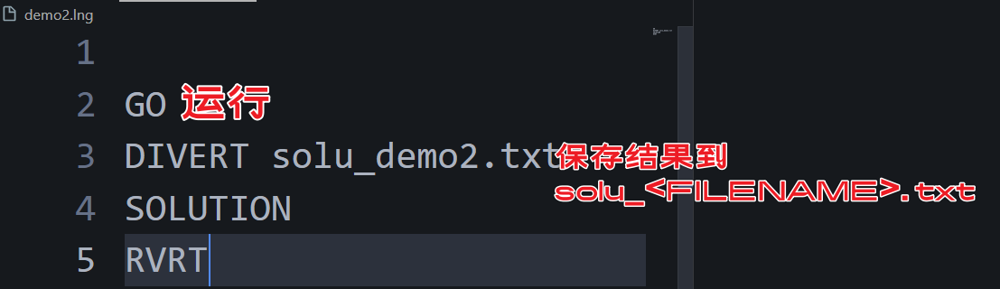

输入`lingo`补全完整结构

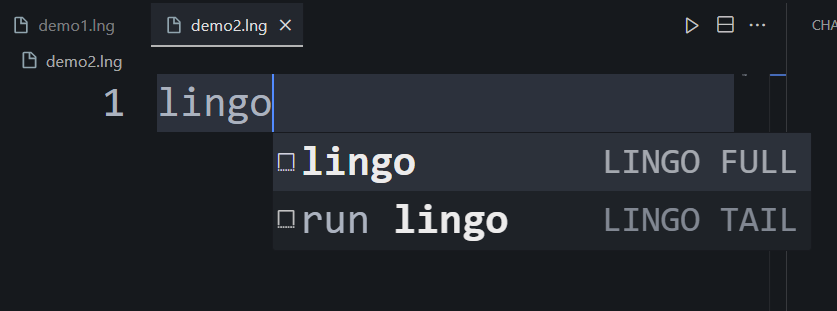

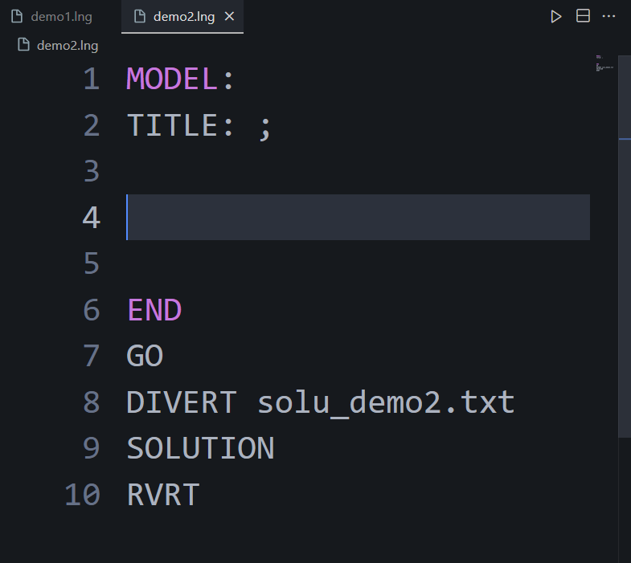

结果保存展示

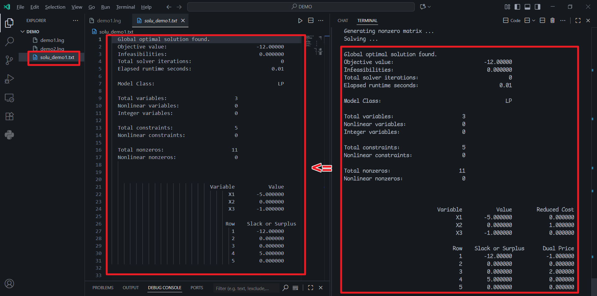

推荐数据保存还是在DATA中使用使用`@text('<OptFileName.txt>')=<VAR>;`


---


*来源: https://linux.do/t/topic/1542051.json*

