---

id: 1561917

title: "免费低门槛获取一些服务器玩openclaw的途径。（欢迎各位佬补充修改编辑。）"

created_at: 2026-02-03T16:05:22.348Z

username: renran

display_username: "renran"

---

# 免费低门槛获取一些服务器玩openclaw的途径。（欢迎各位佬补充修改编辑。）

1. **腾讯云cloud studio**

[Cloud Studio_在线编程_在线IDE_WebIDE_CloudIDE_腾讯云](https://cloud.tencent.com/product/cloudstudio)

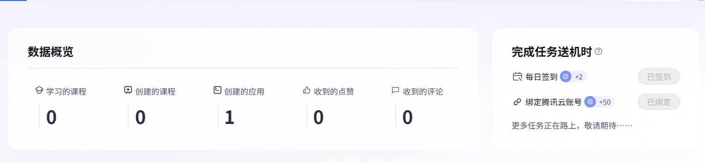

腾讯云的配置挺不错的，给的地区是香港的（好像没有了？关掉一会就开不出来了？？！）。

**实测1核2G的配置也可以带的动，建议先使用2核心4G的配置好，再降配，这样可以获得一个凭签到就可以活的更长的openclaw**

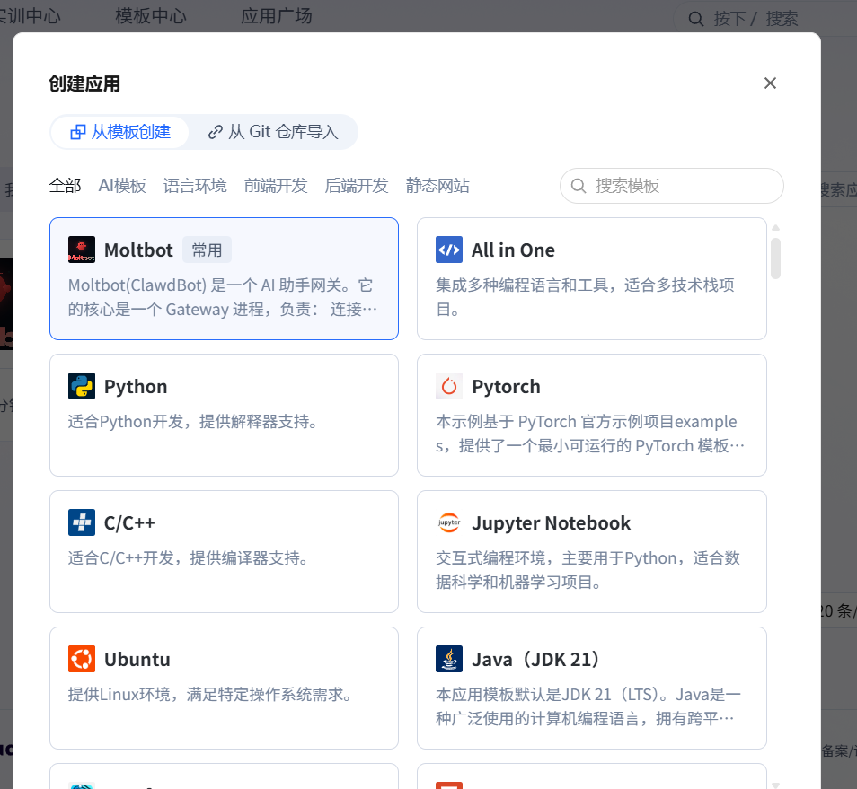

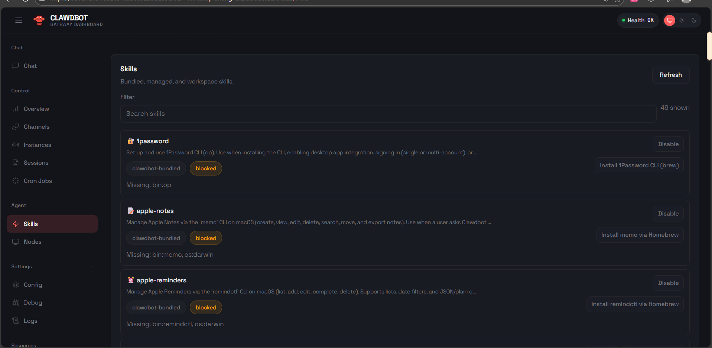

如果有佬想用其他版本的，也可以使用它的ubuntu环境来搭建。

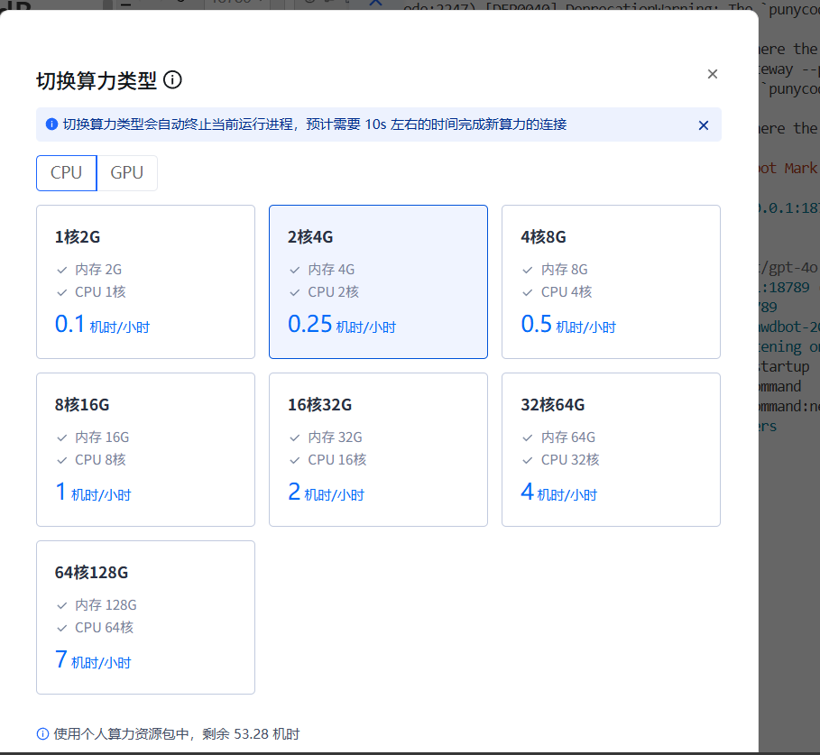

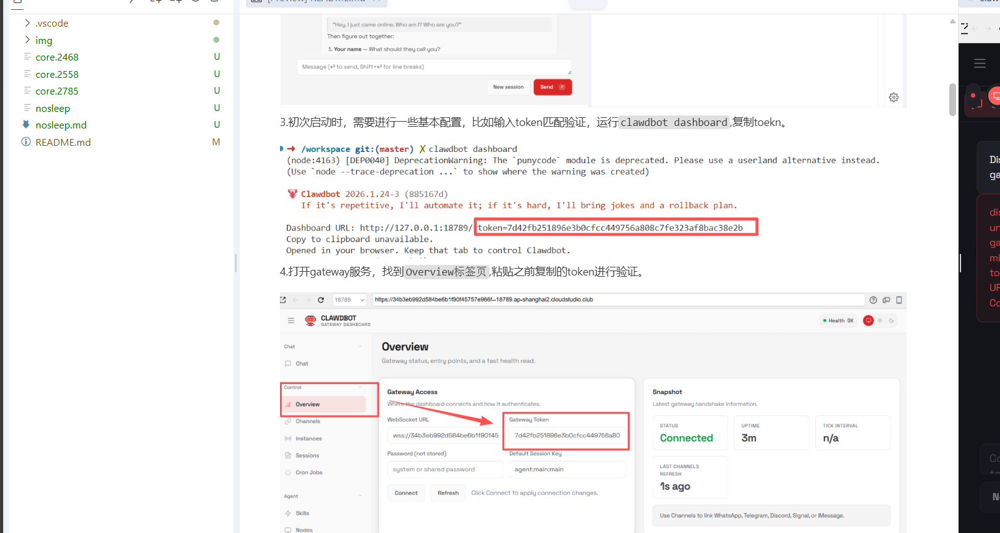

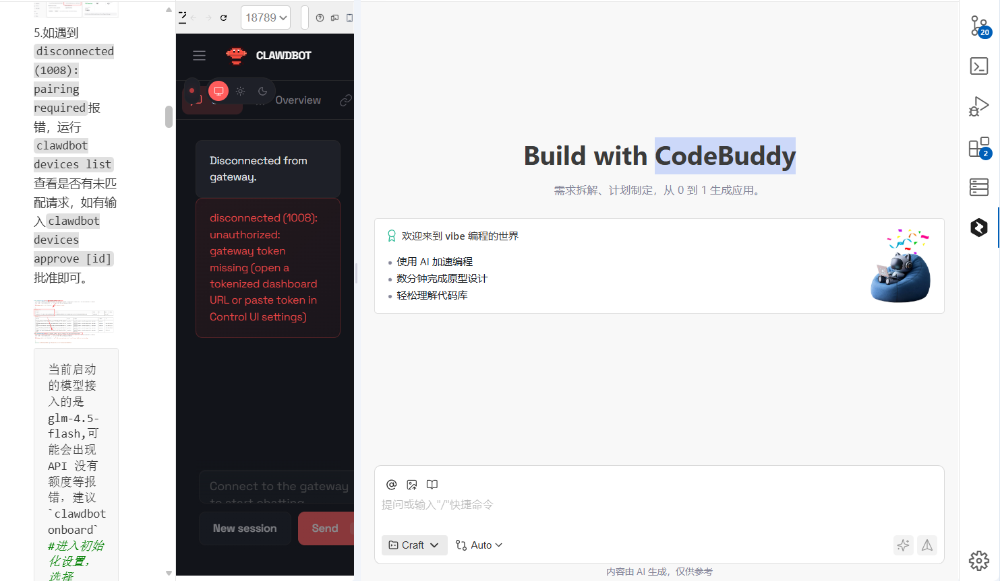

*当前***来说是腾讯云非常良心的**，（注意，腾讯云的**签到积分是只有7天的有效期**的，不要当囤囤鼠）而官方说的是1天有效期。

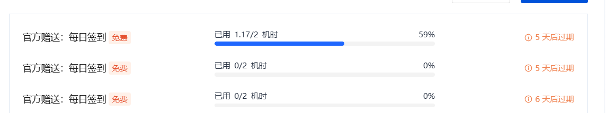

1. **天翼云一个月Windows服务器**

[开箱即用OpenClaw，AI云电脑秒变您的7x24小时全能AI助理-天翼云电脑（政企版）-最佳实践 - 天翼云](https://www.ctyun.cn/document/10027004/11091012)

Windows用户狂喜，上手简单，不过好像只给不到一个月的了，28天。不过它换第三方AI提供商是我目前见到的最容易的了，配置是4核心8G的。用起来感觉十分顺手。

领取后登录地址：[https://pc.ctyun.cn/](https://pc.ctyun.cn/)

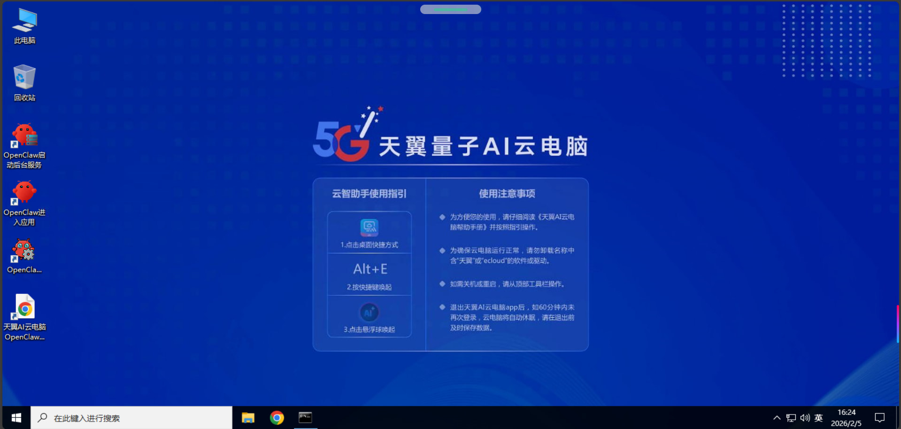

1. **华为云开发者计划**

[华为开发者空间_Huawei Developer Space_开发者空间_开发者平台-华为云](https://developer.huaweicloud.com/space/developerspace.html)

华为云也提供类似的活动，不过一切都要自己配，给720核时（一年总），可开4核8G的国内服务器，不过网络环境好像没有优化，拉取时动不动就断。不过现在好像也不用向以前一样要过一段时间就点击续期按钮了，可以长期运行了。

1. **华为云沃土云创计划**（十年免费高配服务器获得渠道）

[开发者空间-华为云](https://developer.huaweicloud.com/space/incentive/program-activity/personal-common/apply/A111111)进去后点击通用权益的申请。

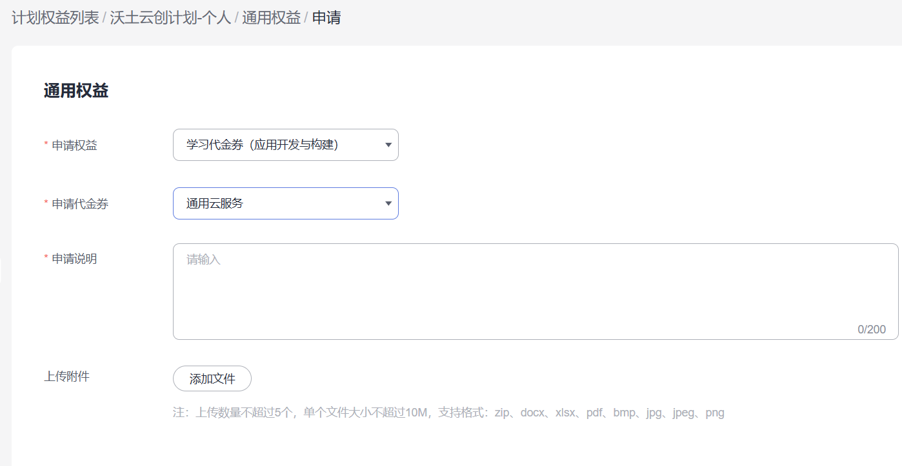

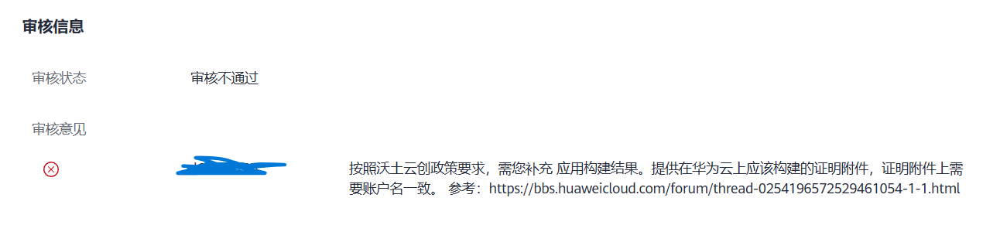

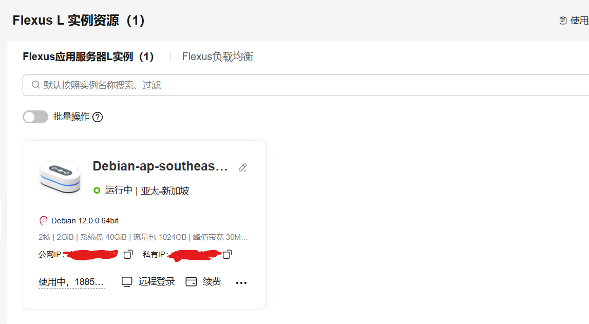

1. **腾讯云codbuddy的活动**

### [登录 - 腾讯云](https://cloud.tencent.com/login?s_url=https%3A%2F%2Fcloud.tencent.com%2Fact%2Fpro%2Fcodebuddy-lighthouse%3Ffrom_column%3D20421%26from%3D20421)

腾讯云为数百万的企业和开发者提供安全、稳定的云服务器、云主机、CDN、对象存储、域名注册、云存储、云数据库等云服务，帮助用户解决游戏、视频、移动、微信、互联网+等行业的架构难题，是全球领先的云计算服务商。

如果觉得时间太短，可以通过腾讯云codbuddy的活动获得3个月的服务器（2核2G），其中可以使用应用镜像。其中包含openclaw服务器。

1. **GitHub的github codespace**

**GitHub Free 个人账户**：每月免费 120 核心小时（相当于在 2 核机器上运行 60 小时(2.5天)），以及 15 GB 存储空间。

**GitHub Pro 账户** ：每月免费 180 核心小时（相当于在 2 核机器上运行 90 小时（3.75天）），以及 20 GB 存储空间

注意，直连极慢，界面很卡。

1. **阿里云无影云电脑**

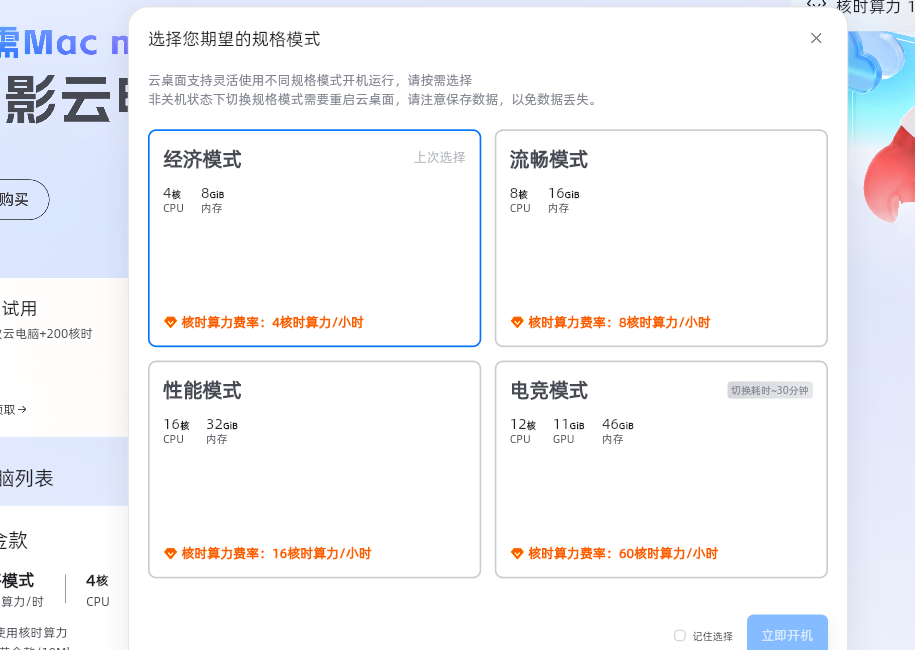

阿里云的无影云电脑为未使用过无影云的用户提供400核时的用量[200核时（一个月）+200核时（一年））]。提供openclaw镜像，用户无需过多操作。默认最低配置为4核8G（4核时一小时）（4天连续）.

获取更多阿里云无影云电脑核时的兑换码:

[https://linux.do/t/topic/1617089?u=renran](https://linux.do/t/topic/1617089)

感谢icybreaker佬的探路，可以通过这个兑换码获得720核时。

登录地址:

### [无影云电脑](https://wuying.aliyun.com/)

wuying

1. **自己电脑的虚拟机**

一般来说个人电脑配置是绝对够的，可以使用vmwave这样的软件开虚拟机。

但是有风险。

谨慎考虑，我开了一台（2核心4G的），直接导致我电脑完全卡死。重启后，恢复正常。再试，又不得不重启一次。使用的是Ubuntu22.04的iso.

在这些途径中，（个人）使用虚拟机体验感最差,同时使用虚拟机会出现不便。不建议新手尝试。

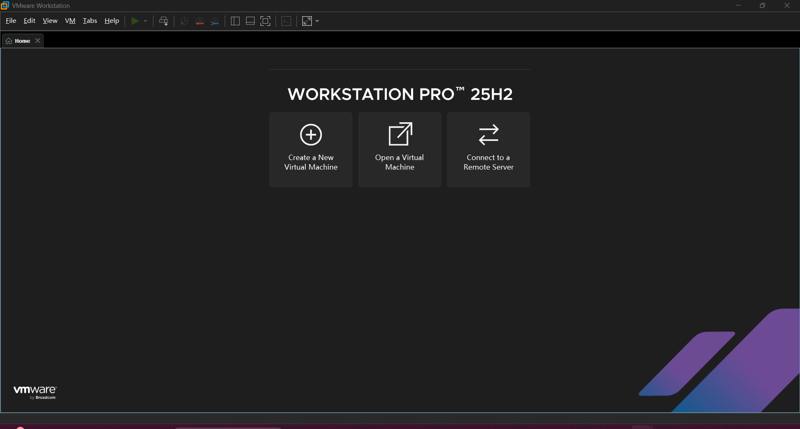

1. **百度云的1分钱一个月的openclaw活动**

活动地址

### [快速部署OpenClaw 定制 AI 助手-百度智能云](https://cloud.baidu.com/product/BCC/moltbot.html)

OpenClaw（Clawdbot）超级智能助理，7×24 小时全天候在岗，通过消息应用接收任务指令并精准执行。

1分钱跟白送没什么区别了。更重要的是它已经配置好了，可以直接上号玩。

1. **各大厂商云服务器的试用活动**

因其无人不知，故不赘述

[https://linux.do/t/topic/117865?u=renran](https://linux.do/t/topic/117865)

仅供参考，因为这个帖子的创建时间有一点久了。

1. **雨云的签到活动**

地址

### [雨云 - 新一代云服务提供商](https://app.rainyun.com/)

欢迎来到以用户体验为优先的雨云，我们提供稳定高速的云服务器、游戏云、物理服务器，强大的功能，高效率的客户支持，简洁易用的面板，值得您的信赖

纯娱乐，如果急着用就不要去搞。每次签到获得500积分，大约签到120天就可以获得一个月的云服务器了（2核2G）。（有一直玩养成游戏的感觉？其实积分如果积攒太长时间，反而舍不得用了。）

- 其他途径(docker类型)：

1.[魔搭社区](https://www.modelscope.cn/home) ，详细信息见[Brunoy佬的帖子](https://linux.do/t/topic/1702573/1)，**体验感很好，强烈推荐！！！**

2.[zeabur](https://zeabur.com/)（注册需要验证手机号）的五美元赠金（容器）（也需要保活，同时启动越来越困难。）(该渠道当前存在不确定性，详细可见[Lonely佬的帖子])( [Zeabur 免费共享集群即将收费](https://linux.do/t/topic/1639491) )【该途径已失效】

3.[clawcloud](https://console.run.claw.cloud/signin)（6个月的GitHub注册）（容器），每个月赠送5美元额度。每个月必须登录一次（免费层要求）【该途径已失效】

4.[sealos](https://bja.sealos.run/)(github注册)赠送5元额度（容器），后续不再赠送。若使用国内区域容器，需要实名认证。

4.[docker官方](https://app.docker.com/)，注册并验证邮箱，手机号，银行卡，会获得7天的试用额度。

5. [钢铁龙虾](https://www.ironclaw.com/)，来源信息： [白嫖钢铁龙虾，5刀订阅版本目前免费，带docker环境](https://linux.do/t/topic/1659340)  使用条件未知，未尝试待补充。

**API额度**

**最后给一个免费GLM-5的渠道吧**，只适合体验一下，额度很少（注册可领5美元）。详细可见：

[（赠金减少，但是它增加了GLM 5渠道）一个免费开源模型渠道](https://linux.do/t/topic/1544991)

还能用，可以直接使用API调用，速度比英伟达的快（**速度约30-50token每秒**）注：没感觉到排队。

**编辑此贴须知：**

**1.不可以编辑与此贴主题无关内容。**

**2.服务器或容器类的申请条件应该尽可能标注清楚。（如需要银行卡验证，手机号注册等，尤其涉及国外服务商类的）**

**3.绝不可以放置一些非常规手段才可以获得的福利。**

---

*来源: https://linux.do/t/topic/1561917.json*

