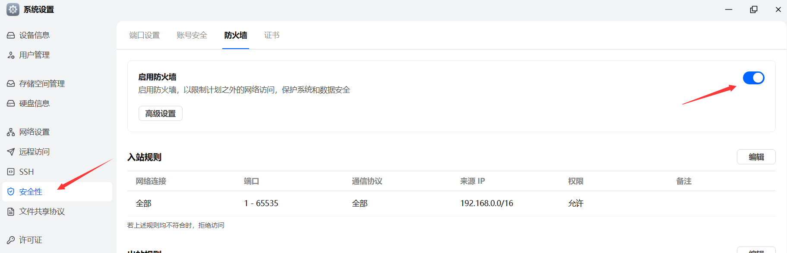
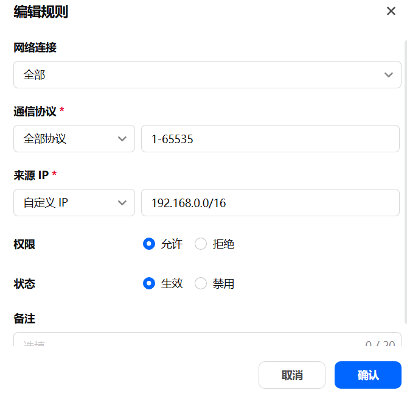
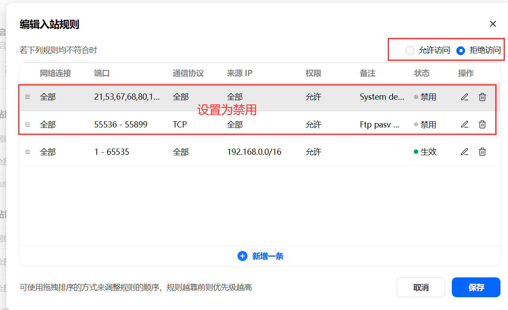
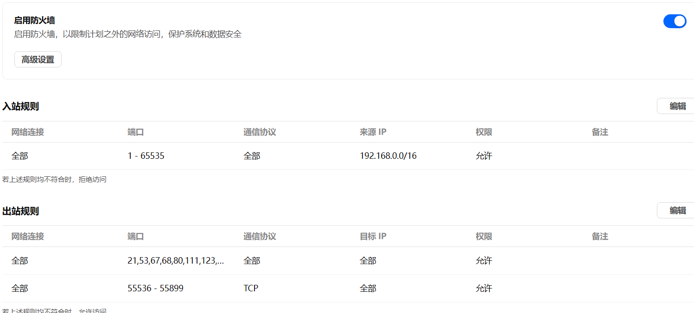

---

id: 1566342

title: "飞牛OS 关闭公网访问，只允许局域网访问"

created_at: 2026-02-04T16:34:55.199Z

username: k452b

display_username: "干啥啥不行"

---

# 飞牛OS 关闭公网访问，只允许局域网访问

**不要跳步：** **必须先设置允许局域网访问，最后再改为拒绝默认访问**。如果顺序反了，无法登录后台！

1. 登录飞牛OS桌面。

2. 打开 **【设置】** > **【安全性】** > **【防火墙】**，点击开关，**启动防火墙。**

3. 找到 **【入站规则】** 区域，点击 **【编辑】**，点击 **【新增一条】**。按照以下参数填写规则：

**策略：** 允许

**协议：** 选择 **【全部协议】** (TCP/UDP)

**端口：** 填写 `1-65535` （代表开放所有端口）

**来源IP：** 填写 `192.168.0.0/16`

这个写法涵盖了 `192.168.0.x` 到 `192.168.255.x` 的所有家庭常见网段。

**备注：** 填写 “局域网放行”

4. 默认的两条规则设置为禁用。“若上述规则均不符合时，允许访问”，将其修改为： **【拒绝访问】**，点击 **【保存】**。

5. 其他不用修改，最后结果如下。

[飞牛OS 防火墙错误设置无法访问](https://linux.do/t/topic/1566393)

---

*来源: https://linux.do/t/topic/1566342.json*

