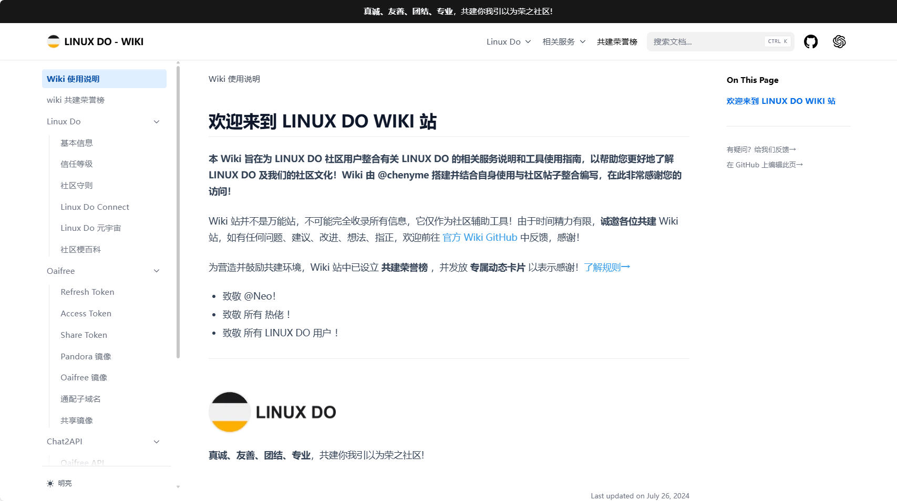
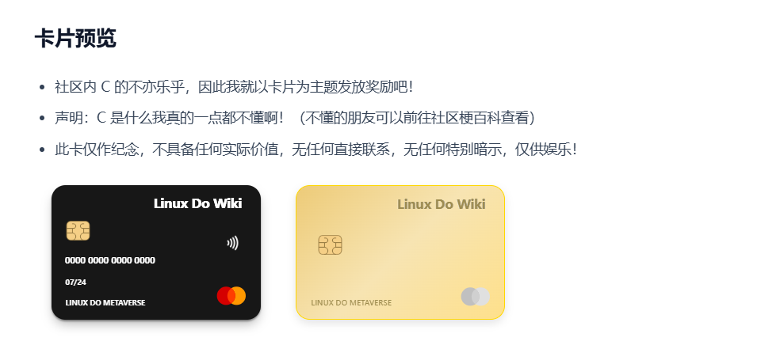

---

id: 157048

title: "【号外】Linux Do Wiki 站 | wiki.linux.do 现已上线！"

created_at: 2024-07-23T05:43:23.516Z

username: Chenyme

display_username: "Chenyme"

---

# 【号外】Linux Do Wiki 站 | wiki.linux.do 现已上线！

# Linux Do Wiki  | [wiki.linux.do](http://wiki.linux.do) 现已上线！

**真诚** 、**友善** 、**团结** 、**专业**，共建你我引以为荣之社区，恭喜 **Linux Do 元宇宙** 再添一员！

（后来的佬麻烦评论区帮顶一顶！感谢！）

---

**本 Wiki 旨在为 LINUX DO 社区用户整合有关 LINUX DO 的相关服务说明和工具使用指南，以帮助您更好地了解 LINUX DO 及我们的社区文化！ Wiki 由 @chenyme 搭建并结合自身使用与社区帖子整合编写，欢迎各位热佬和萌新前往 WIKI 查阅！**

Wiki 站并不是万能站，不可能完全收录所有信息，它仅作为社区辅助工具！由于时间精力有限，**如有任何问题、建议、改进、想法、指正** 都可以前往官方 [WIKI - GitHub](https://github.com/Chenyme/Linux-Do-Wiki) 反馈！

## 感谢我们的共建者

---

## 共建榜相关说明

---

为营造并鼓励共建环境，秉着**真诚、友善、团结、专业，共建你我引以为荣之社区的精神**。现对所有社区热佬提交的 Issue/PR ，在成功采纳后 将依据 Wiki 站共建奖励制度，按照相应规则向各位共建者发放 **专属动态卡片** 或 其他奖励 以表示感谢！

**反馈参与地址**：[Linux Do Wiki 官方 GitHub](https://github.com/Chenyme/Linux-Do-Wiki)，若 已达标/可升级/被遗漏，请及时私信 [@chenyme](https://linux.do/u/chenyme/summary)

## 奖励分数表

---

| 类型 | 事件内容 | 分数 |

| --- | --- | --- |

| Issue | 成功采纳 | 15 |

| Issue | 标记为建设性、重要 | 50 |

| PR | 成功合并 | 25 |

| PR | 标记为建设性、重要 | 75 |

## 奖励一览表

---

分值明细公示：[Wiki 站共建反馈情况公示](https://zwho5v3j233.feishu.cn/base/UAGzbp3LQa5kpMsGnoicWgTvnLc?from=from_copylink)。

| 条件 | 奖励 |

| --- | --- |

| PR 成功合并 | 在 GitHub 鸣谢 |

| 累计 50 分 | 获得专属动态 **黑卡** |

| 累计 150 分 | 升级为专属动态 **白金卡**，并置顶显示 |

| 累计 500 分 | 目前还没想好，欢迎大家提Issue |

## 反馈格式和说明

---

为了方便更好的管理和维护 Wiki 站，在提交 Issue/PR 时请遵循一定的格式！

- PR 时请遵循项目框架 Nextra 的编写规范

- PR 在 Merge 后会在每晚定时更新

- Issue/PR 提交时的格式和说明 ：

| 标题 | Issue 内容 |

| --- | --- |

| 【建议】xxx 页面的 xxx 内容 | 建议的内容 + 理由 + 相关词条 + 社区个人主页链接 |

| 【错误】xxx 页面的 xxx BUG | 报告 xxx 页面 xxx BUG + 具体情况 + 社区个人主页链接 |

| 【修复】xxx 页面的 xxx BUG | 修复 xxx 页面  xxx BUG + 社区个人主页链接 |

| 【更正】xxx 页面的 xxx 内容 | xxx 页面 需要更新的内容 + 社区个人主页链接 |

| 【新增】xxx 页面的 xxx 内容 | xxx 页面 需要新增的内容 + 理由 + 社区个人主页链接 |

| 【改进】xxx 页面的 xxx 内容 | xxx 页面 需要改进的内容 + 理由 + 社区个人主页链接 |

## Wiki活动

---

[https://linux.do/t/topic/158178支持](https://linux.do/t/topic/158178%E6%94%AF%E6%8C%81)

---

*来源: https://linux.do/t/topic/157048.json*

