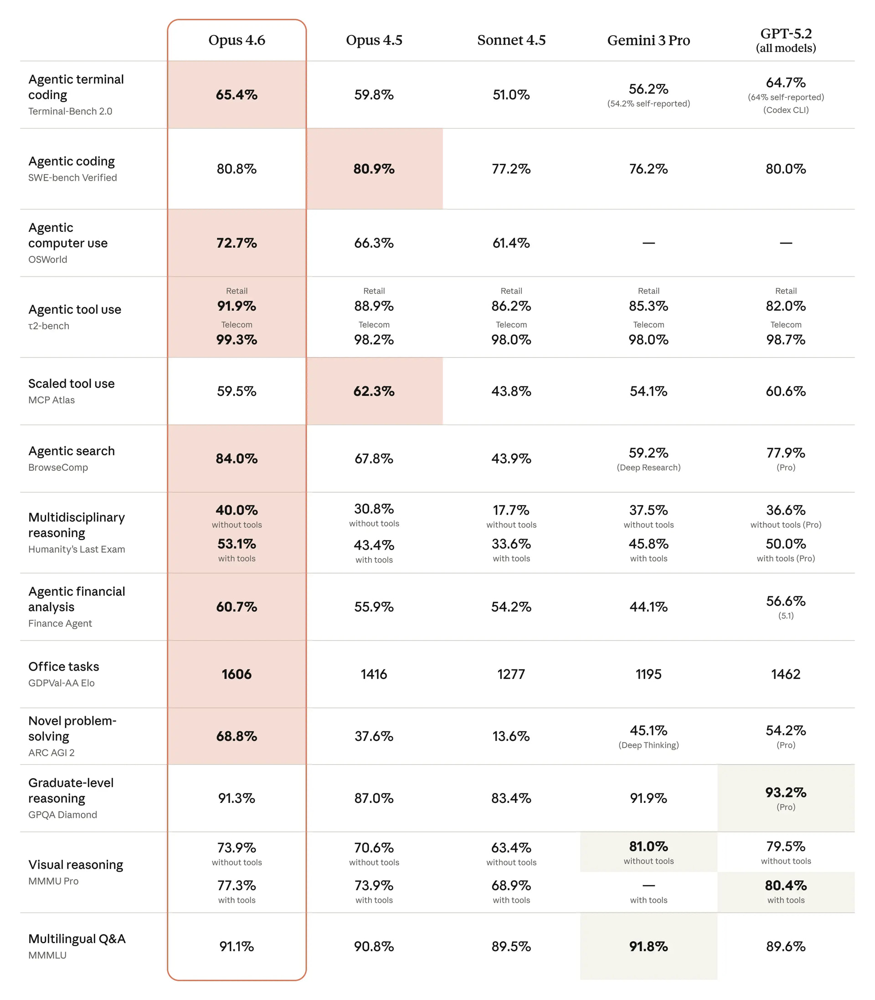
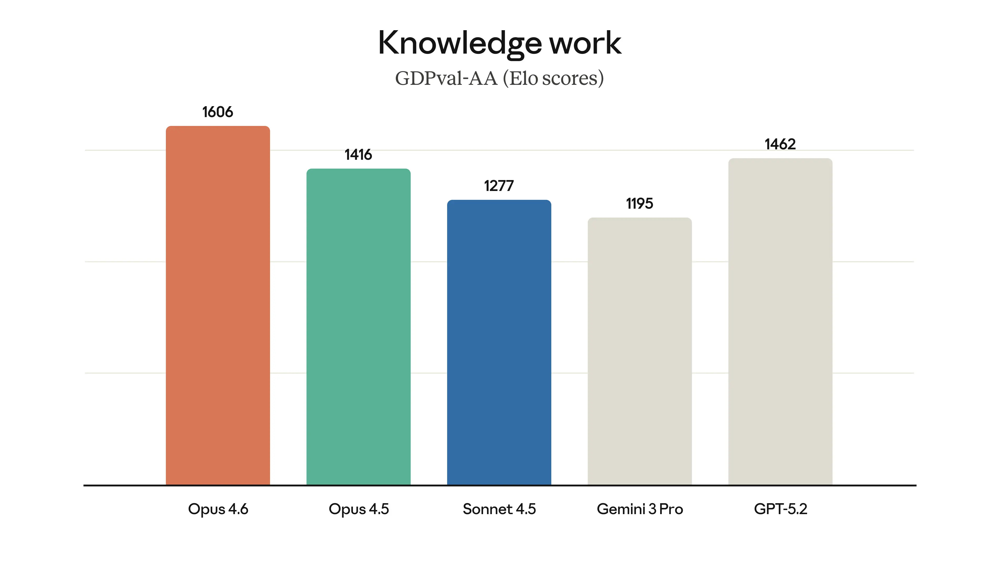
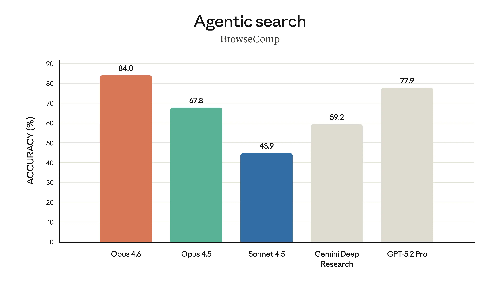
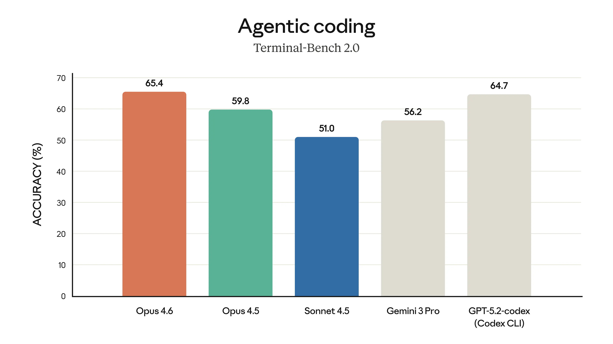
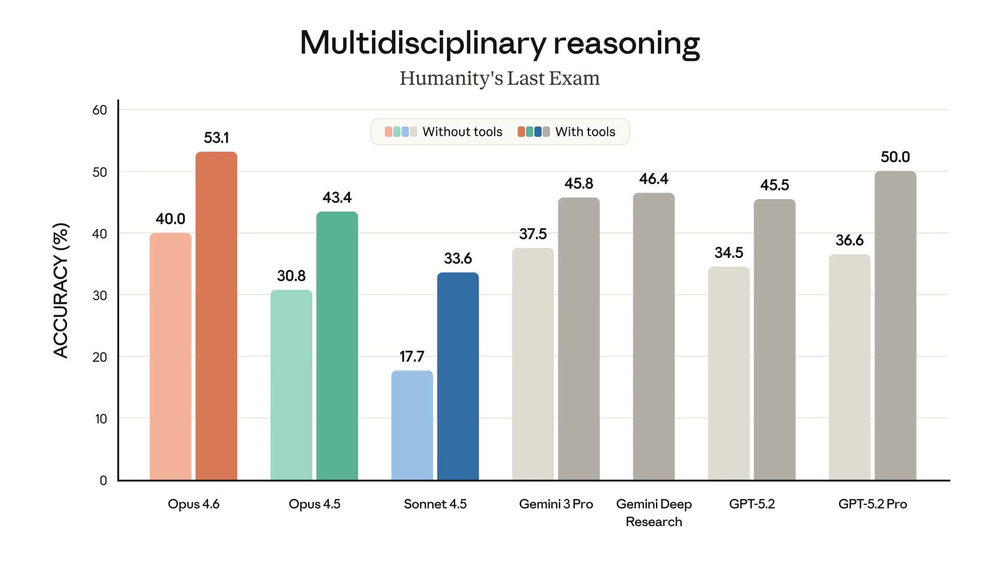
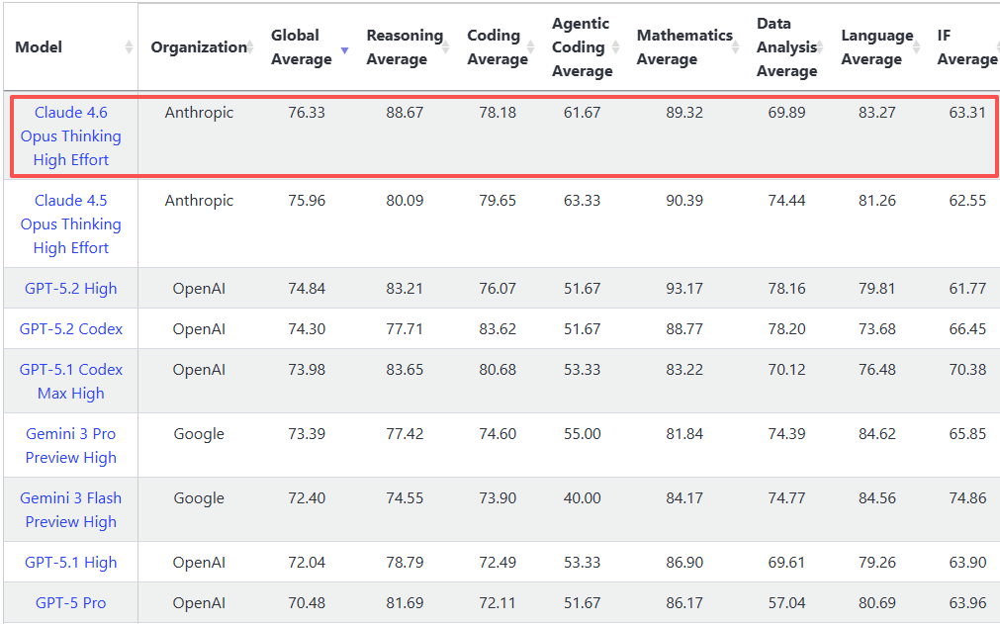
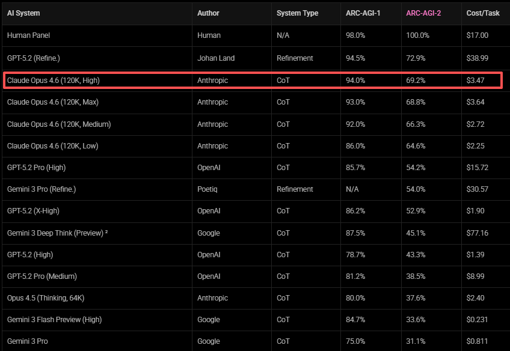

---

id: 1570860

title: ":fire:【大模型系列20】关于Opus-4.6，你想知道的一切【底楼更新METR评测】"

created_at: 2026-02-05T22:23:34.513Z

username: dwqxq1

display_username: "dwqxq1"

---

# :fire:【大模型系列20】关于Opus-4.6，你想知道的一切【底楼更新METR评测】

### 官方资料

官方介绍：[https://www.anthropic.com/news/claude-opus-4-6](https://www.anthropic.com/news/claude-opus-4-6)

系统卡：[https://www-cdn.anthropic.com/0dd865075ad3132672ee0ab40b05a53f14cf5288.pdf](https://www-cdn.anthropic.com/0dd865075ad3132672ee0ab40b05a53f14cf5288.pdf)

价格不变，输入$5，输出$25

但超过200k输入$10，输出$37.5

上下文从200k提升到1000k

最大输出(含思考和实际输出)从64k提升到128k

训练时间25年5月没变

速度比较慢只有40tps左右

---

---

## 评分

### LiveBench

来源：[https://livebench.ai](https://livebench.ai)

---

### ARC-AGI-2

来源：[ARC Prize - Leaderboard](https://arcprize.org/leaderboard)

---

### LMArena 截止到260206 06:21未上线

来源：[Arena Leaderboard | Compare & Benchmark the Best Frontier AI Models](https://arena.ai/leaderboard)

---

### Humanity’s Last Exam 截止到260206 06:21未上线

来源：[Humanity's Last Exam | SEAL by Scale AI](https://scale.com/leaderboard/humanitys_last_exam)

---

## Chat渠道

### 官网App 已上线

需要会员

### OpenRouter Chatroom 已上线

消耗自己API

来源：[AI Chat Playground - Compare AI Models Side by Side | OpenRouter](https://openrouter.ai/chat?models=anthropic/claude-opus-4.6)

### LMArema 截止到260206 06:21未上线

### 其他：Lovable 已上线

---

## IDE渠道

### Claude Code Cli/VSCode插件 已上线

### Cursor/Copilot/Windsurf/Bold/Cencori 已上线

### Antigravity 截止到260206 06:21未上线

---

## API渠道

### OpenRouter 已上线

来源 [Claude Opus 4.6 - API, Providers, Stats | OpenRouter](https://openrouter.ai/anthropic/claude-opus-4.6)

---

最后发张梗图，祝佬友与gpt-5.3-codex和opus4.6玩耍愉快

---

*来源: https://linux.do/t/topic/1570860.json*

