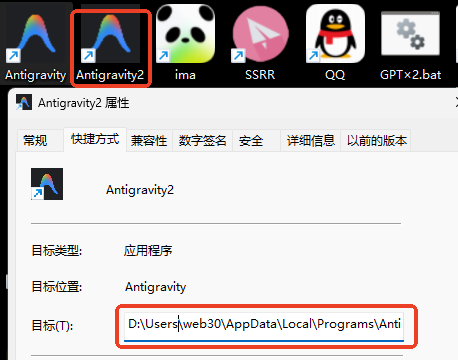
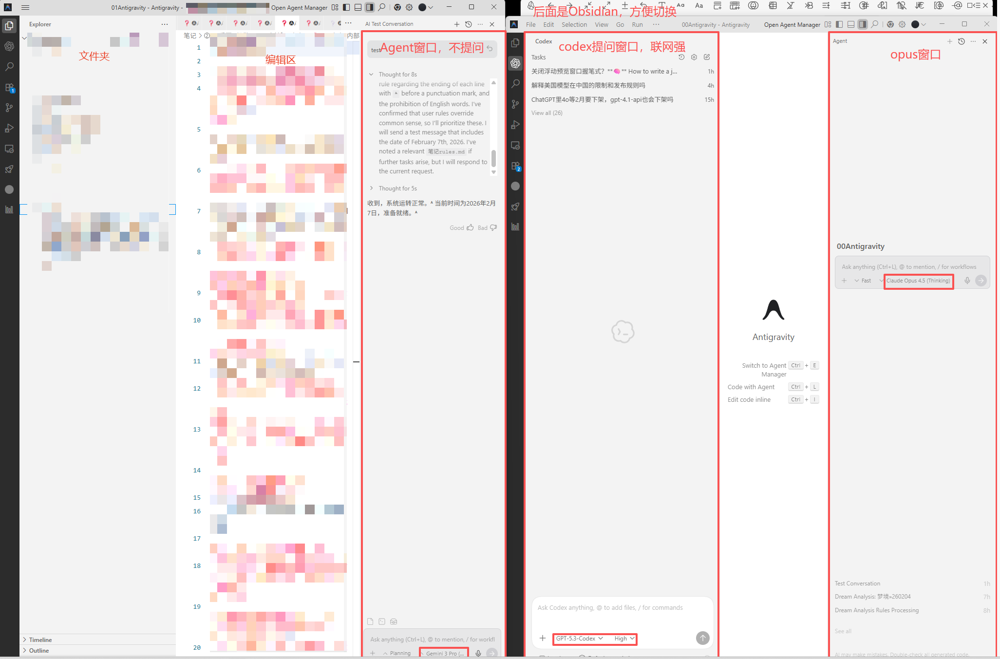

---

id: 1576410

title: "【IDE系列2】Antigravity双开，双账号同时登录，gemini/opus/codex三窗口一起开"

created_at: 2026-02-07T06:42:09.831Z

username: dwqxq1

display_username: "dwqxq1"

---

# 【IDE系列2】Antigravity双开，双账号同时登录，gemini/opus/codex三窗口一起开

以下是Windows11实测可行，Mac版不清楚

此方法是否容易引起风控暂不清楚，我自己双Antigravity一个月，暂时没碰到问题，但需谨慎

### 双Antigravity vs 双Window

双Antigravity是2个完全独立的Antigravity，是双开×单window

双Window是一个Antigravity开2个Window，即File → New window，是单开×双window，是完全不同概念

#### 双Antigravity方法

桌面Antigravity快捷方式 → 复制 → 粘贴 → 改名为Antigravity2

Antigravity2 → 右键 → 属性 → 目标…Antigravity.exe 后面加 `--user-data-dir="%APPDATA%\Antigravity2"`

运行Antigravity2 → 像新的Antigravity一样填写初始信息 → 自动生成新的用户数据文件夹，在`%APPDATA%\Antigravity2`

同理多开可建Antigravity3,4…

可以登录相同的Google Pro账号，两个Antigravity共享额度

也可以登录不同的Google Pro账号，两个Antigravity独立额度，减少额度用光的情况

#### 相似处

都能打开2个窗口

插件的安装和升级是共用的

GEMINI.md是共用的

升级Antigravity时同时升级

#### 双Antigravity优点

双Antigravity两边Chat选模式，选模型，不会自动同步。

双window会自动同步，比如你想一个窗口planning模式opus跑agent，一个窗口fast模式pro提问，会自动同步模式和模型，互相干扰很烦

双Antigravity需要两边用两个不同名称的auto-accept插件，使用不同cdp的端口(例如一个用9000，一个用9001)，如果用同一auto-accept插件，第二个Antigravity的auto-accept会无效

双Antigravity可以双Pro账号同时登录，双倍额度，不必切换账号。双window一次只能登一个账号

双Antigravity两边可以打开相同的workspace，双window不行

双window如果想共享文件，只能嵌套

例如window1打开workspace，file → new window打开workspace/2，内容全部写在 workspace/2 文件夹里

如果三Window共享文件，则要写到workspace/2/3里

方便gemini-3-pro，opus，codex，一问多答，比较答案

双Antigravity可以同时开两个Agent Manager，双window只能一个

#### 双Antigravity缺点

两边的settings.json设置，keyblindding.json快捷键，插件设置等，要分别设置一遍，不会自动同步

办法：跟ai说：把 %APPDATA%\Antigravity\User\settings.json和keyblindding.json 映射到 %APPDATA%\Antigravity2\User\

两个Antigravity的profile是独立的，多占用上百M容量

---

*来源: https://linux.do/t/topic/1576410.json*

