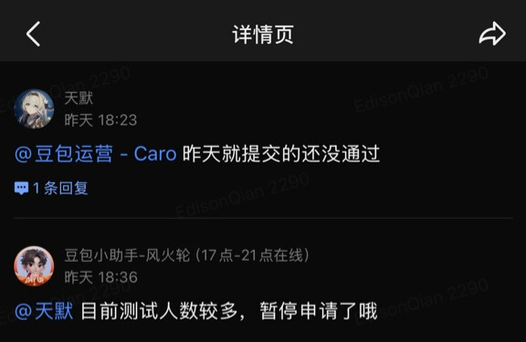
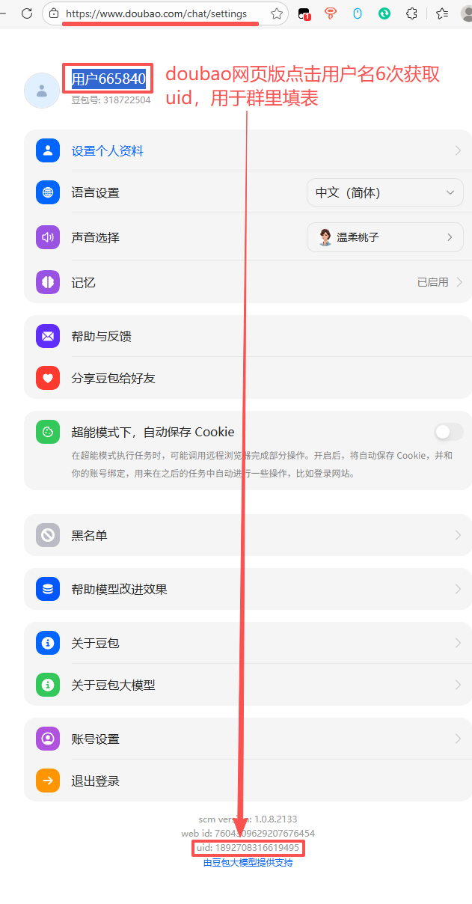

---

id: 1582785

title: ":fire:【图像视频系列4】关于Seedance2，你想知道的一切，性能碾压Sora2/VEO3.1【260326更新海外上市】"

created_at: 2026-02-08T02:49:17.451Z

username: dwqxq1

display_username: "dwqxq1"

---

# :fire:【图像视频系列4】关于Seedance2，你想知道的一切，性能碾压Sora2/VEO3.1【260326更新海外上市】

## Seedance2 vs Sora2

我Sora app里粉丝3万多，全球排名30多名，可能是中国人里排名最高的，还是很了解Sora2的

### 即梦新版App

即梦新版App上市了，界面99%像素级复刻Sora2 App

几个月前Sora2是  [@sama](/u/sama) 奥特曼出来打头阵

即梦是 @shou 周受资(TikTok CEO)，这是否意味着出境功能以后会进入抖音和TikTok，现在即梦和豆包里出境只是试试水呢？

考虑到Sora2在美国已经从App Store第一跌出前100，全面溃败，大势已去，Sora3出来之前，不太可能翻身了，即便Sora3出来之后也很难翻身

如果只靠即梦或豆包做AI视频，显然是重复Sora2老路，很难做起来的。

只有把出镜放到抖音/TikTok里，才有可能做大，并发挥抖音/Tiktok明星网红扎堆的优势

### 字节文生视频技术真的比OpenAI更先进吗？

不一定，sora2毕竟是4个月多前的模型了，现在已经过去至少半代的时间，我认为OpenAI研发中的文生视频(sora3)内部进度，有可能与seedance2差不多，甚至更先进

大模型行业的特点是，不管哪家新模型上线，都说自己是SOTA，或者倒过来，做不到SOTA都不敢拿出来上线。

基本是SOTA风水轮流转，比如gemini-3-pro当SOTA没多久，这两天又被opus4.6比了下去

### 出镜功能(录自己视频@自己或@别人生成视频）

只有豆包App，即梦App和Sora App有录制出镜功能

即梦网页版和小云雀网页版，国内国际版，小云雀App版，Sora网页版都没有录制出镜功能

都是要拍自己视频，念数字克隆声音，不能上传视频

豆包/即梦App版的出镜功能，对标Sora2的Cast in(以前叫Cameo)功能

Sora2不限出镜人数，但实际超过5人很容易混淆，即梦限3人+1道具

### 分辨率

seedance2是原生720p，在即梦网页里可以选提升为1440p(是超分1440p，与原生1440p没法比，貌似不扣积分)，豆包和小云雀不能提升

Sora2免费版是720p，OpenAI的Pro会员/API有1080p

### 时长

Sora2免费会员有10s和15s，$200会员有25s

豆包App有5s和10s，即梦网页版有4~15秒，小云雀网页版有5/10/15s

即梦网页版可以以1秒为单位，精确控制视频时长，即省钱，又减少剪裁工作，例如配音算字数说完大概几秒，就选生成几秒，Sora2是削足适履，选秒数太少说不完被截断，选秒数太多停顿等着或者自己瞎编词以免冷场

### 额度

Sora2免费版早期每天免费30条10s或15条15s，现在降为每天10条10s或5条15s

Sora2的$100会员，每天100条720p10s，或50条720p25s，或33条720p25s

豆包App现在内测是每天10条+即梦14秒+小云雀12秒

### 运镜/切镜

Seedance2好于sora2

### 视频拼接

Seedance可以用上一段视频做参考视频(积分翻倍)，一直连续做下去，音频不完全能接上，但风格相似

Sora2最多拼接60秒，不消耗次数，但是前后的音频是完全断开的，视频也断开，但可勉强理解为分镜，不像音频断开那么违和

### 打斗

Seedance2打击感明显好于sora2

Sora2打斗很肉，而且喜欢用切镜来跳过直接击打瞬间

### 运动

Sora2和Seedance2都有很多篮球视频，seedance2动作明显好于Sora2，而且还能让NBA明星出境

### 对九宫格分镜的理解

都能理解nano banana等生成的三宫格，四宫格，九宫格分镜，也都有丢分镜的问题

Seedance更好

### 体操等快速身体扭动

所有视频模型都处理不太好

Seedance2好于Sora2

### 动漫游戏ip

Seedance2限制少

Sora2第一个月比较宽松，之后就都不能用

### 明星

Seedance2限制少

Sora2在世明星都不能用，去世明星大部分可以用

中国明星，不管在世离世都不能用

### 上传参考图

Seedance2前几天可以上传真人，2月9日起名义上不行了，实际多传几次可以成功

最多上传12素材，包括9图，3视频 (合计≤15s)，3音频 (合计≤15s),

Sora2一直都不能上传真人，而且很严格，可以上传卡通和宠物，只能上传一张图

如果要上传多张需要自己先用工具合并成一张

### 上传参考视频

Seedance2支持上传参考视频和音频

Sora2不支持上传视频

Veo3.1可以上传视频，其他模型一般都不能上传视频

### Character功能

随便App里有原创角色，并且原创角色可以拥有自己独立的抖音号

Sora2有,上传图片或文生视频生成角色，@角色调用

### 价格

Seedance正价大约¥0.4/秒(无水印)，小云雀首月/年付首年可以半价

Sora2 app里超过每天10个免费额度，单买Credit大约¥0.28/秒(有水印)

Sora2 API¥0.7/秒(无水印)，逆向中转站¥0.01/秒

因为便宜，价格是国产正价几十分之一，所以国内漫剧工作室大量使用逆向Sora2

美国夜间时间，Sora2算力90%都是被逆向薅羊毛

### 水印

Seedance2免费有水印，即梦在左上角，小云雀在右下角，会员无水印

Sora2 App有水印，API大部分无水印

### 抽卡

Seedance2抽卡成功率高于Sora2

### 违规警告

seedance2较少

sora2很多，有时10个视频，五个违规，但通常给退积分

---

## Seedance2渠道

另外画图seedream 5.0在2月10日左右也将内测

每个手机号以下①②③合起来每天可以薅十几条2.0视频

不够用就换抖音号(手机号)

### ①即梦网页渠道

网址：[jimeng.jianying.com](http://jimeng.jianying.com)

网页有2.0，App出镜应该是2.0，不出镜貌似没有2.0

时间可以选4~15秒，颗粒度精确到1秒，720p

注册送2次+260积分，

买¥1试用会员才能用2.0，记得立即取消订阅，以免7天后被扣费，每个手机号试用只能买一次

每天送60积分，1秒6积分=¥0.4

年付有半价活动

图文非会员8c，视频13c/s；会员6c/s，视频13c/s

连续包月无折扣=¥69÷1080c=¥0.064/c积分，10s=60c=¥3.84

小套餐包年半价=¥330÷1080c÷12月=¥0.025/c，10s=60c=¥1.5

中套餐包年半价=¥950÷4000c÷12月=¥0.02/c，10s=60c=¥1.2

大套餐包年半价=¥2600÷15000c÷12月=¥0.014/c，10s=60c=¥0.84

### ②小云雀网页渠道

时貌似要手机版先注册，网页才能登上

网页有2.0，App也有

网址：[xyq.jianying.com](http://xyq.jianying.com)

是字节旗下内部赛马App，功能类似即梦，主打Agent一建出长片

时间只能5/10/15秒

账号积分与即梦完全无关，可同一个手机分别注册

注册送3次，1200积分，无需充值就能用2.0，每天120免费积分，免费1秒10积分，会员1秒8积分¥0.2

会员首月39/月÷1200积分=¥0.032/积分，现在推广期价格是即梦一半

### ③随变App渠道，暂时不限量随便用

字节旗下AI视频社交App

字节不愧App工厂名号，这为了seedance，搞了四个App，看了是对AI视频市场志在必得，内部赛马，饱和式攻击

貌似只能竖版

貌似必须图生视频，无图不行

破解办法：用手捂住镜头，拍一张纯黑图，生图时用这张纯黑图，seedance2就会忽略这张图，相当于文生视频

### ④豆包App渠道（260209晚上开始已暂时关闭加群）

app有2.0，网页没有

时间只能5/10秒，没有15秒

质量貌似比即梦/小云雀版略差

必须加豆包官方飞书群（1群或2群）才有2.0，填表填豆包uid，等管理员给通过会收到信息，再打开豆包app就有2.0了，每天10次

260209晚上开始已暂时关闭加群，已经加群但没申请的也不给通过了

---

在这里获取豆包uid：[豆包](https://www.doubao.com/chat/settings)

### ④Dreaminia 即梦国际版网站

网址：[dreamina.capcut.com](http://dreamina.capcut.com)

需要美金信用卡或PayPal，不支持支付宝微信

据说2月24左右上2.0

### ⑤Pippit 小云雀国际网页版渠道

据说2月24左右上2.0

网址：[https://www.pippit.ai/](https://www.pippit.ai/)

需要开Global模式或改Pac文件，否则会跳转到国内版

7天免费试用，需绑卡，记得绑完立即取消，以免7天后扣款

注册送520积分，每天120

会员首月$18=3200积分

国际版可以选Veo3.1，Sora2，Nano banana pro等第三方模型

---

### ⑥higgsfield渠道

在预热，据说2月24左右上2.0

网址：[https://higgsfield.ai/seedance/2.0](https://higgsfield.ai/seedance/2.0)

---

## 视频效果参见L站其他帖子

.[即梦最新模型居然没人发！seedance2.0](https://linux.do/t/topic/1575245)

.[https://linux.do/t/topic/1577222](https://linux.do/t/topic/1577222)

---

### 近期我其他文章

.[🔥【提智降智系列1】未预训练内容造成严重降智，与各模型搜索能力研究](https://linux.do/t/topic/1720257)

.[🔥【资料系列2】Reddit所有AI板块大全【手工收集，长期更新】](https://linux.do/t/topic/1698489)

.[🔥【省钱系列7】常见AI官价/额度，及优惠/羊毛/拼车价汇总【底楼更新闲鱼常见坑】](https://linux.do/t/topic/1664227)

.[🔥【省钱系列6】L站Google/Antigravity/Gemini Ultra会员拼车经验](https://linux.do/t/topic/1658498)

.[🔥【省钱系列5】顶级会员：Gemini Ultra vs ChatGPT Pro【260306楼底更新Deep think常见问题】](https://linux.do/t/topic/1618048)

.[🔥【大模型系列28】关于GPT-5.4-thinking和GPT-5.4-pro，你想知道的一切【底楼更新mini和nano】](https://linux.do/t/topic/1696708)

.[🔥【大模型系列27】关于Grok 4.2，你想知道的一切【底楼更新grok-4.2-beta2上线】](https://linux.do/t/topic/1629018)

.[🔥【大模型系列26】关于Gemini 3.1 Pro，你想知道的一切【底楼更新LiveBench评分】](https://linux.do/t/topic/1629011)

.[🔥【大模型系列25】关于Qwen-3.5，你想知道的一切【百万上下文来了】](https://linux.do/t/topic/1620658)

.[🔥【大模型系列24】关于Doubao Seed 2.0 Pro，你想知道的一切【LMArena总榜第6】](https://linux.do/t/topic/1618304)

.[🔥【大模型系列23】关于Gemini 3.1 Deep Think新版，你想知道的一切](https://linux.do/t/topic/1617191)

.[🔥【大模型系列22】关于Minimax M2.5，你想知道的一切【楼底更新OpenRouter月榜第一】](https://linux.do/t/topic/1616989)

.[🔥【大模型系列21】关于GLM5，你想知道的一切【底楼更新Trae/Kilo免费】](https://linux.do/t/topic/1607580)

.[🔥【大模型系列20】关于Opus-4.6，你想知道的一切【底楼更新METR评测】](https://linux.do/t/topic/1570860)

.[🔥【大模型系列19】关于GPT-5.3-Codex与Codex App，你想知道的一切【Codex App Win版已上线，额度翻倍】](https://linux.do/t/topic/1570858)

.[🔥【图像视频系列5】Ultra会员NotebookLM视频预览新增Cinematic模式【更新实测体验】](https://linux.do/t/topic/1697728)

.[🔥【图像视频系列4】关于Seedance2，你想知道的一切，性能碾压Sora2/VEO3.1【260326更新海外上市】](https://linux.do/t/topic/1582785)

---

*来源: https://linux.do/t/topic/1582785.json*

