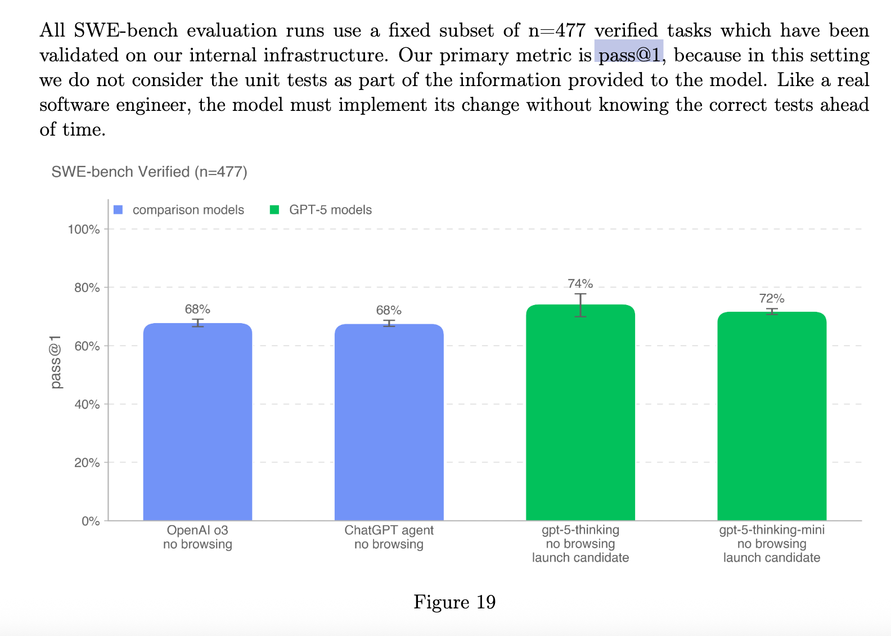

---

id: 1605749

title: "神经网络与大语言模型初步 - 第一章 神经网络 3"

created_at: 2026-02-11T11:48:13.976Z

username: Moonie

display_username: "Moonie"

---

# 神经网络与大语言模型初步 - 第一章 神经网络 3

> 最近实在是忙，面试、research什么的全部堆在一起了，所以更新速度有所降低，还请见谅。

>

> （不得不提一嘴，腾讯的HR面试太奇妙了，流程走到HR面试几天没约面，年前恐怕难oc了

上一期我们讲了非线性的神经网络，这期我们讲 **神经网络的效果评估**。

至于其他更复杂结构的神经网络，比如CNN、RNN、LSTM，我在想是否需要讲。主要的考虑是：这些内容篇幅较长，且并不是理解LLM机理的必要条件，如果写这些，可能会让真正LLM部分出现地更晚，怕消磨了佬友们的注意力和耐心；不讲的话，又感觉对不起标题中的“神经网络”。佬友们有什么建议吗，欢迎评论区提出。

## **1.3 神经网络的评估**

评估其实很简单，就是做题，以做题结果来评判模型效果。

### **1.3.1 数据集划分**

评估是做题得到的，而做的题是从数据集中得到的，数据集划分是确定哪些数据用于训练、哪些用于评估（具体的评估指标放在1.3.2讲）

一般把数据分三份：

- **训练集（train）**：参与训练过程，用于训练模型，更新模型参数

- **验证集（val）**：参与训练过程，但不用于训练/更新参数，而是每训练一段时间在 val 上对模型进行测评，看模型的性能变化

- **测试集（test）**：训练完成后，在 test 上测评模型，评估最终的效果

三者的数据比例一般不固定，根据实际任务来调整

注：

- 除此之外，还有其他的数据集划分方式，比如在数据量较少时会采取 **K折交叉验证**：

将数据集平分成 K 个互不相交的子集

每次选 1 份作为验证集，剩下 K-1 份作为训练集

在训练集上训练，验证集上评估，记录结果

重复 K 次“选集合，记结果”的过程

取 K 次结果的平均值作为最终效果

### **1.3.2 常见评估指标**

#### 回归任务（输出是连续值）

设数据集上有 N 个样本，真实值为 y^{(i)}，预测为 \hat{y}^{(i)}，这种情况下有两种常见指标：

- **MAE（平均绝对误差）**

\mathrm{MAE}=\frac{1}{N}\sum_{i=1}^{N}\left|\hat{y}^{(i)}-y^{(i)}\right|

- **MSE（均方误差）**

\mathrm{MSE}=\frac{1}{N}\sum_{i=1}^{N}\left(\hat{y}^{(i)}-y^{(i)}\right)^2

通常来说，MAE 更“抗异常值”，MSE 对大误差惩罚更重。

#### LLM评估

对于拥有确定性答案的问题，我们一般用下面两种：

- pass@k：进行k次输出，只要对一次就为1，否则为0

- mean@k：进行k次输出，其中正确输出的占比

这两个是当下LLM领域主流的评估指标，尤其是在数学、逻辑、代码等任务上，比如 GPT-5 System Card 中就使用了pass@1等指标（[图源](https://arxiv.org/pdf/2601.03267)）

#### 分类任务（输出是类别，选看）

以二分类只输出0,1为例，这种情况下，MAE 和 MSE 会退化成**1-准确率(Accuracy)**，即分类正确的比例。

准确率指标是最容易想到的，但当类别极不平衡（比如“99%都是正常，1%是异常”）时，准确率其实无法全面评估模型质量，比如有一个模型无脑以100%的概率输出正常，则其准确率是99%，但显然这个模型不是我们想要的。

因此，我们需要其他指标来更全面地评判分类效果。这里，我们引入**精确率 (Precision)、召回率 (Recall)、F1 分数 (F1 Score)**。

定义下面四个变量：

- TP：预测正，实际正的样本数

- FP：预测正，实际负的样本数

- TN：预测负，实际负的样本数

- FN：预测负，实际正的样本数

- 补充：这四个变量构成**混淆矩阵(Confusion Matrix)**  \begin{bmatrix}TP & FN \\FP & TN\end{bmatrix}

则有：

\mathrm{Precision}=\frac{TP}{TP+FP},\quad

\mathrm{Recall}=\frac{TP}{TP+FN},\quad

\mathrm{F1} = \frac{2 \cdot \mathrm{Precision} \cdot \mathrm{Recall}}

{\mathrm{Precision} + \mathrm{Recall}}=\frac{2PR}{P+R}

注： P 和 R 分别是 Precision 和 Recall 的简写

---

*来源: https://linux.do/t/topic/1605749.json*

