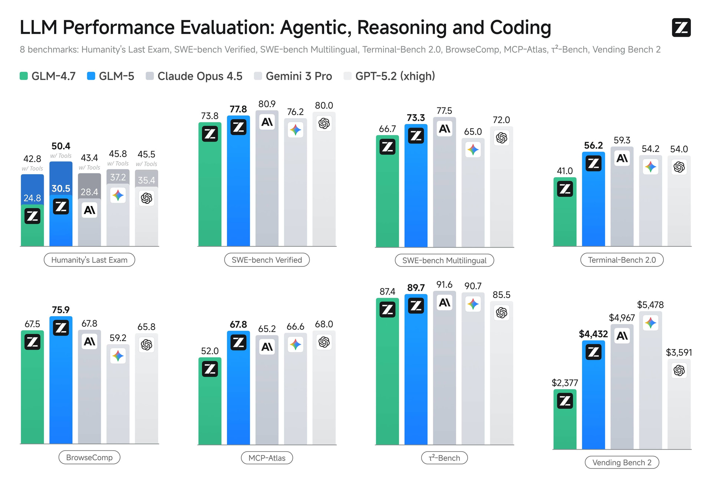
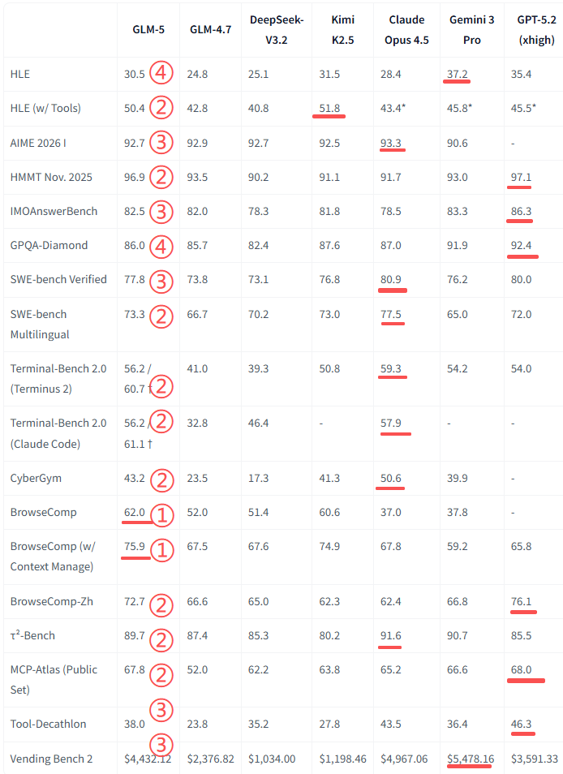
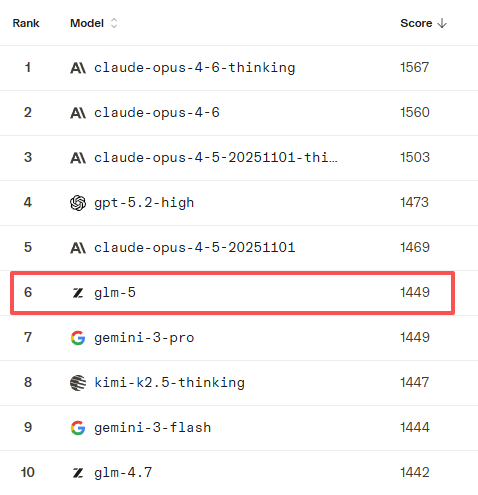
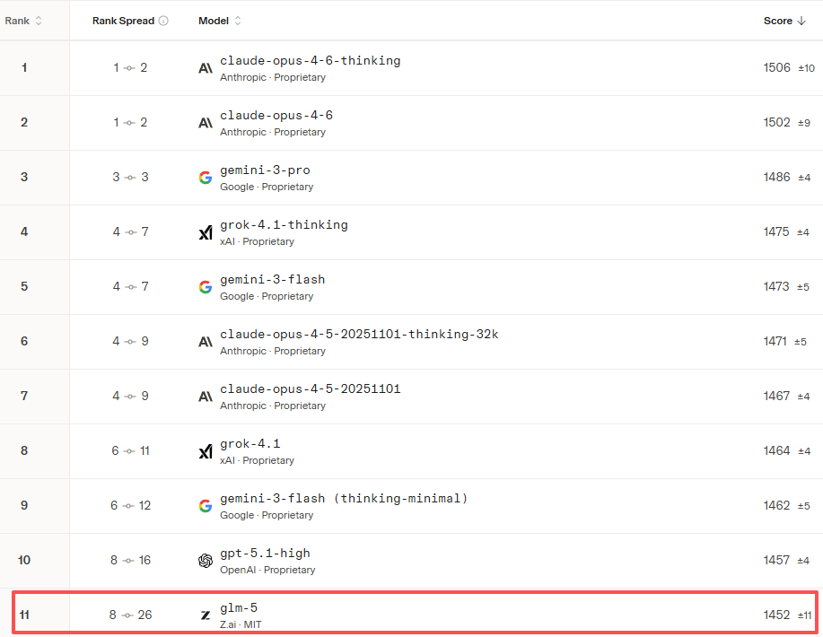
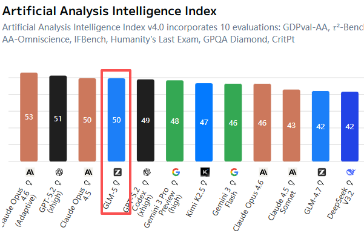

---

id: 1607580

title: ":fire:【大模型系列21】关于GLM5，你想知道的一切【底楼更新Trae/Kilo免费】"

created_at: 2026-02-12T03:06:37.824Z

username: dwqxq1

display_username: "dwqxq1"

---

# :fire:【大模型系列21】关于GLM5，你想知道的一切【底楼更新Trae/Kilo免费】

上下文200k

GLM-5输入$1，输出$3.2

GLM-5-Code输入$1.2，输出$5

参考官方GLM-4.7输入$0.6，输出$2.2

OpenRouter第三方GLM-4.7输入$0.06，输出$0.4

官方文档：[GLM-5 - Overview - Z.AI DEVELOPER DOCUMENT](https://docs.z.ai/guides/llm/glm-5)

官方价格：[Pricing - Overview - Z.AI DEVELOPER DOCUMENT](https://docs.z.ai/guides/overview/pricing)

### 评测

#### 官方自测，②代表第2

---

### LMArena

来源：[Arena Leaderboard | Compare & Benchmark the Best Frontier AI Models](https://arena.ai/zh/leaderboard)

#### 编程

---

#### 综合

---

#### Artificial Analysis评分

不是单独评测，而是来源于多个评测的加权平均分

来源：[https://artificialanalysis.ai/](https://artificialanalysis.ai/)

---

### Chatbot渠道

#### 官方网页/App/免费

来源：[https://chat.z.ai/](https://chat.z.ai/)

---

#### LMArena Direct Chat免费

来源：[Chat with Multiple Frontier AI Models](https://arena.ai/zh/c/new?mode=direct)

---

#### OpenRouter Chat Room

消耗自己余额

来源：[AI Chat Playground - Compare AI Models Side by Side | OpenRouter](https://openrouter.ai/chat?models=z-ai/glm-5)

---

### API渠道

#### 官网包月会员

来源：[智谱AI开放平台](https://bigmodel.cn/glm-coding)

$10=¥49=3xClaude$20额度，不含GLM5

$30=¥149=15xClaude$20额度，暂时不能用GLM5

$80=¥469=60xClaude$20额度，可用GLM5不确定

官方说，因为算力不足，其他计划层级：随着推广的扩大，将逐步添加支持。

新会员涨价3~4倍，貌似原来的老会员不能直接用GLM5

---

#### OpenRouter

来源：[GLM 5 - API Pricing & Providers | OpenRouter](https://openrouter.ai/z-ai/glm-5)

---

### 资源

模型下载：[zai-org/GLM-5 · Hugging Face](https://huggingface.co/zai-org/GLM-5)

Discord：[Z.ai](https://discord.com/invite/QR7SARHRxK)

---

### 近期我其他文章

.[🔥【提智降智系列1】未预训练内容造成严重降智，与各模型搜索能力研究](https://linux.do/t/topic/1720257)

.[🔥【资料系列2】Reddit所有AI板块大全【手工收集，长期更新】](https://linux.do/t/topic/1698489)

.[https://linux.do/t/topic/1664227](https://linux.do/t/topic/1664227)

.[🔥【省钱系列6】L站Google/Antigravity/Gemini Ultra会员拼车经验](https://linux.do/t/topic/1658498)

.[🔥【省钱系列5】顶级会员：Gemini Ultra vs ChatGPT Pro【260306楼底更新Deep think常见问题】](https://linux.do/t/topic/1618048)

.[🔥【大模型系列28】关于GPT-5.4-thinking和GPT-5.4-pro，你想知道的一切【底楼更新LiveBench登顶】](https://linux.do/t/topic/1696708)

.[🔥【大模型系列27】关于Grok 4.2，你想知道的一切【底楼更新grok-4.2-beta2上线】](https://linux.do/t/topic/1629018)

.[🔥【大模型系列26】关于Gemini 3.1 Pro，你想知道的一切【底楼更新LiveBench评分】](https://linux.do/t/topic/1629011)

.[🔥【大模型系列25】关于Qwen-3.5，你想知道的一切【百万上下文来了】](https://linux.do/t/topic/1620658)

.[🔥【大模型系列24】关于Doubao Seed 2.0 Pro，你想知道的一切【LMArena总榜第6】](https://linux.do/t/topic/1618304)

.[🔥【大模型系列23】关于Gemini 3.1 Deep Think新版，你想知道的一切](https://linux.do/t/topic/1617191)

.[🔥【大模型系列22】关于Minimax M2.5，你想知道的一切【楼底更新OpenRouter月榜第一】](https://linux.do/t/topic/1616989)

.[🔥【大模型系列21】关于GLM5，你想知道的一切【底楼更新Trae/Kilo免费】](https://linux.do/t/topic/1607580)

.[🔥【大模型系列20】关于Opus-4.6，你想知道的一切【底楼更新METR评测】](https://linux.do/t/topic/1570860)

.[🔥【大模型系列19】关于GPT-5.3-Codex与Codex App，你想知道的一切【底楼更新LiveBench，OpenRouter已上线】](https://linux.do/t/topic/1570858)

.[🔥【图像视频系列5】Ultra会员NotebookLM视频预览新增Cinematic模式【更新实测体验】](https://linux.do/t/topic/1697728)

.[🔥【图像视频系列4】关于Seedance2，你想知道的一切，性能碾压Sora2/VEO3.1【260211新增随变app不限量渠道】](https://linux.do/t/topic/1582785)

---

*来源: https://linux.do/t/topic/1607580.json*

