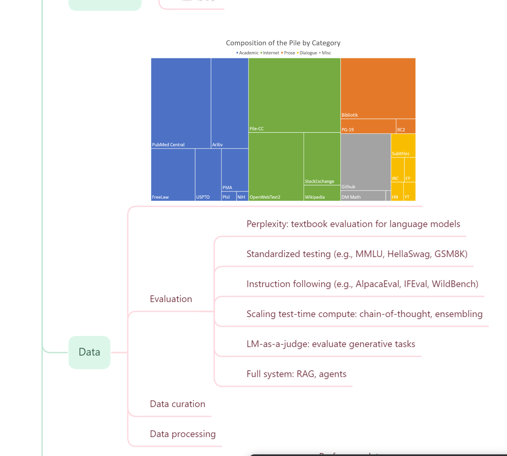

---

id: 1608980

title: "想开一个帖子记录自己的斯坦福CS336学习过程，大家一起共勉"

created_at: 2026-02-12T09:36:51.783Z

username: xxxXX

display_username: "xxxXX"

---

# 想开一个帖子记录自己的斯坦福CS336学习过程，大家一起共勉

今天看了第一课的，感觉讲得很不错，之前对大模型都是各种零散的名词：SFT,RLHF,MOE,完全没有知识体系，看完之后建立起体系了，想在寒假把这门网课学完，但是怕自己又中途放弃，于是开帖激励自己！打算每学完一章就分享笔记

---

*来源: https://linux.do/t/topic/1608980.json*

