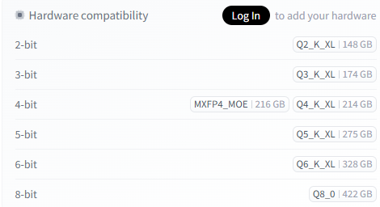

---

id: 1620658

title: ":fire:【大模型系列25】关于Qwen-3.5，你想知道的一切【百万上下文来了】"

created_at: 2026-02-16T11:08:51.865Z

username: dwqxq1

display_username: "dwqxq1"

---

# :fire:【大模型系列25】关于Qwen-3.5，你想知道的一切【百万上下文来了】

### 资料

国际版官方稿：[Qwen](https://qwen.ai/blog?id=qwen3.5)

国际版价格：[https://www.alibabacloud.com/help/en/model-studio/model-pricing](https://www.alibabacloud.com/help/en/model-studio/model-pricing)

#### Qwen-3.5-plus（闭源）

Qwen3.5-Plus 是 Qwen3.5-397B-A17B 的托管版本，具有更多生产特性，例如默认 1M 的上下文长度、官方内置工具和自适应工具使用。

上下文：1m

最大输出：64k

训练截止时间：

价格：$0.4/$2.4，200k以上三倍

#### Qwen-3.5-397B-A17B（开源）

上下文：256k

最大输出：64k

训练截止时间：

价格：$0.6/$3.6

### 评测

#### 官方自评

来源：[Qwen](https://qwen.ai/blog?id=qwen3.5)

#### LMArena 暂未上线

来源：[Arena Leaderboard | Compare & Benchmark the Best Frontier AI Models](https://arena.ai/zh/leaderboard)

#### LiveBench 暂未上线

来源：[https://livebench.ai](https://livebench.ai)

### Chatbot渠道

#### 千问App/网页版

国内版，不可搜索墙外网站，只有Plus： [https://www.qianwen.com](https://www.qianwen.com)

国际版，可搜索墙外网站，有Plus和397B：[https://chat.qwen.ai](https://chat.qwen.ai)

#### OpenRouter Chat Room消耗自己余额

Plus：[AI Chat Playground - Compare AI Models Side by Side | OpenRouter](https://openrouter.ai/chat?models=qwen/qwen3.5-plus-02-15)

397B：[AI Chat Playground - Compare AI Models Side by Side | OpenRouter](https://openrouter.ai/chat?models=qwen/qwen3.5-397b-a17b)

#### LMArena Direct Chat 暂未上线

### API渠道

#### 官方API

国际版：[Qwen](https://qwen.ai/apiplatform)

#### 官方Coding Plan 暂未上线qwen-3.5

国际版：[Coding Plan - Alibaba Cloud Model Studio - Alibaba Cloud Documentation Center](https://www.alibabacloud.com/help/en/model-studio/coding-plan)

国内版：[https://help.aliyun.com/zh/model-studio/coding-plan](https://help.aliyun.com/zh/model-studio/coding-plan)

¥40=$10=1200次/5小时，9000次/周/18000次/月

3月31日前新用户有25折优惠

暂时最高还是qwen3-max-2026-01-23

#### OpenRouter API

.[Qwen3.5 Plus 2026-02-15 - API, Providers, Stats | OpenRouter](https://openrouter.ai/qwen/qwen3.5-plus-02-15)

.[Qwen3.5 397B A17B - API, Providers, Stats | OpenRouter](https://openrouter.ai/qwen/qwen3.5-397b-a17b)

### IDE渠道

#### 阿里灵码IDE版/插件版

#### Trae CN 暂未上线

### 本地运行

下载权重：([Qwen/Qwen3.5-397B-A17B · Hugging Face](https://huggingface.co/Qwen/Qwen3.5-397B-A17B?spm=a2ty_o06.30285417.0.0.72bcc9211VRdpd&file=Qwen3.5-397B-A17B)

显存需求：

---

*来源: https://linux.do/t/topic/1620658.json*

