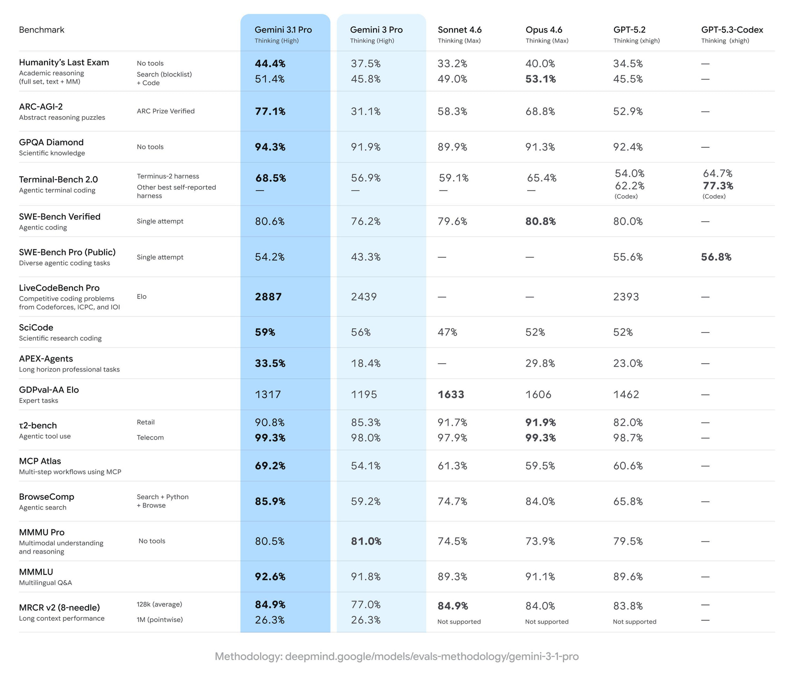
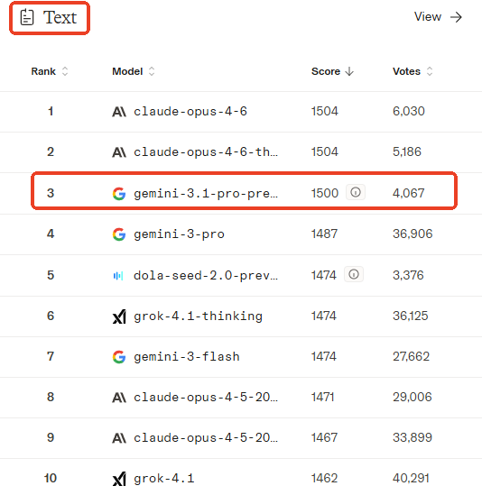
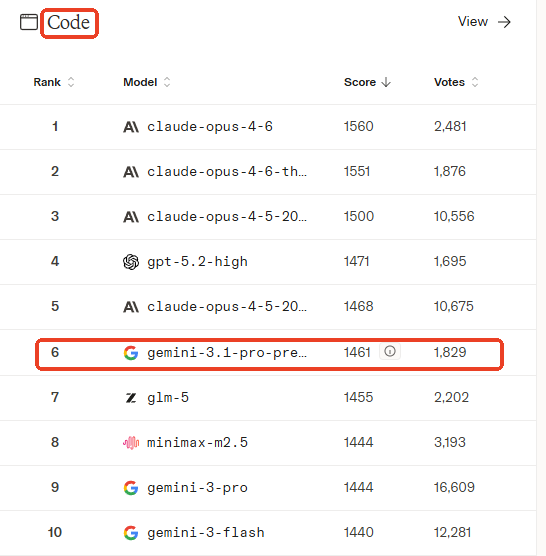
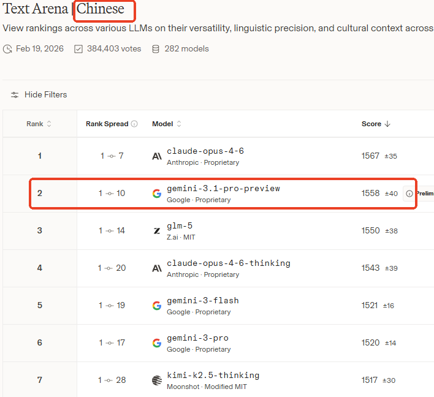
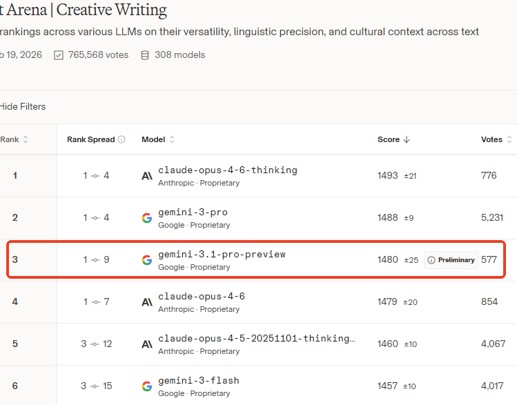
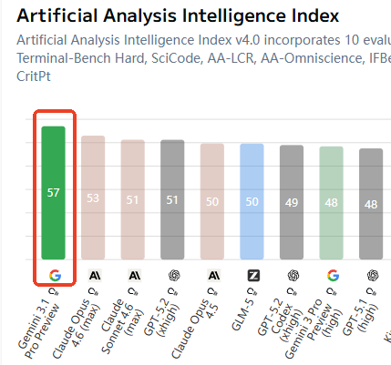
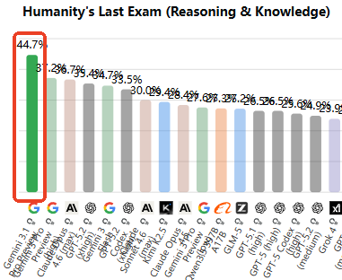
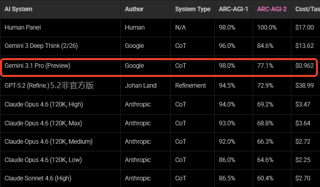

---

id: 1629011

title: ":fire:【大模型系列26】关于Gemini 3.1 Pro，你想知道的一切【底楼更新LiveBench评分】"

created_at: 2026-02-19T20:57:04.643Z

username: dwqxq1

display_username: "dwqxq1"

---

# :fire:【大模型系列26】关于Gemini 3.1 Pro，你想知道的一切【底楼更新LiveBench评分】

### 资料

官方文章：[Gemini 3.1 Pro: Announcing our latest Gemini AI model](https://blog.google/innovation-and-ai/models-and-research/gemini-models/gemini-3-1-pro/)

Model Card：[Gemini 3.1 Pro - Model Card — Google DeepMind](https://deepmind.google/models/model-cards/gemini-3-1-pro/)

文档/价格：[https://ai.google.dev/gemini-api/docs/gemini-3](https://ai.google.dev/gemini-api/docs/gemini-3)

价格$2/$12不变，200k以上$4/$18

上下文1m不变

最大输出64k不变

训练截止日期：2501不变

新版deepthink底模应该是3.1

实际最终输出上限15k(不含思维链)，gemini-3-pro是5k([Gemini 3.1 Pro体验：不用受3 Pro的气了，2.5 Pro 白月光终于回来了？写报告轻松破万字](https://linux.do/t/topic/1628826)

### 评分

#### 官方自评

#### LMArena评分

来源：[Arena Leaderboard | Compare & Benchmark the Best Frontier AI Models](https://arena.ai/zh/leaderboard/)

---

---

---

---

#### ArtificiAlanalysis评分

来源：[Gemini 3.1 Pro Preview - Intelligence, Performance & Price Analysis](https://artificialanalysis.ai/models/gemini-3-1-pro-preview)

---

#### Humanity’s Last Exam

---

#### LiveBench 暂未上线

来源：[https://livebench.a](https://livebench.a)

---

#### ARC-AGI-2

来源：[ARC Prize - Leaderboard](https://arcprize.org/leaderboard)

---

### Chatbot渠道

#### 官网/App

免费版也能用，但额度较低

#### AIStudio

#### OpenRouter Chatroom扣自己余额

来源：[AI Chat Playground - Compare AI Models Side by Side | OpenRouter](https://openrouter.ai/chat?models=google/gemini-3.1-pro-preview)

#### LMArena Direct Chat免费，但限制最大输出

来源：[Chat with Multiple Frontier AI Models](https://arena.ai/zh/c/new?mode=direct)

### API渠道

#### AIStudio API

#### GCP API

#### OpenRouter API

来源：[Gemini 3.1 Pro Preview - API, Providers, Stats | OpenRouter](https://openrouter.ai/google/gemini-3.1-pro-preview)

### IDE渠道

#### Antigravity已上线

注意Antigravity要更新到260219版本才能用3.1

#### Cursor已上线

---

*来源: https://linux.do/t/topic/1629011.json*

