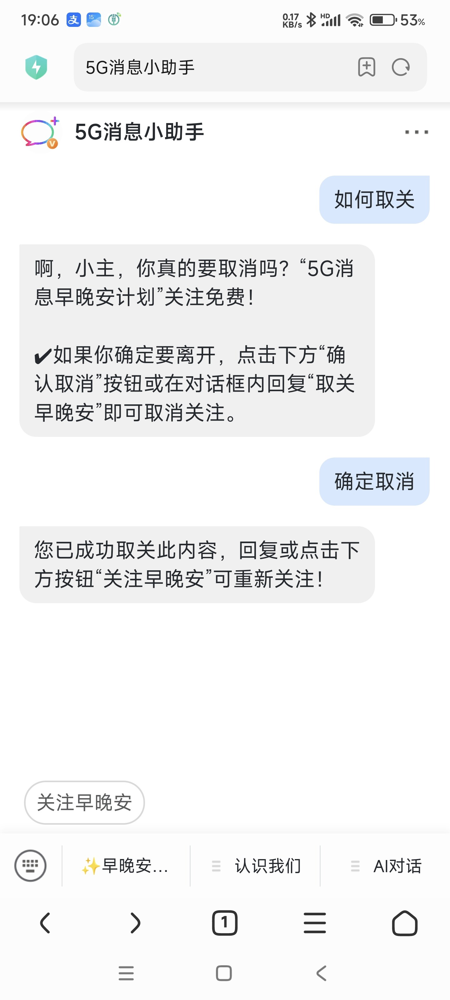
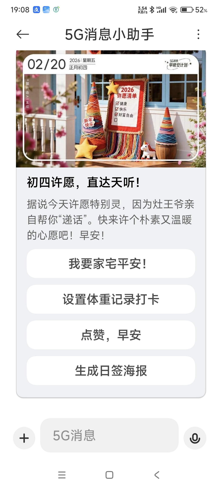

---

id: 1630721

title: "关闭中国移动 5G 消息小助手方法"

created_at: 2026-02-20T13:04:18.643Z

username: jibukeshi

display_username: "轻雨Purainity"

---

# 关闭中国移动 5G 消息小助手方法

开门见山，关闭方法：**浏览器打开 https://rcs.10086.cn/chatboth5/index.html/#/?chabotId=125200201211000319 并使用手机号登录，就可以打开网页版的 5G 消息小助手，在下面点击“如何取关“，再点”确定取消“，就可以关闭了。**

---

5G 消息即为 RCS，但是它也沦为了广告重灾区，中国移动有 5G 消息小助手、灵犀智能助理等天天发卡片消息，发件人全是 sip 开头的号码，用手机自带的骚扰拦截也拦不住。现象就是下图这样：

关键是在网上搜这东西怎么关，搜出来的全是内容农场的垃圾和不相关的东西，没有任何有效信息。于是就写了这篇文章记录一下。

---

*来源: https://linux.do/t/topic/1630721.json*

