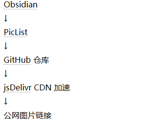
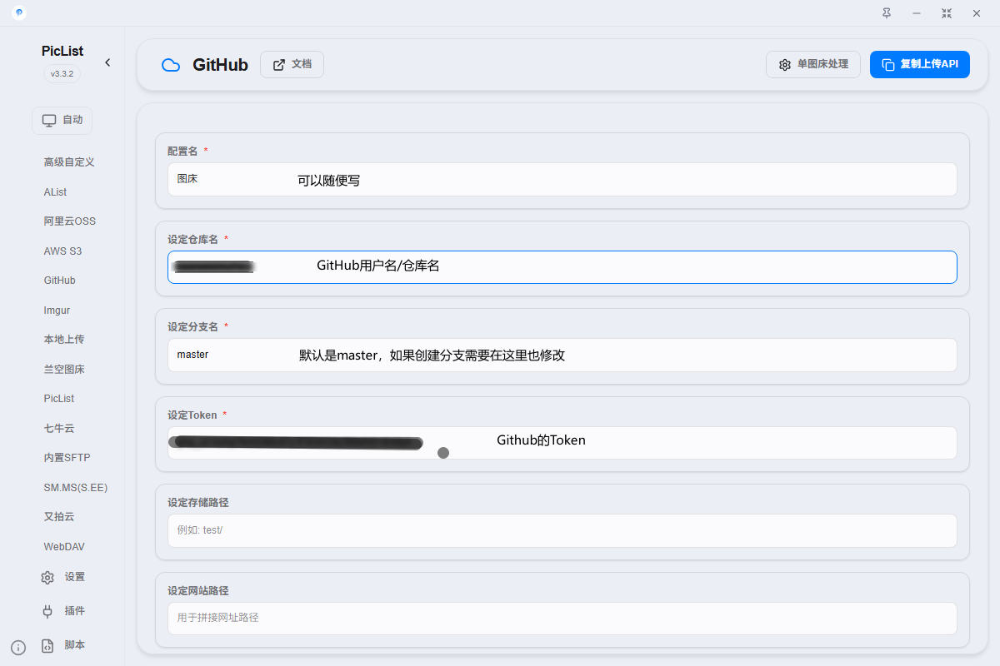
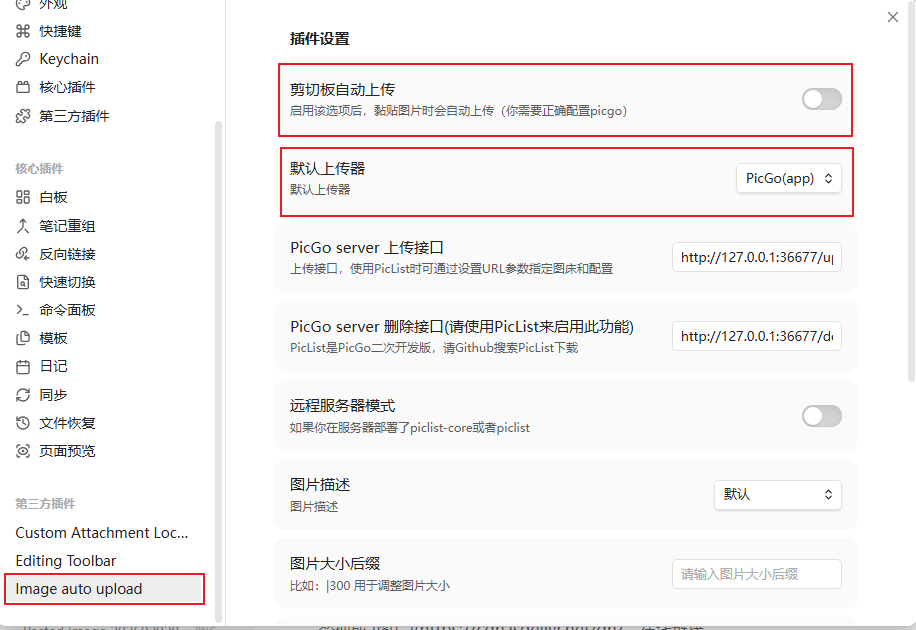

---

id: 1642262

title: "Obisidian文档迁移（一次脑can的尝试！？）"

created_at: 2026-02-24T09:57:53.028Z

username: 1parado

display_username: "Paradox"

---

# Obisidian文档迁移（一次脑can的尝试！？）

### 目标

把Obsidian里的.md笔记（含本地图片） → 全部图片自动变成**稳定在线链接**（GitHub/Gitee图床 + jsDelivr/CDN） → 直接导入CSDN或牛客网，图片永不失效。

---

解决思路：

### 第一步：获取Github Token和配置PicList

在Github中创建个人访问令牌，详情见官方文档：[创建 personal access token (classic)](https://docs.github.com/zh/authentication/keeping-your-account-and-data-secure/managing-your-personal-access-tokens#%E5%88%9B%E5%BB%BA-personal-access-token-classic)

安装PicList，配置图床

运行PicList，可以先测试一下上传图片是否会出现在GitHub仓库中，如果成功即可进行下一步。

### 第二步：下载Obisidian插件

**下载Obsidian 插件**

社区插件搜索安装：**Image Auto Upload**（作者 renmu123）

插件设置：

默认上传器 PicGo(app) 即可，PicList兼容PicGo

可以选择关闭/开启“粘贴时自动上传”，默认是开启

---

### 第三步：迁移笔记

#### 方式A：单篇笔记迁移

1. 在 Obsidian 打开你要迁移的那篇 .md 笔记。

2. 按 Ctrl + P → 输入 Upload all images（或插件对应命令） → 回车。 → 插件自动把这篇笔记里所有本地图片上传到你的图床。

3. Obsidian 会自动把文档中的图片替换成图片公网链接。

4. 保存笔记 → 文件 → 导出为 Markdown（或直接复制整个内容）。

#### 方式B：批量处理多篇笔记

1. 安装 **Custom Image Auto Uploader** 插件。

2. Ctrl + P → 输入 “Batch Upload All Images” 或 “批量上传图片” → 选择整个 Vault 或指定文件夹。

3. 插件会扫描所有笔记 → 批量上传图片 → 全部替换链接。

4. 完成后，所有笔记的图片都变成在线链接。

Tips：

- 在操作之前可以先备份你的文件内容！

- 如果插件开启粘贴即上传，就不需要Ctrl + P 的步骤了，你会在本地文档中直接使用图片的公网链接。

---

剩下的就是Ctrl C 和 Ctrl V了。直接复制到其他平台上的markdown编辑器即可。如果连CV也懒得做，可以做一个脚本一键发布。（这个之后看看可不可以实现一下，今天快下班了估计完不成）

---

后记：草（一种植物）！我刚回过味来，Obisidian插件社区已经有一键同步到GitHub仓库的插件了，本质上都是将本地内容放到公网上，而且可以直接通过Obisidian + Github pages + Hugo同步博客内容，想要发布到其他平台的话，直接将自己的在线博客内容复制到那些平台上就行了。我在做什么？？？？而且我这个好麻烦，还需要下载软件还需要下载两个插件。有无佬友帮我想一下我这么做的意义！

---

*来源: https://linux.do/t/topic/1642262.json*

