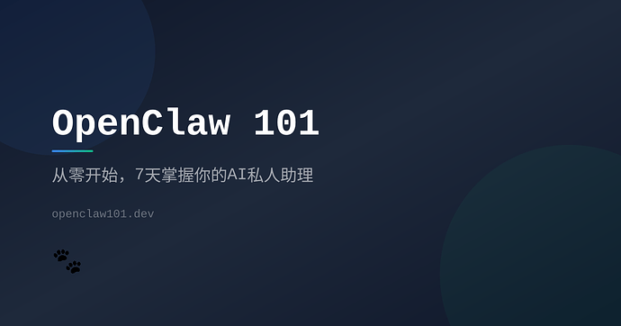
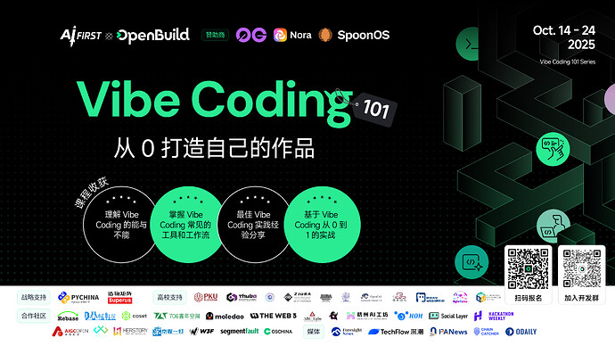

---

id: 1659990

title: "【101系列教程】AI时代 Vibe Coding 入门教程汇总（包含OpenClaw🦞）"

created_at: 2026-02-26T02:41:32.299Z

username: danpeng

display_username: "Sunshine"

---

# 【101系列教程】AI时代 Vibe Coding 入门教程汇总（包含OpenClaw🦞）

感慨技术迭代的速度之快，整理一些优质有效的入门教程可供学习，也作为纪念。欢迎佬们补充 

## 一、Cursor 101

[https://cursor101.com/zh](https://cursor101.com/zh)

## 二、OpenClaw 101

### [7天掌握你的AI私人助理 | OpenClaw 101](https://openclaw101.dev/zh)

从零开始，7天掌握你的 OpenClaw AI 私人助理。包含安装、配置、技能、自动化与精选资源的一站式教程。

## 三、Vibe Coding: 从 0 打造自己的产品

### [Vibe Coding 实战课: 从 0 打造自己的产品](https://openbuild.xyz/learn/courses/1084822912)

Vibe Coding 课程是由 AI First和 OpenBuild 联合资深讲师打磨，不是空谈概念，而是实战导向，让你真正能做出产品。

整个课程不讲空话，全是实战案例，想象一下，几周后你能亲手上线一个产品，不再停留在“我有个想法”的阶段。

## 四、Easy-Vibe : Learn vibe coding from 0 to 1

### [Easy-Vibe 教程](https://datawhalechina.github.io/easy-vibe/zh-cn/)

从零到一学习 Vibe Coding - 零基础学会用 AI 编程，掌握 Claude Code、Cursor 等 AI IDE 工具

## 五、让 OpenClaw 真正进入你的工作流

### [Hello Claw](https://datawhalechina.github.io/hello-claw/cn/)

从零到一学习 OpenClaw：领养你的 AI 龙虾助理，或从零构建属于你的智能体

## 六、HelloClaw

### [Hello Claw 零基础入门 OpenClaw](https://hello-claw.com/)

从零到一学习 OpenClaw：领养你的 AI 龙虾助理，或从零构建属于你的智能体

---

*来源: https://linux.do/t/topic/1659990.json*

