---

id: 1667361

title: "为Cloudflare临时邮箱项目（cloudflare_temp_email）添加发邮件功能使用 Resend"

created_at: 2026-02-27T14:34:47.608Z

username: XiaoHuang

display_username: "小黄"

---


# 为Cloudflare临时邮箱项目（cloudflare_temp_email）添加发邮件功能使用 Resend


从 [【教程】2026版 小白也能看懂的自建Cloudflare临时邮箱教程（域名邮箱）谢谢分享](https://linux.do/t/topic/1666961)  继续

### 写在前面

这里参考项目官方文档给的方案用Resend，今天无论如何都要把这个教程写了，真的鸽了好久了…

项目官方文档：[配置发送邮件 | 临时邮箱文档](https://temp-mail-docs.awsl.uk/zh/guide/config-send-mail.html)

### Resend 普通账号免费额度

- **每天 100 封**邮件

- **每月 3,000 封**

- 只能用 **1 个自定义域名**

### 先注册Resend账号，也可以直接谷歌登录


### [Resend · Email for developers](https://resend.com/signup)

The best way to reach humans instead of spam folders. Deliver transactional and marketing emails at scale.

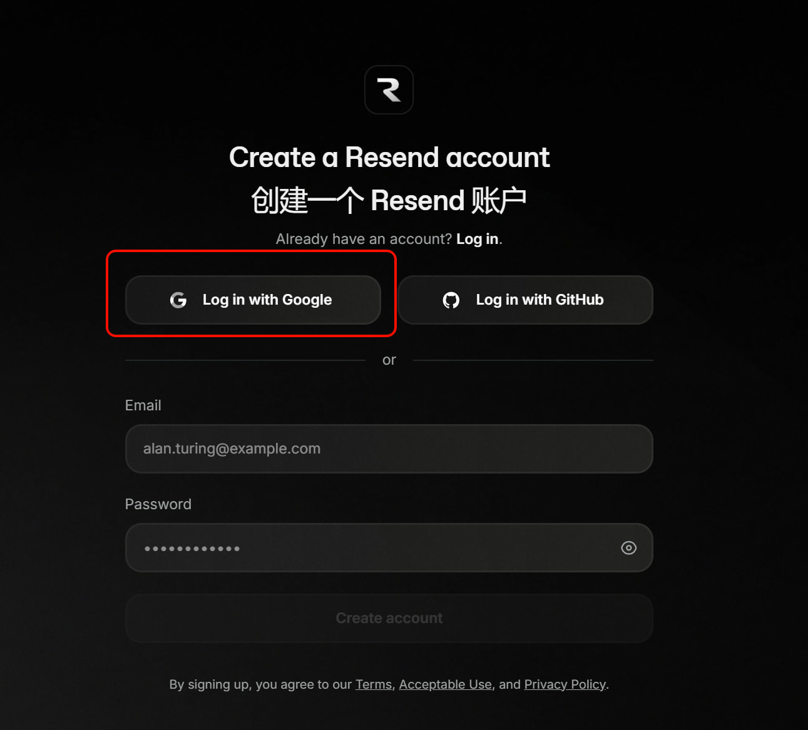

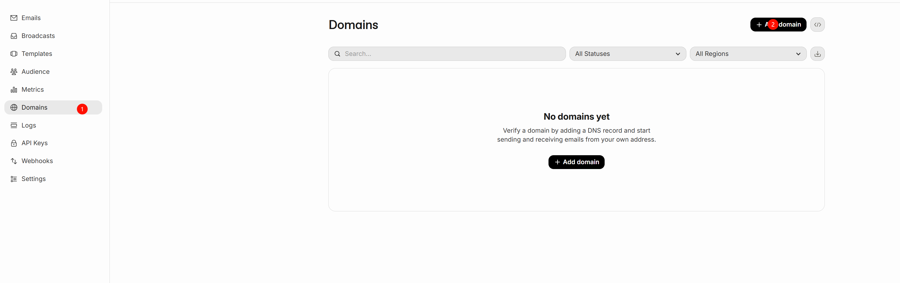

> 填自己的域名邮箱的域名

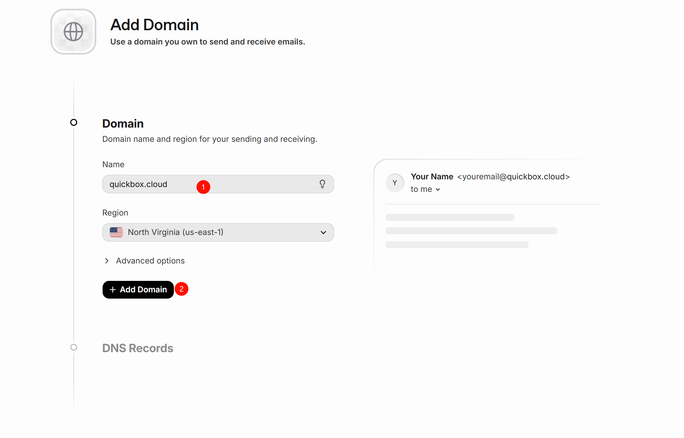

> 这里我们就登录Cloudflare让它自己配置好了

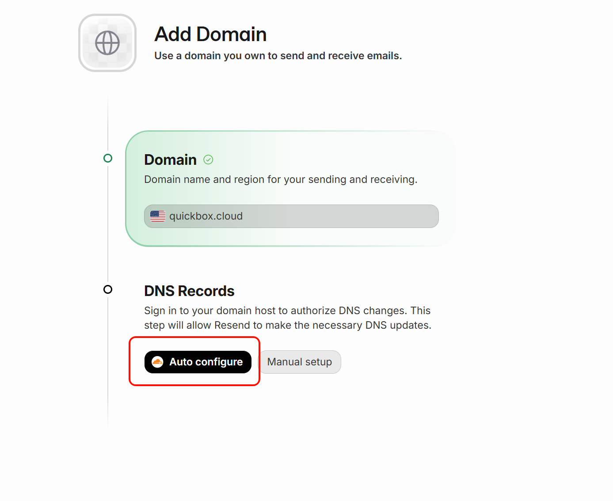

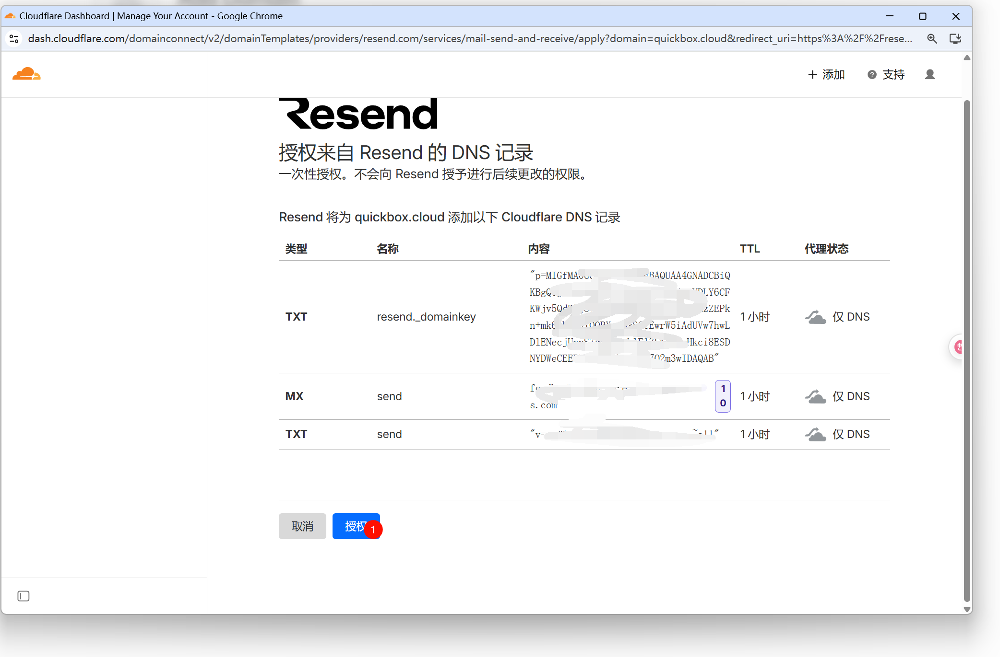

> 这里等几分钟就行

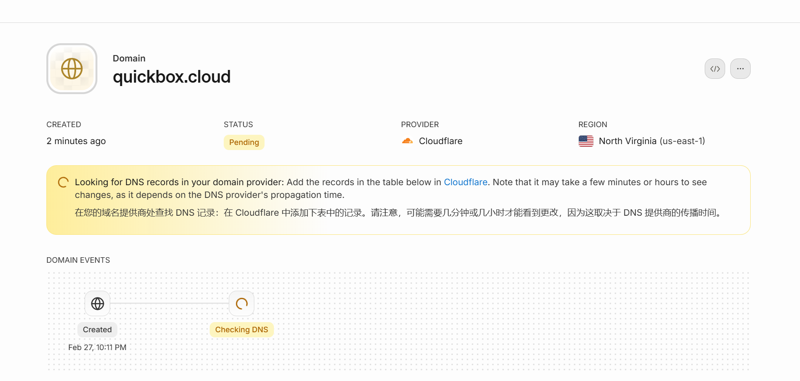

> 绿了就代表OK了

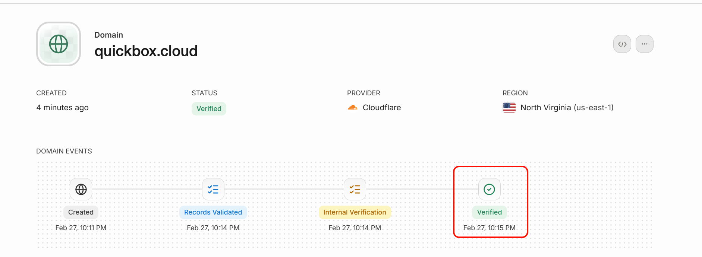

### 创建Api Key

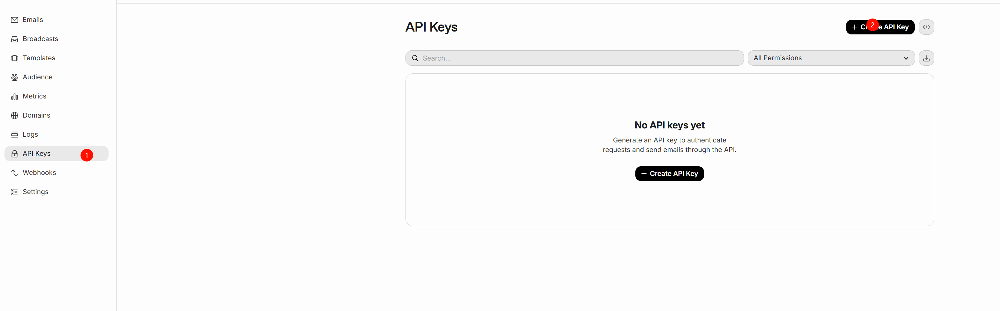

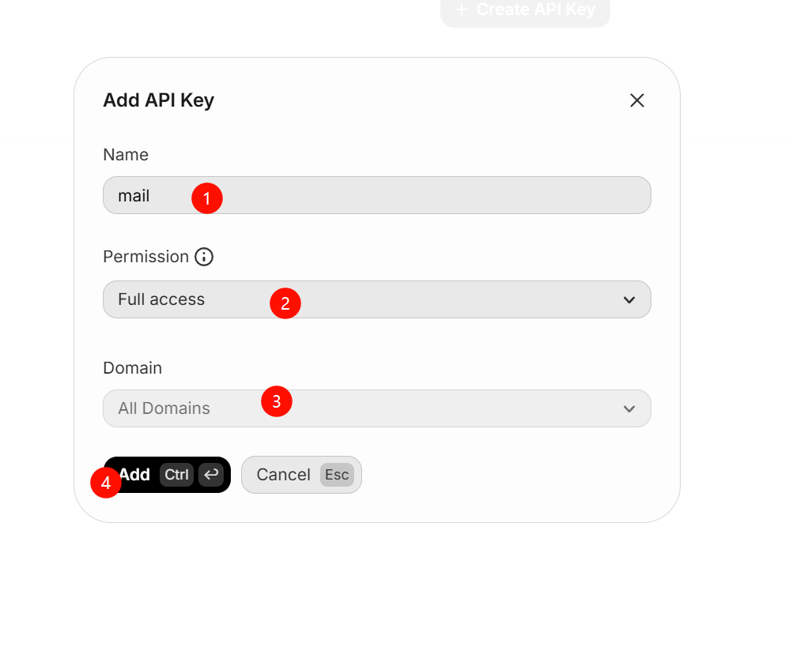

> 复制key，这里就直接复制，不然之后就查看不了，只能新建key了

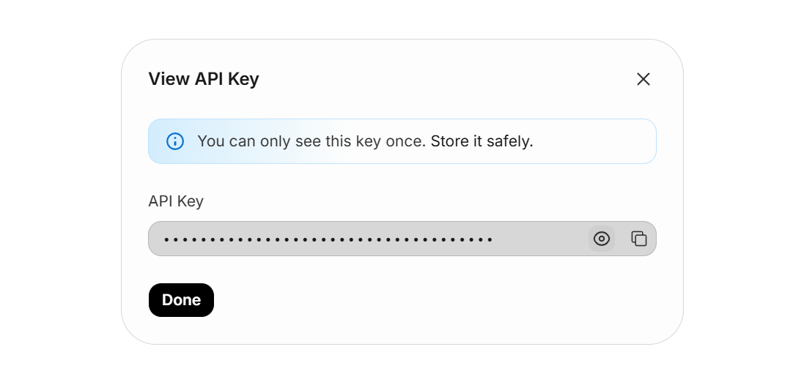

### 回到Cloudflare的后端Workers配置参数

#### RESEND_TOKEN

参数类型：文本

```
re_eaaEdqoy_XXXXXXXXX
```

解释： Resend API 密钥

---

#### DEFAULT_SEND_BALANCE

参数类型；文本

```
0
```

**暂时不给用户开放，佬友可以根据自己的情况来设置**

解释：新建的邮箱地址能发送的邮件数量，`0` = 不能发。用户每发一封扣 1

---

#### NO_LIMIT_SEND_ROLE

参数类型：文本

单个角色示例：

```
admin
```

多个角色示例：

```
vip,admin
```

解释：配置的角色可以无限发邮件，不受限制

---

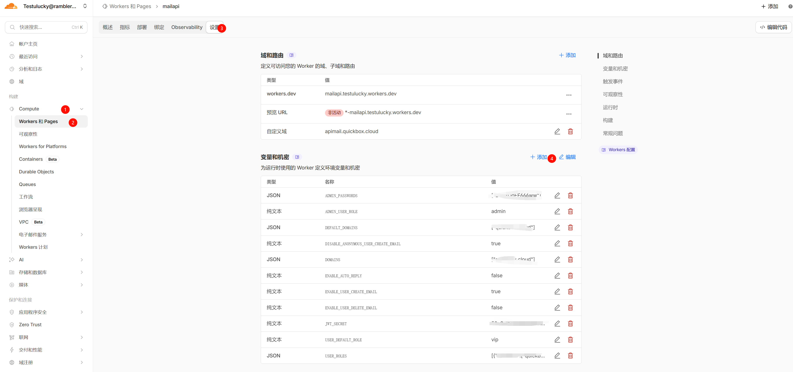

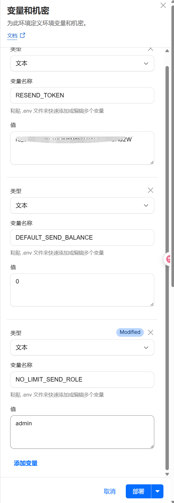

### 测试发送邮件

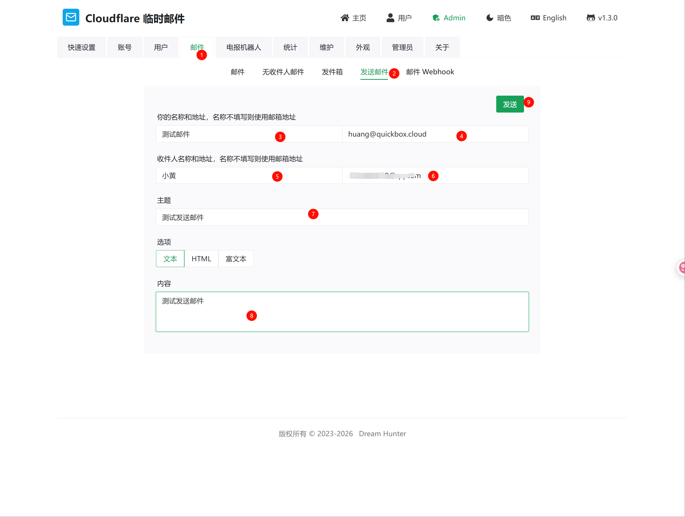

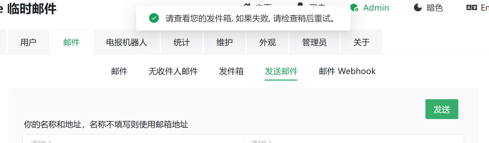

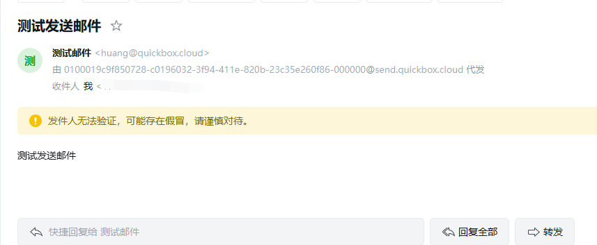

### 结束

至此发送邮件的配置就这么简单！ 

还请各位佬注意额度~

免费额度自己完全够用咯~


---


*来源: https://linux.do/t/topic/1667361.json*

