---

id: 1667411

title: "一个超级无敌强迫症的重装系统步骤"

created_at: 2026-02-27T14:54:06.248Z

username: akane8086

display_username: "思茜"

---


# 一个超级无敌强迫症的重装系统步骤


第一版：

[整理了一下我重装系统的步骤](https://linux.do/t/topic/1465089) [


文档共建](/c/wiki/42)

> 格式可能会很辣眼睛，这是我第一次用Markdown语法码字，可能会有很多问题，请多指教

> 零、需要准备的

> 1.U盘

> 2.Ventoy（[https://www.ventoy.net/cn/index.html）](https://www.ventoy.net/cn/index.html%EF%BC%89)

> 3.微PE（[https://www.wepe.com.cn](https://www.wepe.com.cn)）

> 4.需要的系统ISO文件

> 5.我喜欢用微PE里的Dism++安装系统，大家可以试试，真的很…

## 零、需要准备的

1.U盘

2.Ventoy

### [Ventoy](https://www.ventoy.net/cn/index.html)

Ventoy is an open source tool to create bootable USB drive for ISO files. With ventoy, you don't need to format the disk again and again, you just need to copy the iso file to the USB drive and boot it.

3.一个你喜欢的PE （笔者用的是 微PE工具箱V2.3）

### [微PE工具箱 - 下载](https://www.wepe.com.cn/download.html)

跨时代的PE工具箱，装机维护得力的助手，最后的救命稻草。化繁为简，小材大用，一键安装，极速启动。

4.需要用到的 Windows 镜像

5.各类驱动 （笔者只有显卡驱动和鼠标驱动需要安装，实际情况需自行决定）

6.系统激活工具 （笔者选择的是 MAS，可能会挑网络，请提前准备代理软件安装包在U盘里，以便不时之需）


### [Microsoft Activation Scripts | MAS](https://massgrave.dev)

An open-source Windows and Office activator featuring HWID, Ohook, TSforge, and Online KMS activation methods, along with advanced troubleshooting.

7.主要软件安装包（浏览器、解压缩软件、代理软件 etc.）

8.该版本有输入法候选框消失和 wsappx 进程占用大 问题（不知道 wsappx 进程占用大 这个问题现在有没有修复），所以可以安装好系统之后晾着让电脑更新，或者是在重装之前给镜像文件打好补丁 （打补丁脚本请看下文，如何使用请看 README_cn.md ，笔者就不过多赘述了）

### [GitHub - adavak/Win_ISO_Patching_Scripts: Win_ISO_Patching_Scripts](https://github.com/adavak/Win_ISO_Patching_Scripts)

Win_ISO_Patching_Scripts

## 一、选择的系统

Windows 10 21H2 LTSC（本人觉得 Windows 11 太狗屎了，所以回到了 Windows 10 的怀抱，没有特殊情况请选择x64版本）

下载链接：

Massgrave（免登录，可能需要代理）


### [Windows LTSC Download | MAS](https://massgrave.dev/windows_ltsc_links)

All download links lead to genuine files only.

NEXT, ITELLYOU（需要登录，依赖BT或者ED2K客户端，笔者喜欢在123云盘内解析再下载）

### [登录](https://next.itellyou.cn/Identity/Account/Login?ReturnUrl=%2FOriginal%2F)

**下载后请校验MD5、SHA1或者SHA256有无异常，不然手头没电脑没办法重新下载！！！**

### 校验方法：

1.打开CMD

2.输入以下命令

`certutil -hashfile "镜像路径" MD5|SHA1|SHA256`

（一定要是英文引号）

3.对比结果是否与下载网站给出的信息一致

## 二、系统安装

可以使用微PE内的DiskGenius把所有分区删除之后重启，进入PE后按需分区，然后再重启，乱掉的盘符会自动分配好。之后可以使用Dism++安装系统

教程：

[https://home.gamer.com.tw/artwork.php?sn=5195025](https://home.gamer.com.tw/artwork.php?sn=5195025)

## 三、驱动安装

强烈建议在重装的时候把网线/WIFI断开，直到你需要激活系统的时候再插上/连接上，不然安装的时候 Windows Update 会自作主张帮你安装上驱动

个人认为的4060万金油驱动：


### [搜索结果 |  |](https://www.nvidia.cn/geforce/drivers/results/230856/)

产品和  操作系统的搜索结果

其它系列或者A卡用户按需选择驱动

## 四、激活系统

笔者使用的是 MAS 脚本，可输入命令或者下载 CMD 批处理文件（个别地区或宽带可能需要代理软件才能够激活，所以在此之前请自备代理软件）

命令：

`irm https://get.activated.win | iex`

CMD 批处理文件请选择 Method 2 进行下载

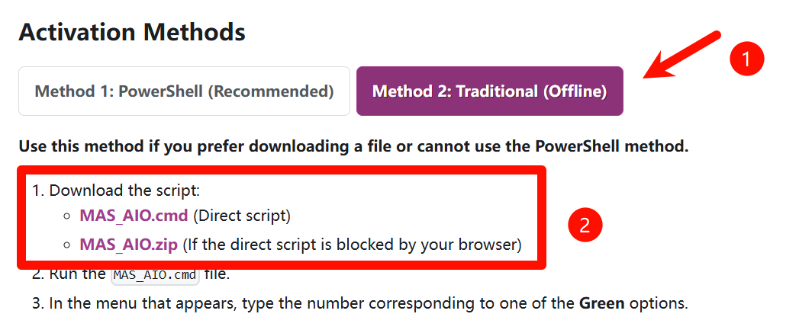

## 五、配置调优

该版本有输入法候选框消失和 wsappx 进程占用大 问题（不知道 wsappx 进程占用大 这个问题现在有没有修复），所以可以安装好系统之后晾着让电脑更新，或者是在重装之前给镜像文件打好补丁 （打补丁脚本请看下文，如何使用请看 README_cn.md ，笔者就不过多赘述了）

### [GitHub - adavak/Win_ISO_Patching_Scripts: Win_ISO_Patching_Scripts](https://github.com/adavak/Win_ISO_Patching_Scripts)

Win_ISO_Patching_Scripts

我的电源计划：

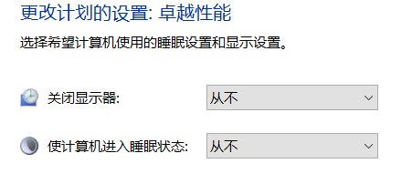

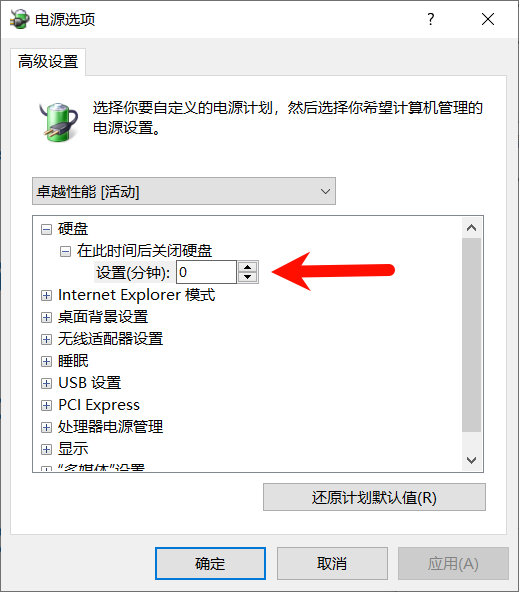

关闭粘滞键：

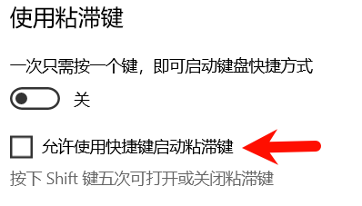

卸载Edge（按需选择）

因为笔者很讨厌这个鬼东西，就算不用的话也不想看到它赖在桌面上，故选择卸载，眼不见心不烦

脚本：

#### [Edge_Removal.bat](https://github.com/AveYo/fox/blob/main/Edge_Removal.bat)

[main](https://github.com/AveYo/fox/blob/main/Edge_Removal.bat)

```
@(set "0=%~f0"^)#) & powershell -nop -c iex([io.file]::ReadAllText($env:0)) & exit /b
#:: just copy-paste into powershell - it's a standalone hybrid script
sp 'HKCU:\Volatile Environment' 'Edge_Removal' @'

$also_remove_webview = 1
## why also remove webview? because it is 2 copies of edge, not a slimmed down CEF, and is driving bloated web apps
$also_remove_widgets = 1
## why also remove widgets? because it is a webview glorified ad portal on msn and bing news cathering to stupid people
$also_remove_xsocial = 1
## why also remove xsocial? because it starts webview setup every boot - xbox gamebar will still work without the social crap

$host.ui.RawUI.WindowTitle = 'Edge Removal - AveYo, 2023.09.14'
write-host "Run the script again whenever you need to reinstall and update edge or webview..`n"
$remove_appx = @("MicrosoftEdge"); $remove_win32 = @("Microsoft Edge","Microsoft Edge Update"); $skip = @() # @("DevTools")
if ($also_remove_webview -eq 1) {$remove_appx += "Win32WebViewHost"; $remove_win32 += "Microsoft EdgeWebView"}
if ($also_remove_widgets -eq 1) {$remove_appx += "WebExperience"}
if ($also_remove_xsocial -eq 1) {$remove_appx += "GamingServices"}

$global:WEBV = $also_remove_webview -eq 1
$global:IS64 = [Environment]::Is64BitOperatingSystem
```

需要保留 WebView2 请按图修改此数值为`0` ，即使忘记修改了也不用担心，可以再执行一遍这个脚本，输入 webview 即可恢复

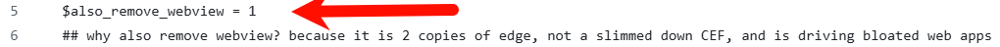

关闭遥测

笔者使用的是WPD，按照软件推荐关闭的选项将其关闭即可

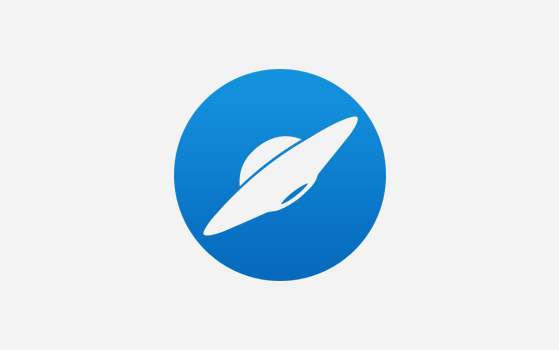

### [WPD](https://wpd.app)

Privacy dashboard for Windows

## 六、软件选择

1.浏览器

这里笔者选择自定义程度算比较高的 Vivaldi ，使用Chromium内核，侧边标签页功能笔者爱不释手

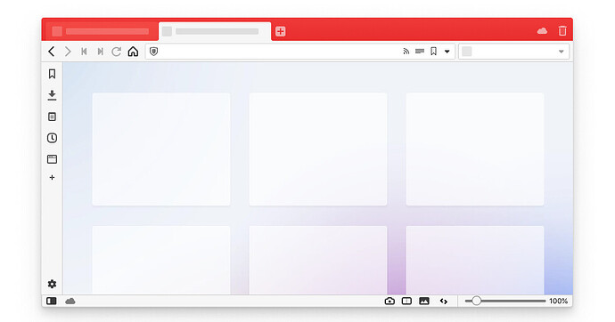

### [下载 Vivaldi | Vivaldi 浏览器](https://vivaldi.com/zh-hans/download/)

下载适用于 Windows、Mac 或 Linux 的最新版 Vivaldi 浏览器。使用完全可定制且功能先进的浏览器，随心所欲地浏览网页。

2.解压缩软件

Bandizip 6.29 版本，最后一个没有广告的版本，功能也算得上够用


### [Bandizip - 下载 Bandizip 6.x](https://www.bandisoft.com/bandizip/old/6/)

Home of Bandisoft

3.代理软件

Throne ，Nekoray 的 fork。使用 singbox 内核，无 DNS 泄露问题

### [GitHub - throneproj/Throne: Cross-platform GUI proxy utility (Empowered by...](https://github.com/throneproj/Throne)

Cross-platform GUI proxy utility (Empowered by sing-box)

在 Throne 里面导入订阅后，可以点击“路由”，点击“下载配置档”，再点击“Bypass_China”，就能有一份比较完美的分流配置了

4.看图软件

Honeyview ，已经停更了，对比它的继承者 Bandiview 来说，没有广告，bug 也没有这么多

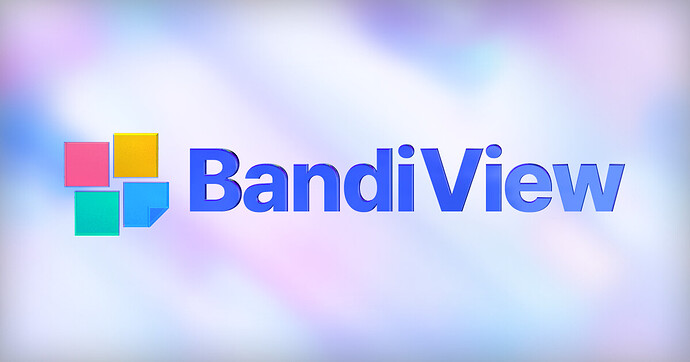

### [BandiView - 图像查看器、快速且强大](https://www.bandisoft.com/honeyview/)

BandiView official page

5.播放器

PotPlayer

### [Global Potplayer](https://potplayer.tv)

6.截图软件

PixPin

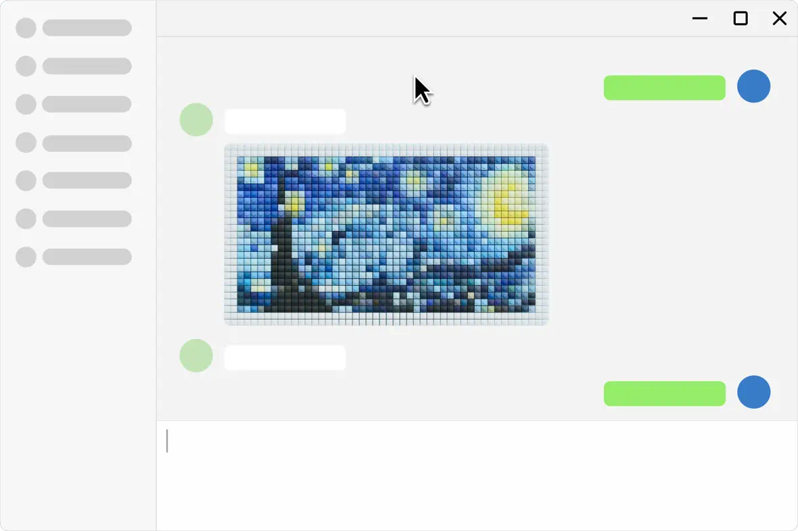

### [PixPin - 截图/贴图/长截图/图片转文字(OCR) | 免费全能截图工具](https://pixpin.cn)

PixPin 是一款专业级免费截图软件，集截图、贴图、长截图、OCR文字识别、屏幕录制于一体。支持 Windows 和 macOS，为您提供高效的桌面办公体验。

下载好之后，在任务栏里右键 PixPin ，勾选“在全屏游戏模式下禁用快捷键”，点击“配置”，在“系统”里勾上“开机后自动启动”，往下滑，反勾“自动发送使用统计（不含任何敏感数据）”

7.记事本

Notepad3

### [GitHub - rizonesoft/Notepad3: Notepad like text editor based on the Scintilla...](https://github.com/rizonesoft/Notepad3)

Notepad like text editor based on the Scintilla source code. Notepad3 based on code from Notepad2 and MiniPath on code from metapath. Download Notepad3:

安装的过程可能会问你是否需要安装 Opera 浏览器，请反勾并点击“Decline”

8.剪贴板

Ditto

### [Ditto - Clipboard Manager](https://sabrogden.github.io/Ditto/)

Ditto Clipboard Manager

9.文件搜索

Everything

### [下载 - voidtools](https://www.voidtools.com/zh-cn/downloads/)

10.下载器

IDM

### [Internet Download Manager is a powerful download accelerator](https://www.internetdownloadmanager.com)

Internet Download Manager (IDM) is a tool to increase download speeds by up to 10 times, resume or schedule downloads and download streaming videos

破解补丁：

### [GitHub - YuHuanTin/IDM_Cracker](https://github.com/YuHuanTin/IDM_Cracker)

通过在 GitHub 上创建帐户来为 YuHuanTin/IDM_Cracker 开发做出贡献。

11.杀毒软件

卡巴斯基

### [卡巴斯基标准反病毒免费试用下载 | 卡巴斯基](https://www.kaspersky.com.cn/downloads/standard-free-trial)

免费试用卡巴斯基标准版 30 天，获得适用于 PC、Mac 和的获奖反病毒软件，保护您的数字生活免受任何网络攻击，以免在您在线时威胁您。

下载普通版，可以去B站或者卡饭论坛找一下激活码

12.卸载软件

HiBit Uninstaller

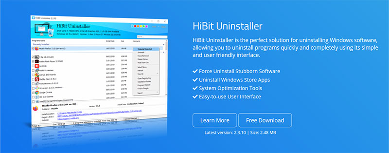

### [HiBit Uninstaller](https://www.hibitsoft.ir/Uninstaller.html)

HiBit Uninstaller Powerful software that helps you uninstalling Windows software and Windows Store apps.

笔者认为是一众免费卸载软件里面最强的一个，卸载时可以把“创建系统还原点”给反勾，最后执行“高级扫描”，应该能卸载的比较干净一点

13.显卡驱动卸载

DDU


### [Display Driver Uninstaller (DDU) 18.1.5.6 Download](https://www.techpowerup.com/download/display-driver-uninstaller-ddu/)

Display Driver Uninstaller (DDU) is a tool that completely removes GPU drivers, ensuring no residual files or registry keys remain. This can help to

在运行之前先下载好显卡驱动，然后断开网络连接，重启进入到安全模式，运行 DDU ，跑完之后回到主系统再安装驱动

## 七、浏览器扩展 & 油猴脚本

1.翻译

Kiss Translator

### [GitHub - fishjar/kiss-translator: A simple, open source bilingual translation...](https://github.com/fishjar/kiss-translator)

A simple, open source bilingual translation extension & Greasemonkey script (一个简约、开源的 双语对照翻译扩展 & 油猴脚本)

让它更好用的方法：

[Kiss Translator 使用教程](https://linux.do/t/topic/855242) [


开发调优](/c/develop/4)

> 文章摘要

> 文章全文摘自我的博客： [Kiss Translator 使用教程](https://pdf.us.kg/posts/2025/08/10/Kiss-Translato-%E4%BD%BF%E7%94%A8%E6%95%99%E7%A8%8B.html) ，简单介绍了 Kiss Translator 的安装使用

> 安装插件

> 从开源仓库跳转安装避免李鬼：[GitHub仓库地址](https://github.com/fishjar/kiss-translator?tab=readme-ov-file#%E5%AE%89%E8%A3%85)

> 安装后点击拓展图标 → SETTING → English，切换为 中文

> 添加接口

> 接入 LINUXDO DeepLX

> 点击拓展图标进入设置，依次点击 接口设置 → DeepLX

>

>

> URL

> h…

可以用赤坂佬的 Chiban API 公益站或者是其他佬的公益站，效果更佳

2.广告屏蔽

uBlock Origin

### [GitHub - gorhill/uBlock: uBlock Origin - An efficient blocker for Chromium...](https://github.com/gorhill/uBlock)

uBlock Origin - An efficient blocker for Chromium and Firefox. Fast and lean.

如果可以的话请选择普通版，Lite 版无法导入他人的规则

我的规则：

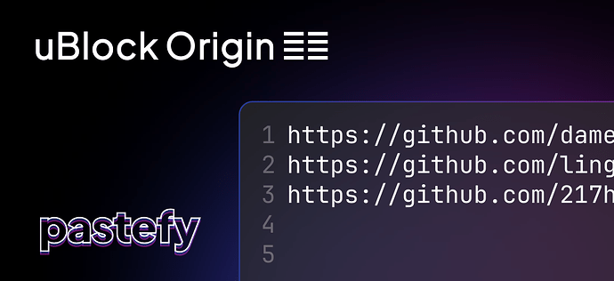

### [uBlock Origin 规则](https://pastefy.app/Opri1c3Y)

View "uBlock Origin 规则" on Pastefy.

将规则导入 uBO 之后，可以点击“规则列表”，按图片指的地方勾选上，可以屏蔽烦人的 Cookies 弹窗

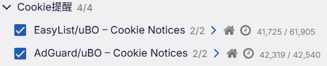

3.脚本管理器

Tampermonkey （油猴）

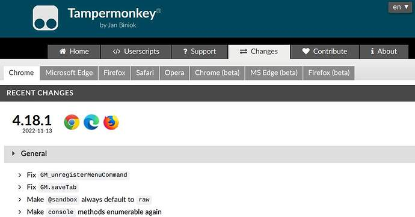

### [Home | Tampermonkey](https://www.tampermonkey.net)

Home

我的脚本：

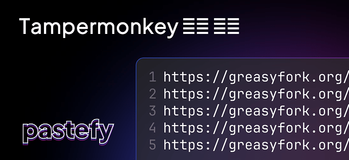

### [Tampermonkey 油猴 脚本](https://pastefy.app/2DEJvHTp)

View "Tampermonkey 油猴 脚本" on Pastefy.

Chromium 系内核浏览器用户请在地址栏输入以下这条，才能让脚本正常注入

`chrome://extensions`

在右上角找到“开发者模式”，并打开。再找到"篡改猴",点击“详情”，再打开“允许运行用户脚本”，就能够正常注入

4.下载 Pixiv 图片

PixivDownloader

### [Powerful Pixiv Downloader, Pixiv Batch Downloader,Pixiv 批量下载器](https://pixiv.download/index-zh-cn.html)

Powerful Pixiv Downloader 是一个免费的 Chrome 浏览器扩展程序，功能强大，使用方便，可以让您在浏览 Pixiv

    时，方便地下载图片和小说。它可以批量下载插画、漫画、动图、小说。

5.听歌识曲

AHA Music

[https://www.aha-music.com/zh](https://www.aha-music.com/zh)

6.密码管理器

Bitwarden

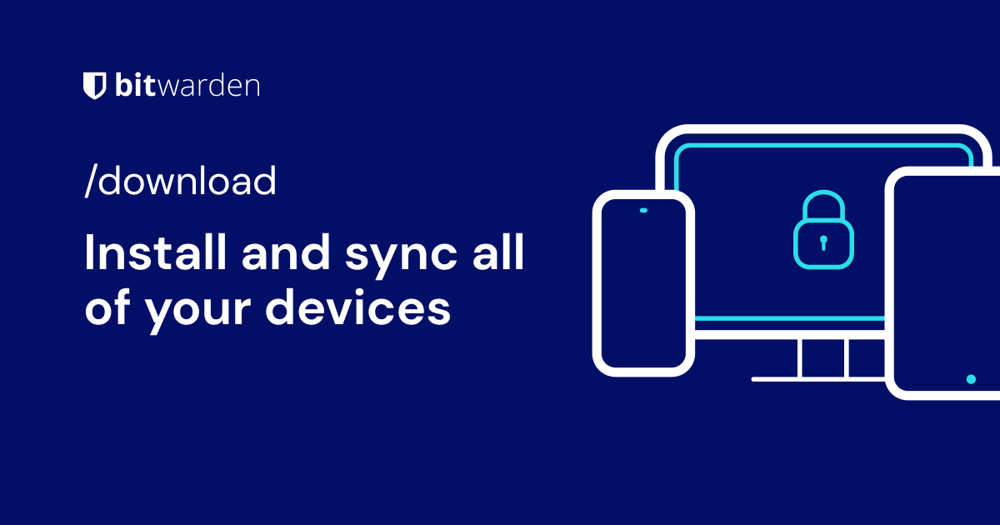

### [Download the Bitwarden Password Manager App for iPhone, Android, Chrome,...](https://bitwarden.com/download/)

Secure your digital life. Download Bitwarden and sync your secure password vault across all your devices including mobile iPhone or Android devices, desktop applications such as Windows, MacOS, or Linux, and the browser extension on Chrome, Safari,...

免费计划适合大部分用户，有能力或者害怕隐私问题可以选择自行部署 VaultWarden

7.B站美化

BewlyCat

### [BewlyCat - Chrome 应用商店](https://chromewebstore.google.com/detail/bewlycat/oopkfefbgecikmfbbapnlpjidoomhjpl)

Just make a few small changes to your Bilibili homepage.

**码字不易，请留个赞和书签再走吧，希望能帮到大家。有问题可以在评论区留言，下次会更加完善！**


---


*来源: https://linux.do/t/topic/1667411.json*

