---

id: 1672075

title: "基于docker搭建sub2api图文教程"

created_at: 2026-02-28T15:18:16.185Z

username: miaowmint

display_username: "miaowmint"

---


# 基于docker搭建sub2api图文教程


本文作者：猫猫摸大鱼

## 1. 前言

本文隶属于 OpenClaw龙虾系列教程文章，建议按顺序阅读 ，可以访问OpenClaw龙虾系列教程文章目录 [https://iloli.love/archives/1766849996690](https://iloli.love/archives/1766849996690) 查看其它文章，本文也可单独作为 sub2api 搭建教程文章阅读

本文基于sub2api v0.1.84版本，Github地址为 [https://github.com/Wei-Shaw/sub2api](https://github.com/Wei-Shaw/sub2api)

sub2api 能够将 GeminiCLI ， ClaudeCode 等转换为不仅限于原客户端使用的API，从而供给OpenCode或其它客户端使用

搭建完才发现，当前版本的sub2api不能提供标准的OpenAI API，可用于OpenCode等，但我不知道能否用于OpenClaw

该项目有更多玩法，本文只赘述其中一部分，其他请自行探索

本系列教程全程使用腾讯云轻量应用服务器，可以参加腾讯云OpenClaw专属活动进行购买，新客68/年起，老客99/年起

活动链接 [https://cloud.tencent.com/act/pro/lighthouse-moltbot](https://cloud.tencent.com/act/pro/lighthouse-moltbot) （无AFF）

**就算不买也强烈推荐使用有 快照 功能的厂商的服务器进行搭建，并且一定要经常打快照，不要问为什么，血的教训，血的教训，血的教训**


## 2. 搭建

首先选择一个目录，本文中使用的是`/data/sub2api`

运行 `mkdir -p /data/sub2api && touch /data/sub2api/compose.yaml` ，创建docker compose文件

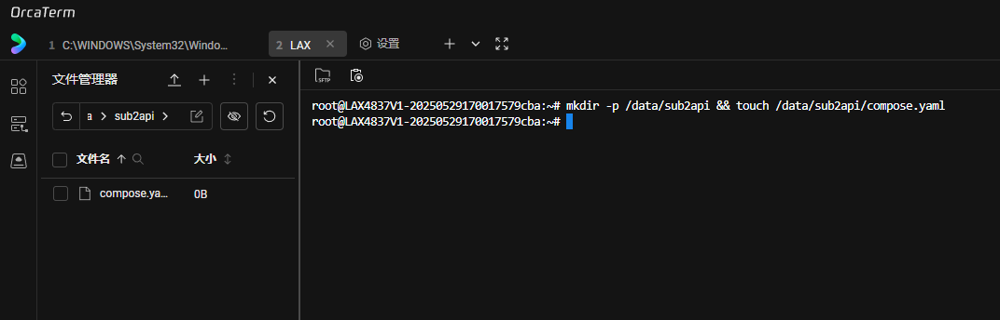

复制以下docker compose 配置（8080端口太常见容易被占用所以这里我改成了6780，可自行修改为其它端口）

```
services:
  # ================= 主程序 =================
  sub2api:
    image: weishaw/sub2api:latest
    container_name: sub2api
    restart: unless-stopped
    ports:
      - "6780:8080"
    volumes:
      - ./data/sub2api:/app/data # 挂载到当前目录的 data/sub2api
    environment:
      - AUTO_SETUP=true # 开启自动初始化
      - TZ=Asia/Shanghai # 设置时区
      - SERVER_MODE=release # 运行模式
      - DATABASE_HOST=postgres
      - DATABASE_PORT=5432
      - DATABASE_USER=sub2api # 默认数据库用户
      - DATABASE_PASSWORD=sub2api_password # 默认数据库密码
      - DATABASE_DBNAME=sub2api # 默认数据库名
      - REDIS_HOST=redis
      - REDIS_PORT=6379
      - REDIS_PASSWORD=redis_password # 默认 Redis 密码
      - ADMIN_EMAIL=admin@sub2api.local # 默认管理员账号
      - ADMIN_PASSWORD=admin123456 # 默认管理员密码
      - JWT_SECRET= # 固定 JWT 密钥
      - TOTP_ENCRYPTION_KEY= # 固定 2FA 密钥
      - SECURITY_URL_ALLOWLIST_ENABLED=false # 禁用白名单检查
      - SECURITY_URL_ALLOWLIST_ALLOW_INSECURE_HTTP=true # 允许 HTTP URL（⚠️ 不安全）
    depends_on:
      postgres: { condition: service_healthy }
      redis: { condition: service_healthy }
    networks:
      - sub2api-network

  # ================= 数据库 (PostgreSQL) =================
  postgres:
    image: postgres:18-alpine
    container_name: sub2api-postgres
    restart: unless-stopped
    volumes:
      - ./data/postgres:/var/lib/postgresql/data # 挂载到当前目录的 data/postgres
    environment:
      - POSTGRES_USER=sub2api
      - POSTGRES_PASSWORD=sub2api_password
      - POSTGRES_DB=sub2api
      - PGDATA=/var/lib/postgresql/data
      - TZ=Asia/Shanghai
    healthcheck:
      test: ["CMD-SHELL", "pg_isready -U sub2api -d sub2api"]
      interval: 10s
      timeout: 5s
      retries: 5
    networks:
      - sub2api-network

  # ================= 缓存 (Redis) =================
  redis:
    image: redis:8-alpine
    container_name: sub2api-redis
    restart: unless-stopped
    volumes:
      - ./data/redis:/data # 挂载到当前目录的 data/redis
    command: ["redis-server", "--requirepass", "redis_password", "--appendonly", "yes"]
    environment:
      - REDISCLI_AUTH=redis_password
      - TZ=Asia/Shanghai
    healthcheck:
      test: ["CMD", "redis-cli", "ping"]
      interval: 10s
      timeout: 5s
      retries: 5
    networks:
      - sub2api-network

networks:
  sub2api-network:
    driver: bridge
```

粘贴到刚刚新建的 compose.yaml 里，可选修改数据库信息，**请务必修改账号密码**

JWT密钥 和 2FA密钥 如果需要请自行生成（作用分别为）

如果使用HTTPS并且在意安全性，请删除 禁用白名单检查 和 允许HTTP URL 两项环境变量

如果只使用HTTP不使用HTTPS的话，这两个则似乎需要保留

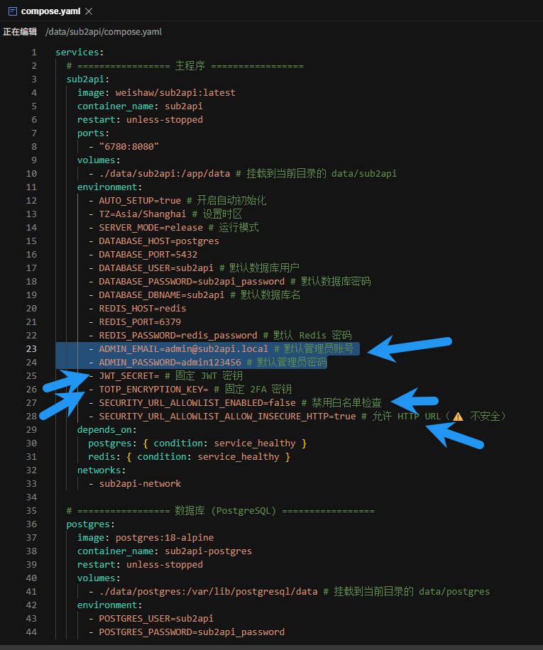

如果在上面修改了数据库信息，别忘了这里也要同步修改；如果没有修改则忽略此处

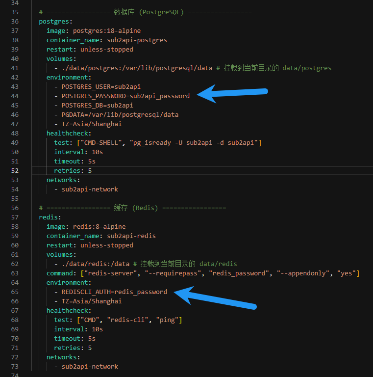

修改好后运行如下命令 `cd /data/sub2api && docker compose up -d` ，创建容器，如图即为成功

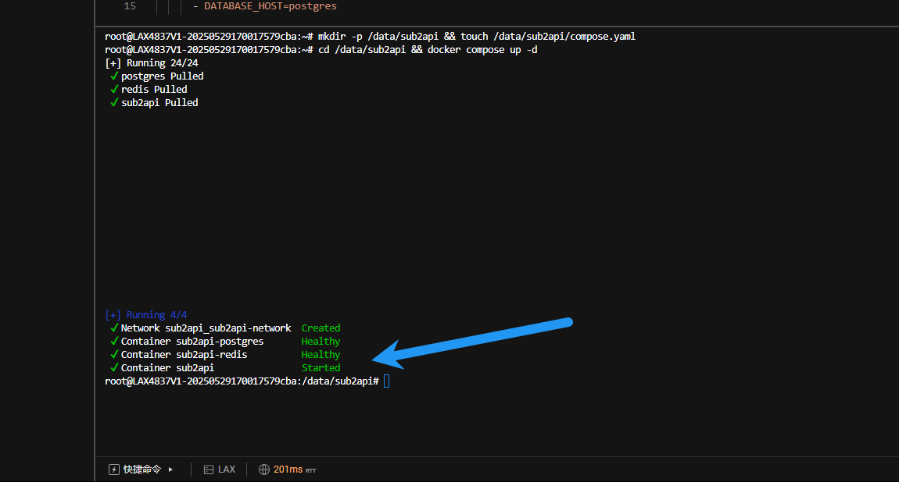

## 3. 配置

访问 服务器IP:6780 （如果你修改了端口则替换为你的端口），进入主页，点击登录

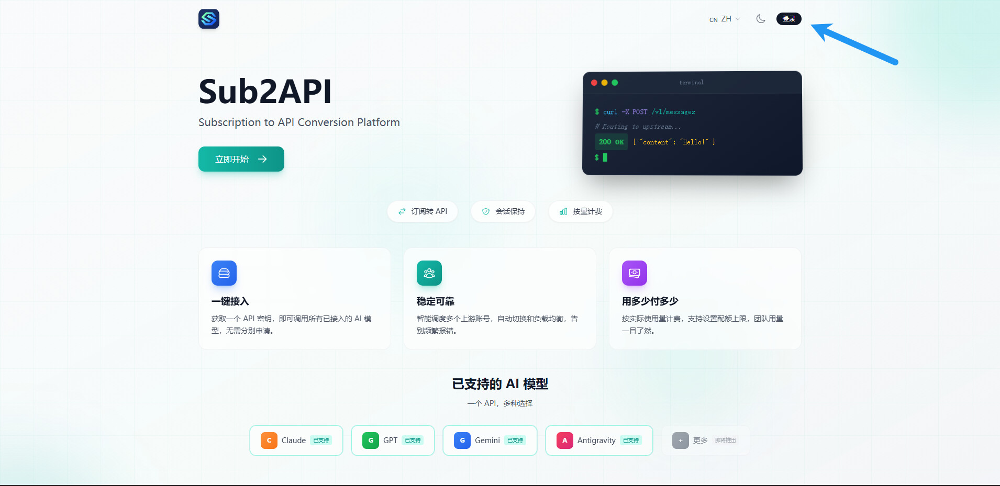

输入你在前面配置的账号密码，登录

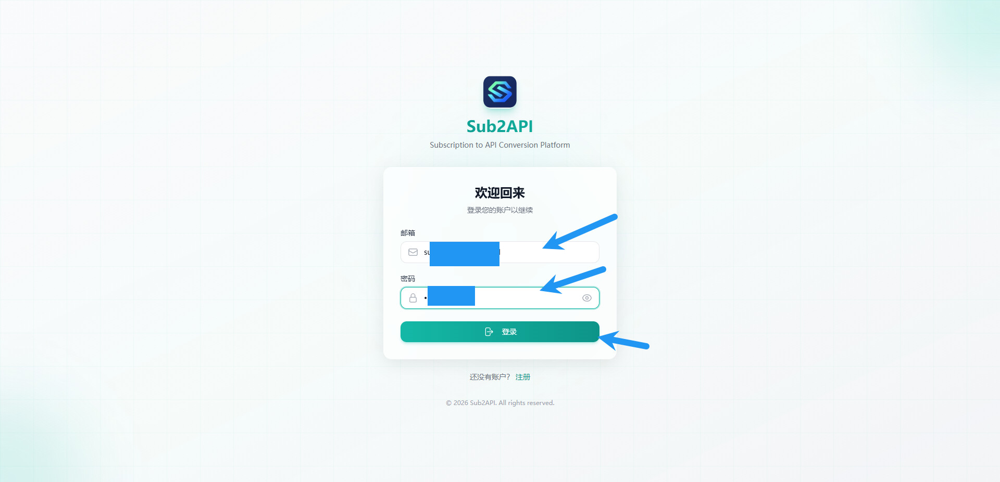

可以看到sub2api已经给出了配置向导，可以根据向导进行配置，也可以跟着我的教程走

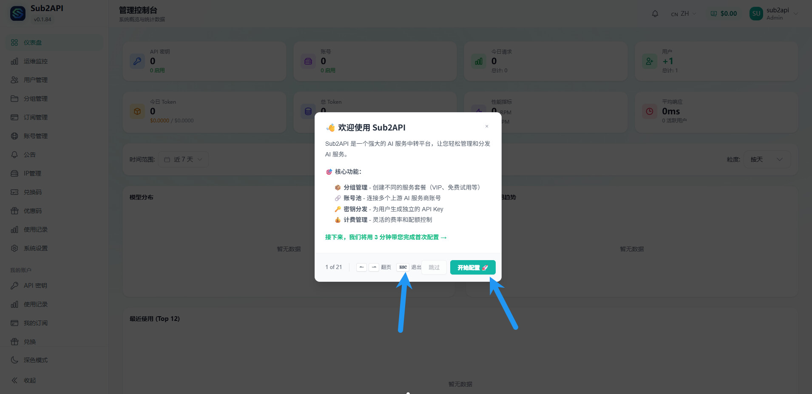

点击 分组管理 ，点击创建分组（不同的平台需要创建不同分组）


本文以对接Codex作为教程，其它大同小异，请自行研究

输入名称，平台选择OpenAI，点击创建

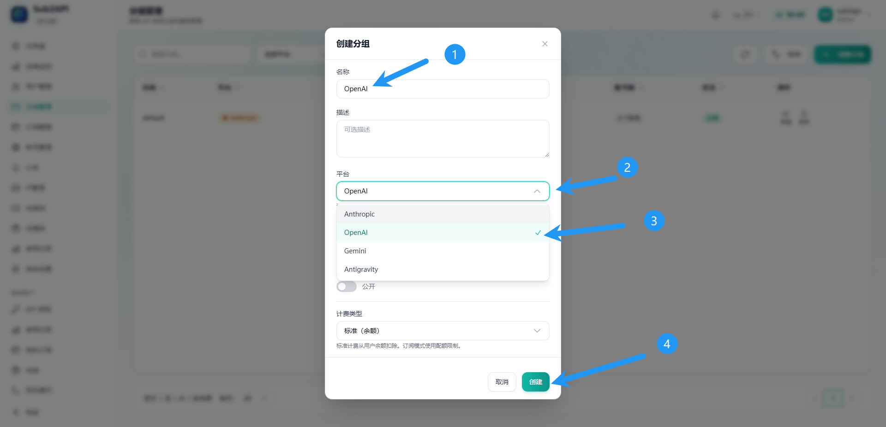

这里可以看见我们已经创建好的分组

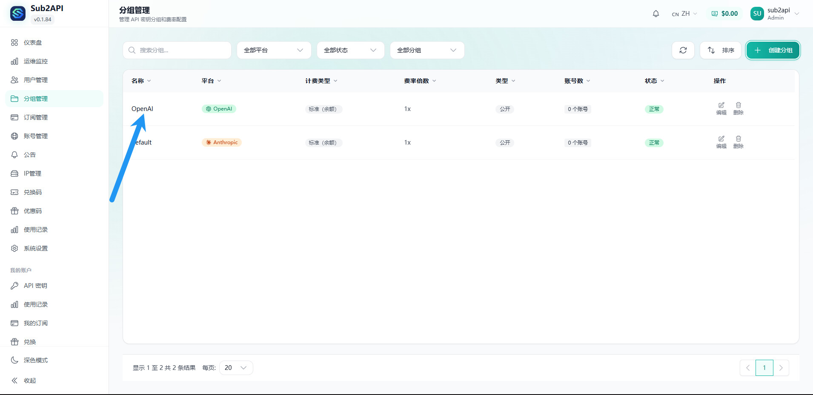

点击账号管理，点击添加账号


填写名称，平台选择OpenAI，账号类型选择OAuth


注意要下拉勾选前面创建的分组 点击下一步


点击生成授权链接


可以看到生成的授权链接，复制到浏览器打开它

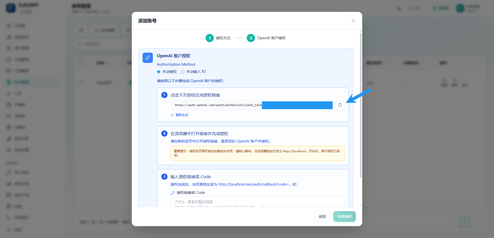

接下来按照提示登录

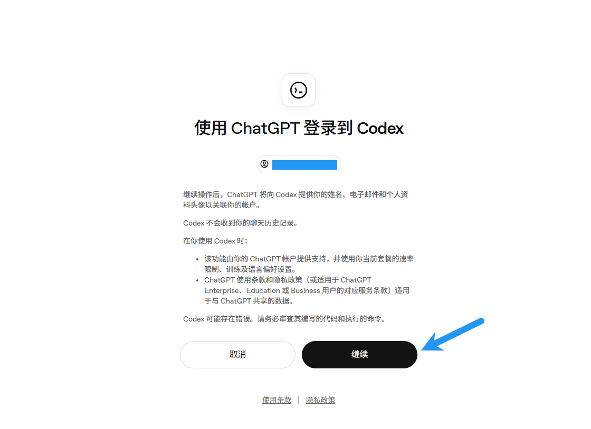

登录后显示无法访问此网站，为正常现象，将网址栏的内容全部复制

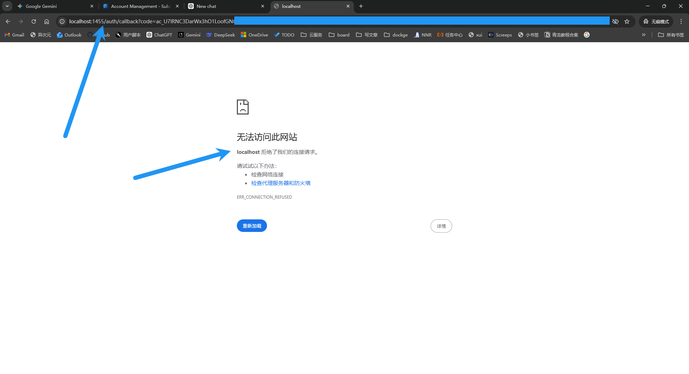

粘贴到如图所示位置，点击完成授权


可以看到我们刚刚添加的账号


接下来点击 API 密钥，点击创建密钥


填写名称，分组勾选我们之前创建的分组，点击创建


可以看到我们刚刚创建的 API 密钥

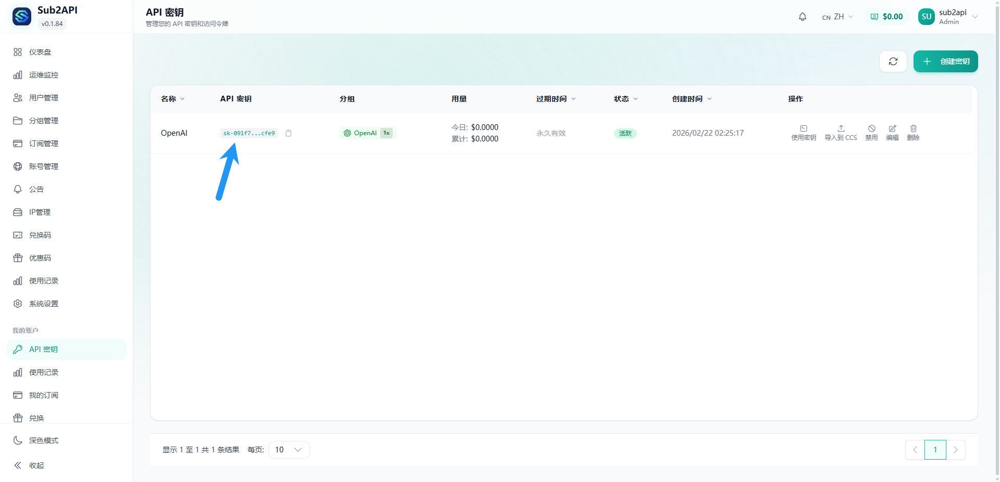

## 4. 使用

到此已经完成，可以使用该密钥了，BaseURL 即为你的服务器IP:项目端口，点击上图中的使用密钥 可以看到相关配置，这个项目不能提供标准的OpenAI API ，似乎只能给 OpenCode 使用，这里就不过多赘述了


---


*来源: https://linux.do/t/topic/1672075.json*

