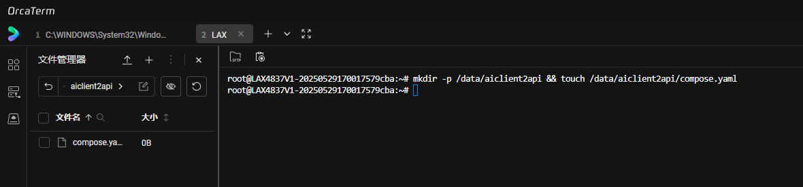
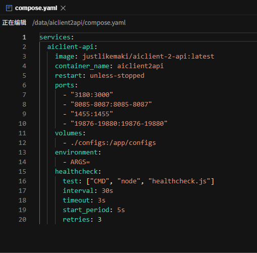
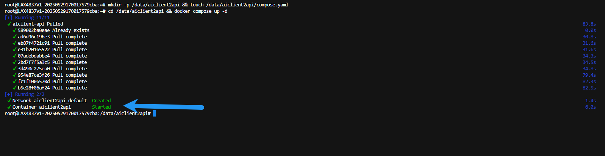
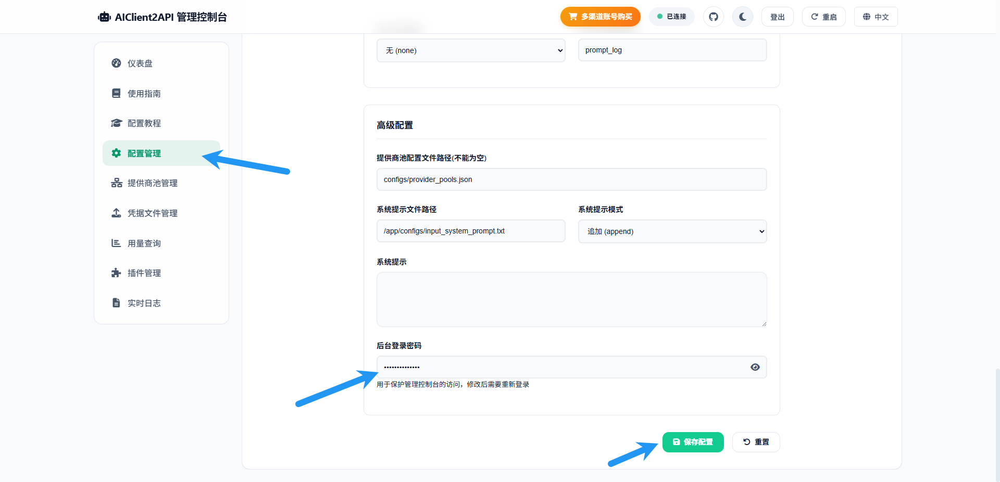
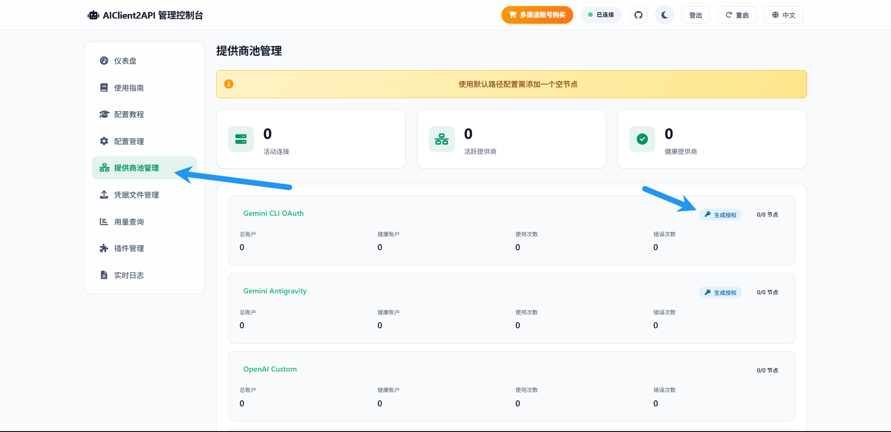
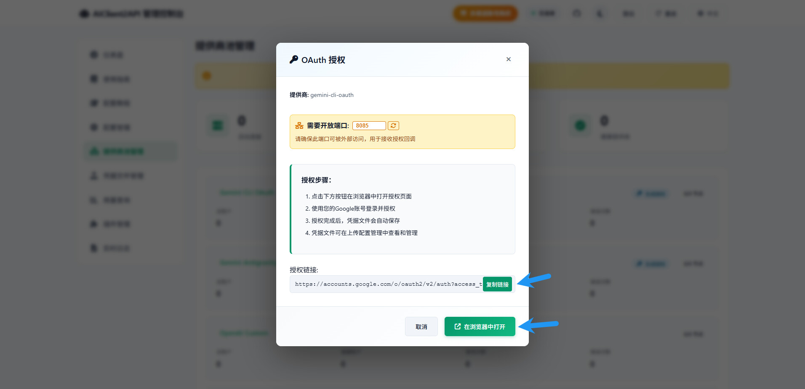
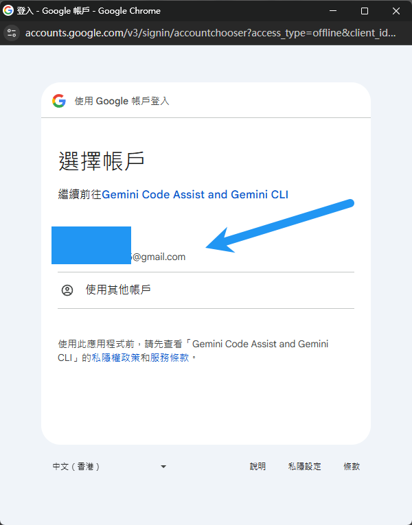
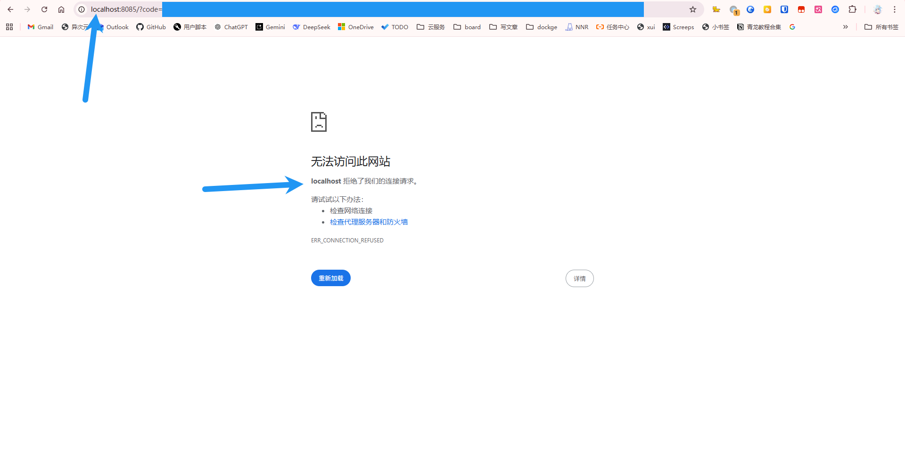
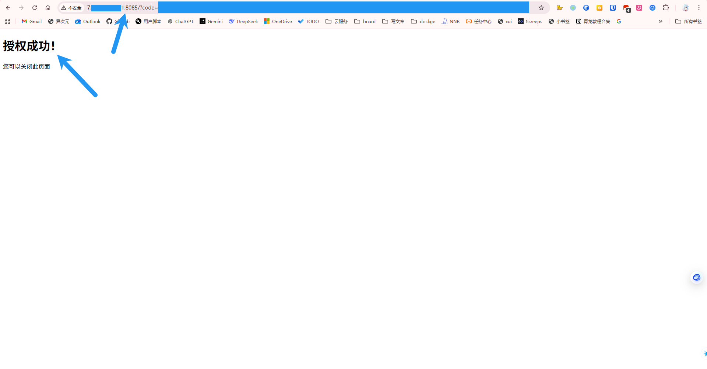
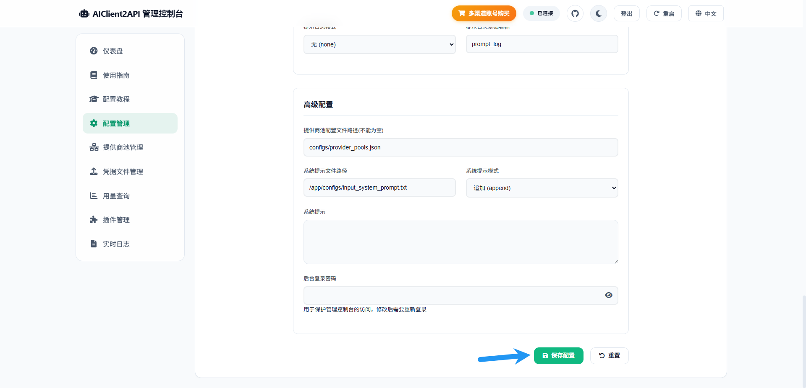

---

id: 1672077

title: "基于docker搭建aiclient2api图文教程"

created_at: 2026-02-28T15:19:04.285Z

username: miaowmint

display_username: "miaowmint"

---


# 基于docker搭建aiclient2api图文教程


本文作者：猫猫摸大鱼

## 1. 前言

本文隶属于 OpenClaw龙虾系列教程文章 ，建议按顺序阅读，可以访问OpenClaw龙虾系列教程文章目录 [https://iloli.love/archives/1766849996690](https://iloli.love/archives/1766849996690) 查看其它文章，本文也可单独作为 aiclient2api 搭建教程文章阅读

本文基于aiclient2api v2.9.7版本，Github地址为 [https://github.com/justlovemaki/AIClient-2-API](https://github.com/justlovemaki/AIClient-2-API)

aiclient2api 能够将 GeminiCLI ， ClaudeCode 等转换为不仅限于原客户端使用的API，从而供给OpenClaw或其它客户端使用

该项目纯自用项目，只能设置一个api密钥

该项目有更多玩法，本文只赘述其中一部分，其他请自行探索

本系列教程全程使用腾讯云轻量应用服务器，可以参加腾讯云OpenClaw专属活动进行购买，新客68/年起，老客99/年起

活动链接 [https://cloud.tencent.com/act/pro/lighthouse-moltbot](https://cloud.tencent.com/act/pro/lighthouse-moltbot) （无AFF）

**就算不买也强烈推荐使用有 快照 功能的厂商的服务器进行搭建，并且一定要经常打快照，不要问为什么，血的教训，血的教训，血的教训**


## 2. 搭建

首先选择一个目录，本文中使用的是`/data/aiclient2api`

运行 `mkdir -p /data/aiclient2api && touch /data/aiclient2api/compose.yaml` ，创建docker compose文件



复制以下docker compose 配置（3000端口比较常见容易被占用所以这里我改成了3180，可自行修改为其它端口）


3000 为 Web UI，其余为 OAuth 回调端口（Gemini: 8085, Antigravity: 8086, iFlow: 8087, Codex: 1455, Kiro: 19876-19880）

```
services:
  aiclient-api:
    image: justlikemaki/aiclient-2-api:latest
    container_name: aiclient2api
    restart: unless-stopped
    ports:
      - "3180:3000"
      - "8085-8087:8085-8087"
      - "1455:1455"
      - "19876-19880:19876-19880"
    volumes:
      - ./configs:/app/configs
    environment:
      - ARGS=
    healthcheck:
      test: ["CMD", "node", "healthcheck.js"]
      interval: 30s
      timeout: 3s
      start_period: 5s
      retries: 3
```

粘贴到刚刚新建的 compose.yaml 里



运行如下命令 `cd /data/aiclient2api && docker compose up -d` ，创建容器，如图即为成功



## 3. 配置

访问 服务器IP:3180 （如果你修改了端口则替换为你的端口），初始密码为 `admin123` ，点击登录


进入管理控制台


首先要修改登录密码，点击 配置管理 ，滑动到最下面，修改后台登录密码，点击保存配置



本文以对接Gemini CLI作为教程，其它大同小异，请自行研究

（如果以前没用过Gemini CLI，可能会遇到需要开启谷歌云或验证手机号等情况，建议先本地安装一个Gemini CLI登录过排完坑了再来接入）

点击提供商池管理，点击生成授权



选择 OAuth 授权


复制链接在浏览器中打开，或直接点击 在浏览器中打开 按钮



根据提示登录 Google 账户



此时会显示如下，不要慌张，将此处的 localhost 修改为你的服务器IP，再次访问即可



如下，授权成功



回到aiclient2api可以看到已经成功了


接下来点击配置管理，将API密钥随意修改为你想要的，下面的模型提供商把你对接了的都选上（本文只对接了一个 Gemini CLI 所以暂时只选这一个）


下拉到此处，启用OAuth令牌自动刷新


下拉到最下方，保存配置



## 4. 使用

到此已经完成，可以使用该密钥了，BaseURL 即为你的服务器IP:项目端口，本项目能提供标准的OpenAI API和Claude API，这里就不过多赘述了


---


*来源: https://linux.do/t/topic/1672077.json*

