---

id: 1672081

title: "基于docker搭建CLIProxyAPI图文教程"

created_at: 2026-02-28T15:19:42.503Z

username: miaowmint

display_username: "miaowmint"

---


# 基于docker搭建CLIProxyAPI图文教程


本文作者：猫猫摸大鱼

## 1. 前言

本文隶属于 OpenClaw龙虾系列教程文章，建议按顺序阅读，可以访问OpenClaw龙虾系列教程文章目录 [https://iloli.love/archives/1766849996690](https://iloli.love/archives/1766849996690) 查看其它文章，本文也可单独作为 CLIProxyAPI 搭建教程文章阅读

本文基于CLIProxyAPI v6.8.24版本，Github地址为 [https://github.com/router-for-me/CLIProxyAPI](https://github.com/router-for-me/CLIProxyAPI)

CLIProxyAPI 能够将 GeminiCLI ， ClaudeCode 等转换为不仅限于原客户端使用的API，从而供给OpenClaw或其它客户端使用

该项目有更多玩法，本文只赘述其中一部分，其他请自行探索

本系列教程全程使用腾讯云轻量应用服务器，可以参加腾讯云OpenClaw专属活动进行购买，新客68/年起，老客99/年起

活动链接 [https://cloud.tencent.com/act/pro/lighthouse-moltbot](https://cloud.tencent.com/act/pro/lighthouse-moltbot) （无AFF）

**就算不买也强烈推荐使用有 快照 功能的厂商的服务器进行搭建，并且一定要经常打快照，不要问为什么，血的教训，血的教训，血的教训**


## 2. 搭建

首先选择一个目录，本文中使用的是`/data/CLIProxyAPI`

运行 `mkdir -p /data/CLIProxyAPI && touch /data/CLIProxyAPI/config.yaml` ，创建项目配置文件

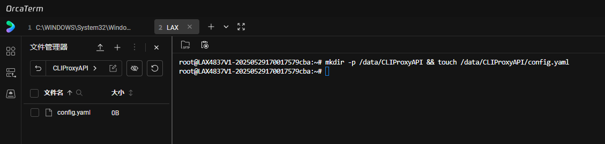

复制以下项目配置，将 secret-key 修改为你的密码

```
# Server host/interface to bind to. Default is empty ("") to bind all interfaces (IPv4 + IPv6).
# Use "127.0.0.1" or "localhost" to restrict access to local machine only.
host: ""
# Server port
port: 8317
# TLS settings for HTTPS. When enabled, the server listens with the provided certificate and key.
tls:
  enable: false
  cert: ""
  key: ""
# Management API settings
remote-management:
# Whether to allow remote (non-localhost) management access.
# When false, only localhost can access management endpoints (a key is still required).
  allow-remote: true
# Management key. If a plaintext value is provided here, it will be hashed on startup.
# All management requests (even from localhost) require this key.
# Leave empty to disable the Management API entirely (404 for all /v0/management routes).
  secret-key: "loginpassword"
# Disable the bundled management control panel asset download and HTTP route when true.
  disable-control-panel: false
# GitHub repository for the management control panel. Accepts a repository URL or releases API URL.
  panel-github-repository: "https://github.com/router-for-me/Cli-Proxy-API-Management-Center"
# Authentication directory (supports ~ for home directory)
auth-dir: "~/.cli-proxy-api"
```

粘贴到刚刚新建的 config.yaml 里

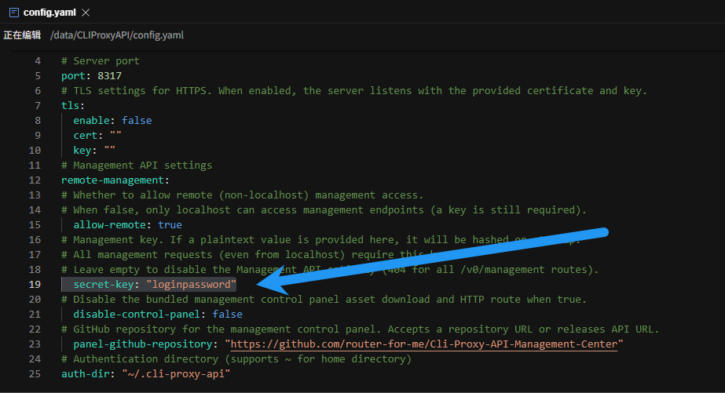

然后运行 `mkdir -p /data/CLIProxyAPI && touch /data/CLIProxyAPI/compose.yaml` ，创建docker compose文件

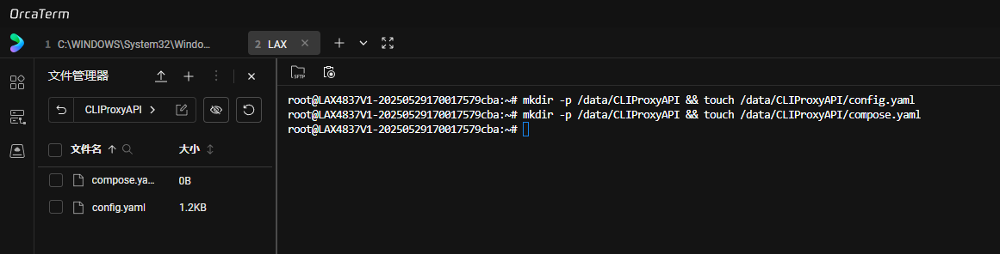

复制以下docker compose 配置

```
services:
  cli-proxy-api:
    image: eceasy/cli-proxy-api:latest
    container_name: cli-proxy-api
    ports:
      - "8317:8317"
    volumes:
      - ./config.yaml:/CLIProxyAPI/config.yaml
      - ./auths:/root/.cli-proxy-api
    restart: unless-stopped
```

粘贴到刚刚新建的 compose.yaml 里

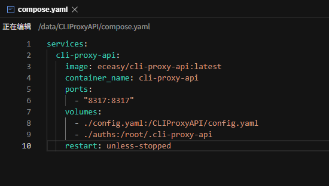

运行如下命令 `cd /data/CLIProxyAPI && docker compose up -d` ，创建容器，如图即为成功

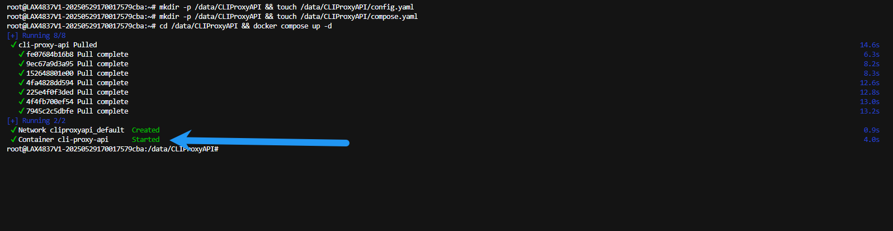

## 3. 配置

接下来访问 `服务器IP:8317/management.html` ，进入后台管理页（如果你修改了端口则替换为你的端口），输入你在前面配置的密码，登录

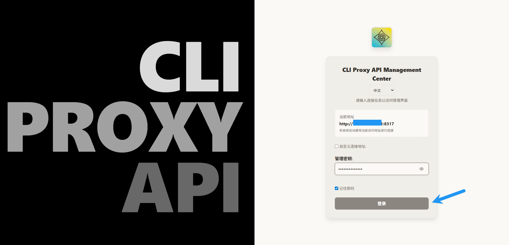

进入后台主页

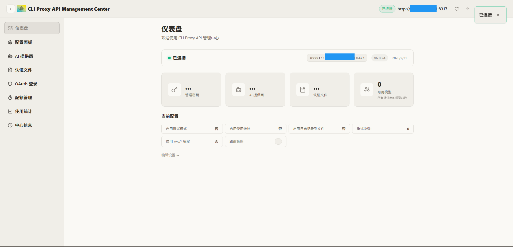

本文以对接Qwen作为教程，其它大同小异，请自行研究

点击 OAuth 登录

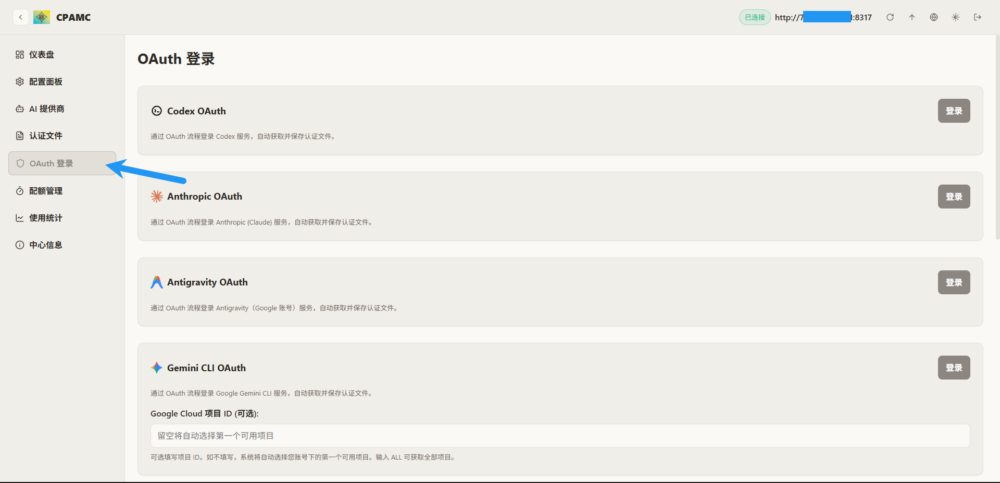

下拉到 Qwen OAuth ，点击登录，等待链接出现后，复制链接到浏览器打开，或者点击 打开链接 按钮

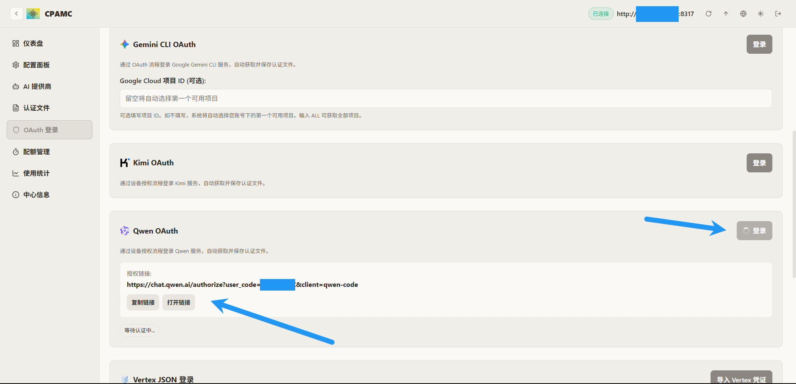

登录千问账号

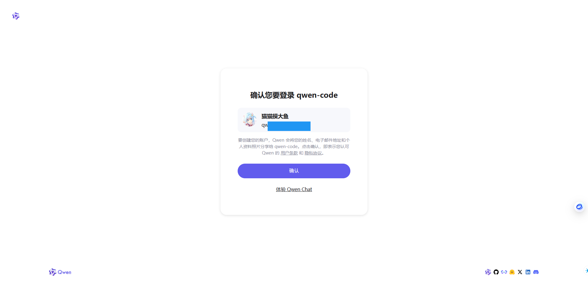

千问显示认证成功

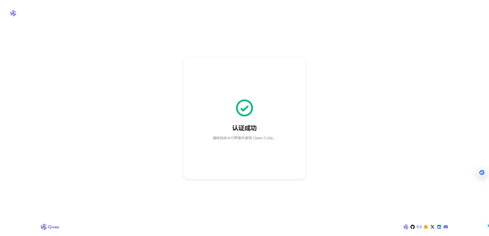

回到项目后台，也可以看到认证成功

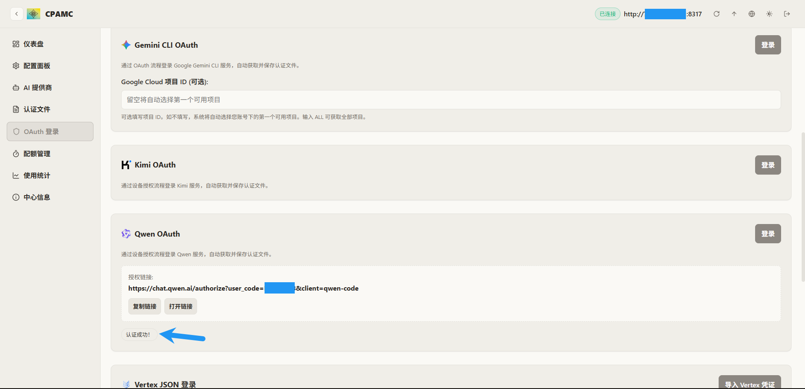

接下来添加 API 密钥，点击配置面板，下拉到认证配置处，点击添加 API 密钥

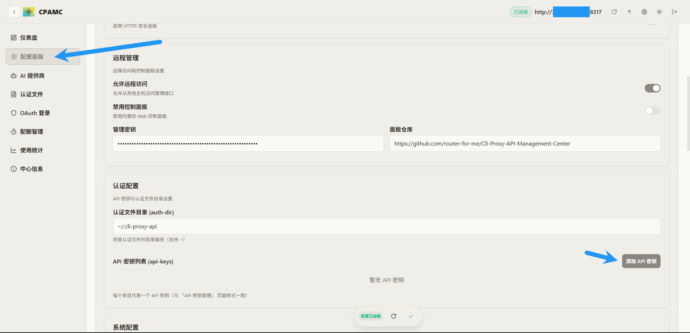

可自定义或随机生成一个 API 密钥，点击添加

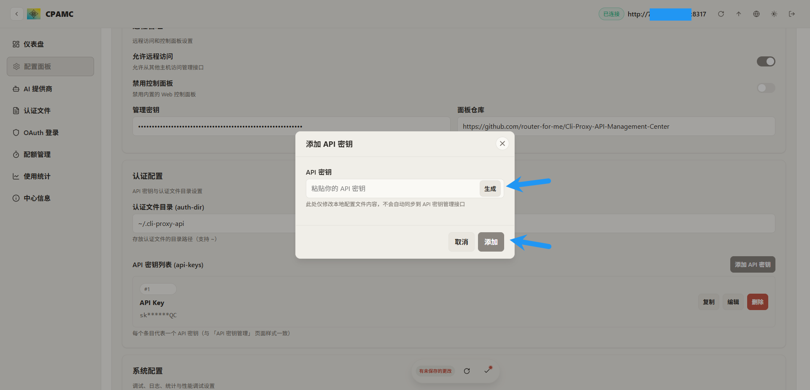

可以看到我们刚刚添加的 API 密钥，点击下方的对号，保存更改

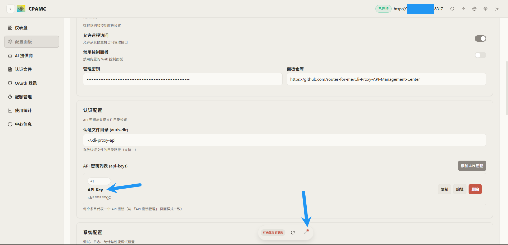

点击确认保存

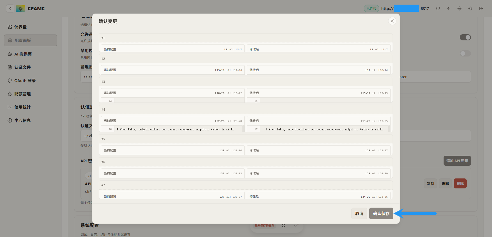

## 4. 使用

到此已经完成，可以使用该密钥了，BaseURL 即为你的服务器IP:项目端口，本项目能提供标准的OpenAI API和Claude API，这里就不过多赘述了


---


*来源: https://linux.do/t/topic/1672081.json*

