---

id: 1672092

title: "基于docker搭建octopus图文教程"

created_at: 2026-02-28T15:21:04.829Z

username: miaowmint

display_username: "miaowmint"

---


# 基于docker搭建octopus图文教程


本文作者：猫猫摸大鱼

## 1. 前言

本文隶属于 OpenClaw龙虾系列教程文章 ，建议按顺序阅读，可以访问OpenClaw龙虾系列教程文章目录 [https://iloli.love/archives/1766849996690](https://iloli.love/archives/1766849996690) 查看其它文章，本文也可单独作为 octopus 搭建教程文章阅读

本文基于octopus v0.9.18版本，Github地址为 [https://github.com/bestruirui/octopus](https://github.com/bestruirui/octopus)

octopus 是一个聚合API项目，能够将其它免费或付费 API 接入，并统一到一个API接口，从而方便供给OpenClaw或其它客户端使用

该项目偏向于个人化使用场景，并且比较偏向 模型 的聚合，适合同一个模型有多个中转站或者某个渠道有多个官网账号的人使用

该项目有更多玩法，本文只赘述其中一部分，其他请自行探索

本系列教程全程使用腾讯云轻量应用服务器，可以参加腾讯云OpenClaw专属活动进行购买，新客68/年起，老客99/年起

活动链接 [https://cloud.tencent.com/act/pro/lighthouse-moltbot](https://cloud.tencent.com/act/pro/lighthouse-moltbot) （无AFF）

**就算不买也强烈推荐使用有 快照 功能的厂商的服务器进行搭建，并且一定要经常打快照，不要问为什么，血的教训，血的教训，血的教训**


## 2. 搭建

首先选择一个目录，本文中使用的是 `/data/octopus` ，先在该目录下创建 `compose.yaml` 文件

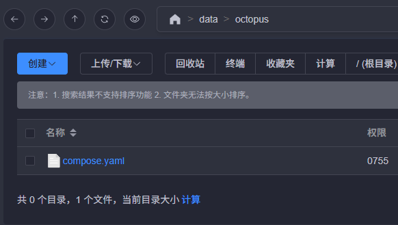

复制以下 docker compose 配置（8080端口太常见容易被占用所以这里我改成了8780，可自行修改为其它端口）

```
services:
  octopus:
    image: bestrui/octopus
    ports:
       - '8780:8080'
    volumes:
       - './data:/app/data'
    container_name: octopus
    restart: unless-stopped
```

粘贴到 compose.yaml 里

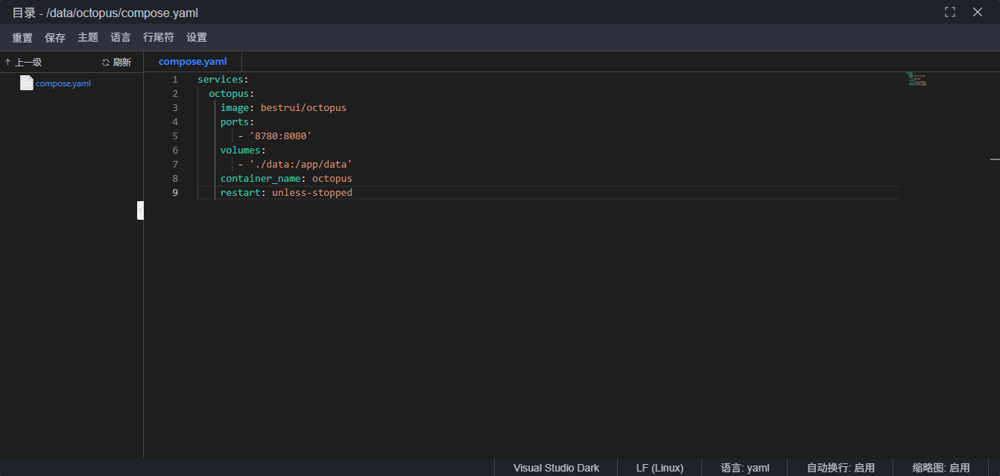

在 `/data/octopus` 下运行 `docker compose up -d` ，创建容器，如图即为成功

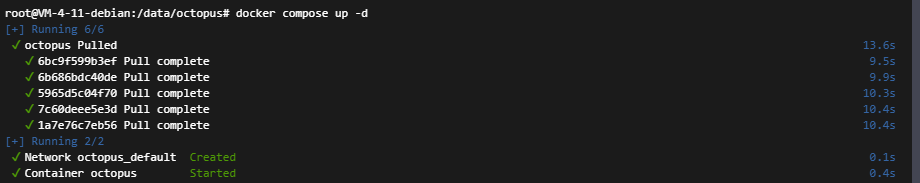

## 3. 配置

访问 服务器IP:8780 （如果你修改了端口则替换为你的端口），进入登录界面，初始账号密码为 `admin` ，点击登录

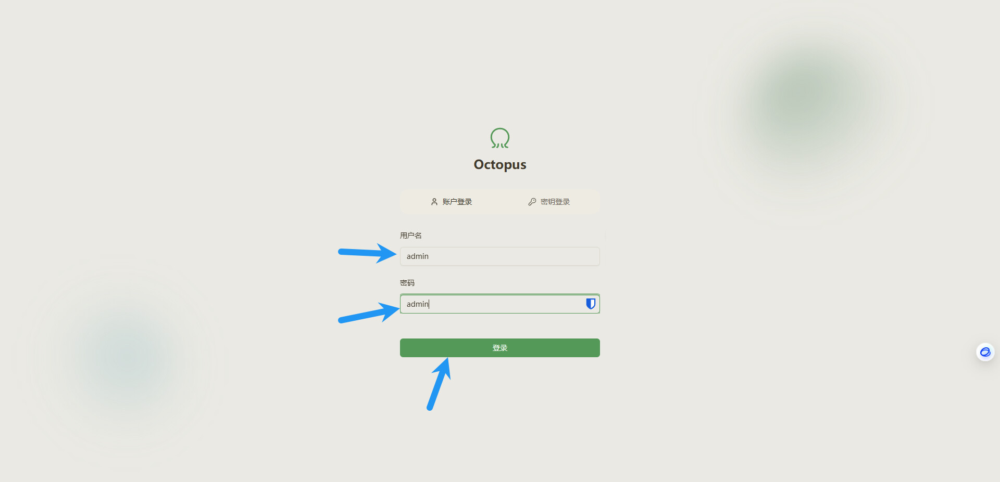

进入后台主页

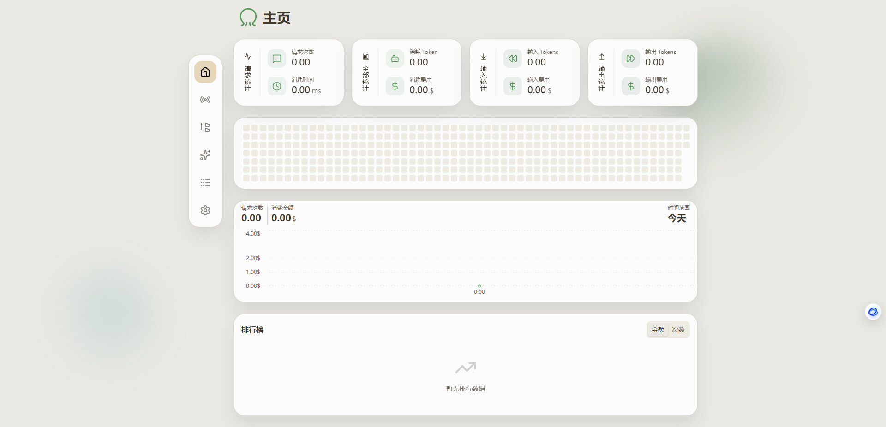

点击设置，修改初始用户名，点击保存（我不理解为什么用户名和密码不能一起修改，一定要分开修改，修改其中一个还需要重新登录，导致我需要修改，登录，再修改，再登录，并且还没有退出登录按钮）

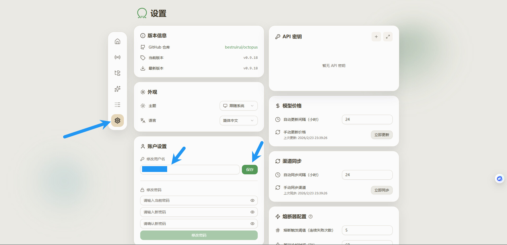

用新用户名和旧密码 `admin` 登录

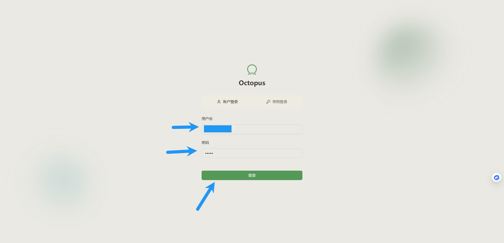

点击设置，修改初始密码，点击修改密码

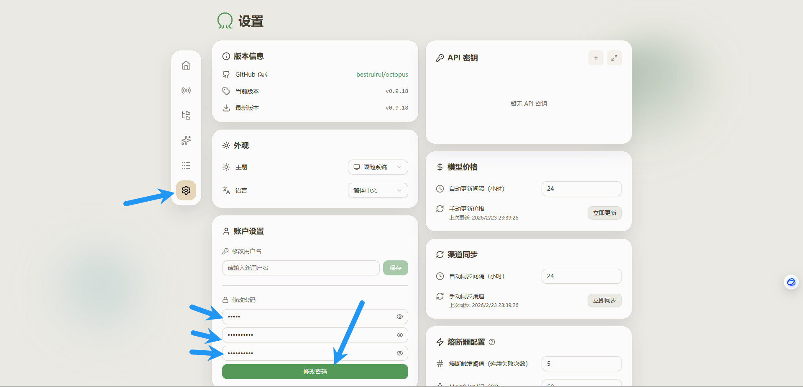

用新用户名和新密码登录

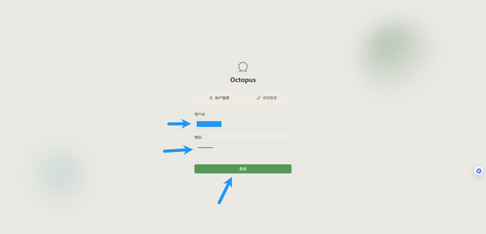

点击 渠道 ，点击右上角 +

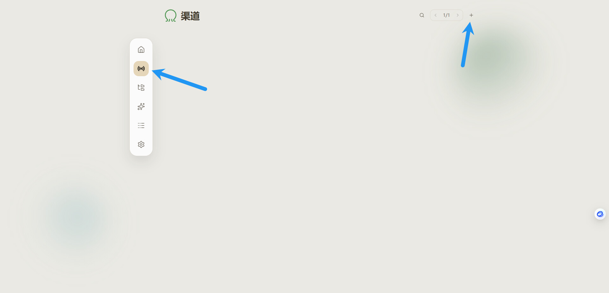

这里我们可以接入多种类型的免费或者付费 API ，本文中我们仅演示接入在 [https://iloli.love/archives/1771758983917](https://iloli.love/archives/1771758983917) 这篇文章里搭建的 API

（所有兼容标准化 OpenAI API 的大模型，都可以按照这个方法接入）

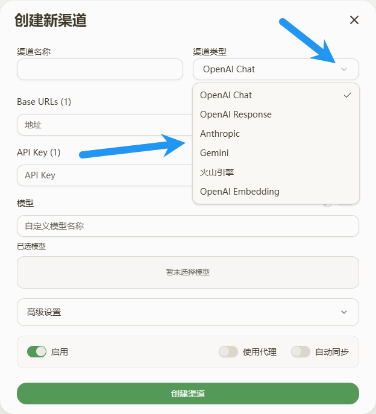

类型默认 OpenAI Chat ，名称随意，API Key 填写在CLIProxyAPI配置的密钥，Base URL填写 CLIProxyAPI的服务器IP:端口/v1，或是你反代CLIProxyAPI的域名/v1（注意！一定要带/v1），点击模型处的刷新，点击创建渠道

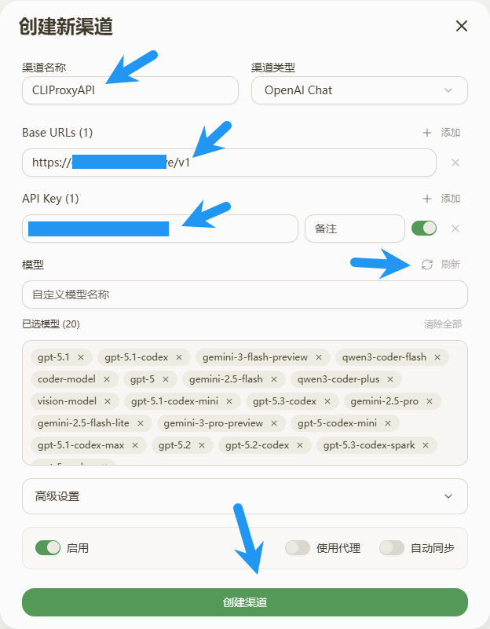

可以看到我们刚刚创建的渠道

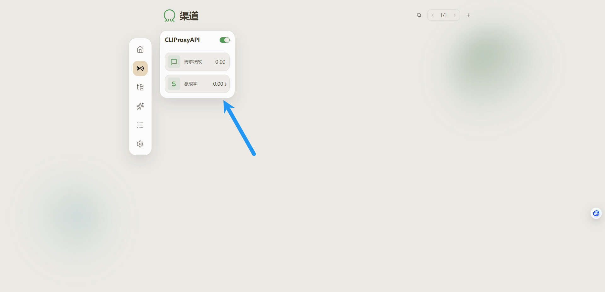

点击分组，点击右上角 +

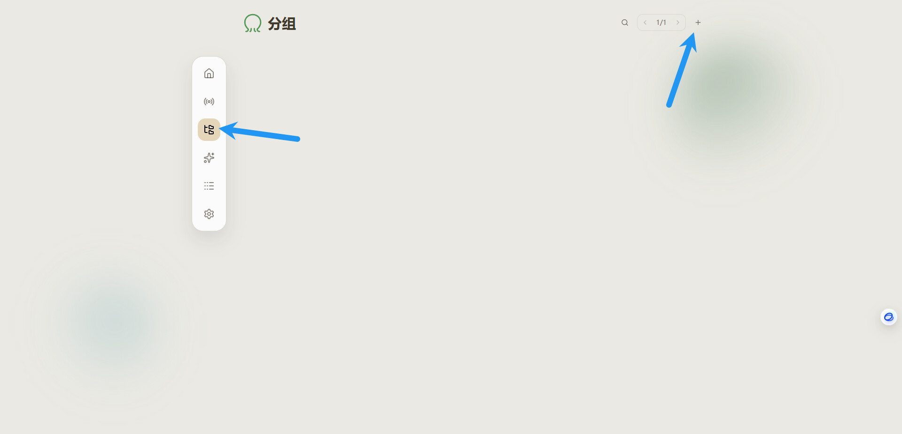

该项目的分组最好是以模型为单位配置的，即每个模型一个分组，这里我们只为 `qwen3-coder-plus` 添加一个分组作为演示

名称这里我选择使用模型名作为分组名，点击以下拉渠道，点击 `qwen3-coder-plus` 模型右边的加号，点击创建

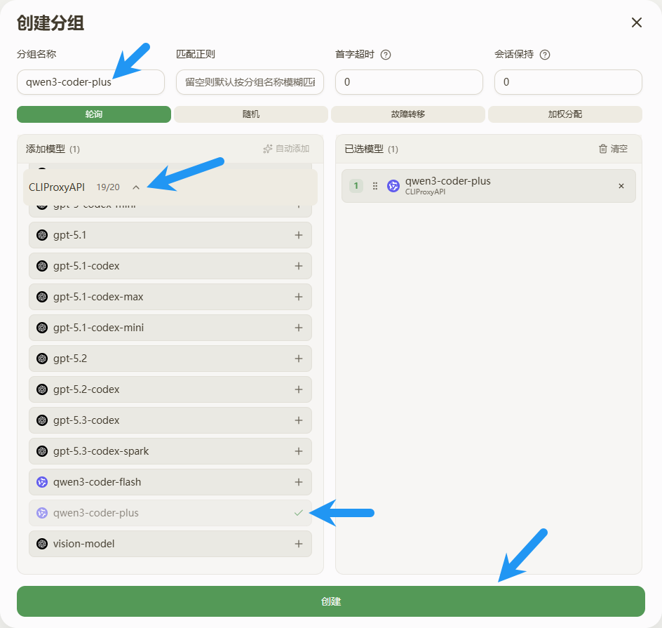

可以看到我们刚刚创建的分组

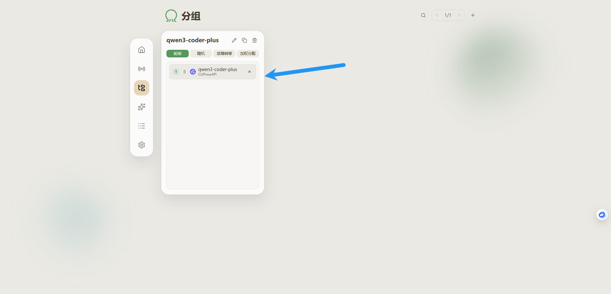

点击设置，点击 API 密钥的 + ，添加 API 密钥

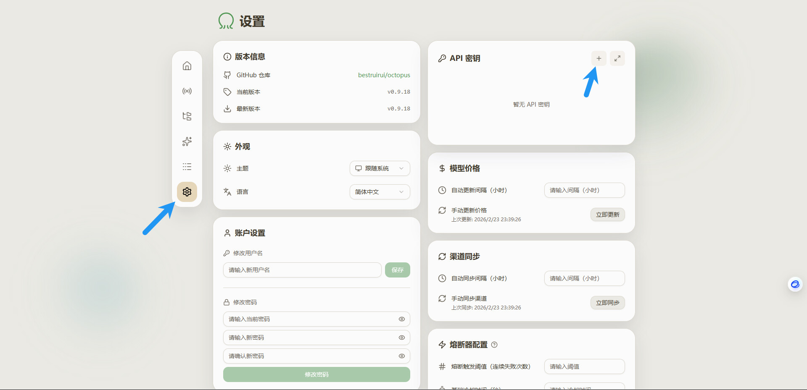

名称随意，把刚刚创建的分组点亮，点击创建

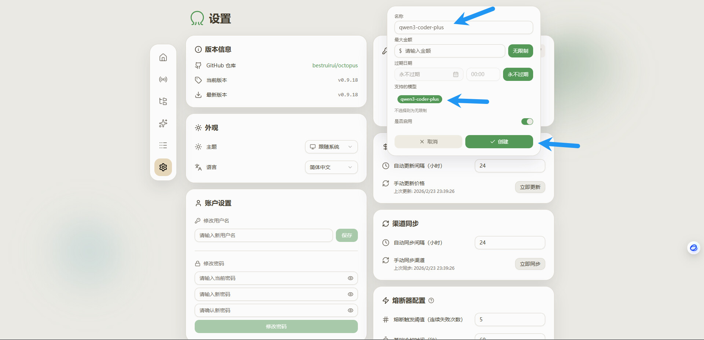

可以看到我们创建的 API 密钥

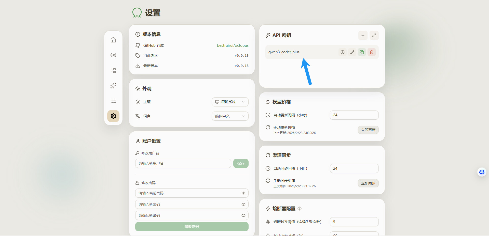

## 4. 使用

到此已经完成，可以使用该密钥了，BaseURL 即为你的服务器IP:项目端口，该项目可以聚合更多大模型 API ，统一直接供给 OpenClaw 使用，这里就不过多赘述了

*彩蛋：（因为我一开始踩大坑了，所以写完我特意测试了一下，确定了这么配置是可以用的）*

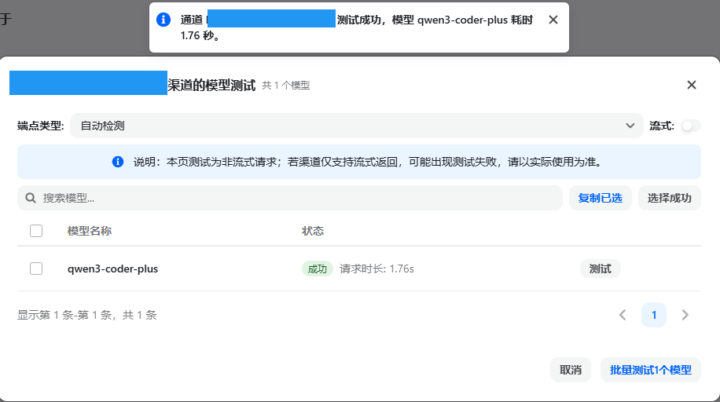


---


*来源: https://linux.do/t/topic/1672092.json*

