---

id: 1672098

title: "使用1panel搭建OpenClaw图文教程"

created_at: 2026-02-28T15:22:29.945Z

username: miaowmint

display_username: "miaowmint"

---

# 使用1panel搭建OpenClaw图文教程

本文作者：猫猫摸大鱼

## 1. 前言

本文隶属于 OpenClaw 龙虾系列教程文章，建议按顺序阅读，可以访问OpenClaw龙虾系列教程文章目录 [https://iloli.love/archives/1766849996690](https://iloli.love/archives/1766849996690) 查看其它文章

本文基于 1Panel v2.1.1 版本以及 OpenClaw-20260226 版本

本文中安装的是由 1Panel 构建的 Docker 版本，非官方直装版本

本系列教程全程使用腾讯云轻量应用服务器，可以参加腾讯云OpenClaw专属活动进行购买，新客68/年起，老客99/年起

活动链接 [https://cloud.tencent.com/act/pro/lighthouse-moltbot](https://cloud.tencent.com/act/pro/lighthouse-moltbot) （无AFF）

**就算不买也强烈推荐使用有 快照 功能的厂商的服务器进行搭建，并且一定要经常打快照，不要问为什么，血的教训，血的教训，血的教训**

## 2.配置并搭建

进入 1Panel 面板，点击 AI 下拉，点击智能体，点击模型账号，点击创建模型账号

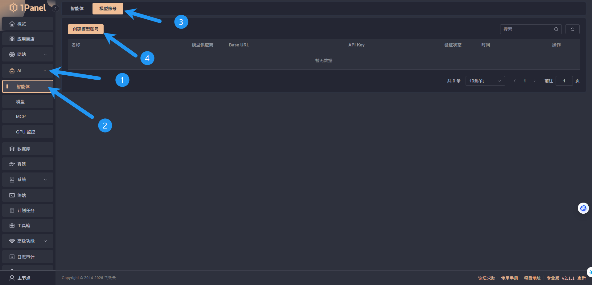

点击下拉模型供应商，选择自定义（这里我要使用的是前面教程反代出来的自建 API，如果你有其他官方 API，也可以直接在这里接入，这里不做赘述）

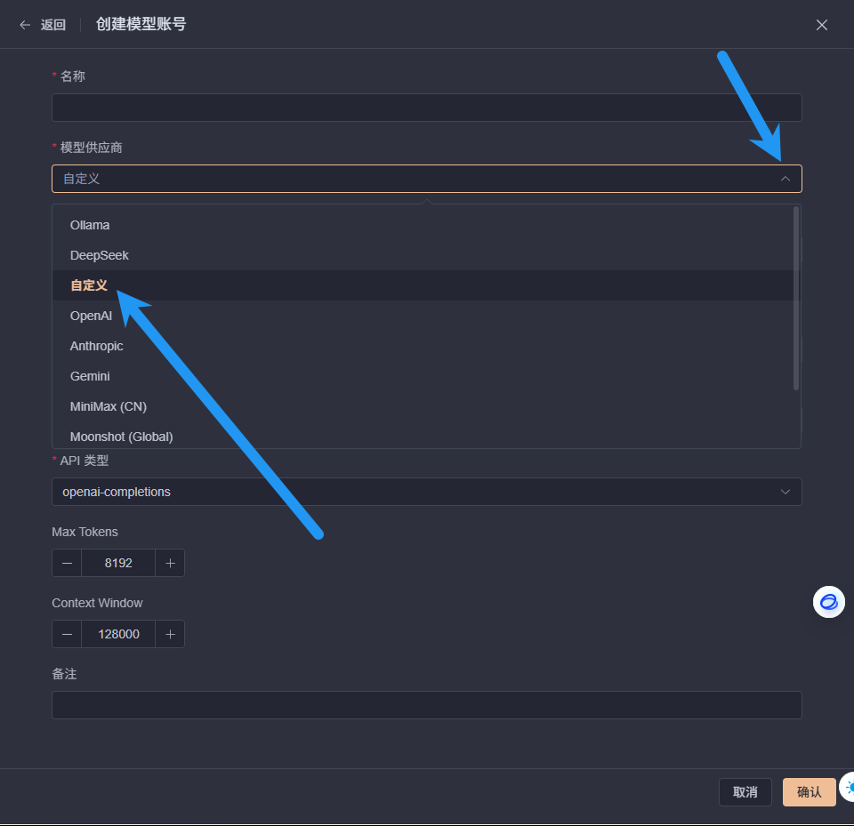

根据自己的实际情况，填写相关信息，点击确认

（ 名称随意；API Key 为在自建项目里创建的 API Key ；Base URL 为自建项目的 服务器IP:端口 或是为项目反代的 域名（结尾一定要带`/v1`）；模型 为在自建项目里获取到的模型名称，选择其中一个；API 类型 无需改动）

（Max Tokens 为 AI 每次生成的最大 Token 数量；Context window 为模型上下文窗口的长度；这两个可以根据模型的实际情况进行调整，也可以直接默认）

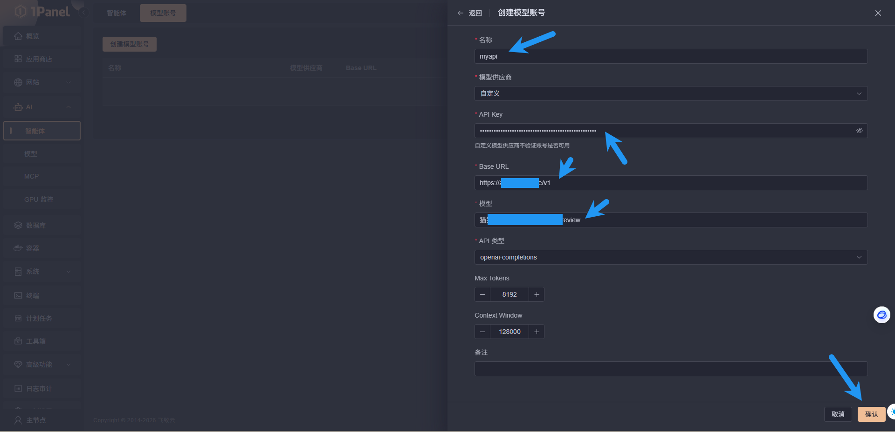

可以看到我们刚刚创建的模型账号

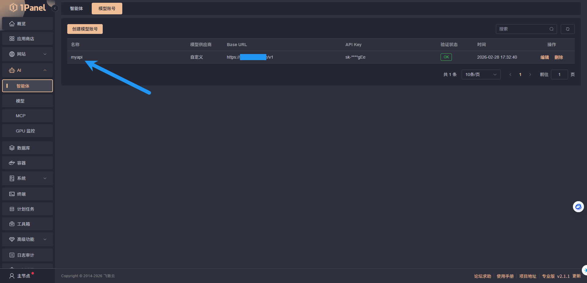

点击智能体，点击创建智能体，点击下拉模型供应商，选择自定义，点击确认

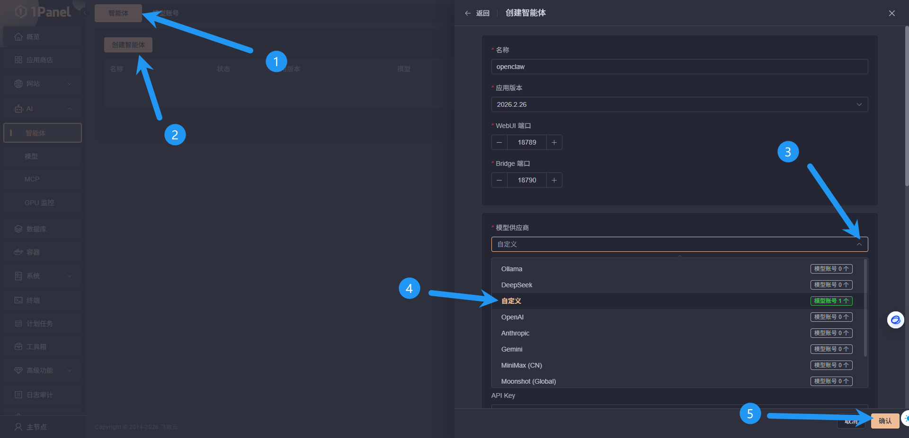

等待一会，如图所示即为成功

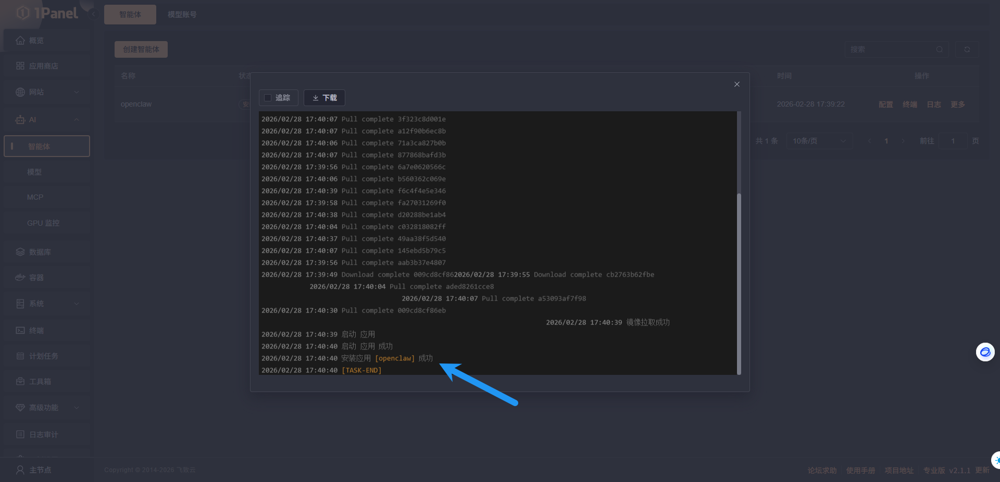

可以看到我们刚刚创建的智能体（OpenClaw）

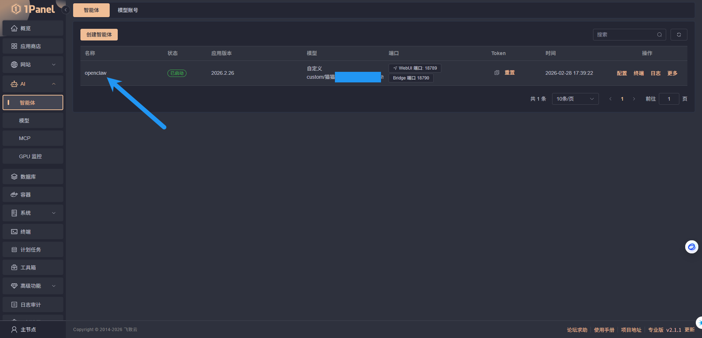

接下来点击面板设置，点击默认访问地址的设置，填入自己服务器的 IP ，点击确认

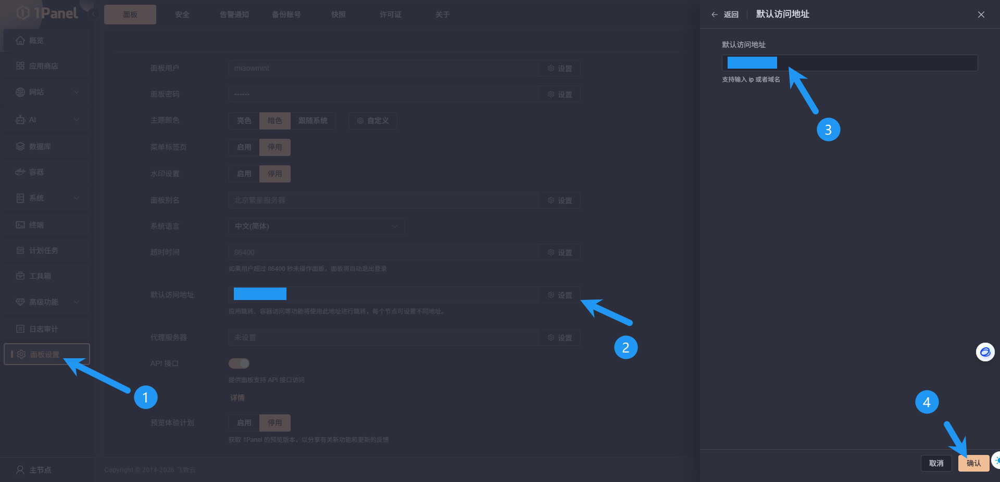

然后点击 AI ，点击智能体，点击 WebUI 端口 这个按钮

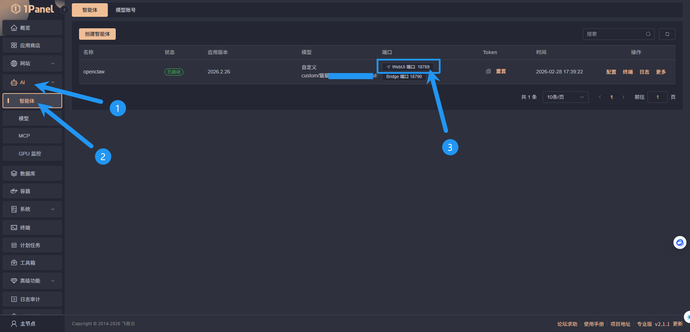

会跳转访问 服务器 IP:18789/?token=你的OpenClawToken

然后会重定向到 WebUI 界面

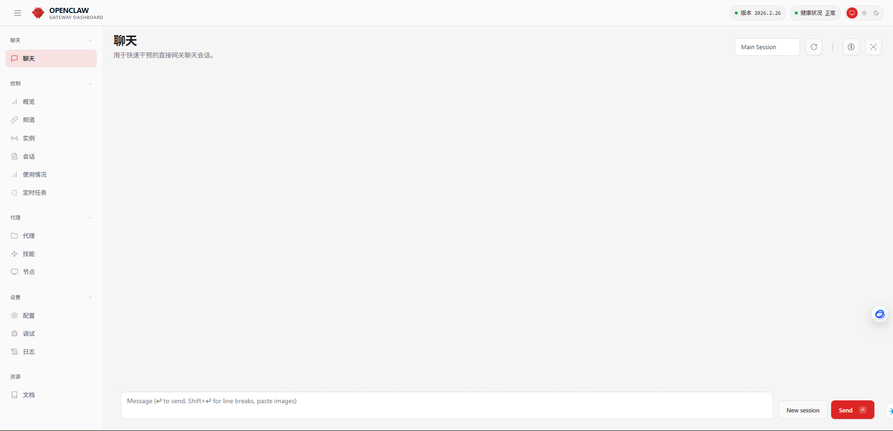

## 3. 开始使用

接下来就可以在 WebUI 里进行其他配置与聊天了

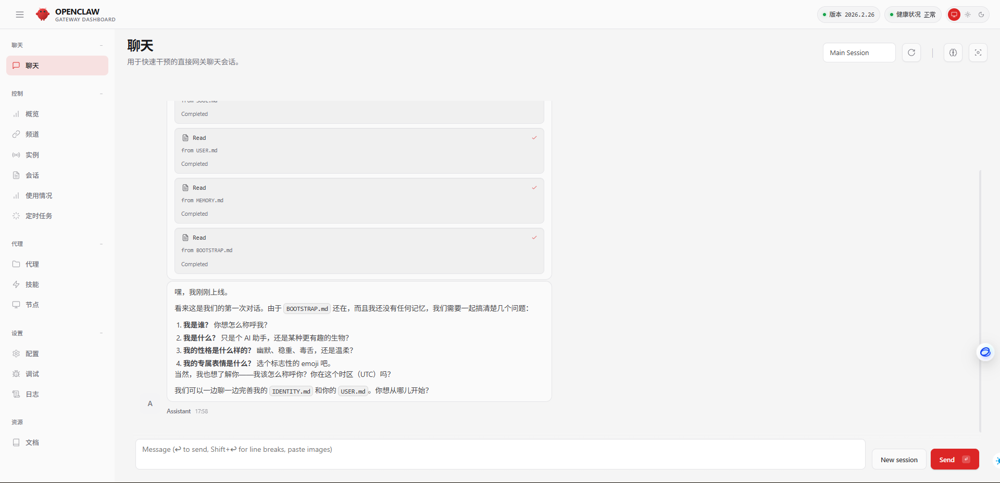

---

*来源: https://linux.do/t/topic/1672098.json*

