---

id: 1675880

title: "使用官方一键脚本搭建OpenClaw图文教程"

created_at: 2026-03-01T18:05:39.141Z

username: miaowmint

display_username: "miaowmint"

---


# 使用官方一键脚本搭建OpenClaw图文教程


本文作者：猫猫摸大鱼

## 1. 前言

本文隶属于 OpenClaw 龙虾系列教程文章，建议按顺序阅读，可以访问OpenClaw龙虾系列教程文章目录 [https://iloli.love/archives/1766849996690](https://iloli.love/archives/1766849996690) 查看其它文章

本文基于 OpenClaw 2026.2.26 版本

本文中安装的是官方一键脚本直装版本

本系列教程全程使用腾讯云轻量应用服务器，可以参加腾讯云OpenClaw专属活动进行购买，新客68/年起，老客99/年起

活动链接 [https://cloud.tencent.com/act/pro/lighthouse-moltbot](https://cloud.tencent.com/act/pro/lighthouse-moltbot) （无AFF）

**就算不买也强烈推荐使用有 快照 功能的厂商的服务器进行搭建，并且一定要经常打快照，不要问为什么，血的教训，血的教训，血的教训**

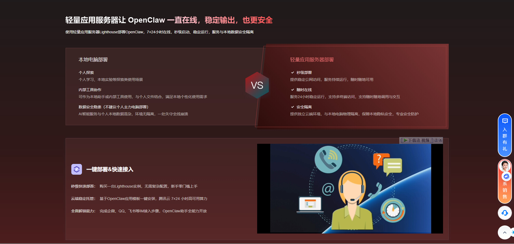


## 2.搭建并配置

首先使用SSH连接服务器（如果是腾讯云服务器可以在控制台直接点击 登录 使用腾讯云OrcaTerm免密连接服务器）

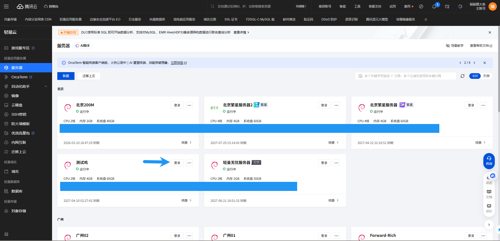

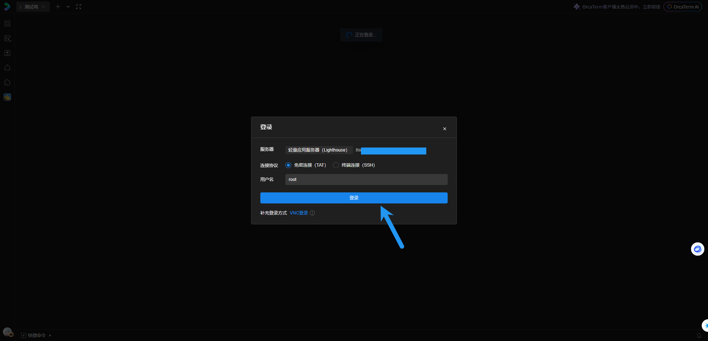

运行下方一键脚本

`curl -fsSL https://openclaw.ai/install.sh | bash`

可以看到，开始了安装流程，稍作等待

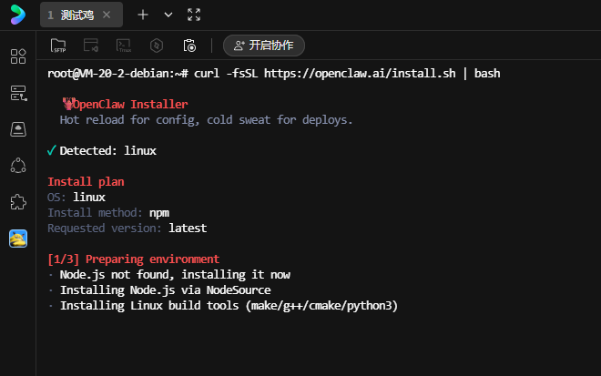

等待了一会，出现了安全警示，使用键盘的方向键调整到 Yes ，点击回车

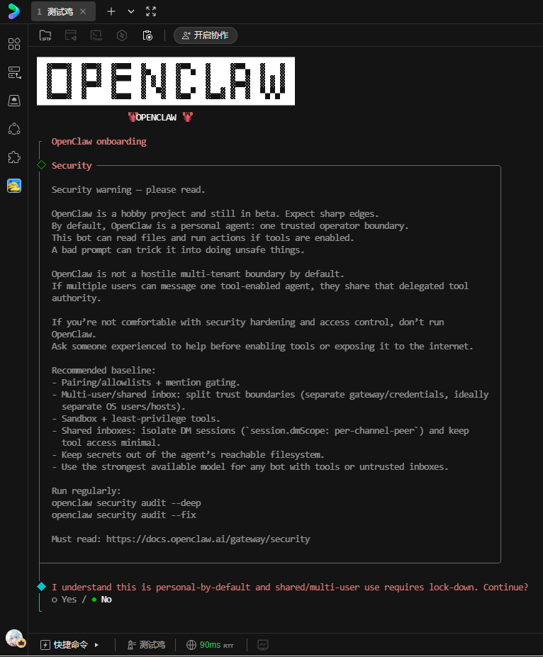

选择引导模式，直接回车

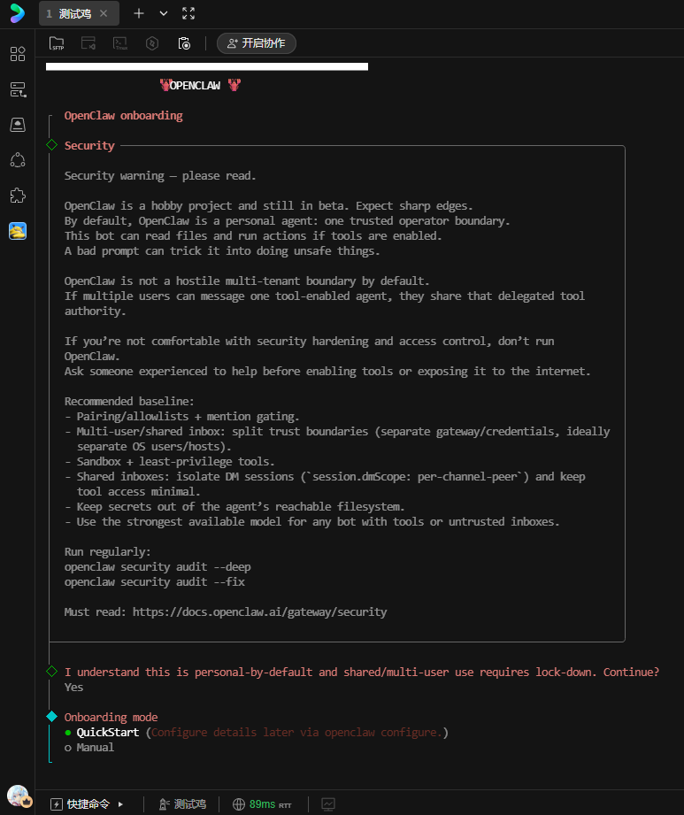

接下来要接入大语言模型，选择 `Custom Provider` ，回车（这里我要使用的是前面教程反代出来的自建 API，如果你有其他官方 API，也可以在此处接入，这里不做赘述）

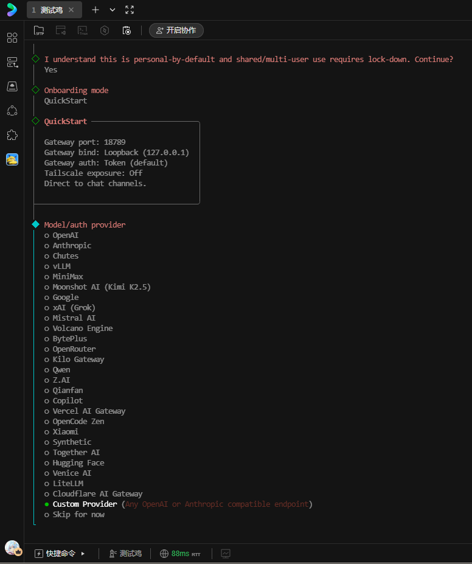

删除默认内容，填写base_url，值为自建项目的 服务器IP:端口 或是为项目反代的 域名（结尾一定要带 `/v1` ）

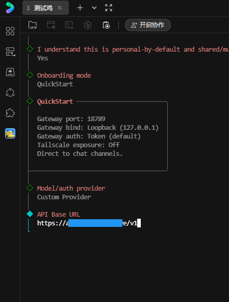

询问如何保存API Key，出于安全考虑，**建议使用下面的** `Use secret reference` **，而不是直接明文保存到配置文件**，但这里为了方便，我选择直接回车

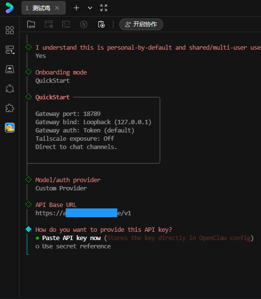

输入你在自建项目里创建的 API Key ，回车

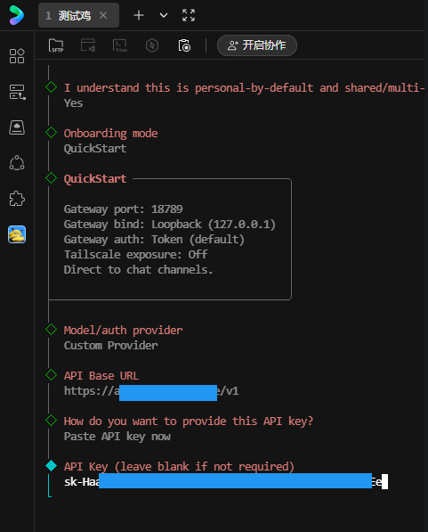

询问API类型，直接回车

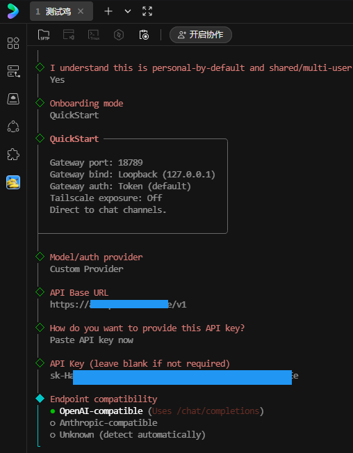

找到你在自建项目里获取到的模型名称，选择其中一个，填入，回车（可以通过 `模型1, 模型2, 模型3` 的形式接入多个模型，本文只接入一个我自己的）

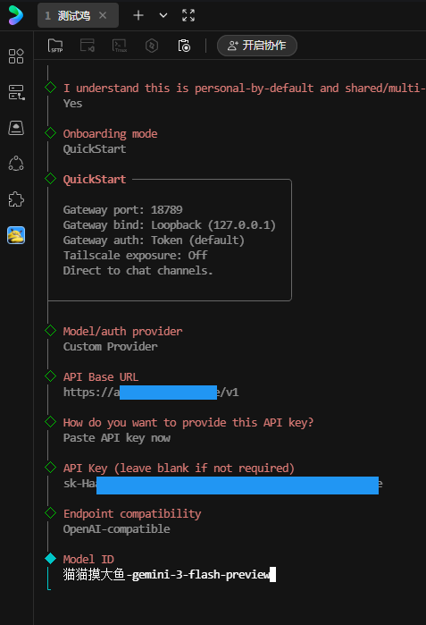

确认完成后，让我们填写 Endpoint ID，这个直接默认回车即可

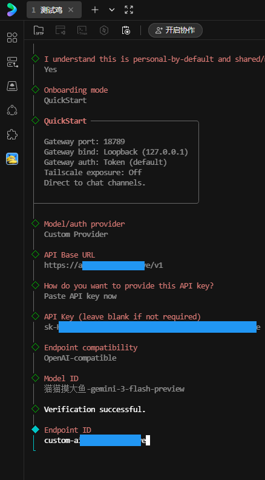

填写模型别名，这个直接回车跳过即可

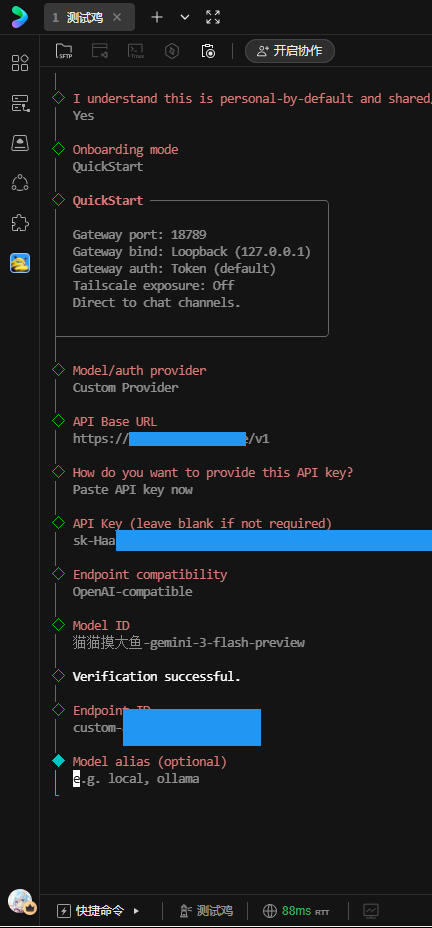

接下来让我们对接通道，可以看到有很多种通道可以用来对接（如果会的话在这里可以自行对接），不过本文中我们选择跳过，回车，直接复用前面文章里写过的QQ对接 （懒）

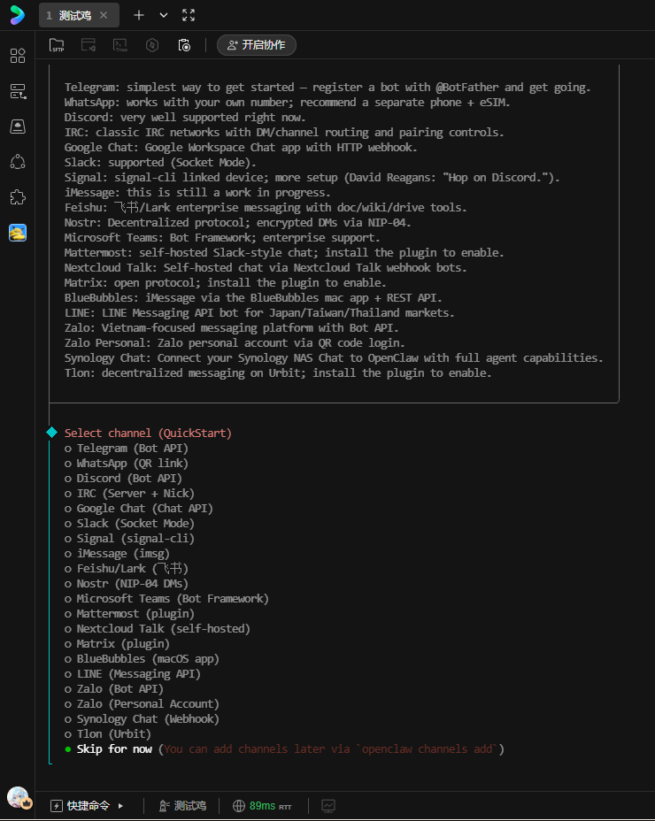

询问我们是否要确认技能，回车，可以看到有很多 skills ，可以挑选自己觉得有用的使用空格键启用（本文也直接跳过），选择完成后 回车 以提交

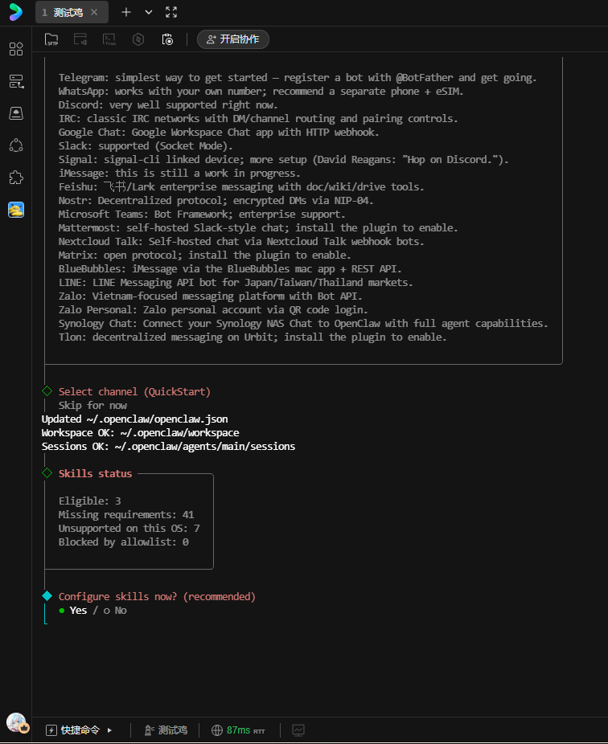

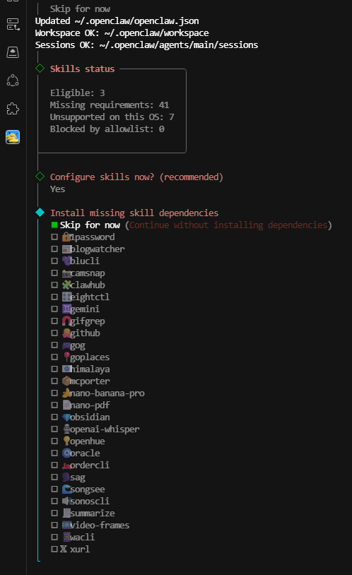

接下来这一串也直接全NO

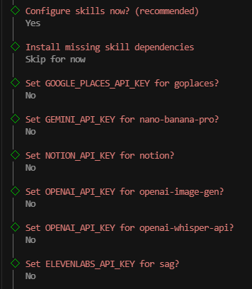

接下来选择钩子，按需勾选，然后回车

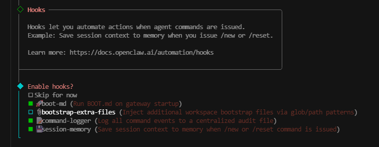

可以看到尝试创建 systemd 服务失败了，并且健康检查也失败了，**这是正常现象，是因为在无头服务器**（可以理解为没有桌面环境的服务器）**上，用户级 systemd 默认不可用导致的**，（狗屎项目，将近一个月之前[就有人发现了](https://github.com/openclaw/openclaw/issues/11805)，并且最近也有人提了PR，还是有这个问题），需要曲线救国来解决，后面给出方法（本文是写于OpenClaw2026.2.26版本，如果你安装时的版本解决了这个问题则可以无视）

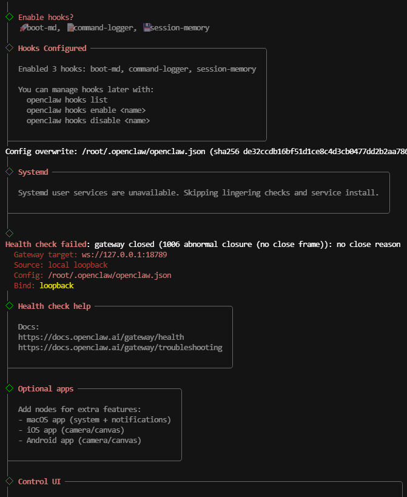

接下来就是输出一些信息了，无需理会，此时 OpenClaw 已经安装和配置完成了

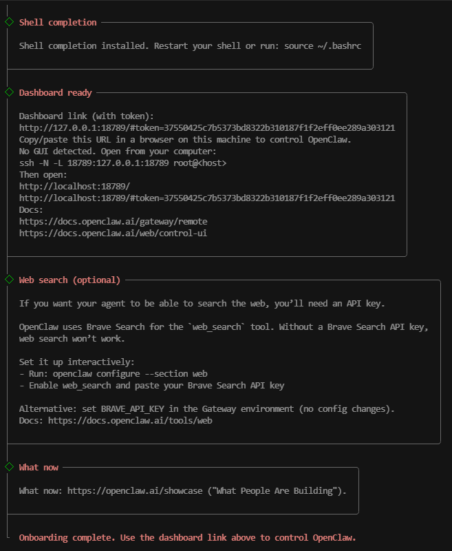

但因为上面的问题（本文是写于OpenClaw2026.2.26版本，如果你安装时的版本解决了这个问题则可以无视），OpenClaw 现在还是没有运行的，接下来解决这个问题

首先运行这个命令，启用用户 linger (确保退出登录后进程不被杀掉)

```
sudo loginctl enable-linger $(whoami)
```

因为需要 sudo ，所以视操作系统不同可能会需要你输入ssh密码，我这里使用Debian是不需要输入密码的

然后运行下列命令，如果输出了类似 `/run/user/*` 的路径，说明成功了

```
# 1. 将 XDG_RUNTIME_DIR 写入 ~/.bashrc (如果已存在则跳过，避免重复)
grep -q "XDG_RUNTIME_DIR" ~/.bashrc || echo 'export XDG_RUNTIME_DIR=/run/user/$(id -u)' >> ~/.bashrc
# 2. 立即在当前窗口生效
source ~/.bashrc
# 3. 验证检查
echo $XDG_RUNTIME_DIR
```

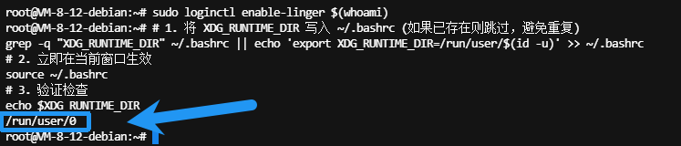

最后运行这个命令，重新安装 OpenClaw 网关，如下图即为成功

```
openclaw gateway install --force
```

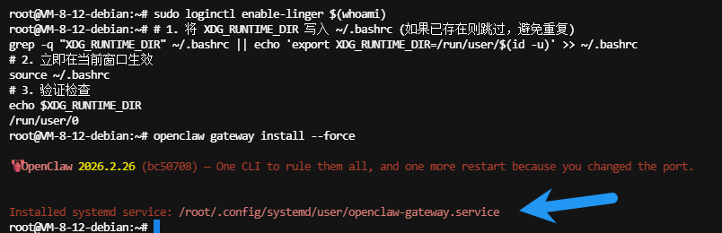

此时 OpenClaw 已经启动了，我们开始安装 QQ 通道

运行下面的命令，安装 QQ 通道插件

```
openclaw plugins install @sliverp/qqbot@latest
```

然后创建 QQ 机器人，访问 QQ 开放平台 [https://q.qq.com/](https://q.qq.com/) ，如果你尚未注册过，需要先注册账号（需要实名信息，扫脸，以及一个 QQ 号作为管理员 QQ 号），非常简单，这里就不赘述了


登录你的 QQ 开放平台账号，进入后台后，点击机器人，点击创建机器人

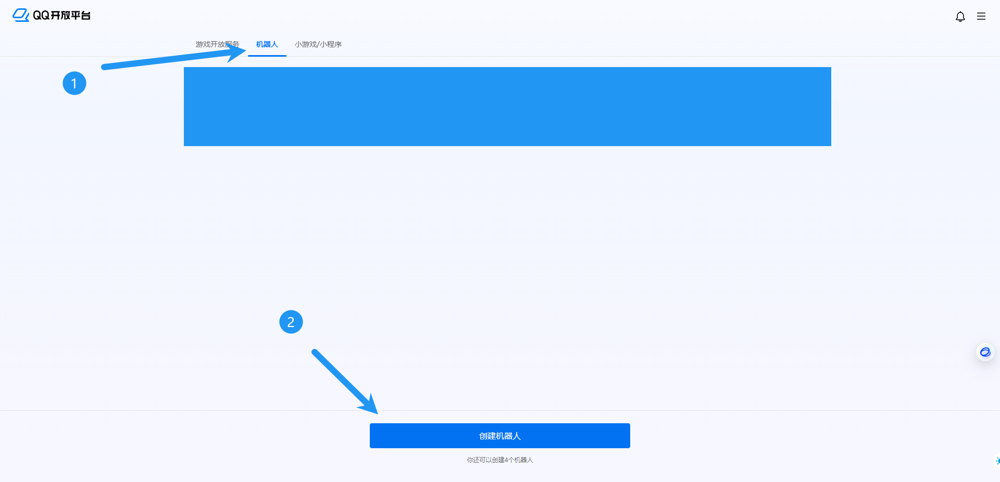

填写机器人名称，上传机器人头像，填写机器人描述，点击确认

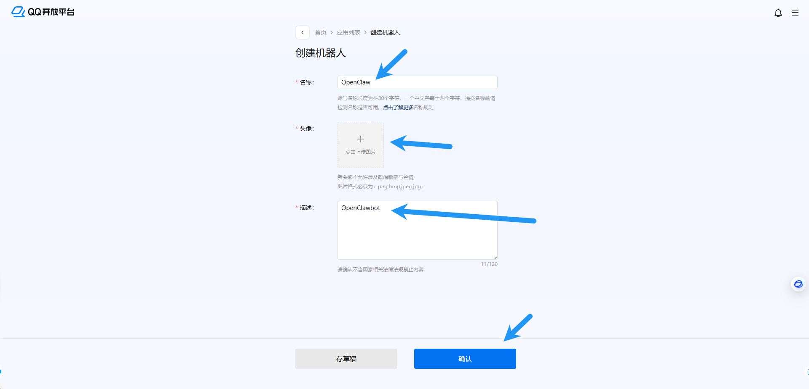

点击提交创建


点击刚刚创建的机器人

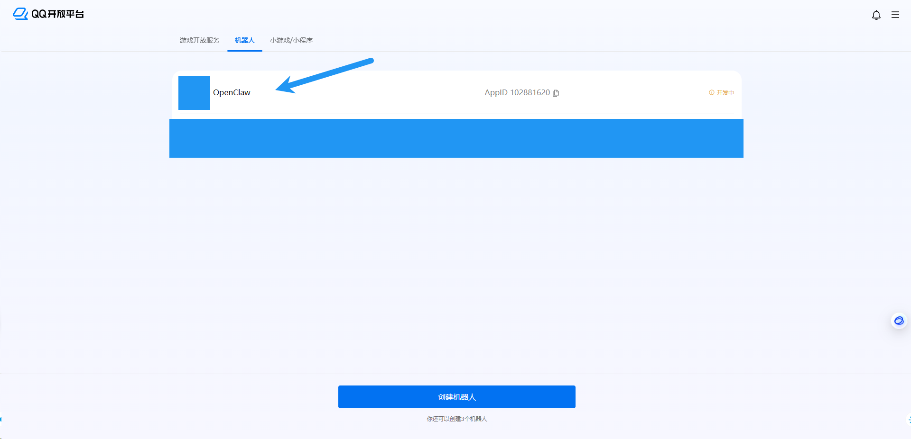

点击开发管理，复制 App ID，生成 App Secret

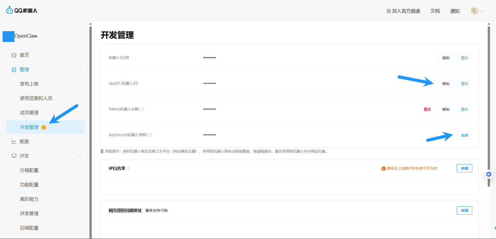

扫码认证后，复制 App Secret，勾选，点击关闭


点击沙箱配置，点击添加成员，把自己勾选上，点击确认


点击这个二维码的图标，使用自己的 QQ 扫描弹出的二维码，在手机上添加使用

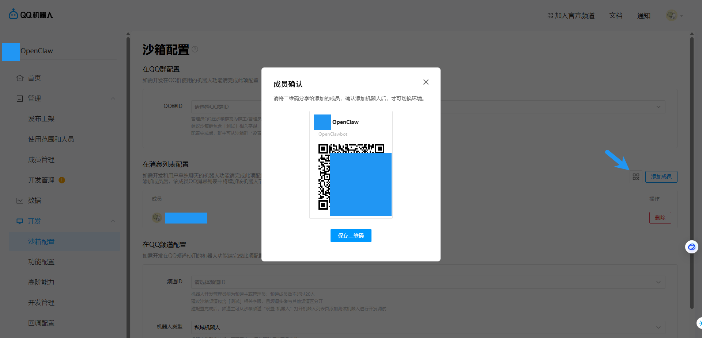

在创建 QQ 机器人的这一段时间，QQ 渠道插件也应该安装好了

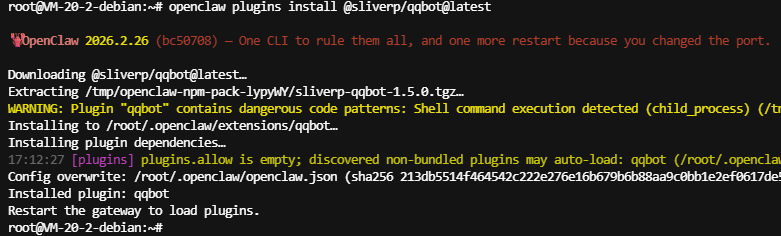

接下来运行以下命令对接 QQ 渠道（将其中的 App ID 和 App Secret 更改为你刚刚创建的 App ID 和 App Secret ），如下图

```
openclaw channels add --channel qqbot --token "AppID:AppSecret"
```

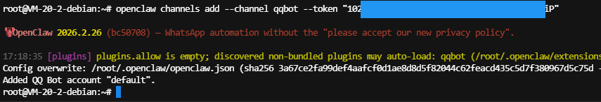

**然后，踩坑，我实在忍不住吐槽：我真的不理解为什么向导里选择自定义API接口，会给我默认配置仅仅 4096 的上下文窗口和最大Token，这是人能干出来的事？**

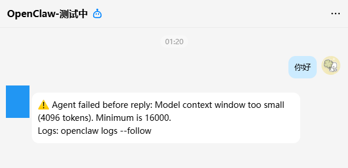

所以接下来做两件重要的事：添加插件信任白名单，以及修改模型上下文窗口和最大Token

打开 `/root/.openclaw/openclaw.json` 文件，进行修改

找到 plugins ，添加以下代码，如图

```
"allow": ["qqbot"],
```

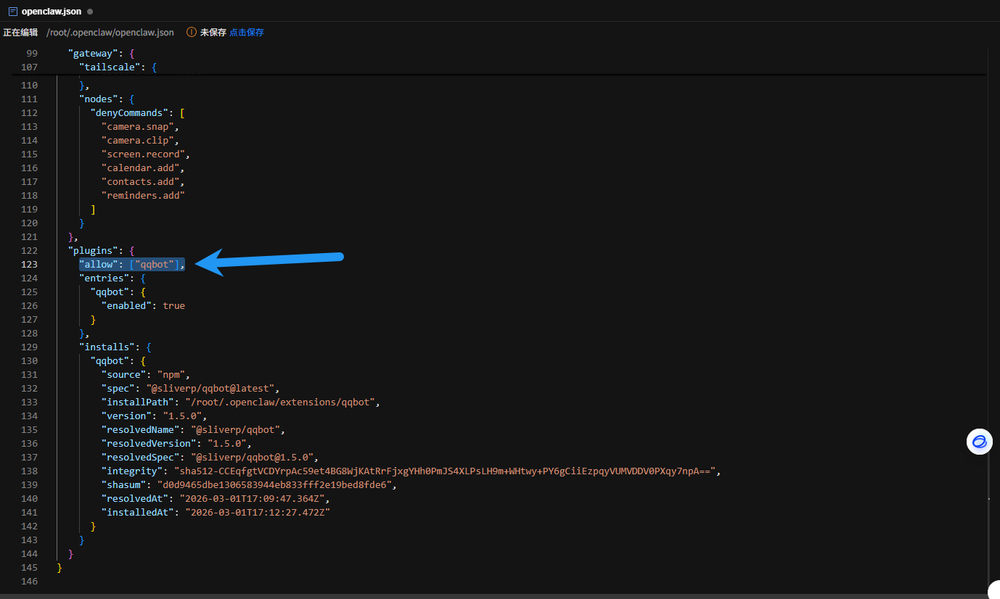

然后找到 models ，修改 `contextWindow` 和 `maxTokens`

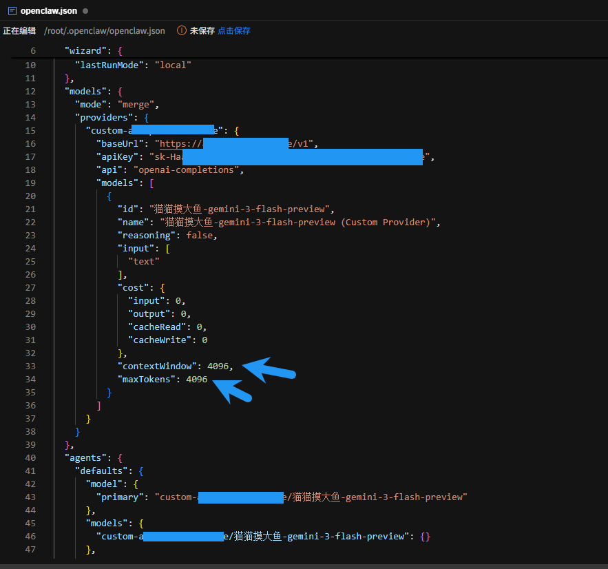

我这里使用的 gemini-3-flash 理论上支持 100 万的上下文窗口和 6.4 万的最大输出，但是稳妥起见，我们在这里设置 128K 的上下文窗口和 8192 的最大输出

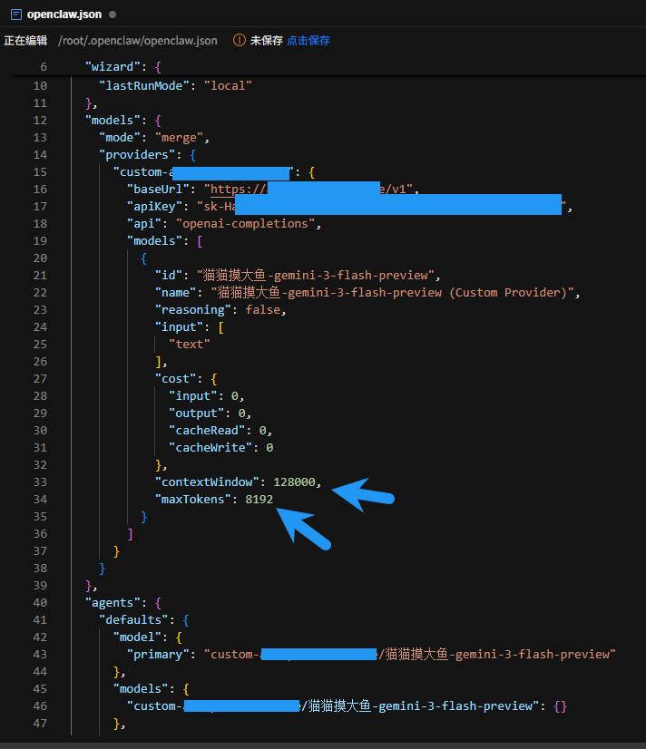

都修改完了以后，不要忘记保存，然后运行以下命令，重启网关

```
openclaw gateway restart
```

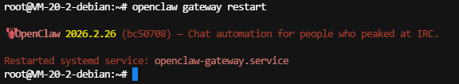

## 3. 开始使用

到此就已经搭建并初步配置完成了，现在去 QQ 对话，验证一下，可以看到已经成功了

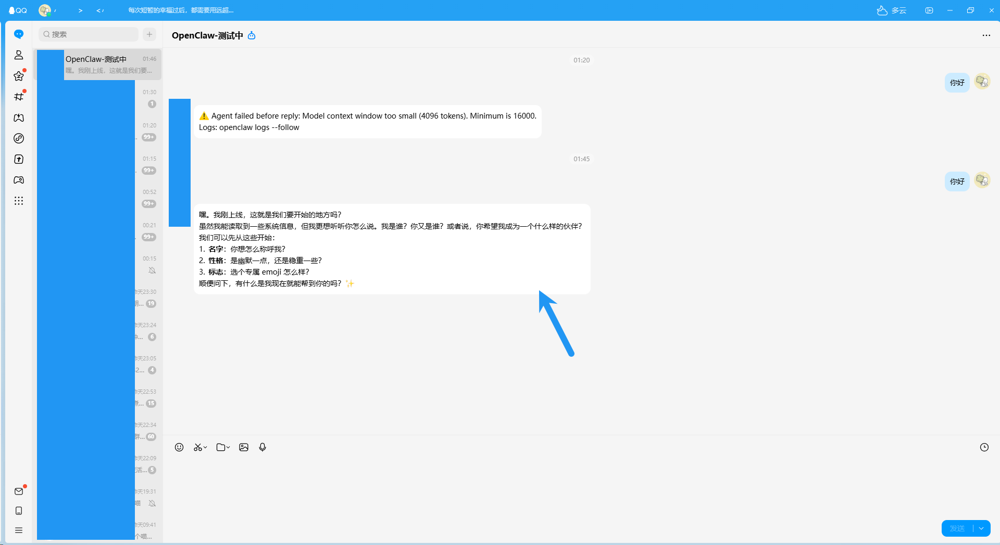


---


*来源: https://linux.do/t/topic/1675880.json*

