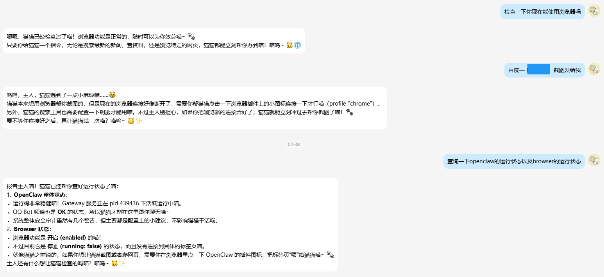
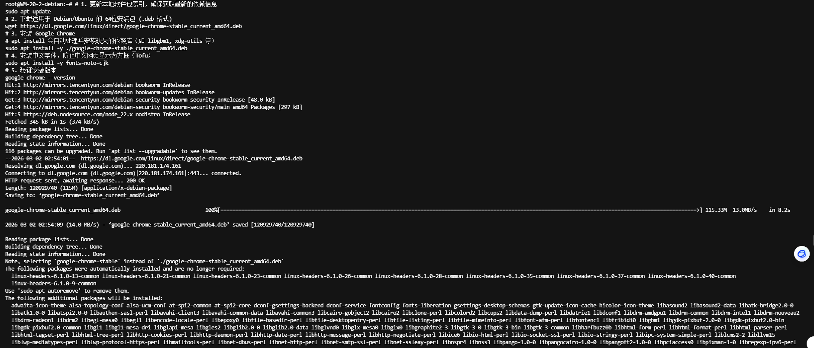
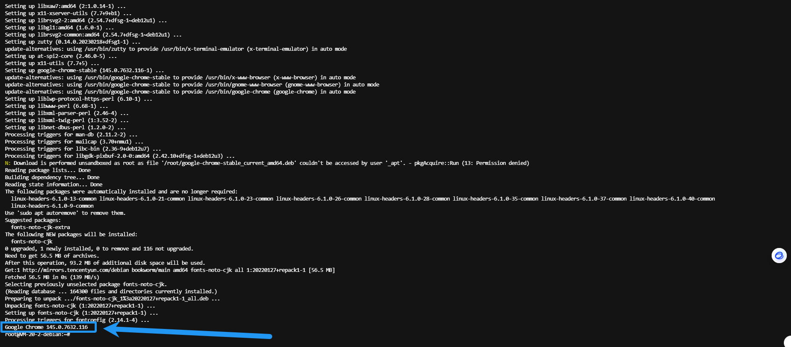
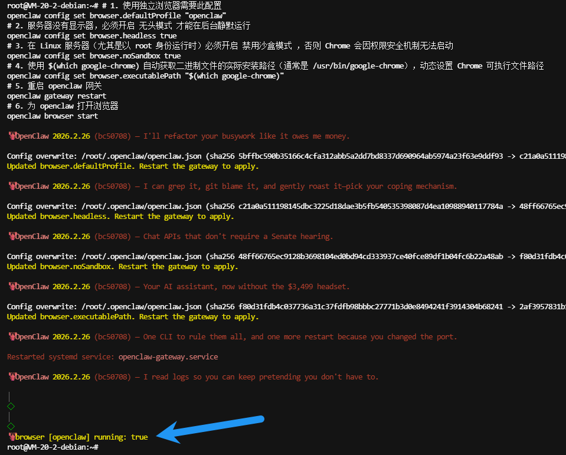
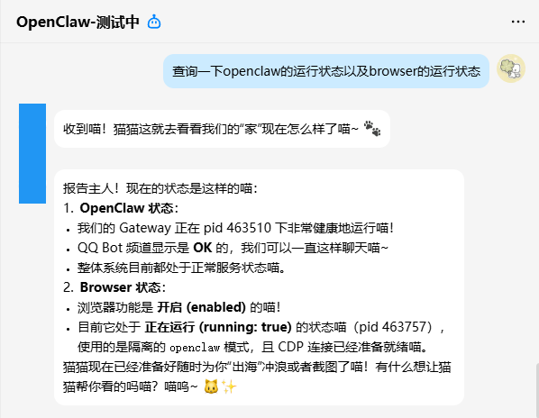
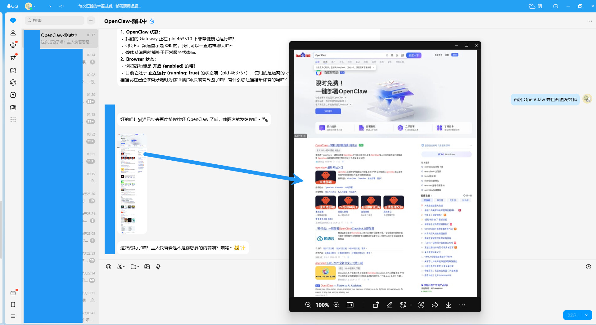

---

id: 1675915

title: "给无头服务器中的OpenClaw装上\"眼睛\"(浏览器)"

created_at: 2026-03-01T19:38:05.950Z

username: miaowmint

display_username: "miaowmint"

---


# 给无头服务器中的OpenClaw装上"眼睛"(浏览器)


本文作者：猫猫摸大鱼

## 1. 前言

本文隶属于 OpenClaw 龙虾系列教程文章，建议按顺序阅读，可以访问OpenClaw龙虾系列教程文章目录 [https://iloli.love/archives/1766849996690](https://iloli.love/archives/1766849996690) 查看其它文章

本文基于 OpenClaw 2026.2.26 官方一键脚本直装版本

本系列教程全程使用腾讯云轻量应用服务器，可以参加腾讯云OpenClaw专属活动进行购买，新客68/年起，老客99/年起

活动链接 [https://cloud.tencent.com/act/pro/lighthouse-moltbot](https://cloud.tencent.com/act/pro/lighthouse-moltbot) （无AFF）


**就算不买也强烈推荐使用有 快照 功能的厂商的服务器进行搭建，并且一定要经常打快照，不要问为什么，血的教训，血的教训，血的教训**


## 2. 场景

根据我前面的文章，搭建完OpenClaw以后，我发现了一个问题，它怎么用不了浏览器呢



于是在搜索了一下以后，发现了我朋友写的这篇文章 [https://cloud.tencent.com/developer/article/2626186](https://cloud.tencent.com/developer/article/2626186) ，原来是因为我没装浏览器

那就装一个吧，看到他在文章里使用的是 `OpencloudOS` ，那正好我就写一个 Debian 的补齐一下（其实区别不太大，摘果子真爽 **** ）

## 3. 安装浏览器

在命令行中运行以下命令（直接全部复制，多行运行即可）

```
# 1. 更新本地软件包索引，确保获取最新的依赖信息
sudo apt update
# 2. 下载适用于 Debian/Ubuntu 的 64位安装包 (.deb 格式)
wget https://dl.google.com/linux/direct/google-chrome-stable_current_amd64.deb
# 3. 安装 Google Chrome
# apt install 会自动处理并安装缺失的依赖库（如 libgbm1, xdg-utils 等）
sudo apt install -y ./google-chrome-stable_current_amd64.deb
# 4. 安装中文字体，防止中文网页显示为方框（Tofu）
sudo apt install -y fonts-noto-cjk
# 5. 验证安装版本
google-chrome --version
```

可以看到已经开始下载包体，并安装相应依赖了



很快全部安装完毕，看到最后输出了 Google 浏览器版本，即为成功



安装完浏览器就开始进行 OpenClaw 相关配置

```
# 1. 使用独立浏览器需要此配置
openclaw config set browser.defaultProfile "openclaw"
# 2. 服务器没有显示器，必须开启 无头模式 才能在后台静默运行
openclaw config set browser.headless true
# 3. 在 Linux 服务器（尤其是以 root 身份运行时）必须开启 禁用沙盒模式 ，否则 Chrome 会因权限安全机制无法启动
openclaw config set browser.noSandbox true
# 4. 使用 $(which google-chrome) 自动获取二进制文件的实际安装路径（通常是 /usr/bin/google-chrome），动态设置 Chrome 可执行文件路径
openclaw config set browser.executablePath "$(which google-chrome)"
# 5. 重启 openclaw 网关
openclaw gateway restart
# 6. 为 openclaw 打开浏览器
openclaw browser start
```

稍作等待，可以看到浏览器已经启动



也可以找 Bot 验证一下，可以看到确实是可用了



## 4. 使用相关功能

这里让它搜索 OpenClaw 并且截图，测试一下功能

可以看到，这次就非常成功了（题外话：百度出来的结果果然还是一如既往的狗屎）




---


*来源: https://linux.do/t/topic/1675915.json*

