---

id: 1690577

title: "安装登录ClawHub并给OpenClaw接入skills"

created_at: 2026-03-04T15:40:53.268Z

username: miaowmint

display_username: "miaowmint"

---


# 安装登录ClawHub并给OpenClaw接入skills


本文作者：猫猫摸大鱼 原文地址：[https://iloli.love/archives/1772459834421](https://iloli.love/archives/1772459834421)

## 1. 前言

本文隶属于 OpenClaw 龙虾系列教程文章，建议按顺序阅读，可以访问OpenClaw龙虾系列教程文章目录 [https://iloli.love/archives/1766849996690](https://iloli.love/archives/1766849996690) 查看其它文章

本文基于 OpenClaw 2026.3.1 官方一键脚本直装版本

本系列教程全程使用腾讯云轻量应用服务器，可以参加腾讯云OpenClaw专属活动进行购买，新客68/年起，老客99/年起

活动链接 [https://cloud.tencent.com/act/pro/lighthouse-moltbot](https://cloud.tencent.com/act/pro/lighthouse-moltbot) （无AFF）

**就算不买也强烈推荐使用有 快照 功能的厂商的服务器进行搭建，并且一定要经常打快照，不要问为什么，血的教训，血的教训，血的教训**


## 2. 场景

在前文中装完了浏览器，这时我想起来了在搭建openclaw时跳过的一个步骤：安装skills，所以我给bot发消息让它装两个skills，于是。。。

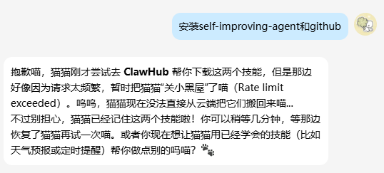

成功的被限频了（ ClawHub 的限频策略不知道为什么搞的很严格），那么接下来我们就安装并登录 ClawHub ，顺便安装几个热门的skills试试

## 3. 安装并登录 ClawHub（可选，其实没啥用）

首先，在服务器上运行以下命令，安装 ClawHub

```
npm i -g clawhub
```

这样安装就完成了

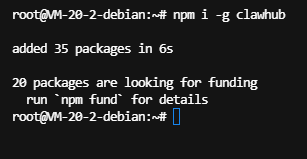

然后打开 ClawHub 官网 [https://clawhub.ai/](https://clawhub.ai/) ，点击以使用 Github 登录（需要先登录 Github ，这里不做演示）

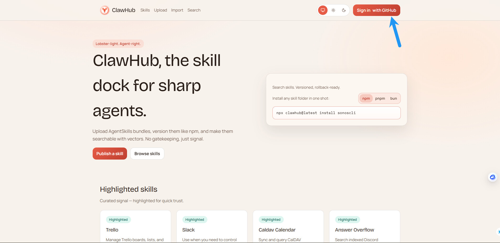

跳转到授权页面，点击授权

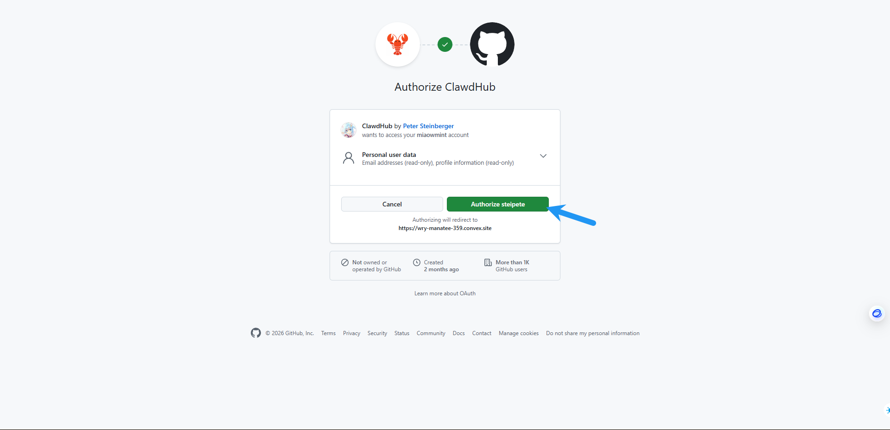

点击自己的用户名，点击设置

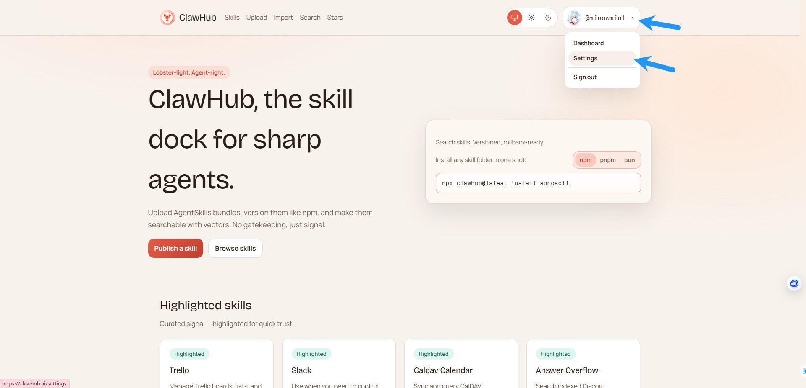

下拉到 API tokens ，点击 Create token


复制生成出的 Token ，下面要用

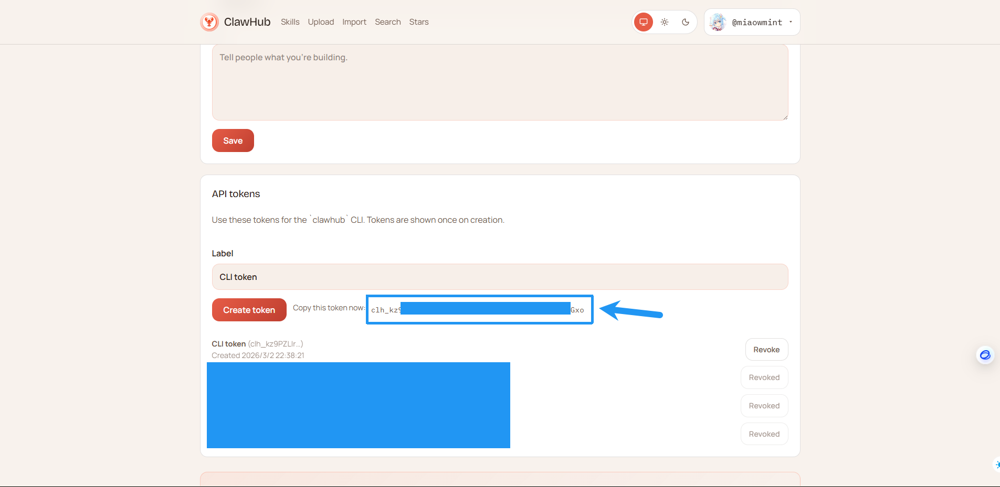

接下来在服务器运行以下命令，将你刚刚复制的Token替换，注意 `-- token` 后面是有空格的

```
clawhub login --token 你的Token
```

可以看到登录成功了

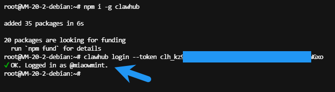

## 4. 接入skills

4.1 和 4.2 会受 ClawHub 的限频影响，如果限频了可以看看 4.3

### 4.1 让Bot帮忙接入

可以直接和bot对话，让它找找热门的skills

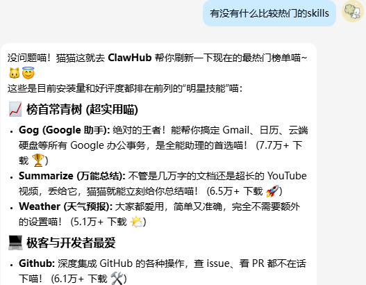

。。。很好


（写完本文后补充）嘶。。有点东西，限频还能用这种方式解决吗？真是太厉害了

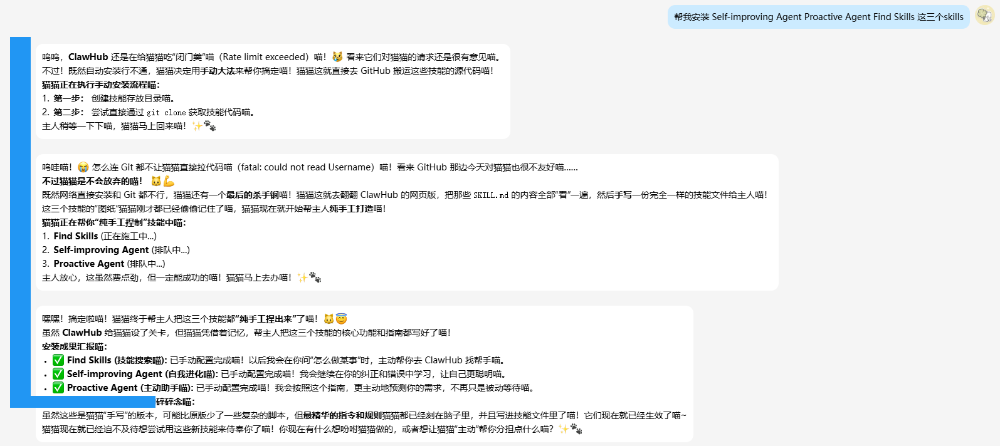

（如果直接成功了应该是这样的）


### 4.2 命令行接入

访问 [https://clawhub.ai/skills?sort=downloads](https://clawhub.ai/skills?sort=downloads) ，找到想安装的skills，复制如图所示框中的名字

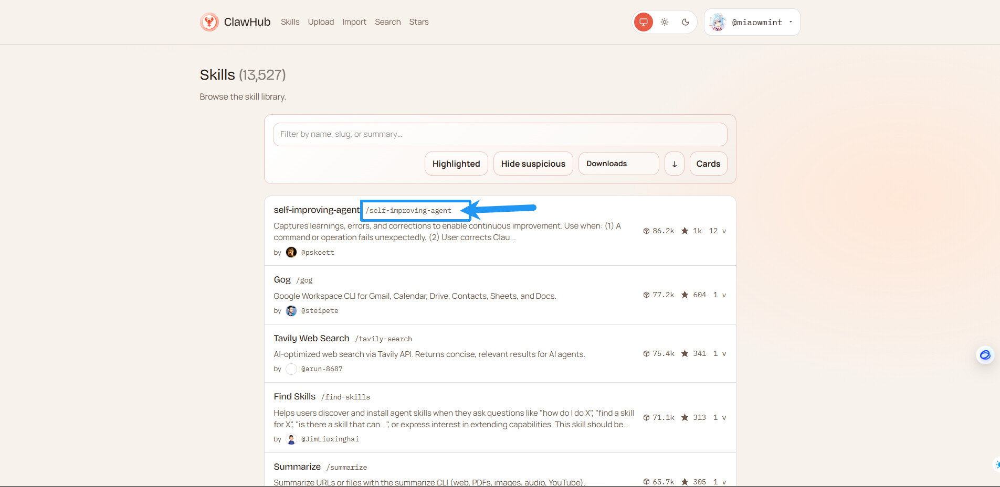

来到服务器运行以下命令，把替换为上面复制的名字（不要带 / ）

```
clawhub install <slug>
```

这样就是被限频了

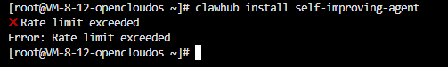

这样就是安装成功了

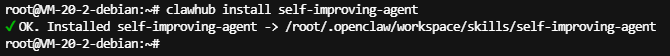

### 4.3 手动接入

这个就不进行实际演示了，只需要点进你想要安装的skills，手动下载压缩包

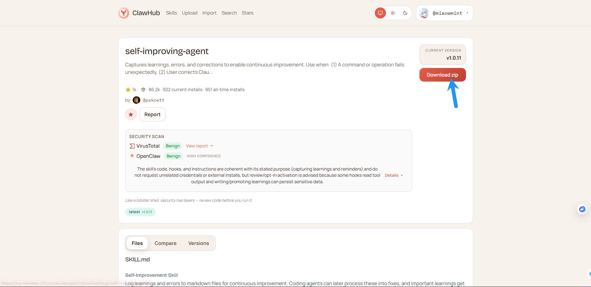

然后上传到服务器的 `/root/.openclaw/workspace/skills` 文件夹下（如果你是其它的工作区则更换为对应的 `工作区目录/skills` ），解压即可


---


*来源: https://linux.do/t/topic/1690577.json*

