---

id: 1691957

title: "基于docker搭建OpenClaw汉化版之OpenClawChineseTranslation图文教程"

created_at: 2026-03-05T02:43:29.022Z

username: miaowmint

display_username: "miaowmint"

---


# 基于docker搭建OpenClaw汉化版之OpenClawChineseTranslation图文教程


本文作者：猫猫摸大鱼 原文地址：[https://iloli.love/archives/1772631145610](https://iloli.love/archives/1772631145610)

## 1. 前言

本文隶属于 OpenClaw龙虾系列教程文章，建议按顺序阅读，可以访问OpenClaw龙虾系列教程文章目录 [https://iloli.love/archives/1766849996690](https://iloli.love/archives/1766849996690) 查看其它文章，本文也可单独作为 OpenClawChineseTranslation 搭建教程文章阅读

本文基于OpenClawChineseTranslation v2026.3.2-zh.2版本，Github地址为 [https://github.com/1186258278/OpenClawChineseTranslation](https://github.com/1186258278/OpenClawChineseTranslation)

OpenClawChineseTranslation 是 OpenClaw 的汉化发行版，每小时自动同步 OpenClaw 官方更新，CLI 命令行和 Dashboard 网页控制台均已深度汉化（摘选自该项目readme文本）

本文仅演示使用 docker compose 搭建该项目

本系列教程全程使用腾讯云轻量应用服务器，可以参加腾讯云OpenClaw专属活动进行购买，新客68/年起，老客99/年起

活动链接 [https://cloud.tencent.com/act/pro/lighthouse-moltbot](https://cloud.tencent.com/act/pro/lighthouse-moltbot) （无AFF）

**就算不买也强烈推荐使用有 快照 功能的厂商的服务器进行搭建，并且一定要经常打快照，不要问为什么，血的教训，血的教训，血的教训**


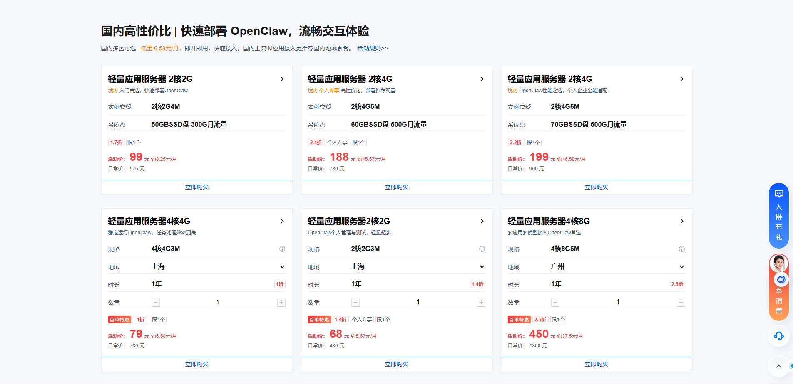

## 2. 初始化配置

首先选择一个目录，本文中使用的是`/data/OpenClawChineseTranslation`

**进入该目录**，然后运行以下命令

```
docker run --rm -it -v ./data:/root/.openclaw \
  1186258278/openclaw-zh:latest openclaw onboard
```

可以看到，拉取完镜像以后，进入了初始化向导

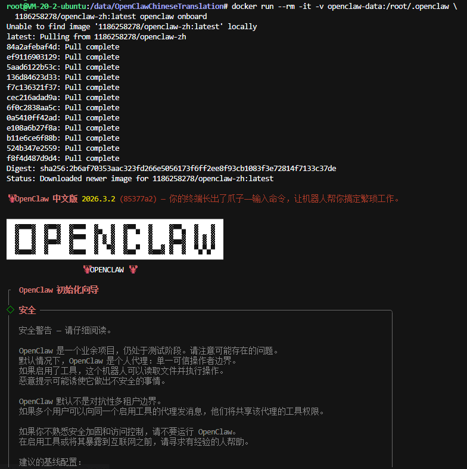

**这个向导和官方的向导是一样的，只是汉化了而已，所以这里我选择把之前文章的官方的向导配置拿过来**（懒）

出现了安全警示，使用键盘的方向键调整到 Yes ，点击回车

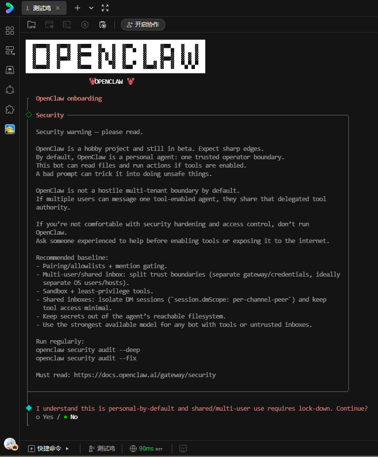

选择引导模式，直接回车

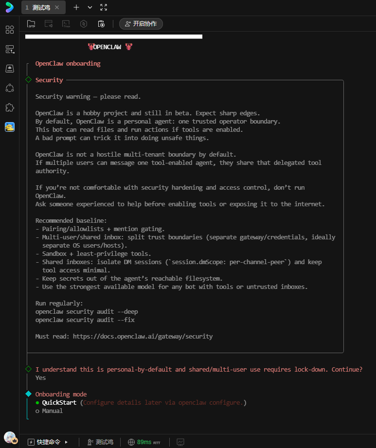

接下来要接入大语言模型，选择 `Custom Provider` ，回车（这里我要使用的是前面教程反代出来的自建 API，如果你有其他官方 API，也可以在此处接入，这里不做赘述）

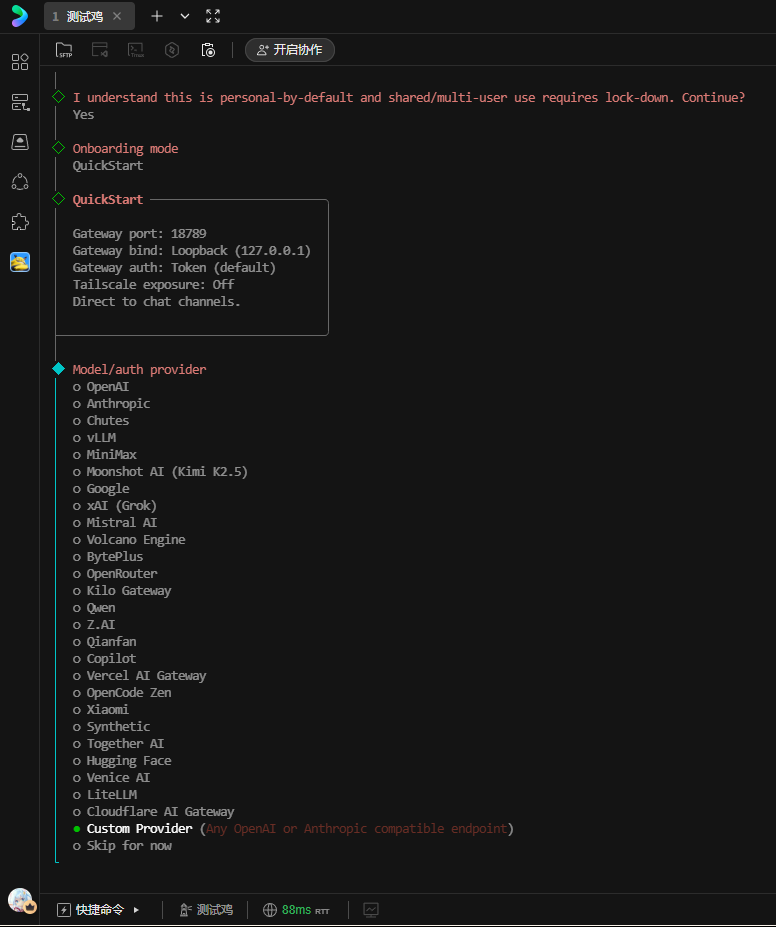

删除默认内容，填写base_url，值为自建项目的 服务器IP:端口 或是为项目反代的 域名（结尾一定要带 `/v1` ）

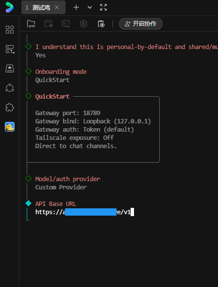

询问如何保存API Key，出于安全考虑，**建议使用下面的** `Use secret reference` **，而不是直接明文保存到配置文件**，但这里为了方便，我选择直接回车

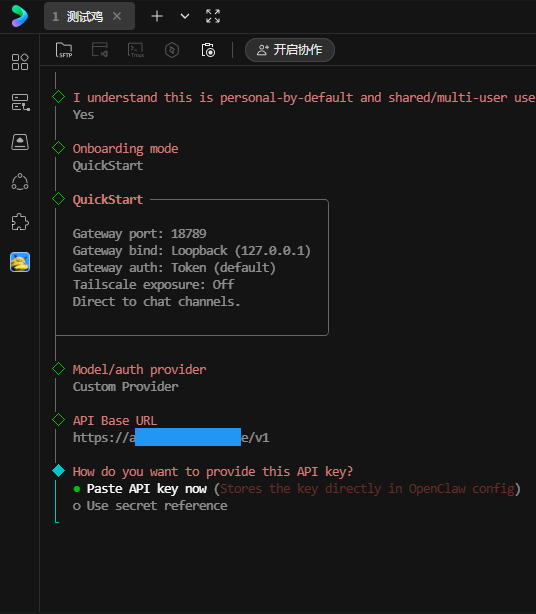

输入你在自建项目里创建的 API Key ，回车

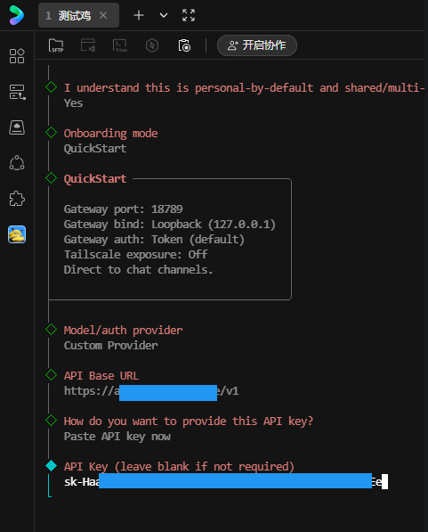

询问API类型，直接回车

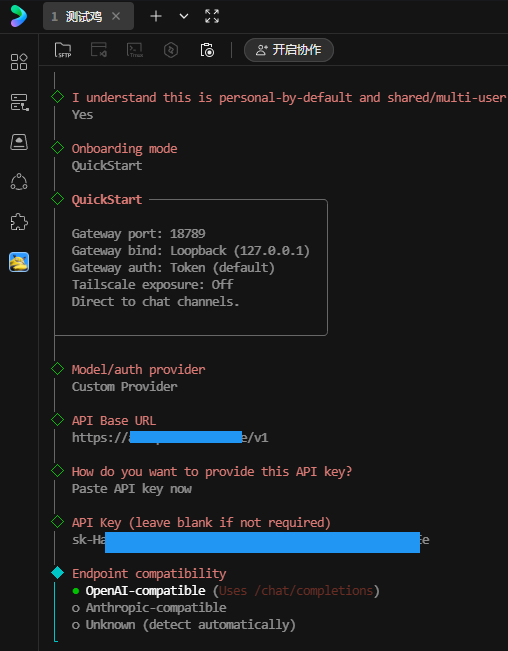

找到你在自建项目里获取到的模型名称，选择其中一个，填入，回车（可以通过 `模型1, 模型2, 模型3` 的形式接入多个模型，本文只接入一个我自己的）

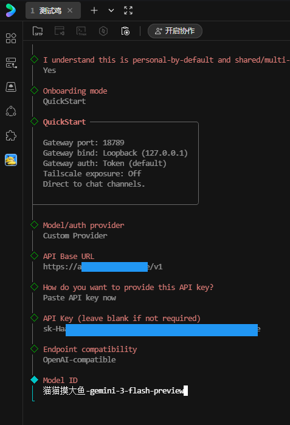

确认完成后，让我们填写 Endpoint ID，这个直接默认回车即可

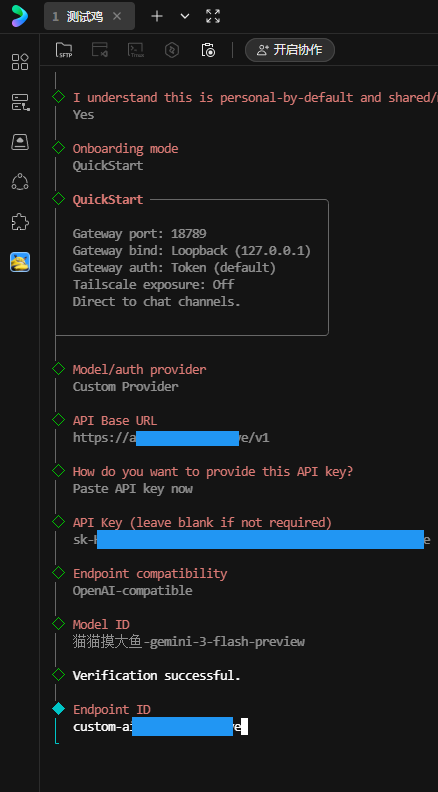

填写模型别名，这个直接回车跳过即可

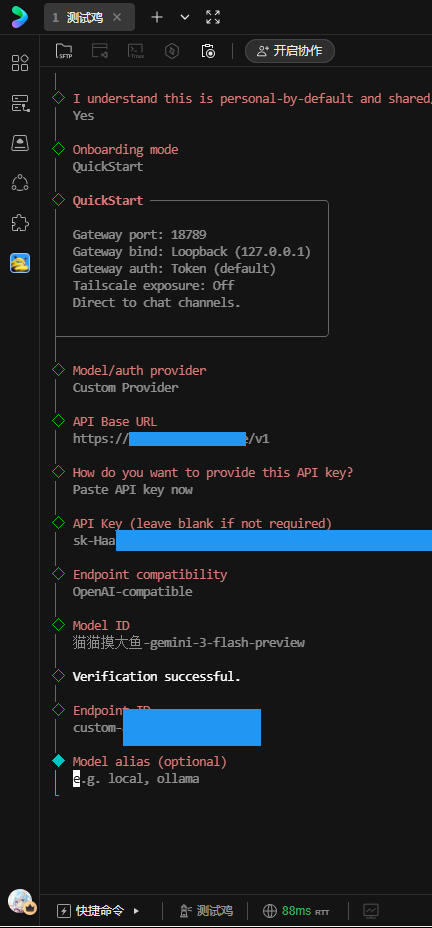

接下来让我们对接通道，可以看到有很多种通道可以用来对接（如果会的话在这里可以自行对接），不过本文中我们选择跳过，回车

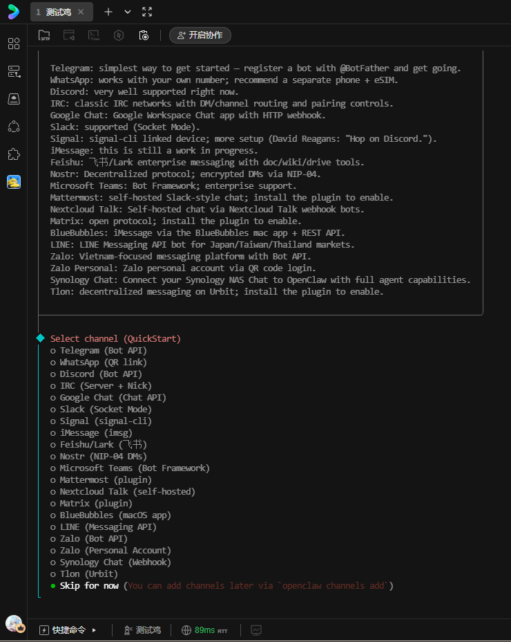

询问我们是否要确认技能，回车，可以看到有很多 skills ，可以挑选自己觉得有用的使用空格键启用（本文也直接跳过），选择完成后 回车 以提交

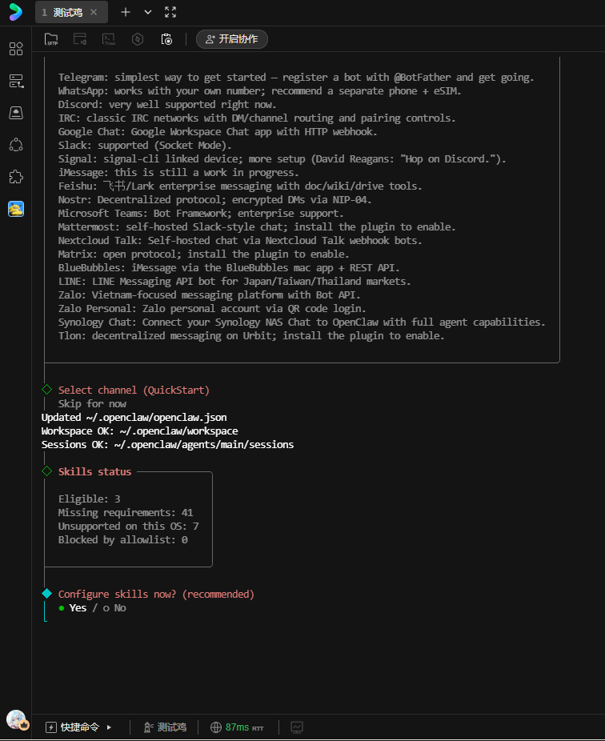

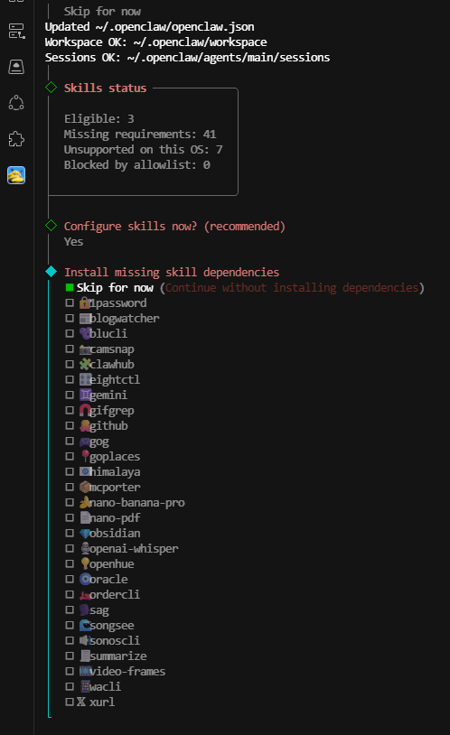

接下来这一串也直接全NO

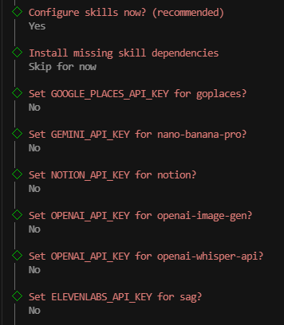

接下来选择钩子，按需勾选，然后回车

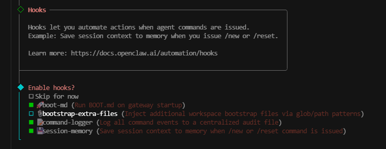

接下来就是输出一些信息了，注意把这个token复制下来

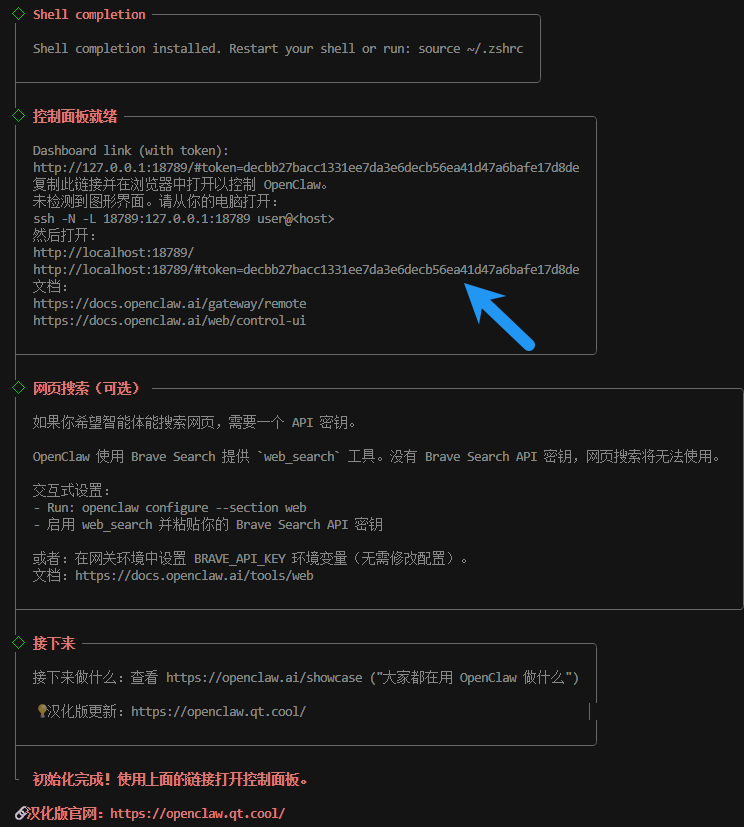

可以看到 `/data/OpenClawChineseTranslation` 下出现了data文件夹

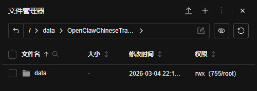

复制以下命令，将 [http://0.0.0.0:18789](http://0.0.0.0:18789) 中的`0.0.0.0`更改为你服务器的实际IP，运行

```
docker run --rm -it -v ./data:/root/.openclaw \
  1186258278/openclaw-zh:latest openclaw config set gateway.mode local
docker run --rm -it -v ./data:/root/.openclaw \
  1186258278/openclaw-zh:latest openclaw config set gateway.bind custom
docker run --rm -it -v ./data:/root/.openclaw \
  1186258278/openclaw-zh:latest openclaw config set gateway.controlUi.dangerouslyDisableDeviceAuth true
docker run --rm -it -v ./data:/root/.openclaw \
  1186258278/openclaw-zh:latest openclaw config set gateway.customBindHost 0.0.0.0
docker run --rm -it -v ./data:/root/.openclaw \
  1186258278/openclaw-zh:latest openclaw config set gateway.controlUi.allowedOrigins '["http://0.0.0.0:18789"]'
```

如图

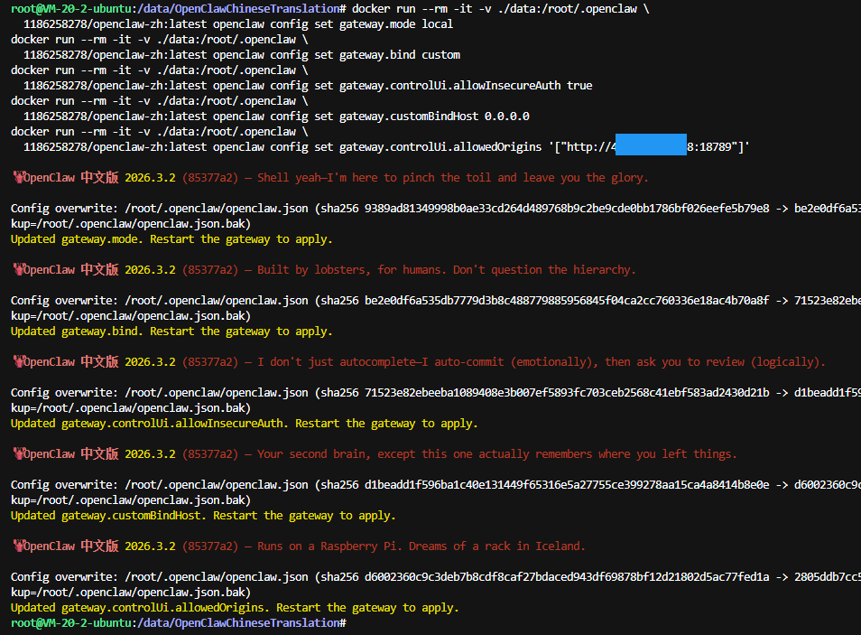

（可选）如果上面忘记复制token了，或者想要重置token，可以将 `your-secure-token` 修改为你自定义的TOKEN，运行以下命令，这里我就不演示了

```
docker run --rm -it -v ./data:/root/.openclaw \
  1186258278/openclaw-zh:latest openclaw config set gateway.auth.token your-secure-token
```

## 3. 搭建

在`/data/OpenClawChineseTranslation`下创建 `compose.yaml` 文件

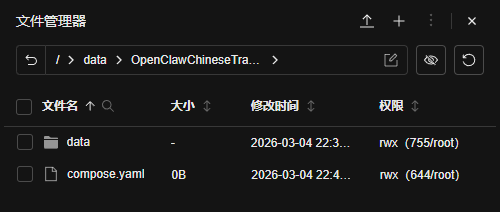

复制以下代码

```
services:
  openclaw:
    image: 1186258278/openclaw-zh:latest
    container_name: openclaw
    ports:
      - "18789:18789"
    volumes:
      - ./data:/root/.openclaw
    restart: unless-stopped
    command: openclaw gateway run --allow-unconfigured
    healthcheck:
      test: ["CMD", "wget", "-q", "--spider", "http://localhost:18789/health", "||", "exit", "0"]
      interval: 30s
      timeout: 10s
      retries: 3
      start_period: 10s
```

粘贴到 `compose.yaml` 里

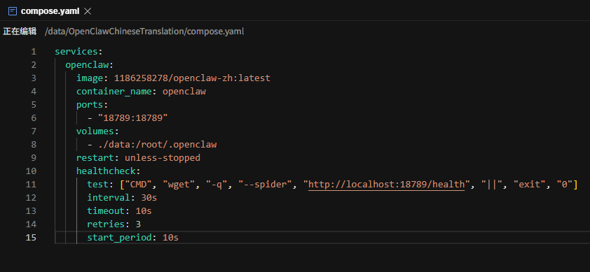

在 `/data/OpenClawChineseTranslation` 下运行 `docker compose up -d` ，创建容器，如图即为成功

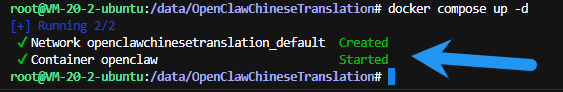

## 4. 开始使用

可以自行接入别的通道，或是访问 `http://服务器IP:18789/#token=你的token` （修改其中信息）

就可以访问WebUI，进行对话和其它可视化配置了

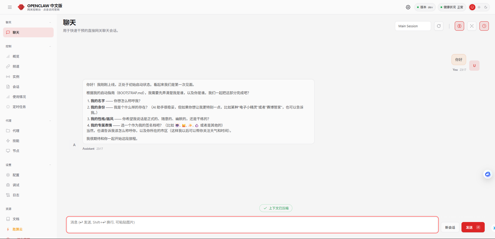


---


*来源: https://linux.do/t/topic/1691957.json*

