---

id: 1696708

title: ":fire:【大模型系列28】关于GPT-5.4-thinking和GPT-5.4-pro，你想知道的一切【底楼更新mini和nano】"

created_at: 2026-03-05T22:06:40.872Z

username: dwqxq1

display_username: "dwqxq1"

---

# :fire:【大模型系列28】关于GPT-5.4-thinking和GPT-5.4-pro，你想知道的一切【底楼更新mini和nano】

### 资料

官方文：[https://openai.com/index/introducing-gpt-5-4/](https://openai.com/index/introducing-gpt-5-4/)

gpt-5.4文档：[GPT-5.4 Model | OpenAI API](https://developers.openai.com/api/docs/models/gpt-5.4)

gpt-5.4-pro文档：[GPT-5.4 pro Model | OpenAI API](https://developers.openai.com/api/docs/models/gpt-5.4-pro)

系统卡：[GPT-5.4 Thinking System Card - OpenAI Deployment Safety Hub](https://deploymentsafety.openai.com/gpt-5-4-thinking)

上下文：1m，上代400k，终于追平Gemini和Claude

最大输出：128k，不变

训练素材截止：250831，不变

gpt-5.4/thinking： 输入$2.5/输出$15，上代$1.75/$14，输出涨价43%，上下文>272k输入价格翻倍

gpt-5.4-pro：输入$30/输出$180，上代$21/$168，输出涨价43%

gpt-5.4-codex：这次并没有发布，现在OpenAI貌似codex与chatbot两个产品线，各发各的，谁也不等谁

#### GPT-5.4-pro

Pro会员不限量，Plus不能用

Business可能还是每月15次，不确定

---

### 评测

#### 官方自评

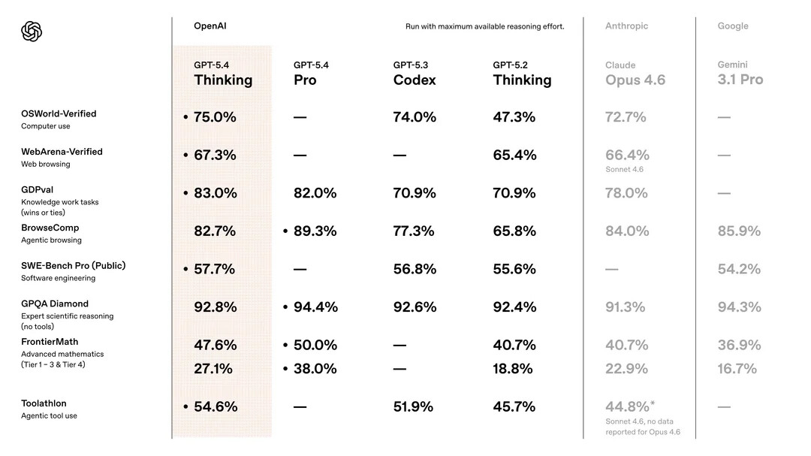

---

#### LMArena评测，综合第7

Code Arena 评测暂未上线

来源：[Arena Leaderboard | Compare & Benchmark the Best Frontier AI Models](https://arena.ai/leaderboard)

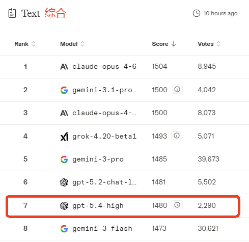

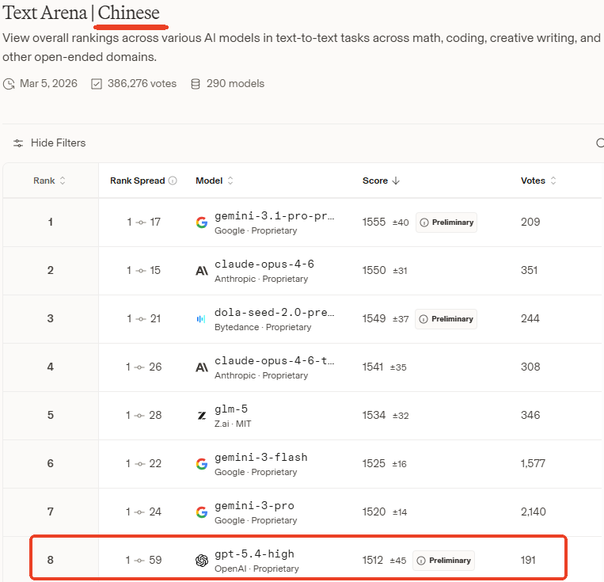

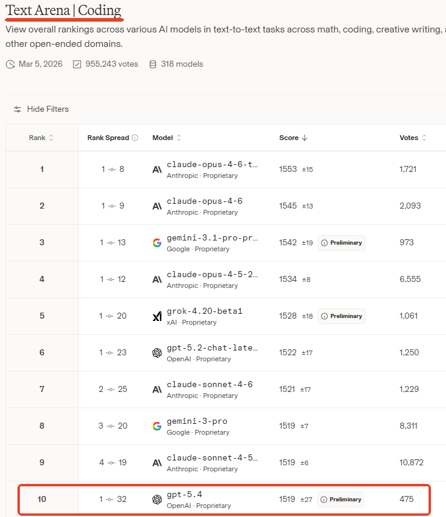

---

#### LiveBench评测第5

来源：[LiveBench](https://livebench.ai/#/?highunseenbias=true)

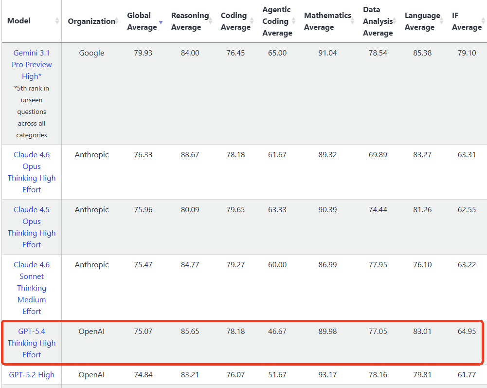

---

#### ARC-AGI-2评测

来源：[ARC Prize - Leaderboard](https://arcprize.org/leaderboard)

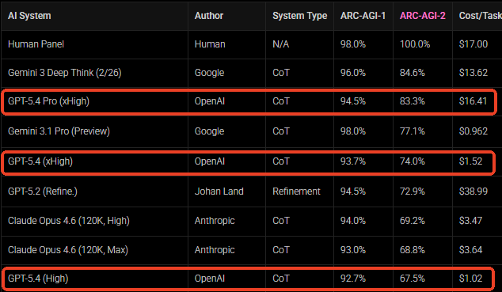

---

#### FrontierMath评测第1

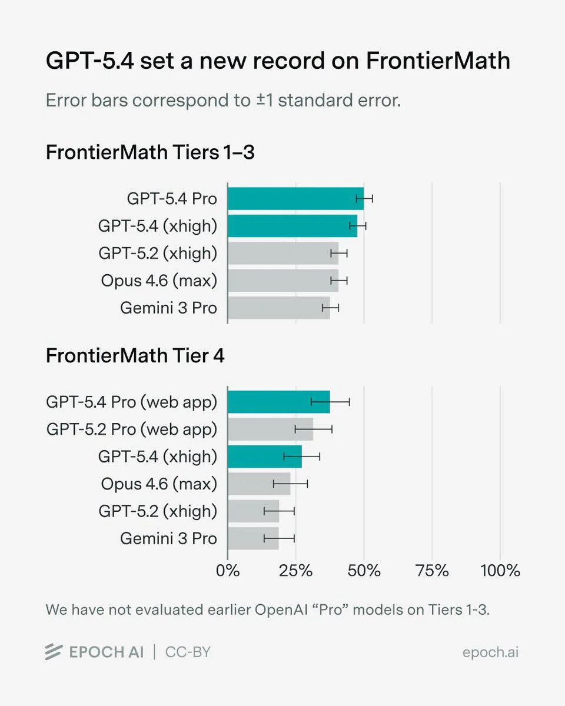

---

#### ArtificiAlanalysis评测 未上线

来源：[https://artificialanalysis.ai/](https://artificialanalysis.ai/)

---

### Chatbot渠道

#### 官网/App已上线

免费号也能用5.4，但是额度少

来源：[https://chatgpt.com/](https://chatgpt.com/)

#### LMArena已上线，免费但限制输出长度

来源：[Chat with Multiple Frontier AI Models](https://arena.ai/text/direct)

#### OpenRouter Chatroom已上线，消耗自己额度

来源：[AI Chat Playground - Compare AI Models Side by Side | OpenRouter](https://openrouter.ai/chat?models=openai/gpt-5.4)

---

### API渠道

#### 官网

#### OpenRouter

5.4：[GPT-5.4 - API Pricing & Providers | OpenRouter](https://openrouter.ai/openai/gpt-5.4)

5.4-pro：[GPT-5.4 Pro - API Pricing & Providers | OpenRouter](https://openrouter.ai/openai/gpt-5.4-pro)

---

### IDE渠道

#### Codex插件和App已上线

Codex App等默认只能使用258k上下文，佬友说可以通过修改设置文件使用1m上下文，但是超过272k部分，扣双倍额度

来源：[https://linux.do/t/topic/1696588/7](https://linux.do/t/topic/1696588/7)

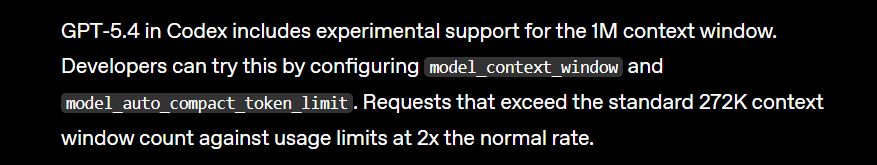

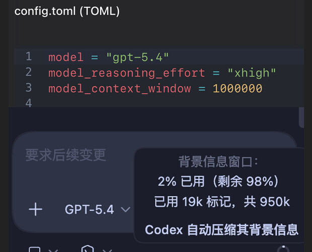

新增"/fast"模式，消耗2x额度，1.5x速度，佬友实测1.35x速度，普号也支持/fast

以前没有这个模式

来源：[【GPT 5.4】 实测 fast 模式也不快，仅提速 35%？（实测数据公开）](https://linux.do/t/topic/1696704)

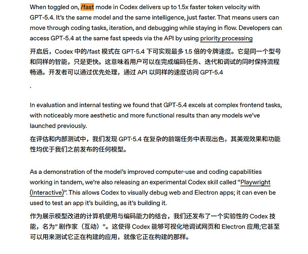

---

#### augment 限时免费

来源：[https://x.com/augmentcode/status/2029628849009700992](https://x.com/augmentcode/status/2029628849009700992)

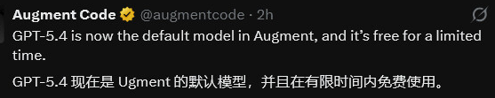

---

最后送大家张梗图，祝与GPT5.4愉快地玩耍

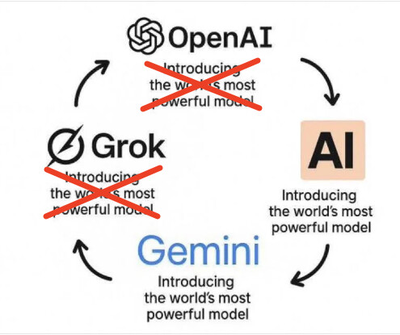

---

*来源: https://linux.do/t/topic/1696708.json*

