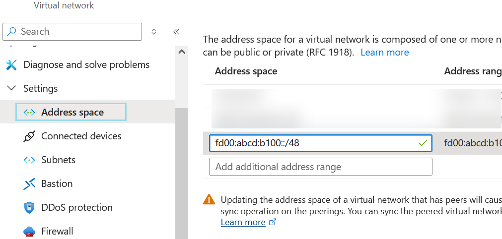
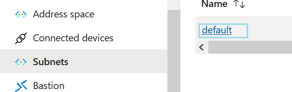
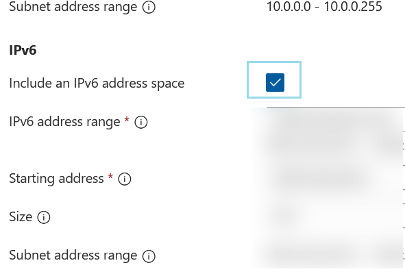
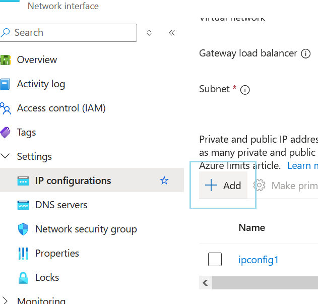
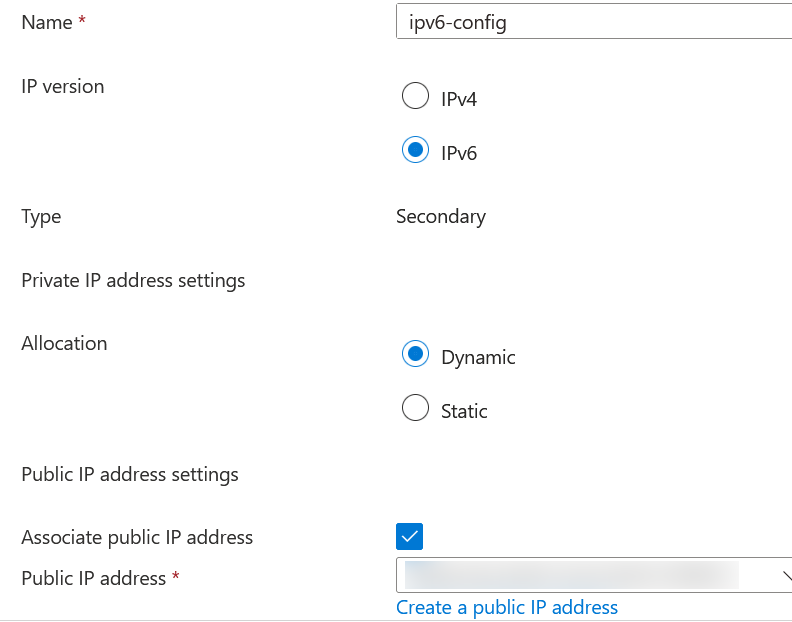
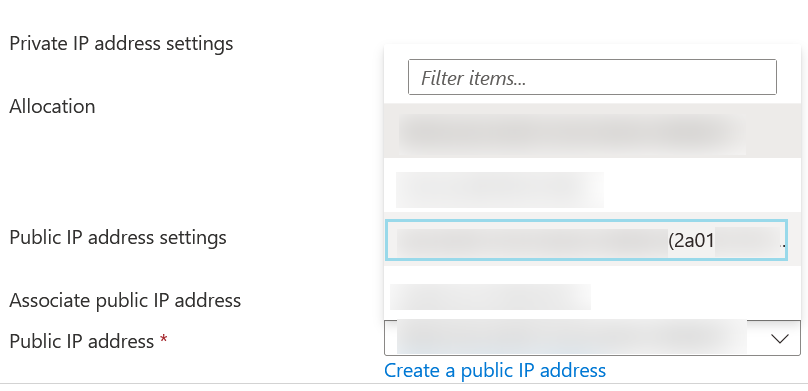
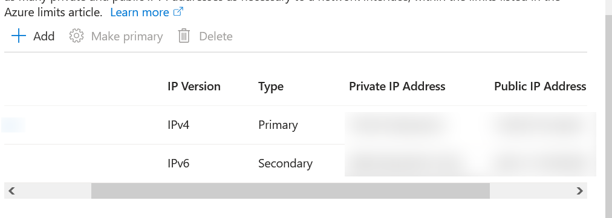

---

id: 172131

title: "Azure 开启IPV6最简单办法"

created_at: 2024-08-07T10:06:44.852Z

username: updownup

display_username: "存档账号"

---

# Azure 开启IPV6最简单办法

首先去子网里面创建一个IPV6的地址空间

IPV6附加后立即可用，无需重启

---

*来源: https://linux.do/t/topic/172131.json*

