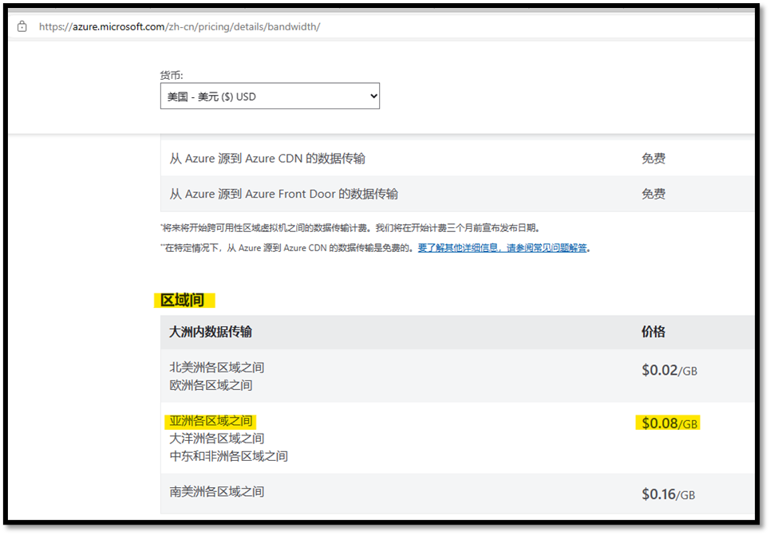
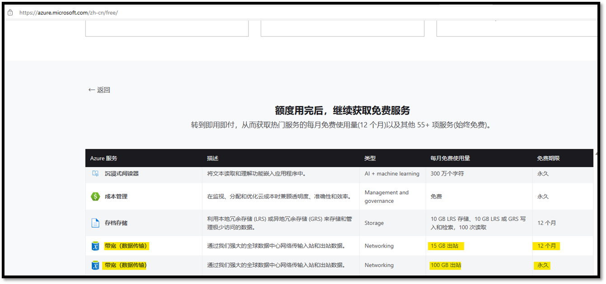

---

id: 173269

title: "关于Azure服务器网络流量(100g)问题"

created_at: 2024-08-08T15:21:32.987Z

username: syoukan

display_username: "syoukan"

---

# 关于Azure服务器网络流量(100g)问题

鉴于在小飞机或者论坛上经常有人问道关于Azure学生包的机器流量究竟是100g，还是15g的问题，我将在Azure上提问的工单发出来，希望能够解决大家的疑惑。

### 以下是工单正文

在Azure for student订阅类型下，仅限提供15GB的带宽免费用量。如若您绑定信用卡并升级订阅类型为即用即付后，可享用100GB的带宽免费用量。

关于升级订阅相关内容可参考以下，资讯来自：[Azure for College Students - 产品/服务详细信息 | Microsoft Azure](https://azure.microsoft.com/zh-cn/pricing/offers/ms-azr-0170p/)

- [定价 - 带宽 | Microsoft Azure](https://azure.microsoft.com/zh-cn/pricing/details/bandwidth/)

- 

- 免费的数据传输用量，这个数据传输指的是**可用性区域**间（**availability zones**）的传输。

- 对于**免费试用**订阅类型，Azure是免费提供**15GB**以内的数据传输的使用量的；而对于**即用即付**订阅类型，Azure是永久提供**100GB**的免费使用量的。

- 

- 关于**Azure Region**和**availability zones**，您可以参考官网 [什么是 Azure 可用性区域？ | Microsoft Learn](https://learn.microsoft.com/zh-cn/azure/reliability/availability-zones-overview) 获取更多详细的说明。

烦请您注意，Azure免费试用订阅提供的带宽数据传输的免费用量指的是*availability zones间的传输*，而*所有Region间的数据传输都是需要收费的*。

以上信息如果有任何问题再请您随时与我联系，我将竭尽所能的为您解决您的问题。

---

*来源: https://linux.do/t/topic/173269.json*

