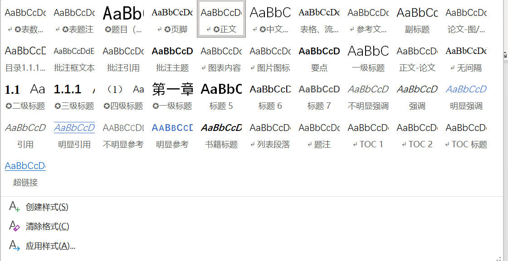
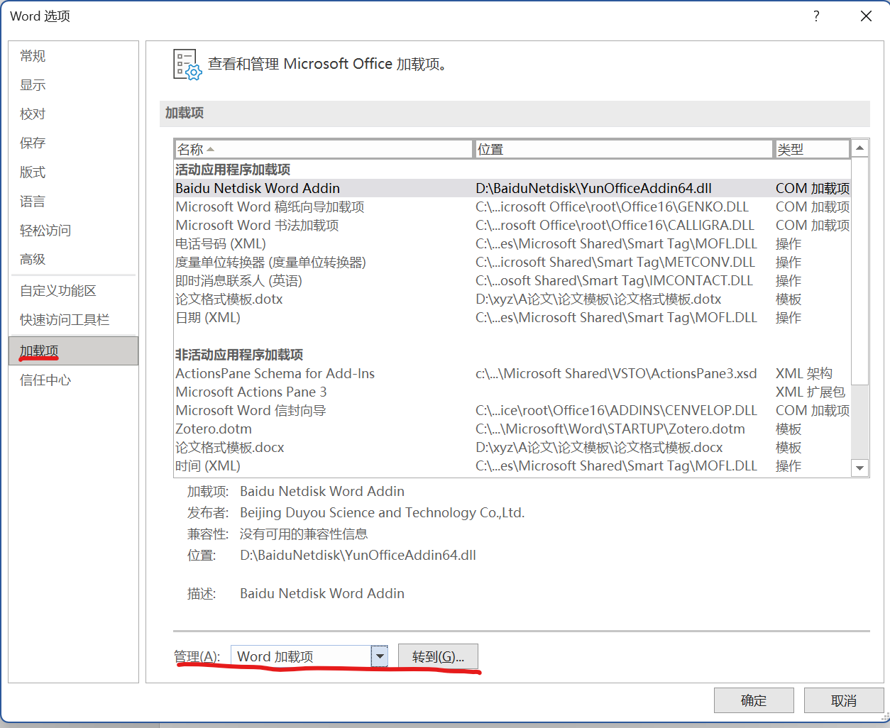
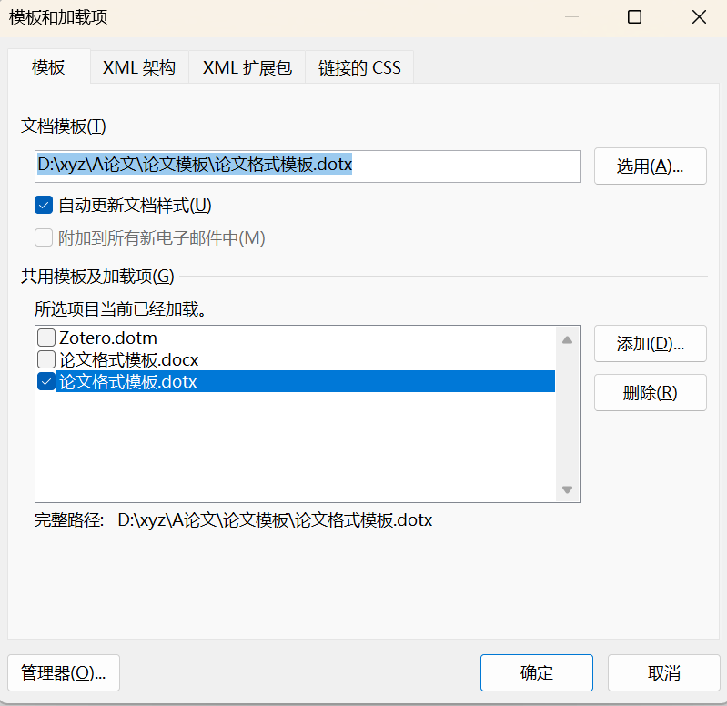
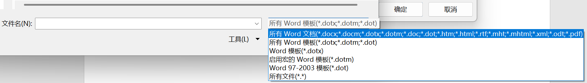
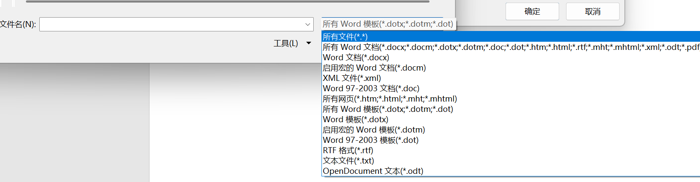

---

id: 1741481

title: "【论文样式模板】通过加载项在word中丝滑使用自定义样式"

created_at: 2026-03-12T08:22:39.165Z

username: Yuki_Toosaka

display_username: "木子米"

---

# 【论文样式模板】通过加载项在word中丝滑使用自定义样式

[Template of thesis format.docx](/uploads/short-url/rZpjqqvStlHRBTzQc0wzuZTDhKc.docx) (24.3 KB)

*L站不能上传dotx类型的模板文件 所以需要大家另存为其他格式*

*tips：在配置过程中若找不到文件 请打开右下角勾选“所有文件”或“所有word文档”*

这是我找到的祖传样式模板，当然，要是能找到你学校的模板会更方便些。以下是加载项教程：

> [!tips] 0. 获取模板

>

> 首先你需要下载、或者 diy 一个可用的模板

> [!info] 1. 加载项设置

>

> 打开 “文件（左上）—— 选项（左下）—— 加载项（左下倒二）”

>

> 在下方 “管理” 中选择 “word 加载项” 并点击 “转到”

> [!info] 2. 选取模板

>

> 进入模板和加载项选项卡

>

> 上方文档模板中 “选用” 需要的模板，勾选自动更新文档样式

>

> 下方可以选取全局模板，点击添加找到需要的模板文件

> [!caution] 找不到文件？

>

> 试试从**所有文件**里找，或者将模板另存为默认的*dotx、dotm、dot*格式

>

> 

>

> 

> [!info] 3. 使用模板

>

> 正确设置之后，应能在样式选项卡中找到如第一张图的样式

> 如果没有正确显示自定义样式，检查步骤 2 中:

>

>

> 是否选取正确模板、是否勾选自动更新、以及检查模板本身是否被替换（请做备份以保证文件安全）

### 以上，祝大家实现论文自由

---

*来源: https://linux.do/t/topic/1741481.json*

