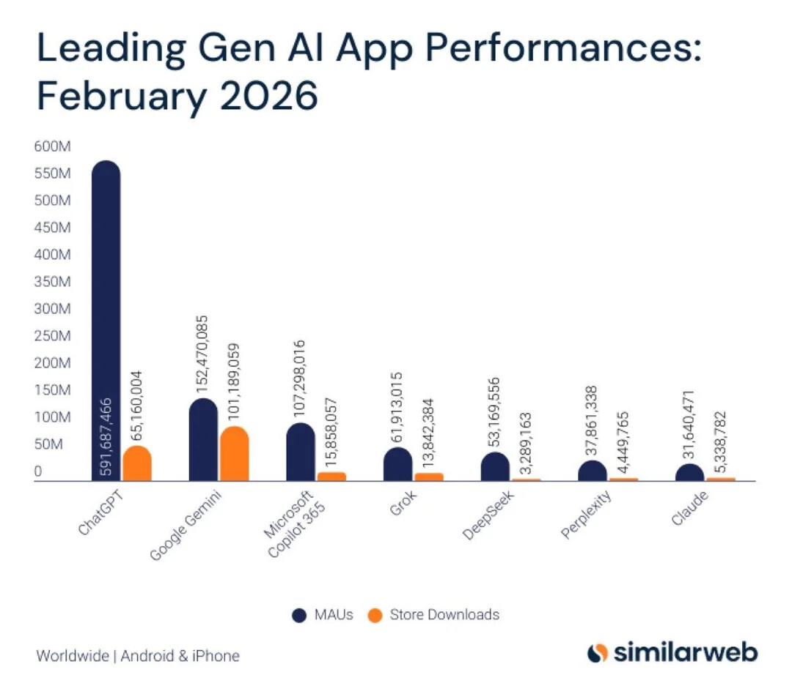
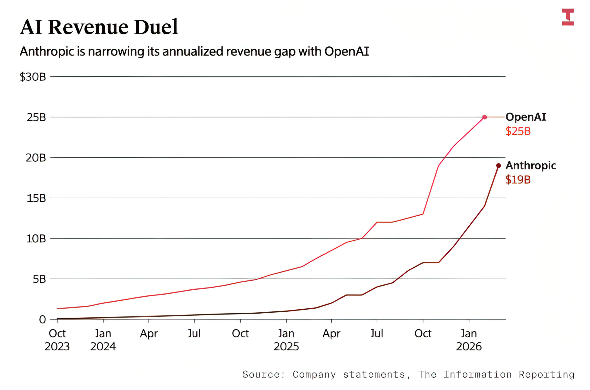

---

id: 1742735

title: "【AI大战短评系列2】26年2月，Gemini App下载量比ChatGPT多50%"

created_at: 2026-03-12T12:07:14.117Z

username: dwqxq1

display_username: "dwqxq1"

---

# 【AI大战短评系列2】26年2月，Gemini App下载量比ChatGPT多50%

包括PlayStore和AppStore

虽然ChatGPT存量月活Mau仍然很高，但增量已经输给Gemini

而未来的存量，只是现在增量的累积

竞争态势，可能已经发生根本性的逆转

---

营业额方面，OpenAI可能也即将被A社追上

---

*来源: https://linux.do/t/topic/1742735.json*

