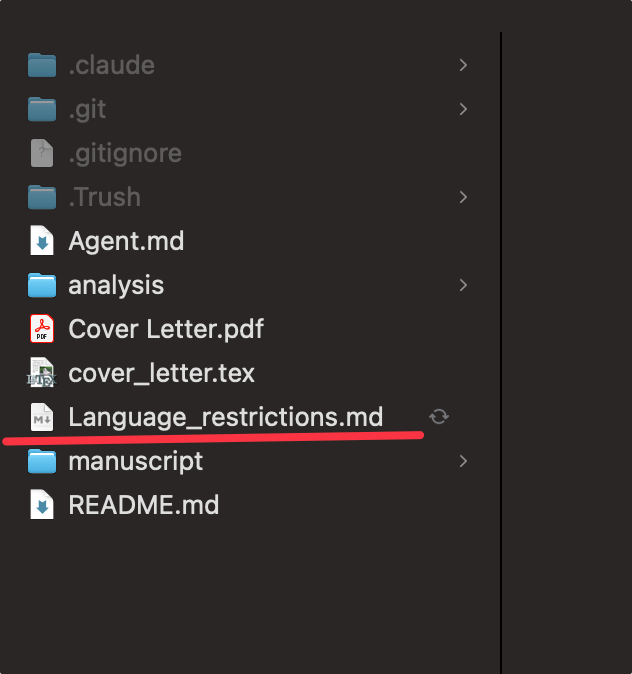
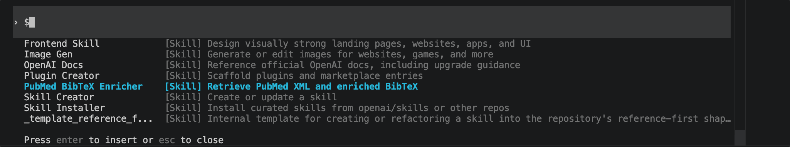
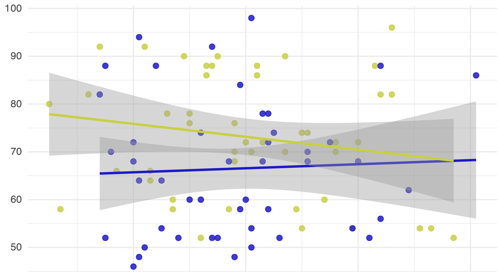
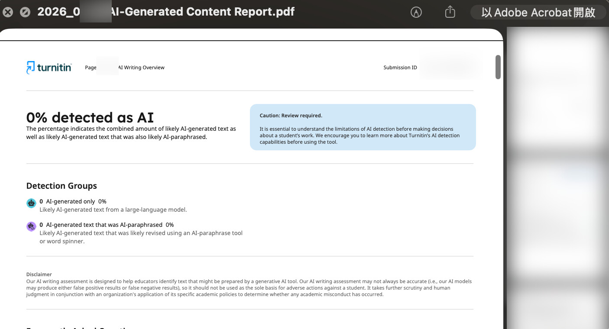
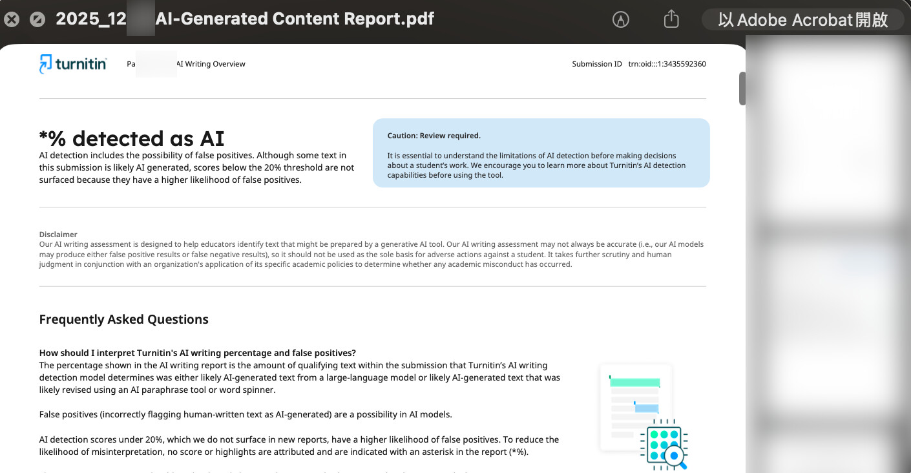
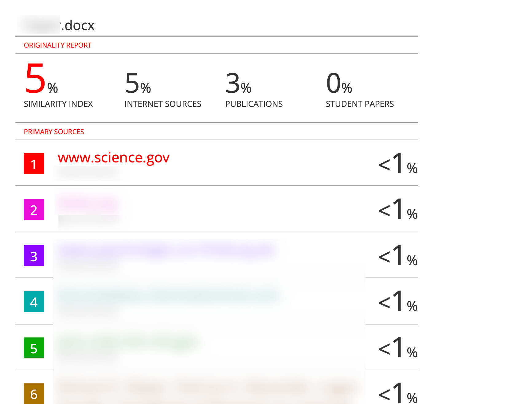
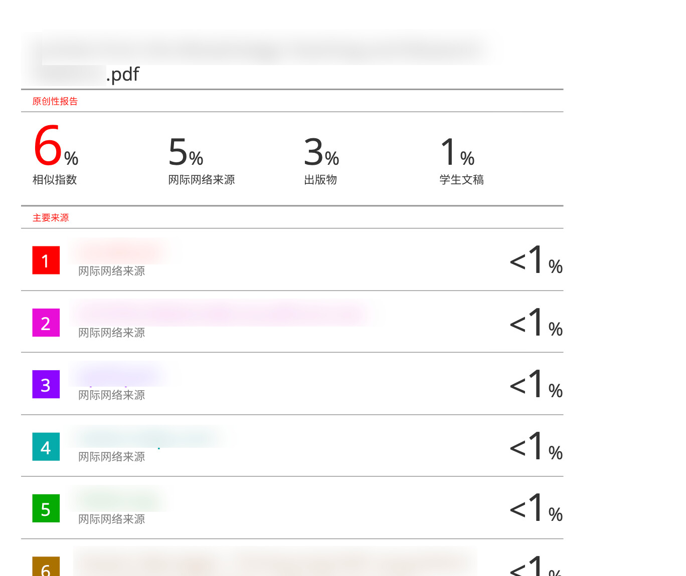

---

id: 1750739

title: "Codex写临床医学的学术论文"

created_at: 2026-03-13T14:13:51.982Z

username: Yael

display_username: "Yael"

---

# Codex写临床医学的学术论文

今年我发了两篇二区的文章（都是小修+Receive），想分享一下我用纯AI写作的Workflow。

### 前置条件

我自己把实验做完了，拿到了实验的原始数据，整理成了好几个csv和图片文件夹；

去期刊官网下载了他们的LaTeX格式zip

### 初始化项目目录

给codex（需要按照实际美化一下）：

你是一个学术论文写作项目管理专家，帮我初始化文件夹：analysis/data/raw里面的csv只可以读取前两行，然后做一个csv的数据映射表；其他的文件按照工程化的思维去组装，我构建这篇论文的技术栈是R语言数据分析、LaTeX写作、TikZ画流程图、nanobanana（baseurl=xxx token=banana_token.txt)画插图；帮我整理好文件夹并创建Readme。

### 准备写作PROMPT

在pubmed、油管、或者各种各样的的开放课程([GitHub - quanghuy0497/Writing-in-the-Sciences: A Stanford writing course to learn how to write scientific articles in a clear, concise, and effective way · GitHub](https://github.com/quanghuy0497/Writing-in-the-Sciences)),检索了十几条或者更多的写作指南，转换成纯文字（OCR，whisper），然后Gemini deep thinking出一套完整的语言风格指南（啥时候用现在时，啥时候用第几人称，这些语法）（这个是可复用的）

还是上面的写作指南文字稿，deep thinking写作指南（文章的结构，每一个段落要干什么，重点强调每一个段落只要一个主题，还有让AI少分点作答的方法）（这个是不可复用的）

两个结合在一起，丢进根目录

### INTRODUCTION

这个部份是漏斗状的，先介绍最大的大环境，然后介绍目前的缺陷，最后介绍我的研究解决了啥问题（有的写作指导给的是四段）

（检索这三个部份需要的提示词不同，我让Gemini生成三到四套的检索词，在pubmed检索，导入zotero用插件自动下载pdf，导出带有摘要的bib文件（接着用minerU API把pdf变成markdown，这一步有时候不是很必要，因为看摘要基本上就明白这一篇文章在干嘛））

这一部份好像不需要了，Pubmed有CLI检索工具（[Entrez® Programming Utilities Help - NCBI Bookshelf](https://www.ncbi.nlm.nih.gov/books/NBK25501/) ），这样的话就可以把检索做成Skills，让AI自己去调用：

然后正式让Codex（先用5.2codex把代码框架写好，然后5.2）开始写作

### METHODS

（写累了 过几天再写）

#### Theoretical Framework

问一下LLM网页版论文和我一模一样研究（或者特别类似的）的提示词，去Pubmed检索出20-50篇，查看引用树（[https://www.connectedpapers.com/](https://www.connectedpapers.com/) ， [https://openalex.org/](https://openalex.org/) 等很多），找到最开始被引用的高被引路轮框架，用他的理论框架

### RESULT

然后问一下LLM网页版论文和我一模一样研究（或者特别类似的）的提示词，去Pubmed检索出20-50篇，下载下来，和我自己的研究内容给Gemini网页版 deep thinking找出这些论文的数据分析所用的所有统计方法，然后把我的实验思路告诉他让他整理出我的统计学方法

然后让AI用R语言分析，分析脚本一定要留痕，可复现。

#### DISCUSS

做到这里，codex已经深度理解这篇论文了，可以让他自己写。

#### 然后

把所有的LateX代码复制到Gemini ChatGPT 让他俩找茬 然后微调（持续好几轮），时不时就要mention语言规范文件

最后发给老师 根据老师的修改意见再改

最后，自查一下AI率和查重（这两篇文章纯Codex，0% written by human）：

---

*来源: https://linux.do/t/topic/1750739.json*

