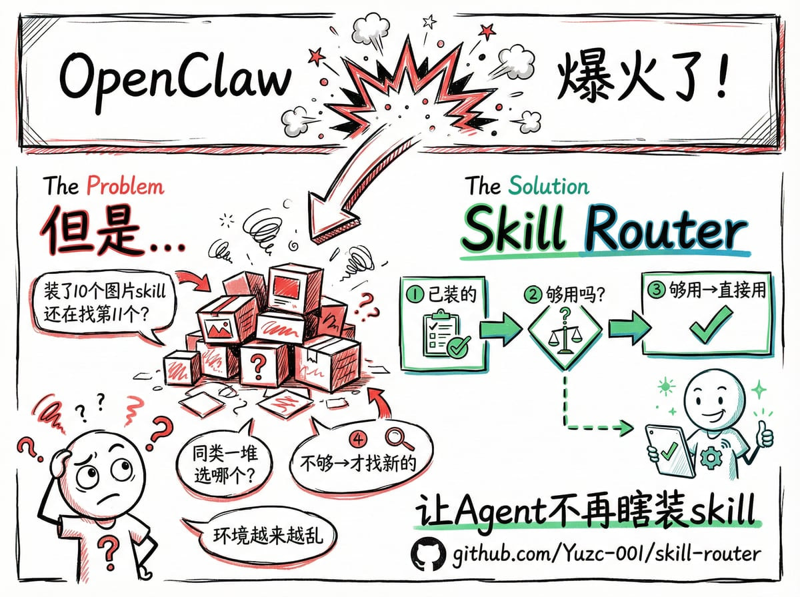
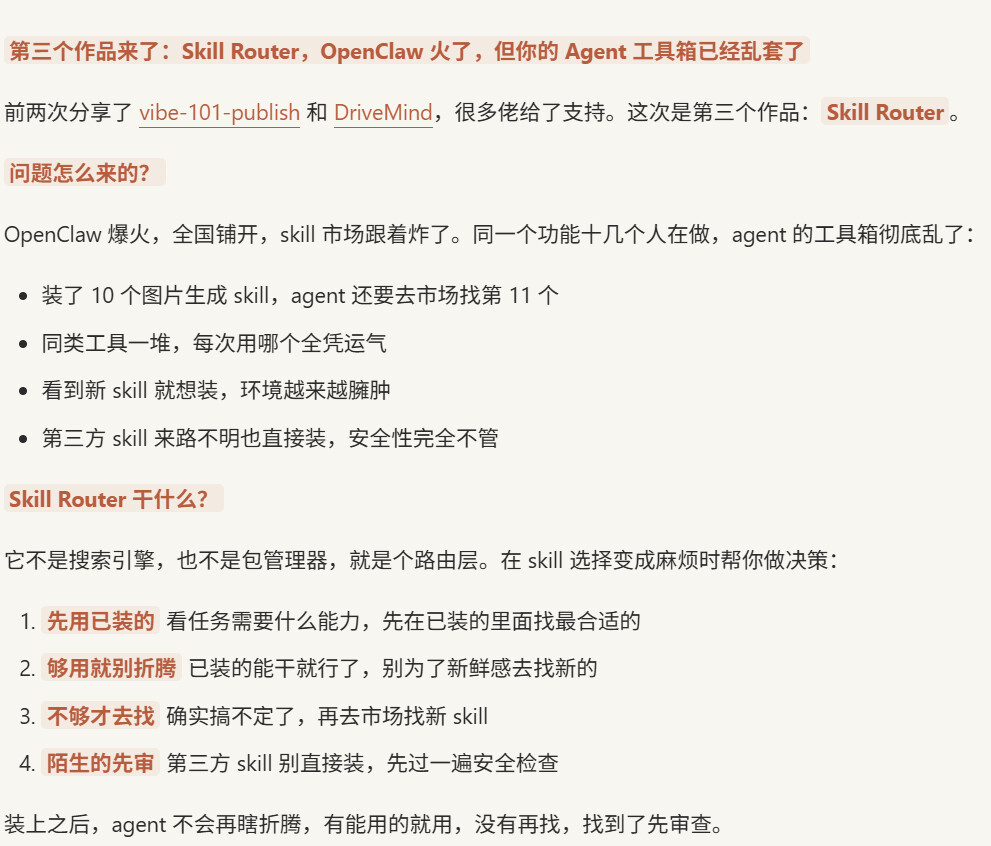

---

id: 1760832

title: "第三个作品：Skill Router，管理 Agent 的 skill 选择（已更新至0.5版本）"

created_at: 2026-03-15T14:00:04.331Z

username: Yuzx

display_username: "Yuzx"

---

# 第三个作品：Skill Router，管理 Agent 的 skill 选择（已更新至0.5版本）

**本帖使用社区公益推广，符合推广要求。我申明并遵循社区要求的以下内容：**

- 我的项目是免费使用的，无收费（变相收费、赞助）部分： 是

- 我的帖子已经打上 公益推广 标签： 是

- 我的项目属于个人项目，与公司或商业机构无关： 是

- 我的项目不存在QQ、TG等群组引流： 是

- 我的项目不存在非运营必要的网站引流： 是

- 我的项目不存在为他人推广、AFF： 是

- 我的项目无关联的商业项目： 是

- 我的 GitHub 项目无未开源部分： 是

- 我帖子内的项目介绍，AI生成、润色内容部分已截图发出： 否

- 以上选择我承诺是永久有效的，接受社区和佬友监督： 是

---

之前分享过公众号排版工具 vibe-101-publish 和 DriveMind，这次是第三个作品：Skill Router。

GitHub 仓库：[https://github.com/Yuzc-001/skill-router](https://github.com/Yuzc-001/skill-router)

如果你也遇到 skill 管理混乱的问题，可以试试。有问题可以在 Issues 里反馈，欢迎 star。

个人主页：[https://github.com/Yuzc-001](https://github.com/Yuzc-001)

这是第三个开源作品，感谢大家的支持。

---

*来源: https://linux.do/t/topic/1760832.json*

