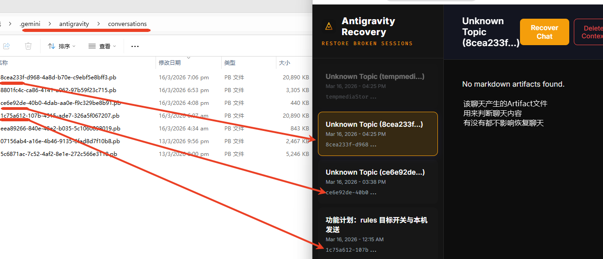

---

id: 1766859

title: "【IDE系列4】Antigravity丢聊天记录的恢复方法."

created_at: 2026-03-16T12:18:24.569Z

username: dwqxq1

display_username: "dwqxq1"

---

# 【IDE系列4】Antigravity丢聊天记录的恢复方法.

### 怎样找回丢失的聊天记录（必读）

[下载恢复工具](https://github.com/Artemis43/AG-Chat-Recovery/releases/tag/v1.0.0) → 解压 → 运行RestoreChats.exe → 弹出浏览器界面 → 在Antigravity里新建一个空对话 → 在恢复工具界面里左边选一个记录(右侧Artifact只是方便确定聊天内容，没有也不影响恢复聊天) → 点recover chat → 关掉Antigravity重开 → 聊天历史里打开最新的聊天记录

如果有很多聊天记录不知道该恢复哪个，可以按照上面方法，开多个空窗口，分别恢复一遍

### 上面恢复工具的显示的聊天时间与我最后编辑时间不一样，也看不到容量，怎么办？（选读）

聊天工具其实是扫描 C:/Users/用户名/.gemini/antigravity/conversations/id…pd

打开这个文件夹，显示最后编辑时间和容量，可以作为参考

### 丢失和恢复的原理是什么？（选读）

谷歌pd文件是专有2进制格式，无法直接打开或阅读

每个新开的聊天对应一个pd文件

丢聊天记录，一般就是这个聊天记录文件还在，但是入口数据丢了

恢复工具的原理，就是你先新开一个空聊天(有入口，没内容)，工具把老聊天pd文件，移花接木替换到到新聊天里面去

因此，如果/conversations/id…pd里没有你丢失日期的pd文件，那就可能彻底丢失了

### 为什么聊天记录会丢失？（选读）

不知道，但Antigravity的聊天记录就是很容易丢失，reddit上也有人反应这个问题

甚至有人做了专门的恢复工具，说明是一个常见问题

### 聊天记录丢失了会怎样？（选读）

通常只是记忆差，一般不会有重大损失

最近聊的内容，可能会失忆

最近刚写一半的程序，可能前面已经解决完的问题他又忘了，有些内容又要重新跟他讲一遍，如果你有单独的开发文档而不是全靠聊天 + 已经生成好的代码ai可以重理解，一般不会有根本性损失

最近很好的讨论记录没有了，想复制或expot，但找不到原文了

时间越久，影响越小，本来上下文也不可能载入很久的聊天记录，老的聊天记录会压缩上下文，或通过搜索获取

### 怎样预防重要聊天记录丢失（选读）

不要信任任何IDE(bug)，网页Chat(封号，盗号，退team，换家庭组用新小号)，都可能造成你聊天记录永久性丢失，养成重要内容当天备份的好习惯，不重要内容丢了就丢了吧，影响不大

Ⓐ鼠标选区 → 复制粘贴

缺点：没有md格式

Ⓑ右边栏右上角 → export(带md格式)

不过260309最新的1.20.5版本有bug，export功能无效，21.6版已修复

Ⓒ让ai输出聊天记录的md文件

Ⓓ注意Agent Manager并没有markdown导出按钮

---

*来源: https://linux.do/t/topic/1766859.json*

