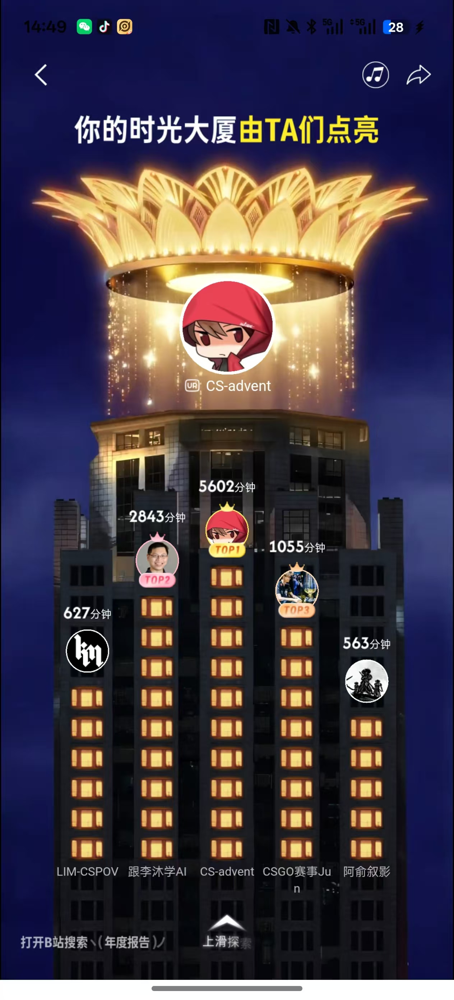

---

id: 1767174

title: "【Just for Sharing】 重温沐神Paper Reading，以及自己的碎碎念。"

created_at: 2026-03-16T13:19:24.689Z

username: yunshen123

display_username: "西格玛男人"

---

# 【Just for Sharing】 重温沐神Paper Reading，以及自己的碎碎念。

在L站学了很多知识，我也想向佬友们**多学习，多输出多交流，共进步**。 

或许这才对得起最开始写得**小作文**？哈哈哈 

站内太多大佬了，我其实一直在思索，学生仔能分享些什么？前不久在学校图书馆看到有同学看沐神的**论文精读**视频，我去年也是一直学沐神的论文，不过沐神**论文精读**系列没配套代码，那我就从这里入手吧。(当然不限于此，paper reading，RL，Agents，LLM方面我都出一些自己经验好了，当记录一下)

学习的话就看沐神视频就行了，十分详细。我就做**复习总结和代码**好了。（一方面是帮我自己巩固一下，另一方面是：AI编程时代，或许我们应该确保自己现有的**编程水平不退化？**）

我就先从 **科研术语** 说起（佬友们觉得又和不妥或者补充的可直接编辑）：

本文为科研新手梳理这些高频术语的精确含义。

## 实验评估

### Baseline（基线）

用于对比的**参考方法**。新方法必须超越 Baseline 才能证明其价值。

选择原则：相关、公认、可复现。典型做法是同时选择经典方法（如逻辑回归）和当前 SOTA 作为 Baseline。

### Benchmark（基准测试）

标准化的**评估体系**，包含数据集、评价指标和测试流程，让不同团队的工作可以公平比较。

| 领域 | 常见 Benchmark |

| --- | --- |

| 图像分类 | ImageNet |

| 自然语言理解 | GLUE / SuperGLUE |

| 目标检测 | COCO |

| 阅读理解 | SQuAD |

### Baseline vs Benchmark

| 维度 | Baseline | Benchmark |

| --- | --- | --- |

| 本质 | 参考模型/方法 | 评估体系（数据集 + 指标 + 流程） |

| 回答的问题 | “我的方法比什么强？” | “在哪里测、用什么标准？” |

| 示例 | ResNet-50、逻辑回归 | ImageNet、GLUE |

### SOTA（State-of-the-Art）

当前**最优性能**。论文声称 “achieve SOTA” 意味着在某个 Benchmark 上超越了所有已发表方法。SOTA 是动态的——今天的 SOTA 明天就可能被刷新。

### Ablation Study（消融实验）

通过**逐一移除或替换**模型组件，验证每个组件的贡献。类似控制变量实验：去掉注意力模块性能下降多少？去掉残差连接呢？审稿人最看重的实验之一。

### Ground Truth（真实标签）

数据集中人工标注的**正确答案**。模型输出与 Ground Truth 的差距即为误差。

## 训练流程

### Epoch / Batch / Iteration

- **Epoch**：完整遍历一次训练集

- **Batch**：一次前向/反向传播使用的样本子集，大小称为 Batch Size

- **Iteration**：一次参数更新。训练集 10000 样本、Batch Size = 100，则 1 Epoch = 100 Iterations

[Epoch / Batch / Iteration 关系图540×410 4.76 KB](https://cdn3.ldstatic.com/original/4X/a/7/0/a702b1a1dbc418d09018656e994087423770cbe0.svg)

### Hyperparameter（超参数）

训练前人为设定、**不由模型自动学习**的参数，如学习率、Batch Size、Dropout 率。与之对应的是模型参数（权重和偏置），由训练过程自动优化。

### Overfitting & Underfitting

- **过拟合**：训练集上表现优异，测试集上表现差——记住了数据而非学到规律

- **欠拟合**：训练集和测试集上表现都差——模型能力不足或训练不充分

[Overfitting vs Underfitting 损失曲线对比690×230 3.37 KB](https://cdn3.ldstatic.com/original/4X/9/7/f/97fed8c15186554b36a66767ae0f731182616e3a.svg)

### Inference（推理）

模型训练完成后，用于**处理新数据并生成预测**的过程。论文中常见 “inference time” 指推理延迟，“inference cost” 指推理计算开销。

## 模型架构

### Backbone（骨干网络）

模型的**主干特征提取网络**。例如目标检测模型通常以 ResNet 或 ViT 为 Backbone 提取特征，再接检测头（Head）完成具体任务。

### End-to-End（端到端）

从原始输入直接到最终输出的**一体化训练**，无需人工设计中间步骤。与之相对的是 Pipeline 方法——先分词、再提特征、再分类，每步独立优化。

### Feature Extraction（特征提取）

从原始数据中提取对任务有用的**表示**。传统方法依赖人工设计特征（Feature Engineering），深度学习的核心优势在于自动学习特征。

## 学习范式

### Pre-training & Fine-tuning（预训练与微调）

- **Pre-training**：在大规模数据上训练，学习通用特征表示

- **Fine-tuning**：在预训练模型基础上，用少量任务特定数据继续训练，适配具体任务

[Pre-training 到 Fine-tuning 流程700×240 3.79 KB](https://cdn3.ldstatic.com/original/4X/4/6/5/46515a5ba1a8444f1ad4ff6945fc824cdf145ed5.svg)

### Downstream Task（下游任务）

预训练模型被应用到的**具体任务**。BERT 预训练后可微调用于情感分析、命名实体识别、问答等下游任务。预训练是通用的，下游任务是特定的。

### Transfer Learning（迁移学习）

将**源任务**上学到的知识迁移到**目标任务**。Pre-training + Fine-tuning 是迁移学习最成功的实践形式。核心假设：不同任务之间存在共享的底层知识。

### Zero-shot / Few-shot / In-context Learning

- **Zero-shot**：不提供任何示例，模型仅凭指令完成任务

- **Few-shot**：提供少量示例（通常 1-5 个），模型据此学习任务模式

- **In-context Learning**：将示例放在输入上下文中，模型无需更新参数即可适配新任务——大语言模型的核心能力之一

### Generalization（泛化）

模型在**未见过的数据**上的表现能力。泛化是机器学习的终极目标——不关心模型背了多少答案，只关心遇到新问题时能否正确回答。

---

*来源: https://linux.do/t/topic/1767174.json*

