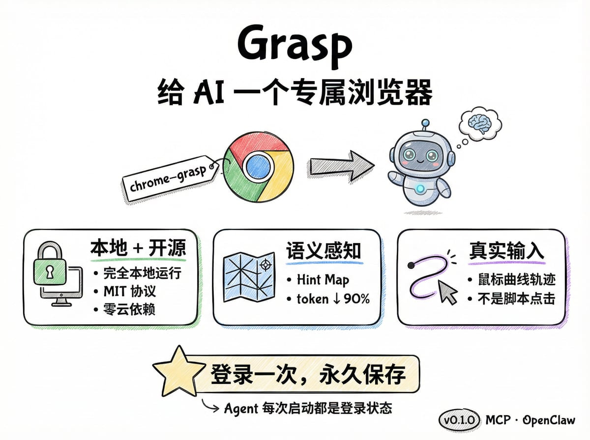
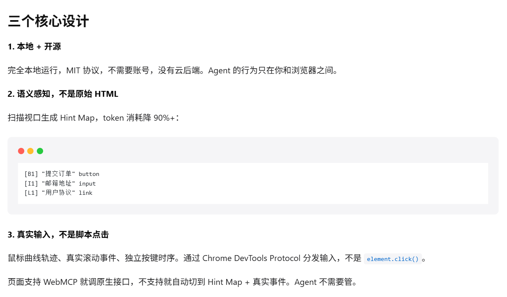
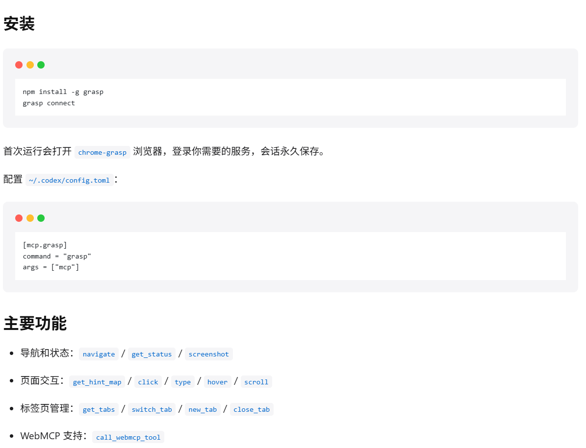

---

id: 1772871

title: "Grasp：给 AI Agent 一个专属浏览器(0.55版本 让你定义ai 浏览器 )"

created_at: 2026-03-17T12:17:35.782Z

username: Yuzx

display_username: "Yuzx"

---


# Grasp：给 AI Agent 一个专属浏览器(0.55版本 让你定义ai 浏览器 )


```
本帖使用社区公益推广，符合推广要求。我申明并遵循社区要求的以下内容：

- 我的项目是免费使用的，无收费（变相收费、赞助）部分： 是
- 我的帖子已经打上 公益推广 标签： 是
- 我的项目属于个人项目，与公司或商业机构无关： 是
- 我的项目不存在QQ、TG等群组引流： 是
- 我的项目不存在非运营必要的网站引流： 是
- 我的项目不存在为他人推广、AFF： 是
- 我的项目无关联的商业项目： 是
- 我的 GitHub 项目无未开源部分： 是
- 我帖子内的项目介绍，AI生成、润色内容部分已截图发出： 是
- 以上选择我承诺是永久有效的，接受社区和佬友监督： 是
```

前三次分享了 vibe-101-publish、DriveMind 和 Skill Router，很多佬给了支持。这次是第四个作品：**Grasp**。



## 为什么做这个？

Chrome 146 发布了，原生支持 MCP，AI 可以直接控制浏览器了。

但现有方案都有问题：

- **云端浏览器**：数据要上传到别人服务器，访问不了内网，还要付费

- **本地 Playwright**：配置复杂，需要自己写代码管理会话

- **通用自动化工具**：不是专门为 AI Agent 设计的

我们希望 AI 能有一个**真正属于它自己的浏览器环境**——本地运行，开箱即用，专为 Agent 设计。

## Grasp 是什么？

一个开源 MCP Server，给 AI 开一个专属的 Chrome 配置文件 `chrome-grasp`。

**登录一次，永久保存。** Agent 每次启动都是登录状态，你的浏览器原封不动。

**当前版本：** v0.1.0


**协议支持：** MCP





---

这个项目刚起步，功能还在完善。**希望大家多提需求和 issue，一起把它打磨好。**

需要本地运行、数据不出本地的浏览器自动化方案的可以试试。

**GitHub:**

[https://github.com/Yuzc-001/grasp](https://github.com/Yuzc-001/grasp)

**个人主页：**

[https://github.com/Yuzc-001](https://github.com/Yuzc-001)

欢迎 star，感谢大家支持，这是第四个作品，后面还有，慢慢来。


---


*来源: https://linux.do/t/topic/1772871.json*

