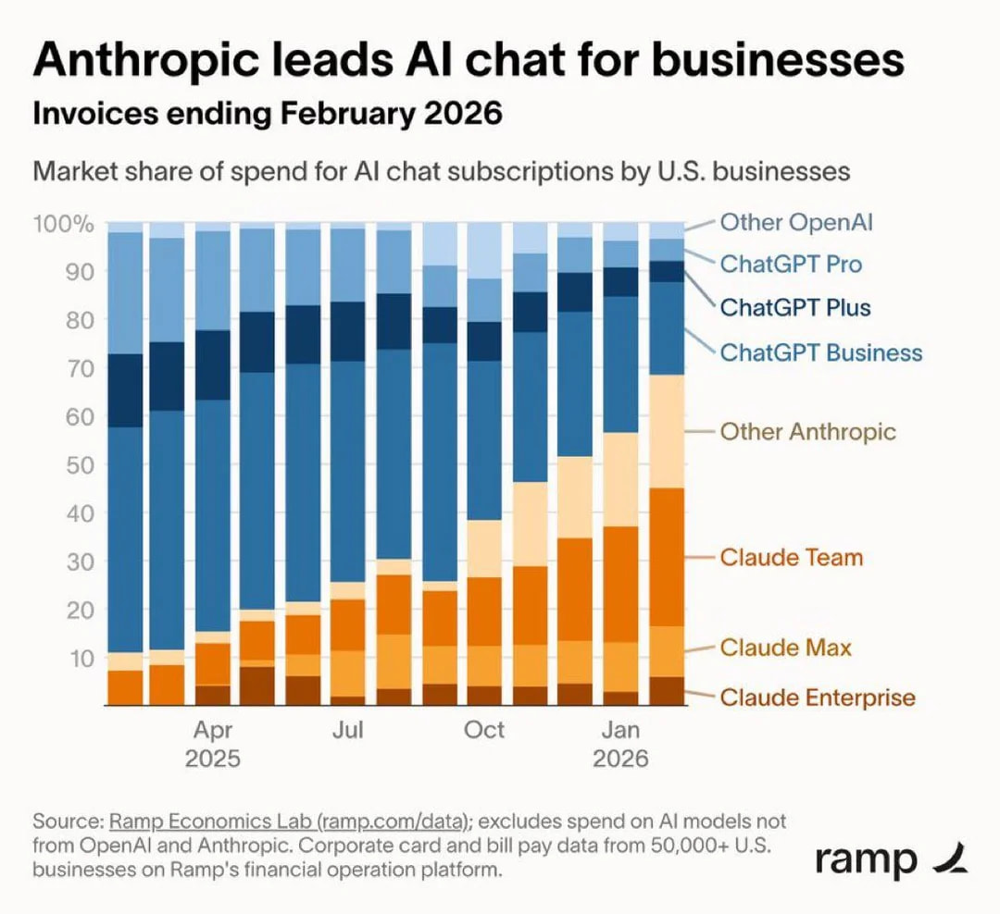

---

id: 1780088

title: "【AI大战短评系列4】GPT在2B市场份额，一年前是Claude9倍，现在缩水到只有Claude一半"

created_at: 2026-03-18T23:07:43.505Z

username: dwqxq1

display_username: "dwqxq1"

---

# 【AI大战短评系列4】GPT在2B市场份额，一年前是Claude9倍，现在缩水到只有Claude一半

图片只统计了OpenAI和A社两家

所以Openai最近把很大精力放在Codex上

Business试用，也是御三家里唯一不太管反代的，可能也是故意放水

---

*来源: https://linux.do/t/topic/1780088.json*

