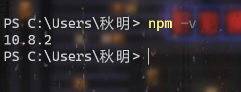
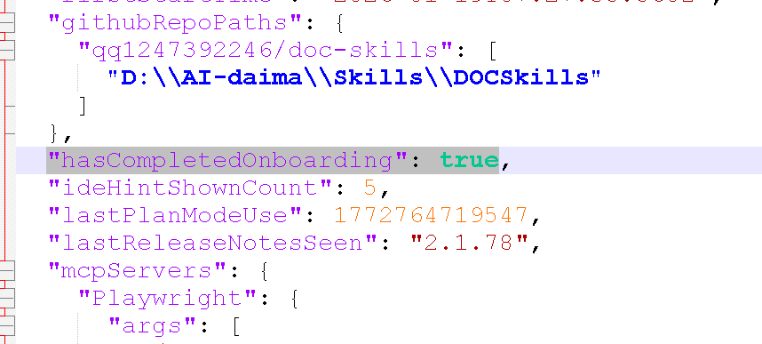
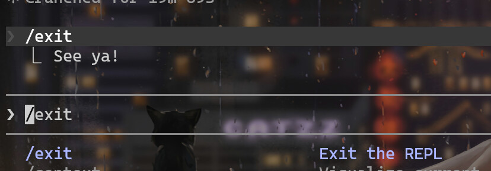
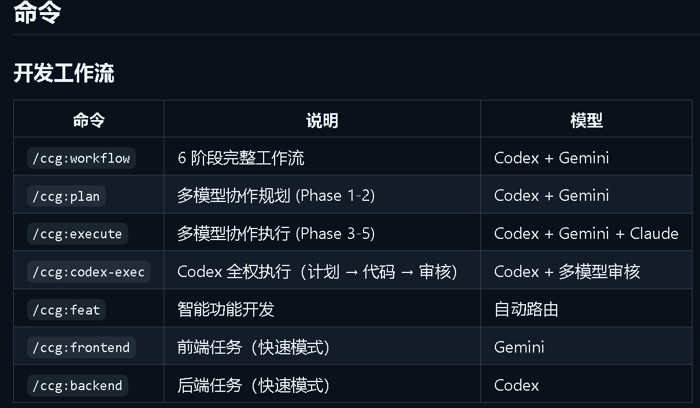
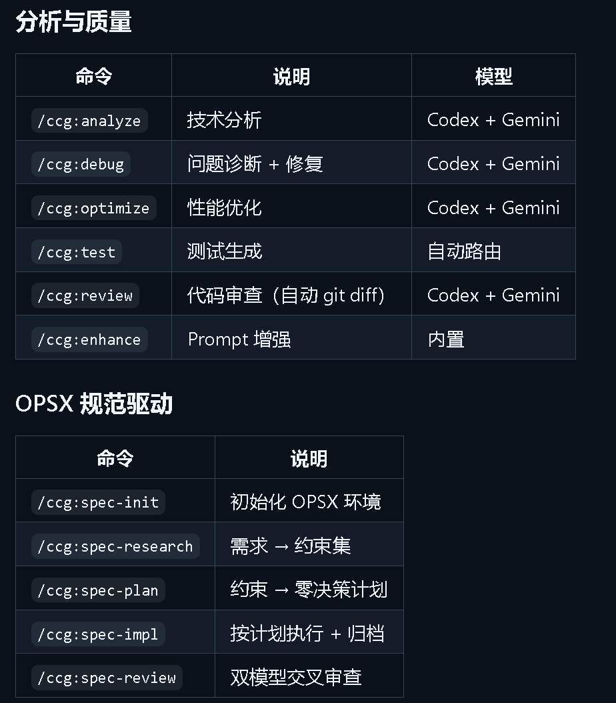
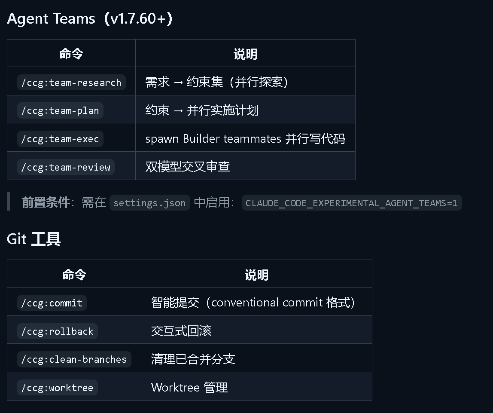
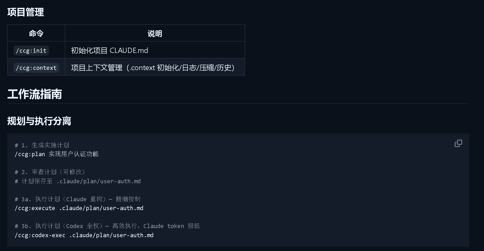
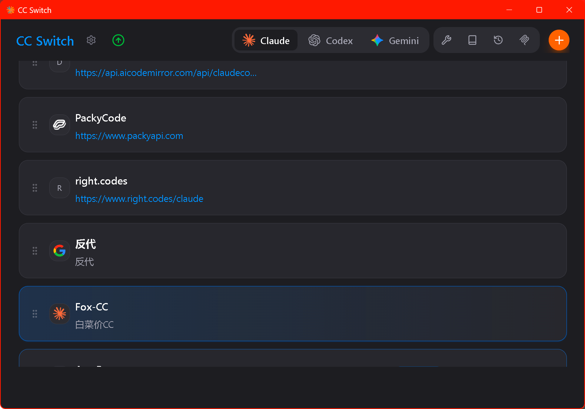

---

id: 1781214

title: "【CCG 自动化流 安装教程（纯风佬CCG）】更新教程！！！新佬友们别迷路！！！(老佬友们叙叙旧√)"

created_at: 2026-03-19T02:50:08.460Z

username: akirann

display_username: "秋明"

---


# 【CCG 自动化流 安装教程（纯风佬CCG）】更新教程！！！新佬友们别迷路！！！(老佬友们叙叙旧√)


# 声明： 我不需要流量，我只是想为更多加入AI编程的佬友铺点路

# 如果帮到你，或者曾经帮到你，可以给个评论，顶贴让新佬友看到

`忘了请求帮顶是不是违反社区规则了，懒得看了，如果违反，麻烦佬友提醒一下。`

## 现在LDC维护中，给我流量我也换不了LDC，以此证明我不是为了那点LDC来的（傲娇）。


# 之前两篇帖子无法修改，新开一篇!

## 前言：

> **原始教程帖 1**:  [【CCG 自动化流 安装教程】 三合一自动化编程 ，助力每一位佬友 享受 [自动化流] 氛围编程时代（谁再说AI代替程序员，我就要开始闹了）](https://linux.do/t/topic/1414909)

>

> **原始教程帖 2**: [【CCG 自动化流 安装教程(孙佬+风佬升级装)】 三合一自动化流编程，这波升级顺滑如水啊 ！！！助力每位佬友 享受 [自动化流] 氛围编程时代！ - 开发调优 - LINUX DO](https://linux.do/t/topic/1445303)

>

> **CCG原贴**（包含Github链接） : [【补档】CCG v1.7.82 : Claude Code 编排三 CLI 协作 | Codex + Gemini + Claude | 引入了fast-context-mcp - 开发调优 - LINUX DO](https://linux.do/t/topic/1710380)

> 最近发现，还是有很多人在看我写的CCG教程，而之前的CCG教程 **已经过期！！！**

>

> 故此，新开一篇CCG安装教程，希望能帮到各位佬友。

>

> (因为是教程，就算被爬了我也当帮助他人，所以不打算设置等级，各位佬友如果有想法，提高教程等级（如1级，以防资源外泄）可以和我沟通)

### 1. 环境安装

**在终端输入以下命令 （依次）**

```
# 查看当前npm 版本
npm -v
# 如果没有npm，可以看下面这个文档，进行npm安装
# https://www.runoob.com/nodejs/nodejs-install-setup.html
```



### 2. CLI 安装

**安装完后，输入Cli名称则可以进入Cli**


**在Cli中输入 /exit 即可退出**

```
# codex CC  Gemini 更新 Or 安装
npm i -g @anthropic-ai/claude-code@latest
npm i -g @openai/codex@latest
npm i -g @google/gemini-cli@latest
```

> 初次安装 Claude 可能需要登录，**看下方截图**，在 .claude.json 中添加配置

>

> “hasCompletedOnboarding”: true

>

> 

> 进入和退出

>

> 

>

> 

### 3. 下载CCG，初始化并安装

> 进入到这里，我就不打教程了，因为风佬本身封装的特别好，开箱即用，Skills和MCP都有教程，很简单的。

```
# ccg更新 : https://github.com/fengshao1227/ccg-workflow
npx ccg-workflow
```









# 好了安装完了

## 恭喜你，解锁了 自动化流 氛围编程 技能

# 强大的程序员大人啊，请用金钱狠狠砸出代码吧！

## 你还在看什么？

### 怎么还不走？

# 就是这么简单啊，还能怎样？ 

## 那就再来点吧

**3. 关于APIKey**


这里推荐一个 快速切换环境 的 小软件： **CC Switch**


[CC Switch （可用于 Claude Codex Gemini OpenClaw OpenCode）](https://github.com/farion1231/cc-switch)



> 二编： 佬，大早上没睡醒吗？ 一起喝杯瑞幸吧

>

> 


---


*来源: https://linux.do/t/topic/1781214.json*

