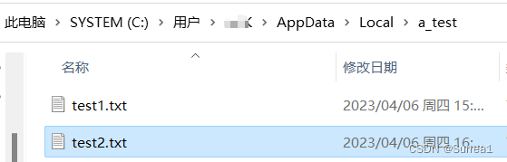
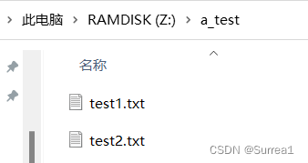
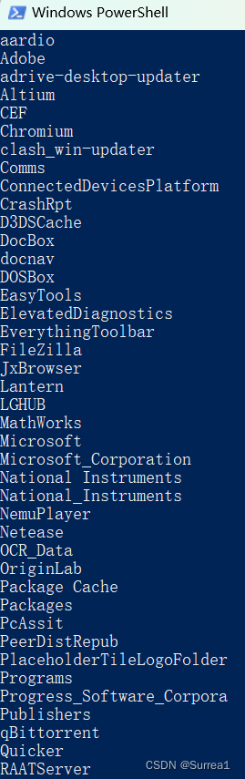
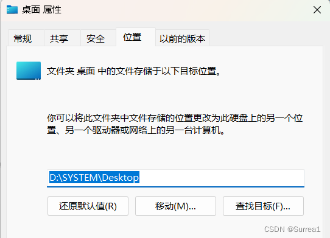

---

id: 178976

title: "论如何迁移C盘的用户和程序数据至其他位置"

created_at: 2024-08-16T04:10:09.432Z

username: Winston

display_username: "阿撒托斯🛡"

---

# 论如何迁移C盘的用户和程序数据至其他位置

C盘主要的用户数据包含两类。一类是程序生成的数据文件（AppData文件夹），另一类是用户个人文件夹（图片、视频、下载等等，如下图）

那么有没有办法将这些数据转移至其他盘呢？答案是肯定的，请看下面详细介绍。

请注意，本篇文章的操作需要一定的计算机基础知识，如果你不清楚自己在做什么，请不要随意操作。

迁移AppData

AppData 文件夹位于 C 盘路径：C:\Users\用户名\AppData，也可以在路径栏用 %LOCALAPPDATA% 快速打开该路径，该路径下包含 Local、LocalLow、Roaming 等三个文件夹，如下图，这三个文件夹中的大部分文件都是需要迁移的。

Windows 中有一个命令为 mklink，它可以将特定路径链接到另一个路径，简单的说就是为文件夹建立了一个传送门机制（比如说将文件夹 A 链接到文件夹 B，当你进入文件 A 时，虽然路径显示的是 A 的路径，但实际上你是在 B 的路径下，你做的任何修改都是在 B 的路径下发生的）。mklink 命令的用法如下：

mklink [[/d] | [/h] | [/j]] Link Target

`      `/d 创建目录符号链接。默认为文件符号链接。

`      `/h 创建硬链接而非符号链接。

`      `/j 创建目录联接。

`      `Link 指定新的符号链接名称。

`      `Target 指定新链接引用的路径(相对或绝对)。

使用 mklink 命令建立链接的方法的最大优点就是灵活性，可以对不同的文件夹作不同的处理（比如放到不同的位置，例如放到程序本身的安装路径下，不过本文都是迁移到同一路径下）；另外当有重装系统的需求时，可以放心对 C 盘直接进行格盘重装，重装后只需要重新建立链接即可快速恢复到重装系统前的状态，能够节省大量时间。

请注意同样不建议直接用 mklink 迁移整个 AppData 文件夹，这种做法同样很容易产生问题。本文推荐的做法是将 Local、LocalLow、Roaming 三个文件夹中的非系统产生的文件夹使用 mklink 命令链接到其他路径下。具体的步骤为：

将这三个文件夹中的子文件夹整个移动到其他路径（随意，但不要放在某个盘的根目录）

用 mklink 命令（使用 /d 选项）将原来的文件夹路径链接到移动后的路径

这里需要说明，如果在第一步中，没有将整个子文件夹都移动走，只是将子文件夹里面的内容移动走，那么在第二步链接时会提示路径已存在的错误。

这里我们新建一个 a_test 文件夹来举个例子，不需要看例子的直接往后面跳

mklink /d “C:\Users\ASK\AppData\Local\a_test” “Z:\a_test”

注意路径最好用双引号包起来，否则当文件夹名字中存在空格时会出错。

用管理员权限启动命令行，运行命令，成功后会提示创建的符号链接，如下图

以上就是对于单个文件夹的操作流程。

那么当系统已经使用一段时间后，这三个文件夹下可能已经有几十个文件夹了，难道我们需要挨个手动操作吗，对懒狗来说这显然是不可能的，这里我们使用 excel 配合一些命令行和 shell 的命令来帮助我们快速迁移文件夹，输入文件夹名称，通过 excel 给出对应的命令，这里直接给出成品 excel 文件下载 链接: [https://github.com/LeeYouRan/AppData-directory-migration/blob/main/重定向表_空白.xlsm](https://github.com/LeeYouRan/AppData-directory-migration/blob/main/%E9%87%8D%E5%AE%9A%E5%90%91%E8%A1%A8_%E7%A9%BA%E7%99%BD.xlsm)

文件的使用方法很简单，修改原始路径、目标路径，然后输入文件夹名即可，获取文件夹名字也有对应的命令（表格E1位置），点击按钮 “查看原始路径下目录” 可以在 powershell 中快速执行该命令，效果如下图：

了解命令的可以自己在 cmd 或者 powershell 中手动执行命令，也可以用 “生成批处理脚本” 按钮一键生成处理用的脚本，然后双击运行即可。

生成的脚本有三个，分别以 Move、MakeLink 和 MakeDir 结尾，分别用于移动文件、建立链接和在目标路径新建对应文件夹（仅对于新装系统，不需要移动文件时）。

迁移用户文件夹

迁移用户文件夹有两种方法。一种是手动移动文件夹（路径在 C:\Users\用户名），另一种是直接修改注册表，这里两种都介绍一下。需要移动的文件夹如下：

注册表的修改方式则需要用注册表编辑器定位到：计算机\HKEY_CURRENT_USER\Software\Microsoft\Windows\CurrentVersion\Explorer\Shell Folders

然后修改下图中用红色圈圈出项即可，修改完成后需要重启。

---

*来源: https://linux.do/t/topic/178976.json*

